# सेटअप हेल्थ और अपने सेटअप की टेस्टिंग

दो स्क्रीन बिना अंदाज़ा लगाए सेटअप पूरा करने में आपकी मदद करती हैं। **सेटअप हेल्थ** बताती है कि क्या कमी है या क्या गलत है। **अपना सेटअप टेस्ट करें** आपको हर चीज़ वैसे आज़माने देता है जैसे आपकी टीम करेगी। आपके लिए कुछ भी नहीं बदला जाता: हर सुधार एक बटन है जो सही स्क्रीन खोलता है, और बाकी आप करते हैं।

## पता करें कि क्या कमी है

1. बाईं ओर के मेन्यू में **सेटअप हेल्थ** पर क्लिक करें। उसके पास की संख्या बताती है कि कितनी चीज़ें देखने लायक हैं। सब ठीक होने पर यह गायब हो जाती है।
   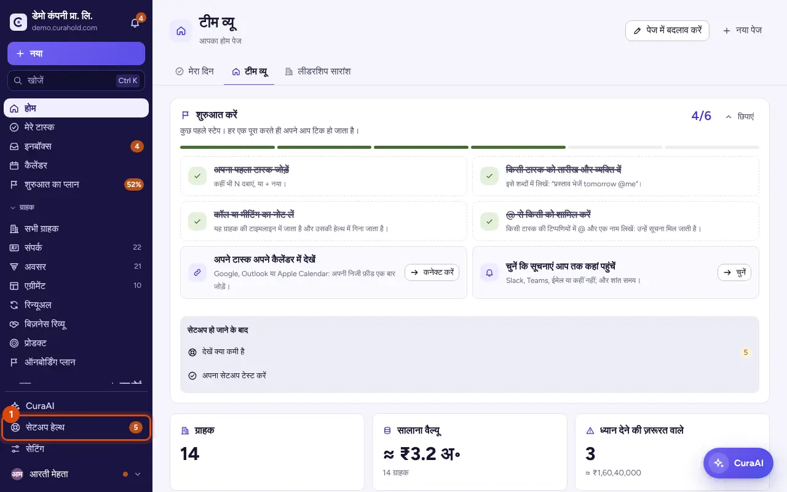
2. पहली पंक्ति पढ़ें। सबसे ज़रूरी सबसे पहले आता है: **पहले ठीक करें**, फिर **ठीक करने लायक**, फिर **जब आपके पास एक मिनट हो**। हर पंक्ति बताती है कि हमने क्या देखा और यह क्यों मायने रखता है।
   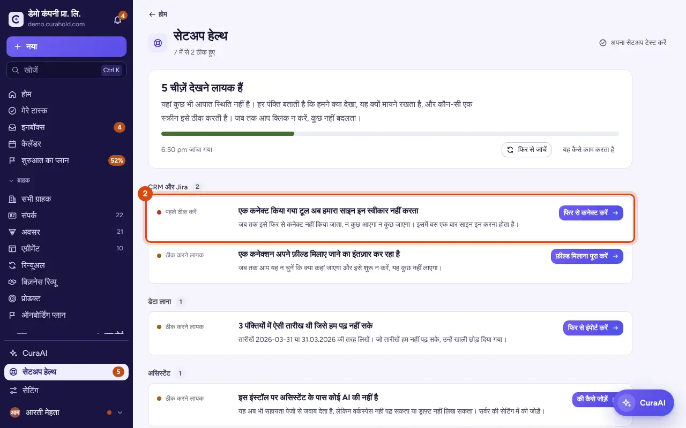
3. उस पंक्ति के बटन पर क्लिक करें। यह ठीक वह स्क्रीन खोलता है जहां आप इसे ठीक करते हैं।
   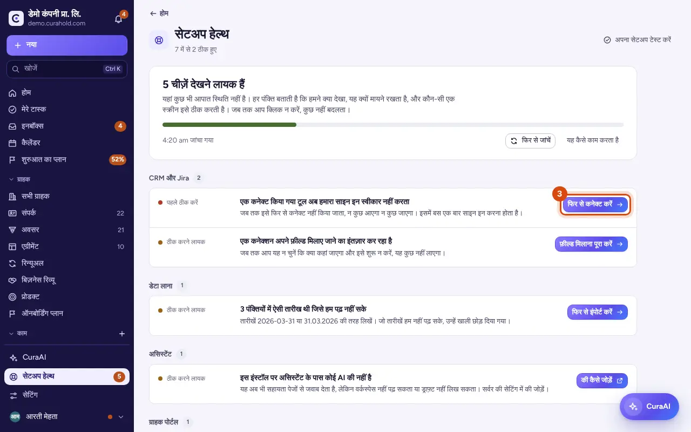
4. ठीक करने के बाद वापस आएं और **फिर से जांचें** पर क्लिक करें। पंक्ति **ठीक किया गया** में चली जाती है, और पेज के ऊपर लिखा होता है कि कितनी ठीक हो गईं।
   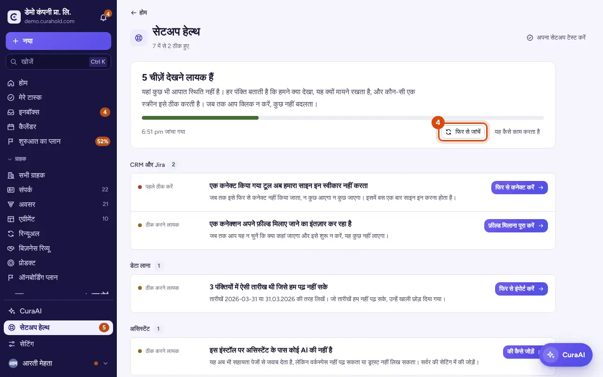
5. समस्या आपको उसे ठीक करने वाली स्क्रीन पर भी, ऊपर एक पीले बॉक्स में, दिखती है। पूरी सूची खोलने के लिए **सब देखें** पर क्लिक करें।
   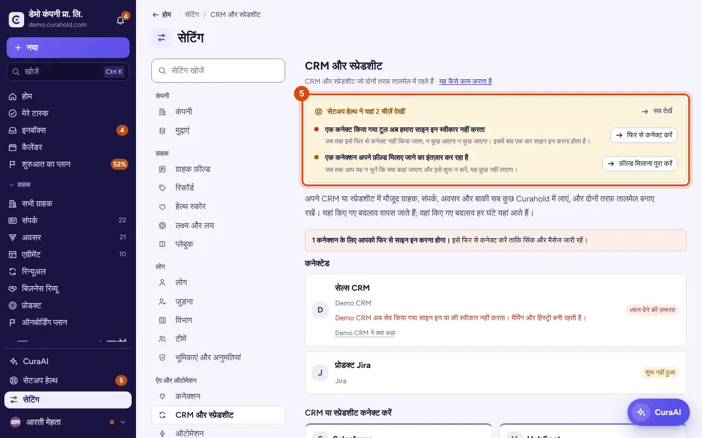

कुछ चीज़ें हम यहां से नहीं पढ़ सकते, जैसे आपके मेल डोमेन के SPF, DKIM और DMARC रिकॉर्ड। इन्हें जोड़ें, फिर उस पंक्ति पर **मैंने यह कर लिया है** पर क्लिक करें।

हर व्यक्ति सिर्फ़ वही देखता है जो वह ठीक कर सकता है। एडमिन कंपनी के बारे में सब कुछ देखते हैं; Curahold सर्वर चलाने वाला व्यक्ति मेल और AI की भी देखता है। हम दिन में एक बार फिर से जांच करते हैं और कुछ भी नया चिह्नित करते हैं।

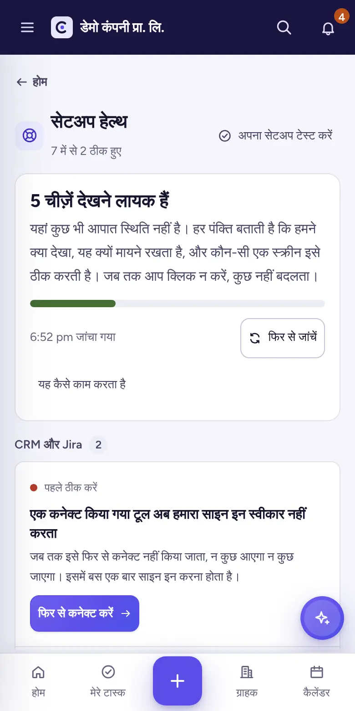

## असिस्टेंट से पूछें

असिस्टेंट खोलें और शब्दशः पूछें:

```text
मेरे सेटअप में क्या गड़बड़ है?
```

यह वही समस्याएं उनके बटनों के साथ बताता है। यह सिर्फ़ पढ़ता है; खुद कभी कुछ ठीक नहीं करता।

## अपना सेटअप टेस्ट करें

1. **सेटअप हेल्थ** पर ऊपर दाईं ओर **अपना सेटअप टेस्ट करें** पर क्लिक करें।
   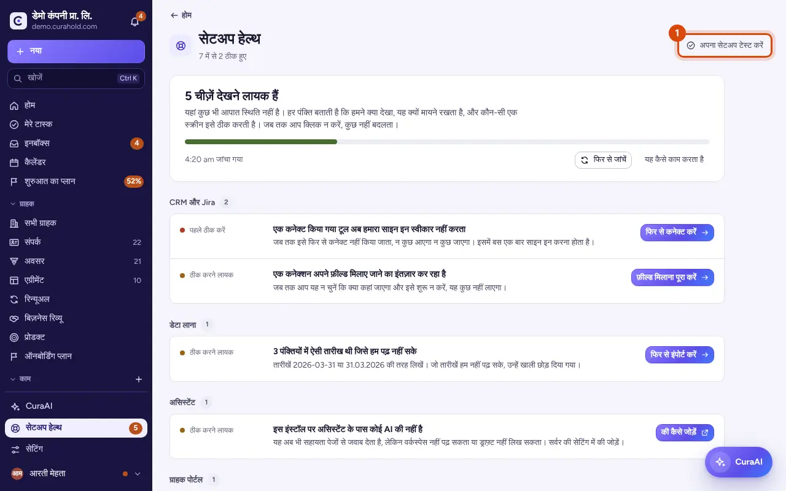
2. किसी स्टेप पर **टेस्ट करें** पर क्लिक करें। जिन स्टेप को आप अपनी आंखों से जांचते हैं, उनमें इसकी जगह **यह काम कर गया** और **यह काम नहीं किया** होते हैं। जहां कोई स्टेप पूछे कि किसके साथ आज़माना है (कोई ग्राहक, कोई कनेक्शन, कोई सहकर्मी), वहां एक बार चुनें: यह अगली कोशिश के लिए रखा जाता है।
   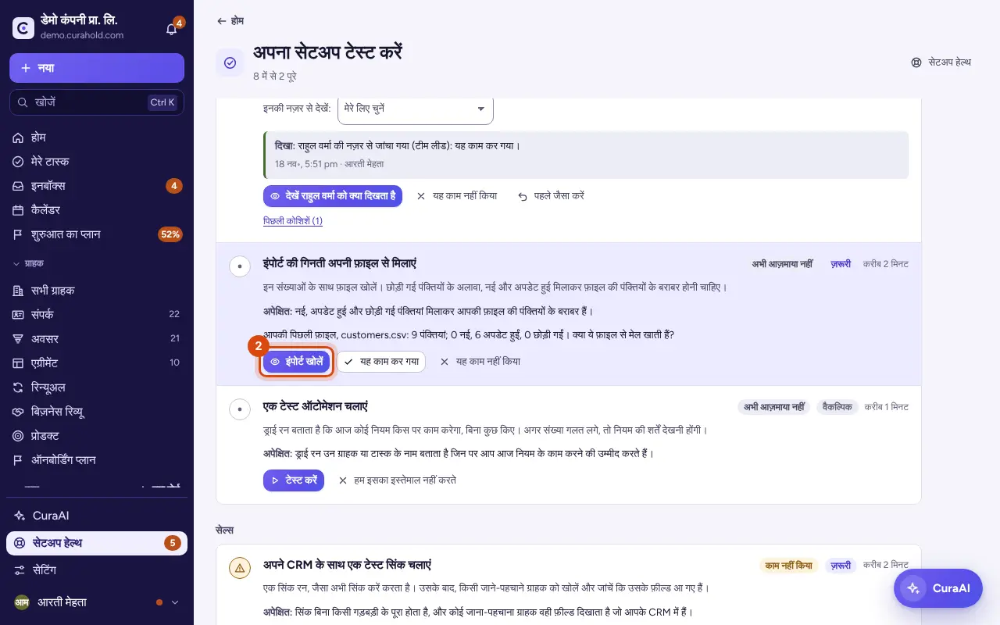
3. **दिखा** की तुलना **अपेक्षित** से करें। अगर दोनों मेल खाते हैं, तो स्टेप पास हो गया। हर कोशिश, किसने और कब चलाई, के साथ रखी जाती है, इसलिए आप कभी भी फिर से टेस्ट कर सकते हैं।
   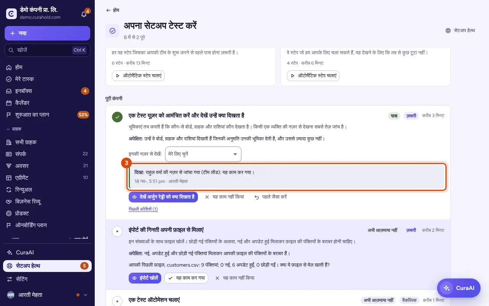
4. अगर यह काम नहीं किया, तो **इसे ठीक करने वाली स्क्रीन खोलें** पर क्लिक करें, ठीक करें और फिर से टेस्ट करें। अगर मदद चाहिए, तो **इश्यू खोलें** पर क्लिक करें: इश्यू स्टेप के साथ रहता है और स्टेप पास होने पर अपने आप बंद हो जाता है।
   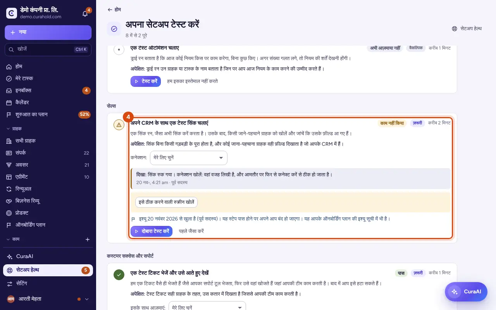
5. एक साथ कई चलाने के लिए एक बंडल चुनें: **गो-लाइव से पहले** या **मासिक जांच**, फिर **ऑटोमैटिक स्टेप चलाएं**।
   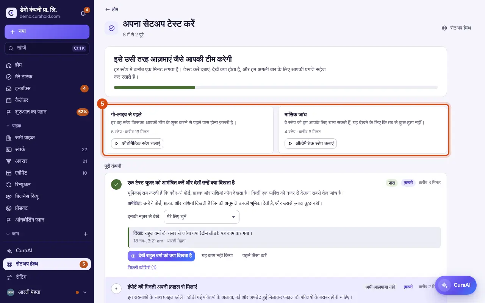
6. जब हर **ज़रूरी** स्टेप पास हो जाए, तो आपकी कंपनी का एक एडमिन **मंज़ूर करें** पर क्लिक करता है, फिर Curahold का कोई व्यक्ति। तब पेज पर तारीख के साथ **सेटअप पूरा हुआ** लिखा होता है।
   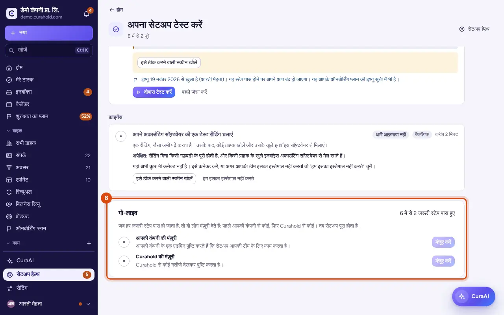

## हर जांच का मतलब

यह टेबल प्रोडक्ट के अपने शब्दों से लिखी गई है, इसलिए यह हमेशा स्क्रीन से मेल खाती है।

<!-- setup-checks:start (scripts/docs/setup-health-page.ts writes this part) -->

### टीम

| हम क्या देखते हैं | यह क्यों मायने रखता है | बटन |
| --- | --- | --- |
| अभी तक यहां सिर्फ़ आप हैं (पहले ठीक करें) | टास्क, हैंडओवर और रिमाइंडर किसी के पास जाने चाहिए। Curahold में काम करने वाले लोगों को आमंत्रित करें। | **लोगों को आमंत्रित करें** |
| … आमंत्रण एक हफ़्ते से ज़्यादा समय से स्वीकार नहीं हुए (जब आपके पास एक मिनट हो) | हो सकता है उनसे ईमेल छूट गया हो। इसे फिर से भेजें या पता जांच लें। | **आमंत्रण देखें** |
| … भूमिकाओं में कोई नहीं है (जब आपके पास एक मिनट हो) | जिस भूमिका में कोई नहीं, वह कुछ नहीं करती। इसे सही लोगों को दें या हटा दें ताकि सूची साफ़ रहे। | **भूमिकाएं खोलें** |

### विभाग

| हम क्या देखते हैं | यह क्यों मायने रखता है | बटन |
| --- | --- | --- |
| विभाग अभी सेट अप नहीं हुए हैं (ठीक करने लायक) | बोर्ड, हैंडओवर और कौन क्या देखता है, ये सब विभागों के हिसाब से चलते हैं। हर व्यक्ति को उसके विभाग में रखें। | **विभाग सेट अप करें** |
| … विभागों का कोई लीड नहीं है (ठीक करने लायक) | सिर्फ़ लीड ही विभाग के बोर्ड खोल सकते हैं, और विभाग को भेजे गए हैंडओवर उसके लीड के पास जाते हैं। | **लीड चुनें** |

### डेटा लाना

| हम क्या देखते हैं | यह क्यों मायने रखता है | बटन |
| --- | --- | --- |
| आपके पिछले इंपोर्ट की … पंक्तियां नहीं आईं (ठीक करने लायक) | उन पंक्तियों में कुछ पढ़ा नहीं जा सका। इंपोर्ट स्क्रीन पर वे अपनी पंक्ति संख्या के साथ दिखती हैं। | **इंपोर्ट खोलें** |
| आपके पिछले इंपोर्ट की … पंक्तियों में ग्राहक का नाम नहीं था (ठीक करने लायक) | नाम ही वह कॉलम है जो हर पंक्ति में होना चाहिए। फ़ाइल में इसे भरें और फिर से इंपोर्ट करें: जो पंक्तियां पहले से हैं वे अपडेट होंगी, दोबारा नहीं बनेंगी। | **फिर से इंपोर्ट करें** |
| … पंक्तियों में ऐसी तारीख थी जिसे हम पढ़ नहीं सके (ठीक करने लायक) | तारीखें 2026-03-31 या 31.03.2026 की तरह लिखें। जो तारीखें हम नहीं पढ़ सके, उन्हें खाली छोड़ दिया गया। | **फिर से इंपोर्ट करें** |
| … पंक्तियों में ऐसी राशि थी जिसे हम पढ़ नहीं सके (ठीक करने लायक) | सिर्फ़ अंक लिखें, जैसे 12500 या 12.500,00, और मुद्रा अपने अलग कॉलम में रखें। वे राशियां खाली छोड़ दी गईं। | **फिर से इंपोर्ट करें** |
| … ग्राहक दो बार दिख रहे हैं (जब आपके पास एक मिनट हो) | टास्क और नोट दोनों कॉपी में बंट जाते हैं। एक को रखें और दूसरे को उसमें मर्ज करें। | **उन्हें दिखाएं** |

### CRM और Jira

| हम क्या देखते हैं | यह क्यों मायने रखता है | बटन |
| --- | --- | --- |
| एक कनेक्ट किया गया टूल अब हमारा साइन इन स्वीकार नहीं करता (पहले ठीक करें) | जब तक इसे फिर से कनेक्ट नहीं किया जाता, न कुछ आएगा न कुछ जाएगा। इसमें बस एक बार साइन इन करना होता है। | **फिर से कनेक्ट करें** |
| … टूल के साथ पिछला सिंक पूरा नहीं हुआ (पहले ठीक करें) | तब से किए गए बदलाव इंतज़ार में हैं। कनेक्शन के पेज पर लिखा है कि इसे किसने रोका। | **देखें क्या हुआ** |
| एक इनकमिंग वेबहुक ने एक दिन से कुछ भी इस्तेमाल नहीं किया (ठीक करने लायक) | हर डिलीवरी या तो अस्वीकार हुई (ग़लत सीक्रेट) या इस्तेमाल नहीं हो सकी (कोई मेल खाता ग्राहक नहीं, बदला हुआ पेलोड)। उसका लॉग बताता है कि कौन-सी बात है। | **इनकमिंग वेबहुक खोलें** |
| WhatsApp कनेक्ट है, लेकिन कोई मैसेज नहीं आया (ठीक करने लायक) | एक दिन बाद इसका आमतौर पर मतलब होता है कि कॉलबैक पता और वेरिफ़ाई टोकन Meta ऐप में सेव नहीं हैं, या “messages” सब्सक्राइब नहीं किया गया है। | **कनेक्शन खोलें** |
| एक कनेक्शन अपने फ़ील्ड मिलाए जाने का इंतज़ार कर रहा है (ठीक करने लायक) | जब तक आप यह न चुनें कि क्या कहां जाएगा और इसे शुरू न करें, यह कुछ नहीं लाएगा। | **फ़ील्ड मिलाना पूरा करें** |
| … बदलाव दूसरे टूल को नहीं भेजे जा सके (ठीक करने लायक) | हमने तीन बार कोशिश की। कनेक्शन के पेज पर हर बदलाव और उसकी वजह दिखती है, और वहां से फिर से कोशिश की जा सकती है। | **उनकी समीक्षा करें** |
| … API कुंजियां दो हफ़्ते के अंदर काम करना बंद कर देंगी (ठीक करने लायक) | जो भी इसका इस्तेमाल करता है, वह भेजना बंद कर देगा। उससे पहले नई कुंजी बनाएं और उसकी जगह लगा दें। | **API कुंजियां खोलें** |
| इस हफ़्ते दूसरे टूल ने … बदलावों को ओवरराइट कर दिया (जब आपके पास एक मिनट हो) | दोनों तरफ़ एक ही चीज़ बदली गई। कुछ भी खोया नहीं है: बदली गई वैल्यू हर टास्क की हिस्ट्री में है। जांच लें कि कनेक्शन का नियम वही है जो आप चाहते हैं। | **नियम जांचें** |

### अकाउंटिंग

| हम क्या देखते हैं | यह क्यों मायने रखता है | बटन |
| --- | --- | --- |
| आपका अकाउंटिंग सॉफ़्टवेयर पढ़ा नहीं जा सका (पहले ठीक करें) | ग्राहक पेजों पर इनवॉइस और भुगतान वैसे ही रहेंगे जैसे पिछली सफल रीडिंग में थे। | **कनेक्शन खोलें** |
| अकाउंटिंग दो दिन से पढ़ा नहीं गया है (ठीक करने लायक) | बकाया इनवॉइस पुराने हो सकते हैं। अभी पढ़ें, या देखें कि रोज़ की रीडिंग क्यों रुकी। | **कनेक्शन खोलें** |

### BI टूल

| हम क्या देखते हैं | यह क्यों मायने रखता है | बटन |
| --- | --- | --- |
| … एनालिटिक्स कुंजियां दो हफ़्ते के अंदर काम करना बंद कर देंगी (ठीक करने लायक) | आपके BI टूल की रिपोर्ट रिफ़्रेश होना बंद हो जाएंगी। कुंजी बदलें और नई कुंजी वहां पेस्ट करें। | **एनालिटिक्स कुंजियां खोलें** |
| आपके BI टूल ने एक हफ़्ते से डेटा नहीं लिया है (जब आपके पास एक मिनट हो) | उसके डैशबोर्ड पिछले हफ़्ते के आंकड़े दिखा रहे हैं। उसका शेड्यूल किया गया रिफ़्रेश या उसकी कुंजी जांचें। | **एनालिटिक्स कुंजियां खोलें** |

### ग्राहक पोर्टल की जांच

| हम क्या देखते हैं | यह क्यों मायने रखता है | बटन |
| --- | --- | --- |
| ग्राहक पोर्टल चालू है, लेकिन ग्राहकों को कुछ नहीं दिखाता (ठीक करने लायक) | पोर्टल के साथ कम से कम एक बोर्ड शेयर करें ताकि ग्राहक अनुरोध भेज सकें और उन्हें ट्रैक कर सकें। | **चुनें कि क्या शेयर करना है** |
| अभी तक पोर्टल पर किसी को आमंत्रित नहीं किया गया है (जब आपके पास एक मिनट हो) | ग्राहक आमंत्रण मिलने के बाद ही साइन इन कर सकते हैं। शुरुआत के लिए किसी एक ग्राहक के संपर्क को आमंत्रित करें। | **ग्राहक को आमंत्रित करें** |
| पोर्टल में अभी भी Curahold के रंग हैं (जब आपके पास एक मिनट हो) | आपका लोगो और रंग ग्राहकों को बताते हैं कि वे सही जगह पर हैं। | **अपना ब्रांड जोड़ें** |

### ऑटोमेशन

| हम क्या देखते हैं | यह क्यों मायने रखता है | बटन |
| --- | --- | --- |
| … ऑटोमेशन ऐसे फ़ील्ड का इस्तेमाल करते हैं जो हटा दिया गया है (पहले ठीक करें) | ऐसे में यह कभी नहीं चल सकता। कोई दूसरा फ़ील्ड चुनें, या नियम बंद करें। | **नियम ठीक करें** |
| … ऑटोमेशन ऐसे बोर्ड की ओर इशारा करते हैं जो अब नहीं है (पहले ठीक करें) | इसे जो टास्क बनाने चाहिए, उनके जाने की कोई जगह नहीं है। कोई दूसरा बोर्ड चुनें। | **नियम ठीक करें** |
| अभी तक कोई ऑटोमेशन नहीं (जब आपके पास एक मिनट हो) | एक नियम, जैसे हर रिन्यूअल से 60 दिन पहले एक टास्क, हर बार एक रिमाइंडर बचाता है। तैयार नियम चालू किए जाने का इंतज़ार कर रहे हैं। | **तैयार नियम देखें** |

### आपके डेटा की जांच

| हम क्या देखते हैं | यह क्यों मायने रखता है | बटन |
| --- | --- | --- |
| … ग्राहक का कोई ओनर नहीं है (ठीक करने लायक) | उनके रिमाइंडर किसी के पास नहीं जाते, और वे किसी की सूची में नहीं हैं। हर एक को एक ओनर दें। | **ओनर दें** |
| … खुली डील का कोई स्टेज नहीं है (ठीक करने लायक) | वे पाइपलाइन और पूर्वानुमान से बाहर रह जाती हैं। | **डील खोलें** |
| … खुले टिकट की देखरेख कोई नहीं कर रहा (जब आपके पास एक मिनट हो) | बिना ओनर का टिकट किसी की कतार में नहीं होता। हर एक को असाइन करें, या ऐसा नियम जोड़ें जो यह करे। | **टिकट खोलें** |

### मेल

| हम क्या देखते हैं | यह क्यों मायने रखता है | बटन |
| --- | --- | --- |
| यह इंस्टॉल अभी ईमेल नहीं भेजता (पहले ठीक करें) | आमंत्रण, साइन-इन लिंक और रिमाइंडर सिर्फ़ सर्वर लॉग में लिखे जाते हैं। मेल रिले या कोई मेल प्रोवाइडर सेट अप करें। | **मेल कैसे सेट अप करें** |
| मेल डोमेन के SPF, DKIM और DMARC रिकॉर्ड की पुष्टि करें (ठीक करने लायक) | इनके बिना आमंत्रण स्पैम में चले जाते हैं या अस्वीकार हो जाते हैं। हम यहां से आपका DNS नहीं पढ़ सकते: रिकॉर्ड जोड़ें, फिर पुष्टि करें। | **रिकॉर्ड देखें** |

### गोपनीयता

| हम क्या देखते हैं | यह क्यों मायने रखता है | बटन |
| --- | --- | --- |
| निजी डेटा के अनुरोधों का जवाब कोई नहीं दे सकता (ठीक करने लायक) | KVKK और GDPR के तहत किसी को किसी व्यक्ति का डेटा एक्सपोर्ट करने या मिटाने में सक्षम होना चाहिए। किसी एक भूमिका को गोपनीयता की अनुमति दें। | **भूमिकाएं खोलें** |

### ट्रायल और प्लान

| हम क्या देखते हैं | यह क्यों मायने रखता है | बटन |
| --- | --- | --- |
| आपका ट्रायल … को खत्म होगा (ठीक करने लायक) | उसके बाद प्लान चुने जाने तक वर्कस्पेस सिर्फ़ पढ़ने के लिए रहेगा। कुछ भी हटाया नहीं जाता। | **प्लान चुनें** |
| ट्रायल की हर सीट भर चुकी है (ठीक करने लायक) | नए लोग सिर्फ़ व्यूअर के तौर पर जुड़ सकते हैं। और सीटें मांगें, या कोई सीट खाली करें। | **सीटें देखें** |

### असिस्टेंट

| हम क्या देखते हैं | यह क्यों मायने रखता है | बटन |
| --- | --- | --- |
| इस इंस्टॉल पर असिस्टेंट के पास कोई AI कुंजी नहीं है (ठीक करने लायक) | यह अब भी सहायता पेजों से जवाब देता है, लेकिन वर्कस्पेस नहीं पढ़ सकता या ड्राफ़्ट नहीं लिख सकता। सर्वर की सेटिंग में कुंजी जोड़ें। | **कुंजी कैसे जोड़ें** |

<!-- setup-checks:end -->

## डेवलपर के लिए

यही जांचें API में भी हैं, की के ओनर के रूप में पढ़ी जाती हैं। दोनों उदाहरणों की जगह अपनी कंपनी का पता और अपनी की रखें:

```bash
curl -H "Authorization: Bearer YOUR_API_KEY" https://your-company.curahold.com/api/setup-health
```

पतों की पूरी सूची [रेफ़रेंस: सेटअप हेल्थ](/docs/hi/ref-setup/) में है।
