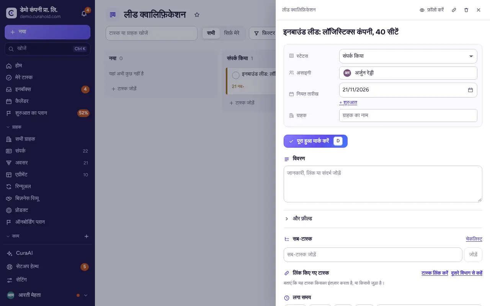

# टास्क और बोर्ड

काम बोर्ड पर चलता है। कोई बोर्ड किसी टीम का, पूरी कंपनी का या सिर्फ़ आपका होता है, और उसके कॉलम आप चुनते हैं।

## एक टास्क

टास्क में शीर्षक, ब्योरा, लोग (10 तक), ड्यू डेट, प्राथमिकता और, चाहें तो, एक ग्राहक होता है। सब-टास्क, फ़ाइलें और कमेंट जोड़ें। टास्क बोर्ड के पास एक पैनल में खुलता है, और उसका लिंक उस हर व्यक्ति के लिए काम करता है जिसे आप भेजते हैं।

हर कार्ड के बाईं ओर की पतली पट्टी दिखाती है कि टास्क समय के हिसाब से कहां है: आराम से, जल्द, आज, देर से, पूरा हुआ। यही रंग कैलेंडर और मेरे टास्क में भी आते हैं। तारीखें प्रोडक्ट के अपने डेट पिकर से चुनी जाती हैं, आपकी भाषा में और उसी क्रम में जिसमें आप तारीखें लिखते हैं।

## जब दो लोग एक ही टास्क बदलते हैं

Curahold कभी चुपचाप किसी का बदलाव नहीं मिटाता। अगर आपके बदलाव करते समय किसी और ने सेव किया, तो उनका बदलाव रखा जाता है और आपका उसके ऊपर लागू होता है। आपसे सिर्फ़ तब पूछा जाता है जब एक ही फ़ील्ड में सच में टकराव हो।

## एक साथ कई बदलना, और पहले जैसा करना

किसी बोर्ड पर या सूची में कई टास्क चुनें और उनका स्टेटस, लोग, तारीख या प्राथमिकता एक साथ बदलें। नीचे की सूचना **पहले जैसा करें** देती है।

## दोहराए जाने वाले टास्क

किसी टास्क को हर कुछ दिनों, हफ़्तों या महीनों में दोहराएं। मौजूदा टास्क पूरा होने पर अगला खुलता है। नई तारीख इनमें से किसी एक तरह गिनी जाती है:

- **ड्यू डेट से:** तय कैलेंडर के लिए, जैसे "हर महीने की 1 तारीख को रिपोर्ट"।
- **पूरा होने के दिन से:** ऐसे काम के लिए, जैसे "आखिरी कॉल के दो हफ़्ते बाद फिर से कॉल करें"।

## मेंशन और म्यूट करना

किसी को मेंशन करने के लिए कमेंट में `@` टाइप करें; उन्हें बताया जाता है। अगर आप किसी टास्क के बारे में अब और नहीं सुनना चाहते, तो उसके मेन्यू में **म्यूट करें** चुनें।

## क्विक सर्च

कोई ग्राहक, टास्क, व्यक्ति, बोर्ड या पेज ढूंढने के लिए कहीं भी Ctrl K (Mac पर ⌘ K) दबाएं। तीर वाली कीज़ से आगे-पीछे जाएं, Enter से खोलें।

## टास्क पर और भी

- **फ़ॉलो करें:** टास्क के ऊपर के बटन से, ऐसे टास्क के कमेंट और कॉलम बदलने की खबर पाएं जो आपका नहीं है।
- **जुड़े हुए टास्क:** बताएं कि कोई टास्क किसी दूसरे का **इसका इंतज़ार करता है**, किसी दूसरे को **इसे रोकता है**, या उससे **इससे जुड़ा है**। इंतज़ार करने वाले टास्क के कार्ड पर "1 का इंतज़ार" लिखा होता है; जिसका वह इंतज़ार करता है वह पूरा होने पर उसके लोगों को "आप शुरू कर सकते हैं" सूचना मिलती है। टास्क एक-दूसरे का गोल घेरे में इंतज़ार नहीं कर सकते।
- **शुरू होने की तारीख:** ड्यू डेट के पास **+ शुरुआत** दर्ज करता है कि काम कब शुरू होता है; टाइमलाइन इसे एक बार के रूप में बनाती है।
- **लगा समय:** +15 m, +30 m, +1 h बटन, या हाथ से ("1.5", "45m", "1:30")। ग्राहक का पेज उस ग्राहक के लिए दर्ज कुल समय दिखाता है।
- **चेकलिस्ट:** अक्सर इस्तेमाल होने वाले स्टेप एक बार सेव करें (सब-टास्क जोड़ें → **चेकलिस्ट → चेकलिस्ट के रूप में सेव करें**), फिर उन्हें किसी भी टास्क में एक क्लिक में जोड़ें।
- **इतिहास:** किसने क्या और कब बदला, पंक्ति-दर-पंक्ति, टास्क के नीचे।
- **मिलते-जुलते टास्क की चेतावनी:** अगर आप जो टास्क जोड़ने वाले हैं वह किसी पहले से खुले टास्क जैसा लगता है, तो क्विक ऐड यह बताता है।

## बोर्ड के अपने फ़ील्ड

बोर्ड की सेटिंग → **फ़ील्ड और अनुरोध फ़ॉर्म**: उस बोर्ड के हर टास्क में अतिरिक्त फ़ील्ड जोड़ें (टेक्स्ट, संख्या, रकम, तारीख, विकल्प, लिंक, ईमेल, व्यक्ति, हां/नहीं)। **पूरा करने के लिए भरना ज़रूरी** मार्क किया गया फ़ील्ड, टास्क के "पूरा हुआ" कॉलम में जाने से पहले भरना होता है; एक साथ किया गया बदलाव ऐसे टास्क छोड़ देता है और बताता है कि कितने। विकल्प फ़ील्ड कार्ड पर रंगीन लेबल के रूप में दिखते हैं और उनसे फ़िल्टर किया जा सकता है।

## फ़िल्टर और सेव किए गए व्यू

बोर्ड के ऊपर **फ़िल्टर** उसे व्यक्ति, ड्यू डेट (ओवरड्यू, आज, 7 दिन…), प्राथमिकता और बोर्ड के विकल्प फ़ील्ड के हिसाब से सीमित करता है। फ़ोन पर हर फ़िल्टर एक ही **फ़िल्टर** शीट पर साथ होता है। लगाए गए फ़िल्टर को **व्यू → सेव करें** से नाम दें, और चाहें तो व्यू बोर्ड के सभी लोगों को दिखाएं।

## अनुरोध फ़ॉर्म

बोर्ड की सेटिंग में **फ़ॉर्म से अनुरोध लें** चालू करें और चुनें कि फ़ॉर्म क्या पूछे। सहकर्मी बोर्ड पर **अनुरोध फ़ॉर्म** बटन इस्तेमाल करते हैं; अनुरोध आपके चुने कॉलम में टास्क के रूप में आता है, और पूछने वाला उसे अपने आप फ़ॉलो करता है।

## किसी दूसरे टूल से आना: फ़ाइल से टास्क इंपोर्ट करना

बोर्ड के ऊपर ऊपर वाले तीर का बटन (**फ़ाइल से टास्क इंपोर्ट करें**) आपके पुराने टूल से एक्सपोर्ट की गई CSV या Excel फ़ाइल लेता है। फ़ाइल ब्राउज़र में पढ़ी जाती है; जब तक आप देख न लें कि कौन-सा कॉलम कहां जाता है, कुछ भी नहीं भेजा जाता।

- कॉलम अपने आप पहचाने जाते हैं (Title, Description, Status, Assignee, Due date, Start date, Priority, Customer, Completed on; इनके तुर्की नाम भी)। इनमें से कोई भी बदलें; "यह बनता है" कॉलम दिखाता है कि पहली पंक्तियां कैसे आएंगी।
- **Status** उसी नाम वाले बोर्ड कॉलम में जाता है। "To do", "In progress" और "Done" जैसे आम नाम भी समझे जाते हैं; बाकी कुछ भी पहले कॉलम में आता है और नतीजे में उसकी सूची होती है।
- **Assignee** का मिलान नाम या ईमेल से होता है; जो लोग नहीं मिलते उन्हें छोड़ दिया जाता है, और आपको बताया जाता है कि कौन। ग्राहक के नाम का मिलान भी इसी तरह होता है।
- पूरे हुए टास्क तब तक छोड़ दिए जाते हैं जब तक आप "पूरे हुए टास्क भी लाएं" पर टिक न करें।
- किसी को सूचना नहीं जाती और कोई नियम नहीं चलता। आप पूरे इंपोर्ट को 30 दिन तक **वापस ले** सकते हैं: जिन टास्क को किसी ने नहीं छुआ वे हटा दिए जाते हैं, जिन पर किसी ने काम किया वे आर्काइव में चले जाते हैं।

एक बार में 5,000 पंक्तियों तक।

## कैलेंडर

**कैलेंडर** दिखाता है कि किस दिन क्या है: ड्यू डेट के हिसाब से टास्क, हो चुकी मीटिंग, कॉल और रिव्यू, रिन्यूअल, और ड्यू होने वाले बिज़नेस रिव्यू। इसके ऊपर के चिप हर तरह को चालू या बंद करते हैं।

- **दिन, हफ़्ता, महीना, साल:** ऊपर का स्विच। दिन उस दिन की हर चीज़ ग्राहक और जिसकी वह है, उसके साथ दिखाता है; साल बारह छोटे महीने दिखाता है, जहां ज़्यादा चीज़ें हों वहां गहरा। किसी दिन की संख्या पर क्लिक करने से वह दिन खुलता है।
- **किसका कैलेंडर:** आपका, या उन सभी का जिन्हें आप देख सकते हैं। जिसकी भूमिका *टीम के साथियों के कैलेंडर देख सकती है* (शुरुआत में एडमिन और टीम लीड), वह किसी एक व्यक्ति या पूरी टीम को भी चुन सकता है। इससे वह उतना ही सीमित होता है जितना वे पहले से देख सकते हैं; कुछ नया नहीं दिखता, इसलिए प्राइवेट बोर्ड प्राइवेट ही रहता है।
- व्यू, दिन और किसका कैलेंडर है, यह पते में होता है, इसलिए लिंक वही चीज़ खोलता है।

## आर्काइव

पूरे हुए टास्क बोर्ड के **आर्काइव** में अपने आप चले जाते हैं जब बोर्ड उन्हें काफ़ी समय तक रख चुका हो (डिफ़ॉल्ट रूप से 90 दिन; बोर्ड की सेटिंग में 30–365 दिन या "हमेशा")। सालों से इस्तेमाल हो रहा बोर्ड भी तुरंत खुलता है। आर्काइव किए गए टास्क रिपोर्ट में गिने जाते रहते हैं; उन्हें बोर्ड / सूची के पास **आर्काइव** व्यू में खोजें और **वापस लाएं** से किसी को वापस रखें। वापस लाया गया टास्क फिर से उतने ही दिन बोर्ड पर रहता है। सूची व्यू से हाथ से आर्काइव किए गए टास्क भी यहीं होते हैं।

## टास्क हटाना, और हटाया गया टास्क वापस पाना

हटाया गया टास्क अपने सब-टास्क, कमेंट, समय और फ़ाइलों के साथ [ट्रैश](/docs/hi/trash/) में जाता है, और उसे 30 दिन तक वापस लाया जा सकता है: हटाने के ठीक बाद सूचना में **पहले जैसा करें** चुनें, या अपना मेन्यू खोलें, **ट्रैश** चुनें और फिर **वापस लाएं**। टास्क को सिर्फ़ उसे बनाने वाला व्यक्ति हटा सकता है, या वह व्यक्ति जिसकी भूमिका कोई भी टास्क हटा सकती है। पूरे हुए टास्क को हटाए बिना रास्ते से हटाने के लिए उसे आर्काइव करें।
