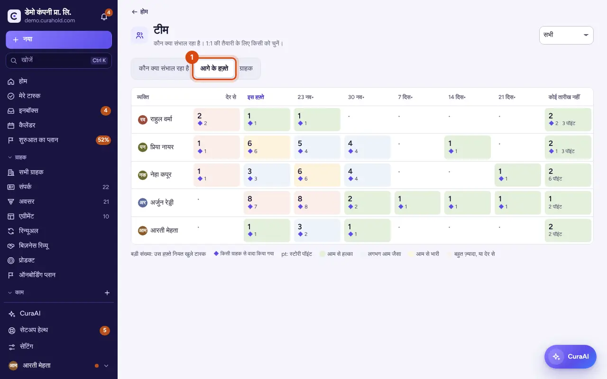
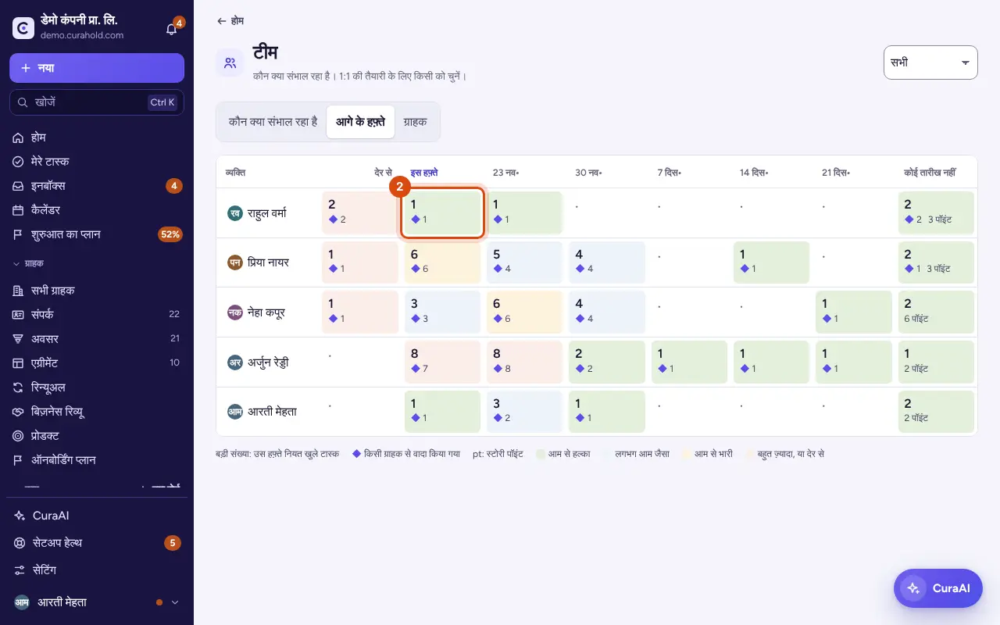
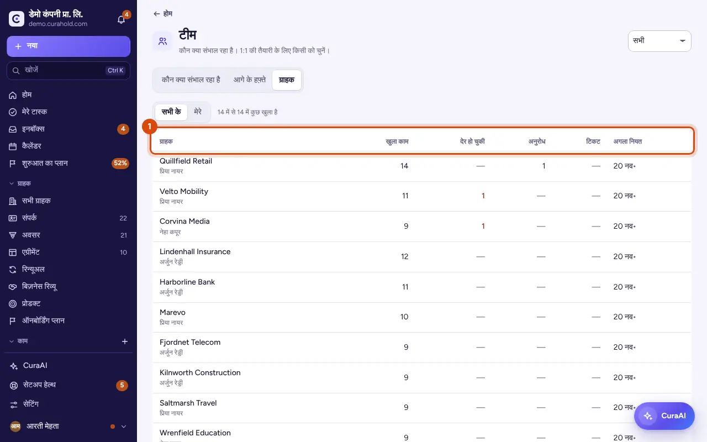
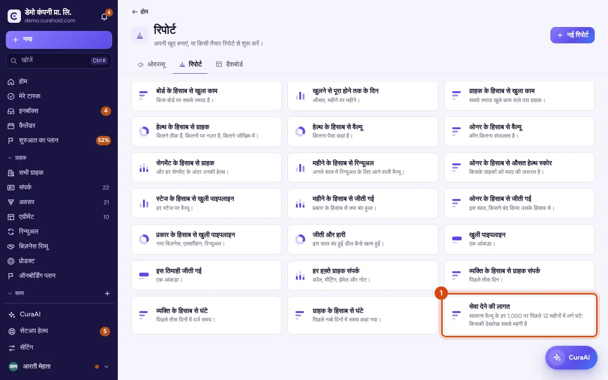

# टीम के हफ़्ते, ग्राहक पोर्टफ़ोलियो और सेवा देने की लागत

**टीम** (बाईं ओर के मेन्यू में) के तीन व्यू हैं: **कौन क्या संभाल रहा है**, **आगे के हफ़्ते** और **ग्राहक**। इनमें से किसी को भी सीमित करने के लिए ऊपर दाईं ओर कोई टीम चुनें। सिर्फ़ वही टास्क गिने जाते हैं जिन्हें आप देख सकते हैं।

## आने वाले हफ़्तों में किसके पास जगह है {#weeks}

1. **टीम** खोलें और **आगे के हफ़्ते** पर क्लिक करें।
   
2. किसी व्यक्ति की पंक्ति हफ़्ते-दर-हफ़्ते पढ़ें। हर सेल में बड़ी संख्या उस हफ़्ते ड्यू खुले टास्क हैं, ◆ बताता है कि उनमें से कितने ग्राहक से किए गए वादे हैं, और **pt** उनके स्टोरी पॉइंट। रंग उस हफ़्ते की तुलना उस व्यक्ति के आम बोझ से करता है: हल्का, लगभग आम, भारी या बहुत ज़्यादा। **देर से** और **कोई तारीख नहीं** के अपने कॉलम हैं। उस व्यक्ति का 1:1 व्यू खोलने के लिए किसी सेल पर क्लिक करें।
   

## हर ग्राहक का खुला काम {#customers}

1. **टीम** खोलें और **ग्राहक** पर क्लिक करें। जिस ग्राहक का कुछ भी खुला है, वह सूची में है, सबसे व्यस्त पहले: खुला काम, उसमें से कितना देर से है, उनके लोगों ने पोर्टल से कौन-से अनुरोध भेजे, कौन-से सपोर्ट टिकट अभी हल नहीं हुए, और अगली ड्यू डेट। किसी कॉलम के नाम पर क्लिक करके उसके हिसाब से क्रम लगाएं; **सभी के** और **मेरे** के बीच बदलें।
   

यहां रकम जान-बूझकर नहीं दिखाई जाती: पैसा कौन देख सकता है, यह फ़ील्ड-दर-फ़ील्ड तय होता है।

## सेवा देने की लागत {#cost-to-serve}

1. मेन्यू में **रिपोर्ट** खोलें, **रिपोर्ट** टैब पर क्लिक करें, फिर **सेवा देने की लागत**। हर ग्राहक के लिए यह पिछले 12 महीनों में उसके काम पर दर्ज घंटे, सालाना वैल्यू के हर 1,000 पर दिखाता है (ARR, नहीं तो MRR × 12, नहीं तो पहला रकम वाला फ़ील्ड)। सबसे ऊपर वाले वे ग्राहक हैं जिन्हें संभालने में सबसे ज़्यादा लागत आती है।
   

रिपोर्ट बिल्डर में इसके साथ दो फ़ील्ड आते हैं: **दर्ज समय, पिछले 12 महीने** और **सालाना वैल्यू के हर 1,000 पर घंटे**। जो व्यक्ति किसी ग्राहक की वैल्यू नहीं देख सकता, उसे लागत का आंकड़ा नहीं मिलता।
