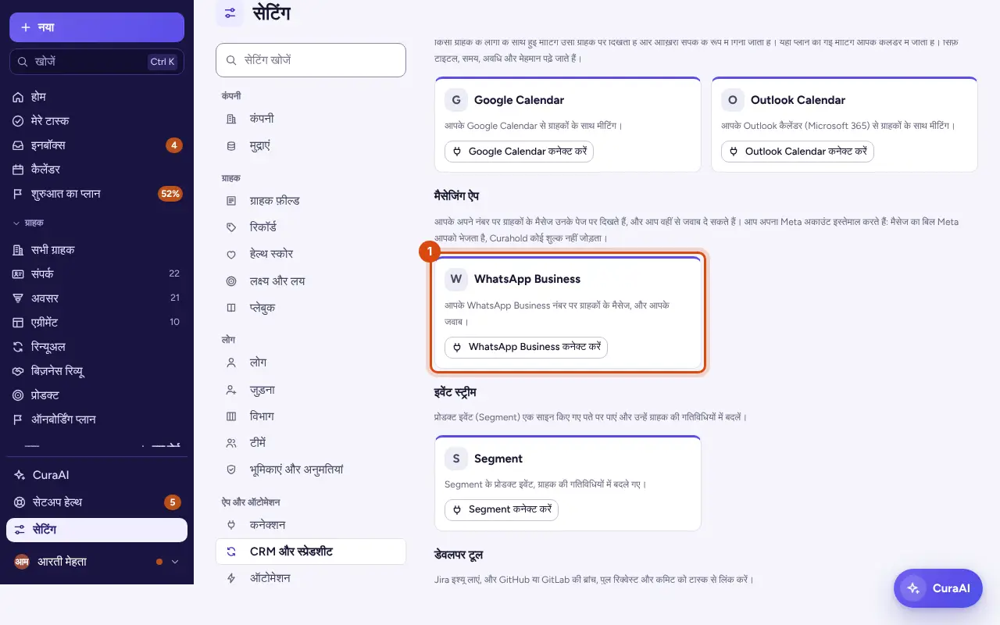
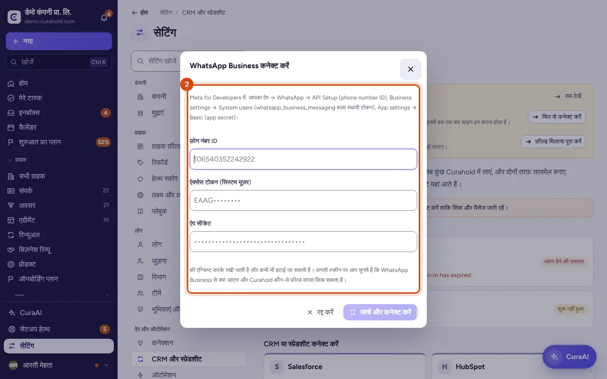

# WhatsApp Business

ग्राहक आपके WhatsApp Business नंबर पर जो मैसेज भेजते हैं, वे उनके पेज पर दिखते हैं, और आप वहीं से जवाब देते हैं। आप अपना **ख़ुद का** Meta ऐप और नंबर इस्तेमाल करते हैं: मैसेज का बिल Meta आपको भेजता है, Curahold कोई शुल्क नहीं जोड़ता और आपका Meta इनवॉइस कभी नहीं देखता।

## शुरू करने से पहले

आपको चाहिए: Cloud API पर WhatsApp Business नंबर वाला Meta बिज़नेस अकाउंट, WhatsApp प्रोडक्ट वाला Meta ऐप, और स्थायी टोकन (अनुमति `whatsapp_business_messaging`) वाला एक **system user**। Meta के अपने पेज इन सबमें आपकी मदद करते हैं; इसमें करीब 15 मिनट लगते हैं।

## Curahold में {#connect}

1. **सेटिंग → CRM और स्प्रेडशीट** खोलें, **मैसेजिंग ऐप** ढूंढें और **WhatsApp Business कनेक्ट करें** पर क्लिक करें।
   
2. नीचे दी तीनों वैल्यू पेस्ट करें और **जांचें और कनेक्ट करें** पर क्लिक करें। इसके बाद कनेक्शन पेज एक **कॉलबैक पता** और एक **वेरिफ़ाई टोकन** दिखाता है।
   

- **फ़ोन नंबर ID**: Meta for Developers → आपका ऐप → **WhatsApp → API Setup**।
- **ऐक्सेस टोकन (सिस्टम यूज़र)**: Business settings → **System users** → आपका यूज़र → **Generate new token**।
- **ऐप सीक्रेट**: आपका ऐप → **App settings → Basic** → **App secret** → **Show**।

## Meta में

1. अपना ऐप खोलें → **WhatsApp → Configuration**। **Webhook** के पास **Edit** पर क्लिक करें।
2. कॉलबैक पते को **Callback URL** में और वेरिफ़ाई टोकन को **Verify token** में पेस्ट करें। **Verify and save** पर क्लिक करें।
3. **Webhook fields** में **Manage** पर क्लिक करें और **messages** को सब्सक्राइब करें।

## क्या आता है, और जवाब देना

मैसेज उस ग्राहक पर नोट के रूप में आता है जिसके किसी संपर्क के पास भेजने वाले का नंबर है (`098…` जैसे स्थानीय रूप भी मेल खाते हैं)। उस नोट पर **WhatsApp पर जवाब दें** पर क्लिक करें। WhatsApp ग्राहक के आख़िरी मैसेज के 24 घंटे के अंदर ही मुक्त टेक्स्ट की अनुमति देता है; उसके बाद Curahold एक मंज़ूर **टेम्पलेट** का नाम और भाषा मांगता है।

## सीमाएं और समय

Meta जैसे ही भेजता है, मैसेज आ जाते हैं। Meta नाकाम डिलीवरी को 7 दिन तक दोबारा भेजता है; हर मैसेज एक ही बार रखा जाता है। Meta सीमित करता है कि एक नंबर कितनी तेज़ी से भेज सकता है; व्यस्त होने का जवाब यह बताता है और कुछ खोता नहीं।

## अगर कुछ ग़लत हो जाए

एक्सपायर या रद्द हुआ टोकन जवाब देते समय दिखता है: **फिर से कनेक्ट करें** से नया टोकन पेस्ट करें। ऐसे नंबर से आया मैसेज जो किसी संपर्क के पास नहीं है, कनेक्शन पर गिना जाता है, सेव नहीं होता। **हटाएं** कॉलबैक तुरंत रोक देता है; ग्राहकों पर पहले से मौजूद नोट बने रहते हैं।

## यह भी देखें

- [टाइमलाइन और हेल्थ स्कोर](/docs/hi/timeline-and-health/)
- [कनेक्शन और CRM](/docs/hi/connections/)
