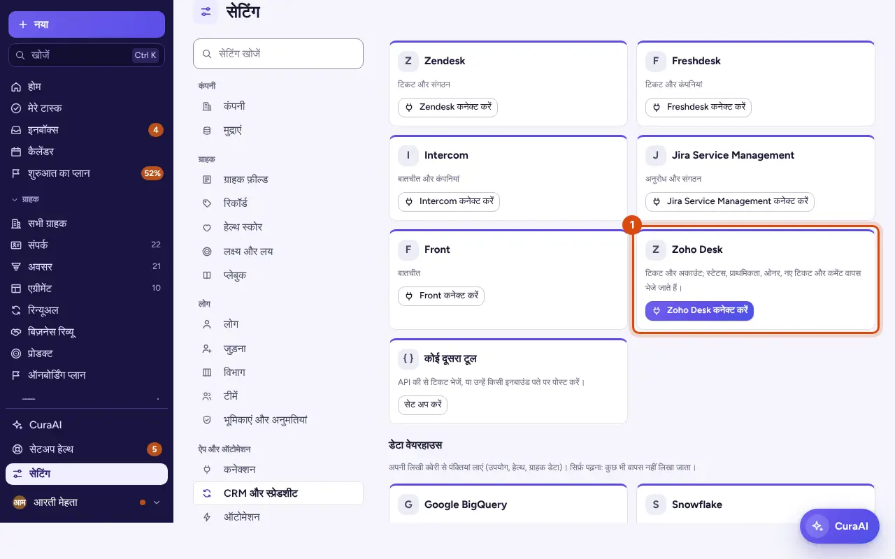

# Zoho Desk

Zoho Desk के टिकट और अकाउंट मेल खाते ग्राहक पर, रोलअप में और हेल्थ स्कोर में दिखते हैं। Curahold में बदले गए स्टेटस, प्राथमिकता और ओनर Zoho Desk में वापस जाते हैं, Curahold में बना टिकट वहां भी बनता है, और जवाब या निजी नोट कमेंट के रूप में जुड़ता है।

## Curahold में {#connect}

1. **सेटिंग → CRM और स्प्रेडशीट** खोलें, **सपोर्ट टूल** ढूंढें और **Zoho Desk कनेक्ट करें** पर क्लिक करें।
   

Zoho खुलता है। अपने हेल्प डेस्क के किसी एजेंट से साइन इन करें और **Accept** पर क्लिक करें। Curahold आपका डेटा सेंटर (.com, .eu, .in, .com.au, .jp, .sa, .uk, .ae, .ca, .com.cn) और आपका पोर्टल ढूंढ लेता है। Curahold में लौटकर **टिकट** और **अकाउंट** पर टिक करें, फ़ील्ड जोड़े जांचें और **सिंक शुरू करें** पर क्लिक करें।

## सीमाएं और समय

बदलाव हर घंटे पढ़े जाते हैं। Zoho हर कॉल पर क्रेडिट गिनता है, जो प्लान के हिसाब से रोज़ाना की सीमा से कटते हैं; सीमा ख़त्म होने पर Zoho इंतज़ार करने को कहता है और Curahold अगली बार आगे बढ़ता है। Curahold से भेजा गया पब्लिक जवाब टिकट पर पब्लिक कमेंट होता है; ईमेल जवाब Zoho Desk से भेजा जाता है।

## अगर कुछ ग़लत हो जाए

एक्सपायर हुआ साइन-इन अपने आप नवीनीकृत होता है। अगर एजेंट का एक्सेस चला गया हो, तो कनेक्शन **ध्यान देने की ज़रूरत** दिखाता है: **फिर से कनेक्ट करें** और दोबारा साइन इन करें। **हटाएं** साइन-इन मिटा देता है; पहले से आए टिकट बने रहते हैं।

## यह भी देखें

- [टाइमलाइन और हेल्थ स्कोर](/docs/hi/timeline-and-health/)
- [कनेक्शन और CRM](/docs/hi/connections/)
