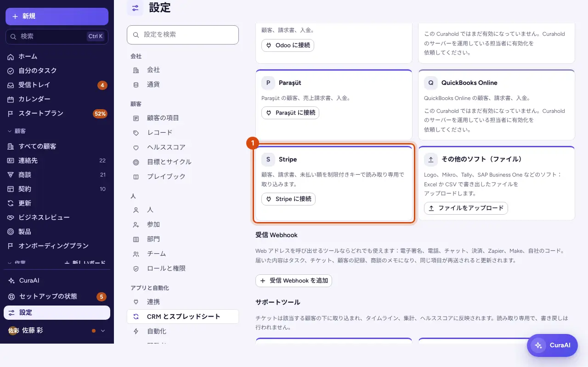

# Stripe（読み取り専用）

Stripe の顧客、請求書（支払期日と残額付き）、入金を取り込みます。Curahold が Stripe に書き込むことはなく、渡すキーは読み取りしかできません。

## Curahold で {#connect}

1. **設定 → CRM とスプレッドシート** を開き、**会計ソフト** で **Stripe に接続** をクリックします。
   

制限付きキーを **制限付きキー** に貼り付けて **接続** をクリックします。すべての権限を持つシークレットキー（`sk_…`）は意図的に受け付けません。続いて **開始** をクリックし、照合できなかった顧客を **照合** タブで確認します。

## Stripe で

1. **開発者 → API キー** を開き、**制限付きキーを作成** をクリックします。
2. 名前を `Curahold` にします。
3. **Customers**、**Invoices**、**Events** を **Read** にし、それ以外は **None** のままにします。
4. **キーを作成** をクリックし、2 段階目で確認して、キーをコピーします。次のように始まります：

```text
rk_live_
```

まず試すには、サンドボックスのキー（`rk_test_…`）を使ってください。

## 制限とタイミング

最初の読み取りですべてを取り込み、その後は Stripe のイベント一覧（Stripe が 30 日保持）から変更分だけを読み取ります。Stripe の上限は毎秒 100 リクエスト（サンドボックスは 25）で、Curahold はそれを大きく下回ります。金額は通貨ごとの小数桁で読み取ります（円は小数なし）。Stripe が「uncollectible」とした請求書もここでは未払いのまま残るため、延滞は表示され続けます。

## うまくいかないとき

ロールまたは削除されたキーでは連携が **要確認** になります。新しい制限付きキーを作り、**再接続** で貼り付けてください。権限が足りない場合は、接続の手順でどの権限かが表示されます。**削除** するとキーは消えますが、読み取った数字は消すまで残ります。

## 関連項目

- [会計ソフト](/docs/ja/accounting/)
