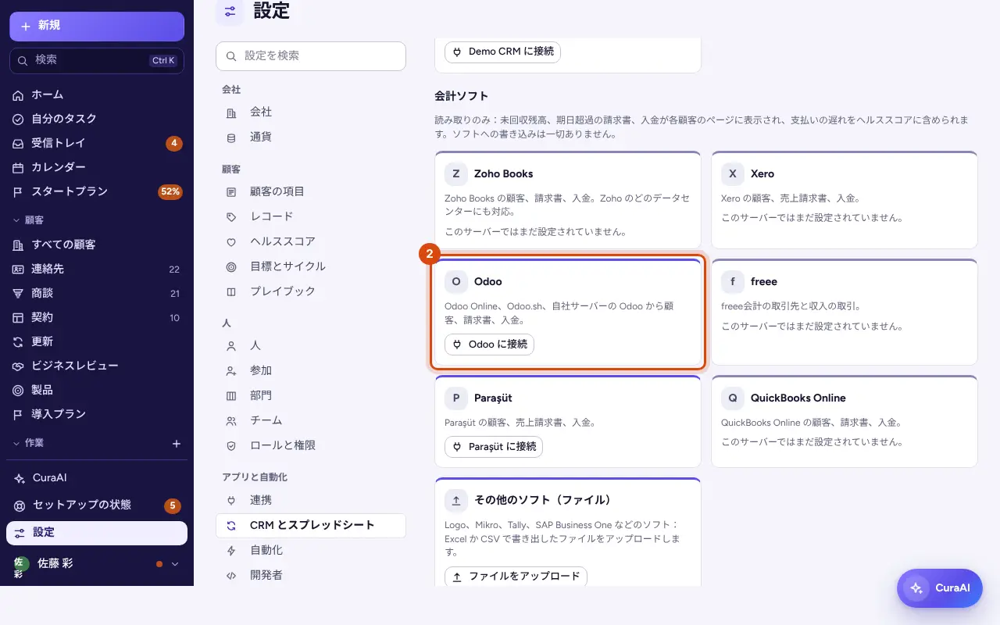

# 会計ソフト

会計ソフトを連携すると、各顧客のページにその顧客の未払いが表示されます。未回収残高、期日超過の金額とその日数、最後の入金、請求書です。支払いの遅れをヘルススコアに含めることもできます。Curahold は読むだけで、ソフトへの書き込みは一切ありません。

## 対応するソフト

| ソフト | 連携方法 | ページ |
| --- | --- | --- |
| Zoho Books | Zoho でログイン | [Zoho Books](/docs/ja/accounting-zohobooks/) |
| Xero | Xero でログイン | [Xero](/docs/ja/accounting-xero/) |
| Odoo | アドレス、ログイン名、API キー | [Odoo](/docs/ja/accounting-odoo/) |
| freee | freee でログイン | [freee](/docs/ja/accounting-freee/) |
| Paraşüt | 会社番号、API クライアント、ユーザー | [Paraşüt](/docs/ja/accounting-parasut/) |
| QuickBooks Online | Intuit でログイン | [QuickBooks Online](/docs/ja/accounting-quickbooks/) |
| その他（Logo、Mikro、Tally、SAP Business One など） | Excel または CSV ファイル | [ファイル](/docs/ja/accounting-file/) |

## ソフトをつなぐ {#connect}

接続を管理する権限が必要です（管理者にあります）。

1. **設定 → CRM とスプレッドシート** を開き、**会計ソフト** までスクロールします。使っているソフトのタイルで **… に接続** をクリックするか、**その他のソフト（ファイル）** で **ファイルをアップロード** をクリックし、上の表にあるそのソフトのページに沿って進めます。
   

## 顧客の照合

会計ソフトの各顧客を Curahold の顧客 1 件と照合します。まず税番号、次にウェブアドレスかメールのドメイン、最後に名前です（Ltd.、A.Ş.、株式会社などの会社の種類は無視します）。ちょうど 1 件が当てはまれば照合し、0 件または複数なら連携の**照合**タブで待ちます。そこで顧客を選ぶか、除外できます。手動の照合は残ります。

## 数字を見られる人

金額は**財務の数字を見る**権限があるロールに表示されます（最初は管理者とマネージャー。設定 → ロールで変更できます）。顧客を見られるほかの人には、ヘルススコアの中で支払いが何日遅れているかだけが見え、金額は見えません。

**財務**部門の人は、ロールにかかわらず金額を見られます。設定 → 部門の**顧客ページで財務を表示できる人**で選んだ部門も同じです。財務部門をオフにすると、これはなくなります。

## ヘルススコアに含める支払いの遅れ

最初の読み込みを始めるときに**支払いの遅れをヘルススコアに含める**を選べます。**期日どおりの支払い**のシグナルは、遅れがなければ満点、最も古い未払いの請求書が 60 日遅れると 0 点です。どちらの数字も 設定 → ヘルススコア で変えられます。ソフトと照合されていない顧客は数えません。

## 連携の状態

会計ソフトの連携は 設定 → 連携 にほかの連携と並んで表示されます。正常、問題あり、一時停止のいずれかと、最後に正常に動いた時刻です。
