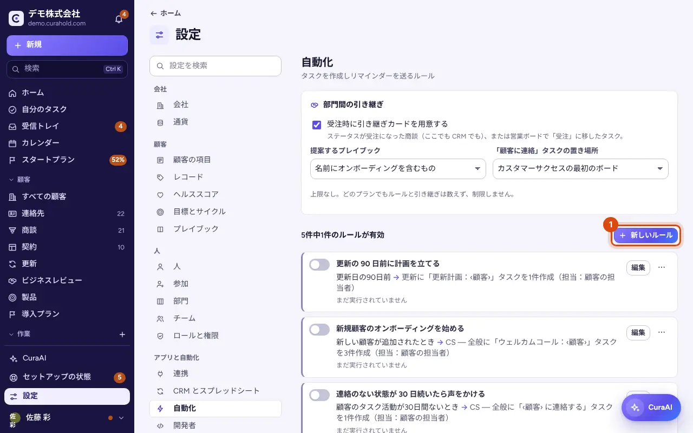
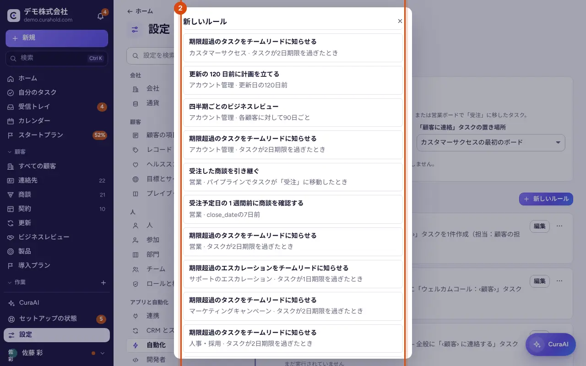
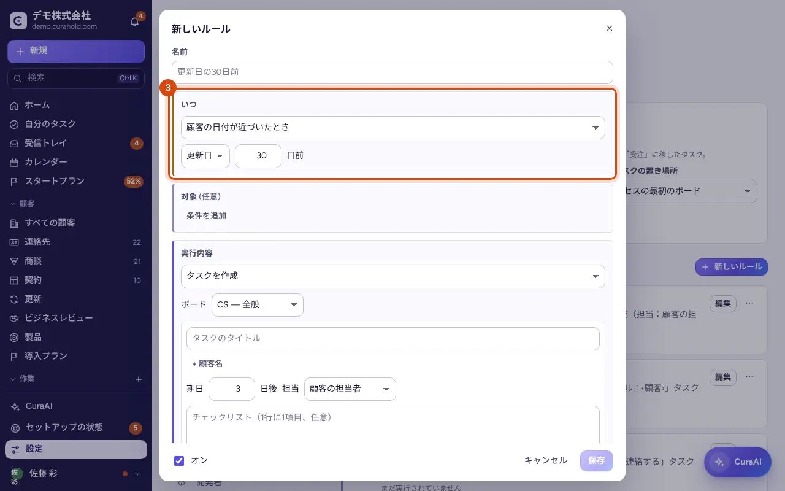
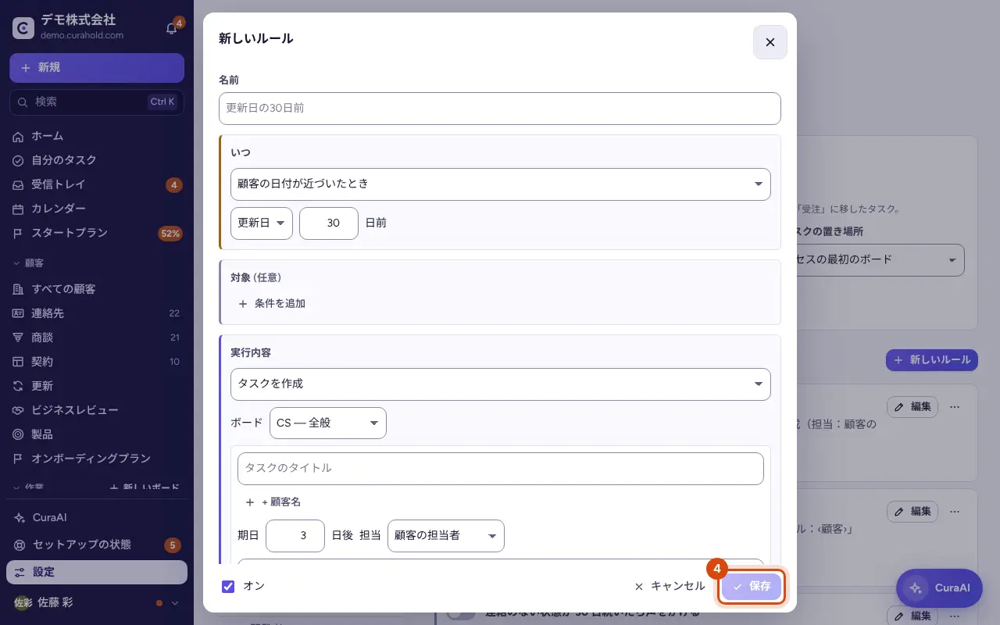

# 自動化

ルールが決まった作業を代わりにこなします：90 日前の更新プラン、新しい顧客へのウェルカムコール、遅れたタスクのリマインダー、受注時の引き継ぎカード。どのプランでも数えられず、上限もありません。

## ルールを作る {#new-rule}

自動化を管理する権限が必要です（管理者にあります）。

1. **設定 → 自動化** を開き、**新しいルール** をクリックします。
   
2. 合う既製のルールを選ぶか、**ゼロから始める** を選びます。
   
3. **いつ** で、ルールを始めるきっかけと詳細（どの日付、何日、どのボード）を選びます。一部の顧客やタスクに絞るには **条件を追加** をクリックします。**実行内容** で何をするかを選びます。下の「本日は…件が対象です」で、今どれに作用するかがわかります。まだ何も変わりません。
   
4. **名前** を付け、**オン** にチェックを入れたまま **保存** をクリックします。
   

## ルールを始めるきっかけ {#when}

顧客の近づく日付（更新、契約終了）、顧客ごとに一定日数おき、静かになった顧客、新しい顧客、遅れたタスク、列に移ったタスク、追加または完了したタスク、ボードのフォームからの依頼、ステージに達したレコード、起票されたサポートチケット。

## ルールにできること {#then}

タスクを開く（チェックリスト付き、顧客の担当者や誰にでも）、リマインダーを送る、割り当てる、移動する、項目を設定する、コメントを書く、Webhook に送る、引き継ぎカードを準備する。

## 実行と停止 {#running}

各ルールには直近 30 日の実行回数が表示されます。**今すぐ実行** は、スケジュールされたルールを次の正時を待たずにすぐ実行します。それでも 1 つの機会につき 1 回だけ作用します。一時停止するにはルールをオフにします。ルールを削除しても、開いたタスクは残り、ルールは 30 日間ゴミ箱に残ります。

同じページ上部の引き継ぎ設定は [引き継ぎ、要望、顧客へのフィードバック](/docs/ja/handover-and-requests/) にあります。
