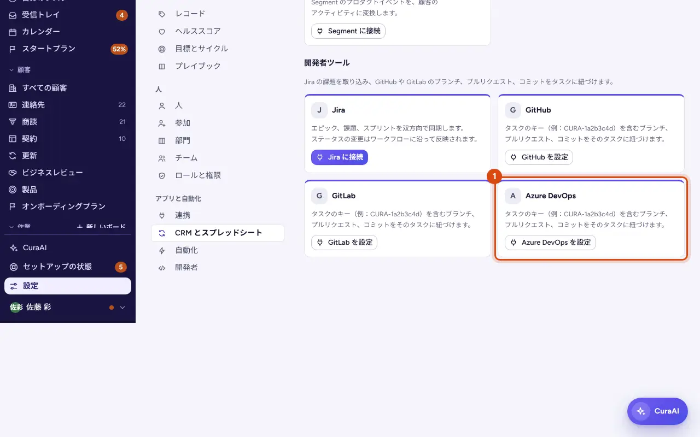
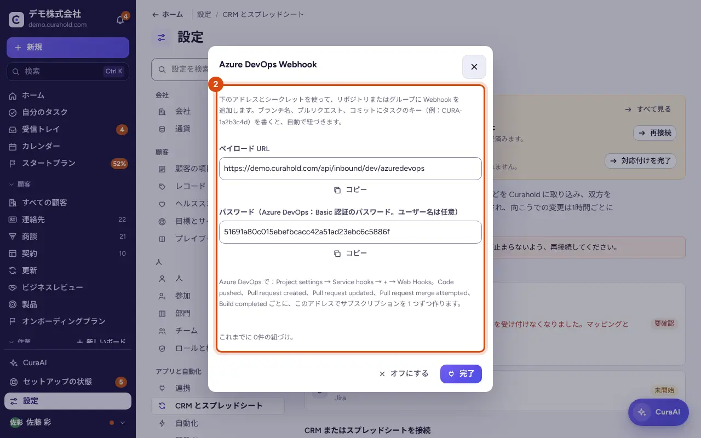

# Azure DevOps

タスクに触れている Azure Repos のブランチ、プルリクエスト、コミットがそのタスクに紐づき、状態（オープン、マージ済み、クローズ）とビルド結果も表示されます。GitHub や GitLab と同じく、ブランチ名、プルリクエストのタイトル、コミットメッセージにタスクのキー（例：`CURA-1a2b3c4d`）を書きます。

## Curahold で {#connect}

1. **設定 → CRM とスプレッドシート** を開き、**開発者ツール** で **Azure DevOps を設定** をクリックします。
   
2. **オンにする** をクリックし、表示された **アドレス** と **パスワード** をコピーします。
   

## Azure DevOps で

次のイベントごとに 1 回ずつ行います（Code pushed、Pull request created、Pull request updated、Pull request merge attempted、Build completed）：

1. プロジェクトを開き → **Project settings** → **Service hooks** → **+**（Create subscription）。
2. **Web Hooks** を選び、**Next** をクリックします。
3. イベントを選び、フィルターはそのままで **Next** をクリックします。
4. アドレスを **URL** に貼り付けます。**Username** は任意（例：`azure`）、パスワードを **Password** に貼り付けます。
5. **Resource details to send** は **All** のまま、**Test**、続いて **Finish** をクリックします。

## 制限とタイミング

Azure DevOps が送るとすぐに紐づきます。Azure DevOps は HTTPS でのみ送信し、署名はしません。パスワードが証明になるので、パスワードとして管理してください。

## うまくいかないとき

Azure DevOps は各送信の応答を **Service hooks → History** に表示します。401 はパスワードの誤りです（Webhook をもう一度オンにして新しいパスワードを発行し、すべてのサブスクリプションを更新します）。**オフにする** と新しい紐づけは止まり、既存の紐づけはタスクに残ります。

## 関連項目

- [連携と CRM](/docs/ja/connections/)
- [タスクとボード](/docs/ja/tasks/)
