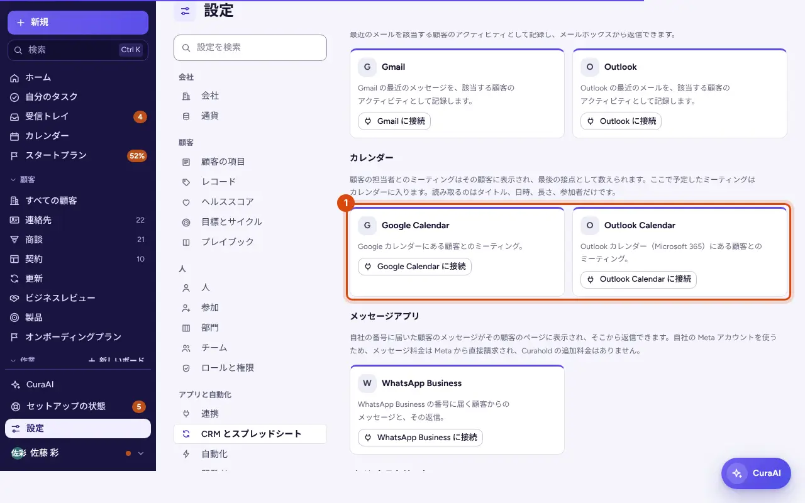

# Google カレンダーと Outlook カレンダー

カレンダーを接続すると、顧客の担当者と行ったミーティングが、長さ付きのミーティングとしてその顧客のタイムラインに表示され、最後の接点として数えられます。顧客のタイムラインから直接カレンダーにミーティングを予定することもでき、招待はカレンダーから届きます。

## 読み取るもの、読み取らないもの

メインのカレンダーにある、すでに行われたミーティングだけを読み取ります：タイトル、日時、長さ、参加者。説明、場所、会議リンクは読み取りません。非公開の予定、終日の予定、社外の参加者がいないミーティングは対象外です。ミーティングは、連絡先が参加者に含まれる顧客、または Web アドレスが参加者のドメインと一致する顧客に記録されます。

## Curahold で {#connect}

1. **設定 → CRM とスプレッドシート** を開き、**カレンダー** で **Google Calendar に接続** または **Outlook Calendar に接続** をクリックします。
   

Google または Microsoft のページが開きます。仕事用のアカウントを選び、**許可**（Google）または **承諾**（Microsoft）をクリックします。Curahold に戻ったら **開始** をクリックします。直近 90 日を読み取り、その後は 1 時間ごとです。

## ミーティングを予定する

顧客のページで **タイムライン** を開き、**Google Calendar でミーティングを予定**（または Outlook）をクリックします。タイトル、日時、長さ、参加者のメールアドレスを入力して **… に追加** をクリックします。ミーティングは実施後にタイムラインに表示されます。

## 制限とタイミング

1 時間ごとに読み取ります。直近 1 週間で名前が変わったりキャンセルされたミーティングは更新または削除されます。Google と Microsoft は毎分のリクエスト数を制限しています。「混雑」の応答があると読み取りは一時停止し、次回続きから再開します。

## うまくいかないとき

サインインの期限切れは自動で更新されます。アクセスが取り消された場合（パスワード変更、管理者の判断など）、連携は **要確認** になります。**再接続** をクリックし、同じアカウントでサインインしてください。**削除** するとサインイン情報は消えますが、タイムラインのミーティングは残ります。

## 関連項目

- [タイムラインとヘルススコア](/docs/ja/timeline-and-health/)
- [連携と CRM](/docs/ja/connections/)
