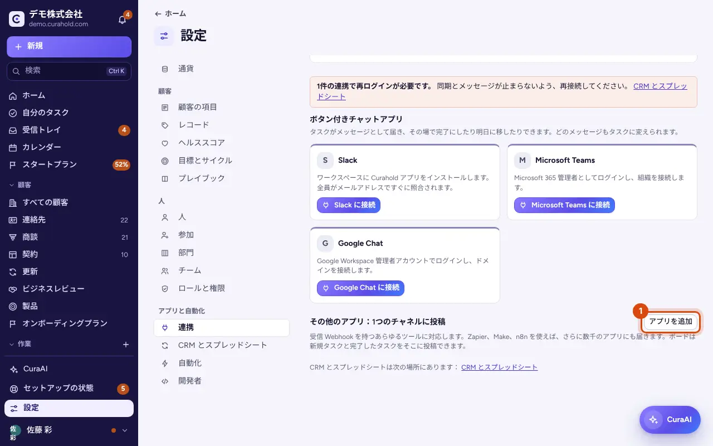
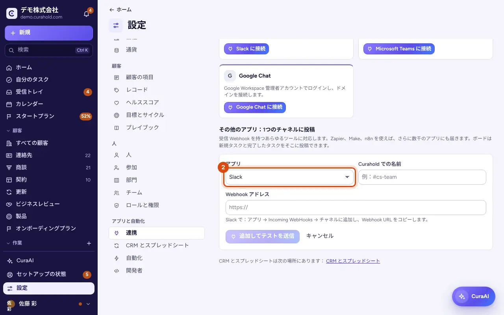

# Lark・Feishu・Telegram の通知

ボードは新着（新しいタスク、完了したタスク）をグループチャットに投稿できます。Lark と Feishu はグループのカスタムボットを、Telegram は 2 分で作れるボットを使います。どちらも一方向で、投稿するだけで返信は受け取りません。

## Curahold で {#connect}

1. **設定 → 連携** を開き、**アプリを追加** をクリックします。
   
2. **Lark · Feishu** または **Telegram** を選び、下の手順で得た値を貼り付けて **追加してテストを送信** をクリックします。グループにテストメッセージが届きます。
   

次にボードを開き、ボードの設定の通知で、投稿したい新着にこの連携を選びます。

## Lark · Feishu

1. グループで **設定 → ボット → ボットを追加 → カスタムボット** を開き、名前を付けて **追加** をクリックします。
2. **Webhook アドレス** をコピーします。次のような形です：

```text
https://open.larksuite.com/open-apis/bot/v2/hook/0f3c2a9e-7d1b-4c55-9a7e-2b8f6c1d3e4f
```

任意ですがおすすめ：**セキュリティ設定** で **署名の検証** をオンにし、シークレットを Curahold の **署名キー** にコピーします。キーワードフィルターは使わないでください。メッセージが落ちます。

## Telegram

1. Telegram で **@BotFather** にメッセージを送り、`/newbot` を送信して 2 つの質問に答え、表示された **トークン** をコピーします。
2. ボットをグループに追加します（チャンネルの場合は管理者として）。
3. グループでメッセージを 1 件送ります。Curahold がそこからグループを見つけるので、ID は不要です。
4. トークンを Curahold の **ボットのトークン** に貼り付けます。公開チャンネルなら `@名前` を入力しても構いません。

## 制限とタイミング

Lark はボットごとに毎分約 100 件、Telegram はグループごとに毎分約 20 件まで受け付けます。「混雑」の応答は再送され、失われません。Telegram のメッセージはプレーンテキストで最大 4,096 文字です。

## うまくいかないとき

署名キーの誤り、削除されたボット、取り消されたトークンがあると、設定 → 連携 で連携が **要確認** になり、テストでもそう表示されます。相手側で直してから再度 **テストを送信** をクリックしてください。テストが成功すれば問題は消えます。**削除** で投稿は止まります。ボットはグループ側で外すまで残ります。

## 関連項目

- [連携と CRM](/docs/ja/connections/)
- [通知](/docs/ja/notifications/)
