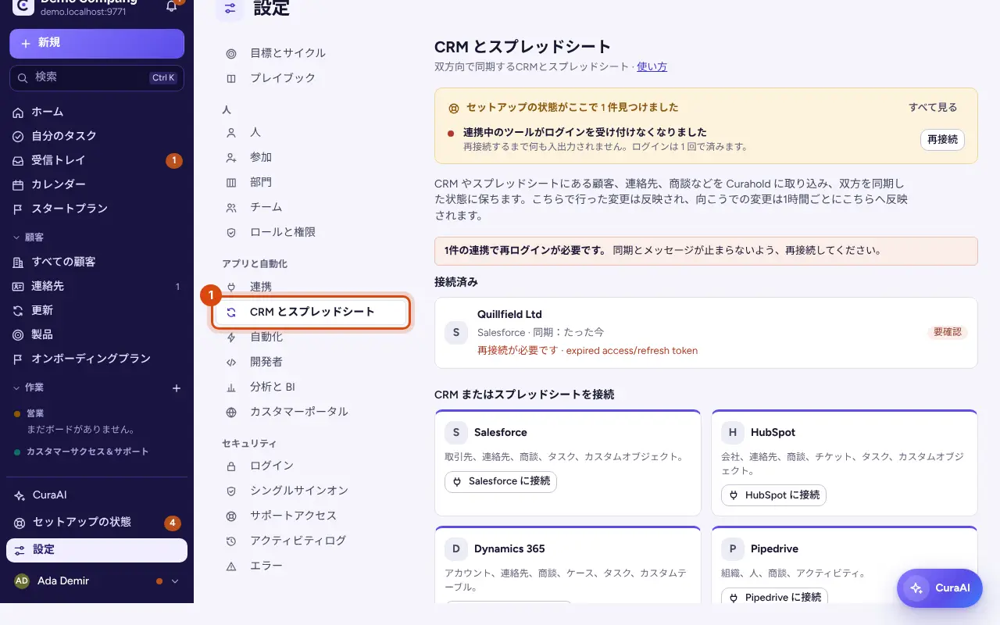
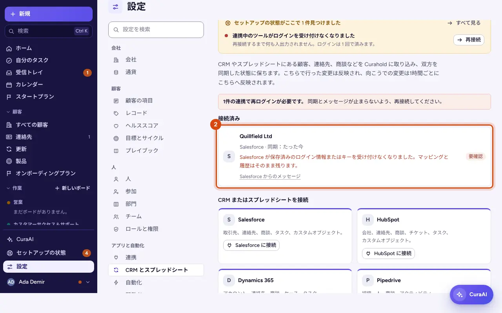
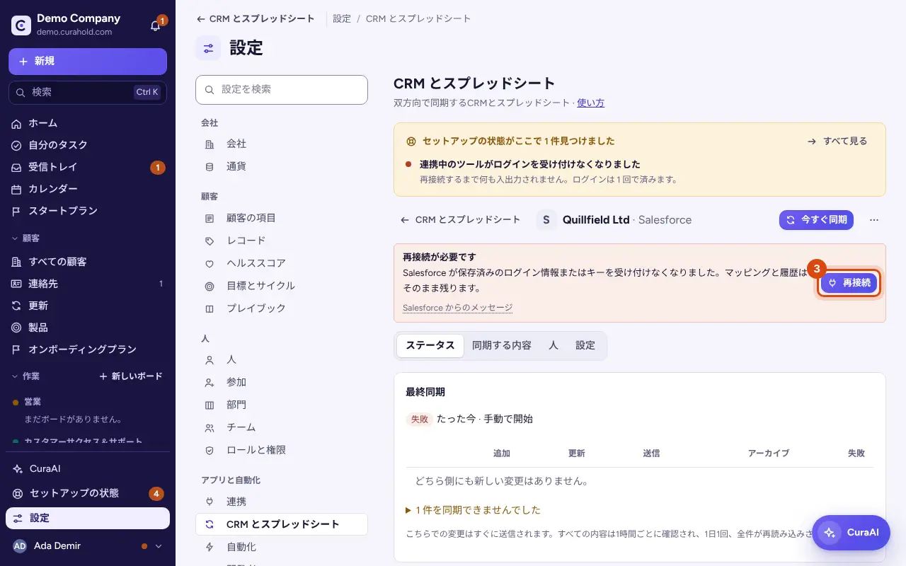
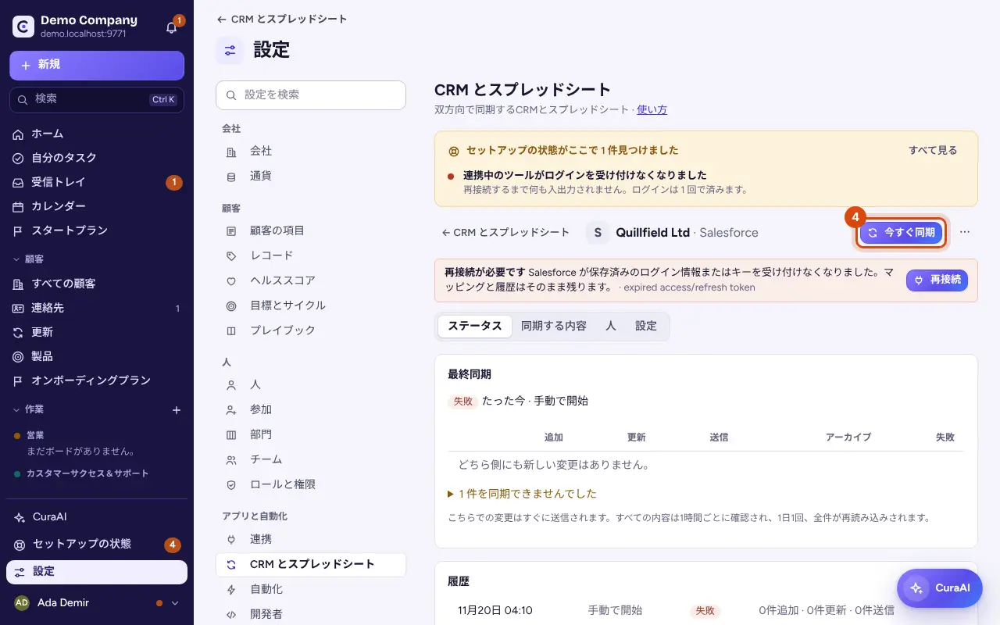

# 連携と CRM

Curahold は、チームがすでに使っているツールと並んで動きます。連携は 設定 → 連携 と 設定 → データソース で管理します。

## チャットアプリ

Slack、Microsoft Teams、Google Chat を接続すると、通知はダイレクトメッセージで届き、メッセージから直接タスクを完了したり再開したりできます。

## CRM とスプレッドシート

顧客、連絡先、商談を、Salesforce、HubSpot、Microsoft Dynamics、Pipedrive、Zoho、Bitrix24、Freshsales、Zendesk Sell、Google スプレッドシート、Excel と同期します。**設定 → CRM とスプレッドシート** を開いて **接続** を選びます。

1. **ログインする。** CRM 自身のログイン画面に移り、Curahold に読み書きを許可する内容を承認します。Curahold にパスワードを入力することはありません。（Bitrix24、Freshsales、Zendesk Sell はキーを使います。下記をご覧ください。）
2. **取り込むものを選ぶ。** 必要なオブジェクトにチェックを入れ、それぞれが Curahold で何にあたるかを決めます：顧客、連絡先、商談、独自のレコードの種類、またはボードのタスク。
3. **項目を対応付ける。** Curahold が項目ごとに対応を提案します。どれでも変更でき、項目ごとに「取り込むだけ」か「両側で同じに保つ」かを選べます。
4. **確認して始める。** 何かが変わる前に、プレビューで追加と更新の件数がわかります。

その後、同期は 1 時間ごとに自動で実行され、Curahold での変更はすぐに CRM に書き込まれます。同期できなかったものは理由とともに一覧になり、再試行できます。同じものが両側で変わった場合は新しい変更が優先されます。常に CRM、または常に Curahold を優先させることもできます（接続の設定タブ）。

接続には、連携を管理する権限が必要です。メンバーはメールで照合されるので、CRM での各顧客の担当者が Curahold でも担当者になります。

## Salesforce

取り込むもの：取引先、取引先責任者、商談、ToDo、カスタムオブジェクト。テスト用の組織を使うには、接続前に **Sandbox** にチェックします。

**最初に一度、Salesforce の管理者が Curahold をインストールします。** Salesforce は組織にインストールされていないアプリをブロックするため、最初のログインの前に管理者がインストールページ（**接続** を選ぶと表示されるリンク）を開いて承認します。パッケージはコード、項目、オブジェクトを一切追加せず、組織の人が Curahold を承認できるようにするだけです。いつでも 設定 → インストール済みパッケージ から削除でき、そうすると Curahold はすぐにアクセスを失います。Salesforce が「アプリが許可されていない」と返す場合は、この手順がまだです。接続するユーザーには Salesforce の API アクセスが必要です（Enterprise 以上に含まれ、Professional ではアドオン）。

## HubSpot

取り込むもの：会社、コンタクト、取引、チケット、タスク、カスタムオブジェクト。HubSpot はどのアカウントを接続するかを尋ね、Curahold が読み書きできる内容を示します。コンタクトと取引は、お使いの HubSpot のプランにある場合だけ求められます。

## Microsoft Dynamics 365

取り込むもの：取引先企業、取引先担当者、営業案件、サポート案件、タスク、カスタムテーブル。ログインの前に組織のアドレス（`https://yourcompany.crm4.dynamics.com` のような形）を入力します。Microsoft に「管理者の承認が必要」と表示されたら、Microsoft 365 の管理者が組織として一度 Curahold を承認する必要があります。

## Pipedrive

取り込むもの：組織、人物、取引、アクティビティ。カスタム項目も標準項目と同じように対応付けられます。

## Zoho CRM

取り込むもの：取引先、連絡先、商談、サポート案件、タスク、カスタムタブ。Curahold はお使いの Zoho のデータセンター（米国、EU、インド、オーストラリアなど）を自動で見つけます。

## Bitrix24、Freshsales、Zendesk Sell

この 3 つは、CRM 側で作るキーで接続するので、ログイン画面も誰かの承認もありません。Curahold は貼り付けた瞬間にキーを確認し、暗号化して保存し、二度と表示しません。接続を外すとキーも消えます。その後は、ほかの CRM と同じく、取り込むものを選び、項目を対応付け、変更は双方向に流れます。

| CRM | 貼り付けるもの | 見つけ方 | 取り込むもの |
| --- | --- | --- | --- |
| Bitrix24 | 受信 Webhook のアドレス | Developer resources → Other → Inbound webhook。CRM の権限と、担当者を照合するための Users を付与 | 会社、連絡先、取引 |
| Freshsales | アドレスと API キー | プロフィール画像 → Settings → API settings | 取引先、連絡先、取引 |
| Zendesk Sell | アクセストークン | Settings → Integrations → OAuth → Access tokens | 会社、人物、取引 |

知っておくと便利なこと：

- **キーは作った人として動きます。** Curahold には、その人が CRM で見られるものが見えます。ここで扱いたい顧客をすべて見られるアカウントでキーを作ってください。
- **Bitrix24 のメール、電話、ウェブサイト** はリストになっています。Curahold は最初のひとつを読み、新しい連絡先や会社を作るときに入力しますが、その後リストを書き換えることはありません。
- **Freshsales は「All accounts」「All contacts」「All deals」のビューから読みます。** どれかの名前が変わっていたり削除されていたりすると、その一覧は読まれず、一部だけを取り込む代わりに実行結果でそう伝えます。
- **Zendesk Sell の取引には会社が必要です。** Curahold で作った商談は、その顧客の会社の下に作られます。
- これらのコネクタは新しいものです。思ったとおりに取り込まれない場合は、製品内の「ヘルプ」からお知らせください。

## Google スプレッドシートと Excel

スプレッドシートは、データを取り込むもっとも簡単な方法で、書き出しのできるどんなツールにも使えます。Google スプレッドシート、または OneDrive や SharePoint にある Excel ファイルをタブごとに接続し、各タブを顧客、連絡先、または独自のレコードの種類にできます。行を識別する列を選んでおくと、変わった行は 2 件目を追加せずに同じ顧客を更新します。 スプレッドシートには行ごとの更新時刻がないため、同じセルが両側で変更された場合は Curahold での変更が優先されます。スプレッドシート側を優先したい場合は、接続の「設定」タブで選んでください。

## サポートツール

Zendesk、Freshdesk、Intercom、Jira Service Management は、アドレスと API キーで接続し、チケットは正しい顧客の下に入ります。Salesforce と Dynamics のサポート案件も、サポートチケットとして対応付けられます。詳しくは [サポートチケット](/docs/ja/support-tickets/)。

## 同期が止まったとき {#sync-stops}

接続の**ステータス**タブに、何が起きたかがわかりやすい言葉で表示され、その下にサービス自身のメッセージが出ます。

| 表示 | すること |
| --- | --- |
| サービスから処理を遅くするよう求められた | 何もしなくて大丈夫です。進み具合は保たれ、次の 1 時間ごとの実行で続きます。 |
| Curahold のログインまたはキーを受け付けなくなった | 下の手順で再接続します。 |
| アカウントに読み取りや変更の権限がない | そのツールの管理者にアクセス権の付与を頼み、**今すぐ同期**を押します。 |
| 接続できなかった | 何もしなくて大丈夫です。次の 1 時間ごとの実行で再試行します。 |

再接続の手順:

1. **設定 → CRM とスプレッドシート**を開きます。
   
2. **要確認**と表示された接続をクリックします。
   
3. ページ上部の**再接続**をクリックします。
   
   以前と同じアカウントでログインし（または新しいキーを貼り付け）、許可します。
4. **今すぐ同期**をクリックします。対応付けたフィールドはそのまま残ります。
   

接続を削除するには、接続を開いて **⋯** をクリックし、**削除**を選びます。同期は止まります。取り込んだ顧客・連絡先・商談は Curahold に残り、相手のツールでは何も削除されません。会計ソフトの場合は、そこから読み取った残高・請求書・入金が顧客ページから削除されます。

## 自社のツール

ほかのシステムとつなぐには、[API キー](/docs/ja/api-keys/)、[Webhook](/docs/ja/webhooks/)、[AI アシスタント](/docs/ja/ai-assistants/) をご覧ください。
