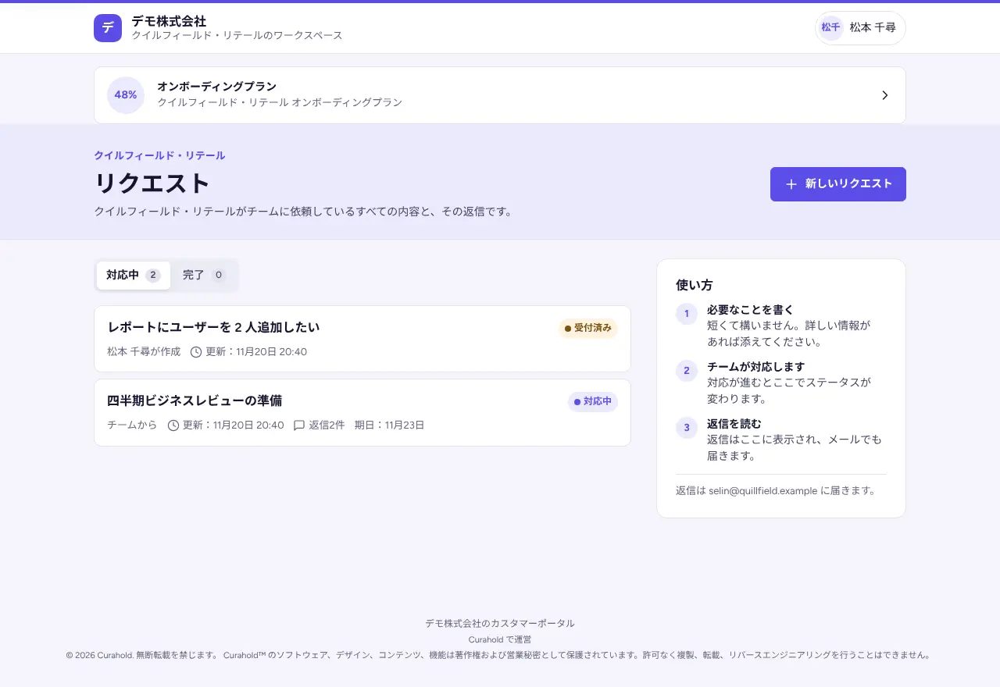

# カスタマーポータル

カスタマーポータルは、選んだボードを顧客の担当者に公開します。顧客は専用のアドレス（例：`acme.curahold-portal.com`）でログインし、自社の未完了の件とその状況を確認し、新しいリクエストを出し、返信できます。

## 顧客に見えるもの、決して見えないもの

| 見える | 決して見えない |
|---|---|
| 自社の、**共有された** タスク | ほかの顧客のタスク |
| 件名、説明、状態（列に付けた表示名で） | 社内メモと社内コメント |
| **顧客への返信** として書かれたコメント | あなたのチーム、ロール、ほかのメンバー |
| ボードで許可した詳細（期日、優先度、対応している人） | 顧客の項目、商談、ヘルススコア、レコード |
| | ほかのボード、ほかの会社、Curahold 本体 |

ポータルは別のドメインで動いており、アプリのセッション、Cookie、API にはまったく届きません。ポータルのリクエストに使われるデータベースのロールはどのテーブルも読めず、ポータル用の関数を呼べるだけです。その関数は、ログインしている人の自社のデータだけを返します。

## オンにする（管理者）

1. **設定 → カスタマーポータル → カスタマーポータルをオンにする。** 顧客がログインするアドレスがそこに表示されます。
2. 公開したい **ボードの設定** → **カスタマーポータル** で：
   - **このボードを顧客に公開する**
   - **新しいリクエストの行き先：** 列を選びます。新しいリクエストは顧客の担当者に割り当てられます。
   - **列ごとに顧客に見せる名前：** たとえば「法務の確認待ち」の代わりに「確認中」。空欄なら列の名前がそのまま表示されます。
   - **顧客に見せる詳細：** 期日、優先度、対応している人。

   もっと早く（まだボードを公開していない場合）: **設定 → 顧客ポータル** にボードが一覧表示されます。リクエストを受けるボードで **… を顧客に公開** をクリックします（最初の列に届きます）。

非公開のボードは公開できません。スイッチをオフにすると、全員に対してポータルがただちに閉じます。

## 招待する

**設定 → カスタマーポータル → ログインできる人**、または顧客のページの **カスタマーポータル** で、名前とメールを入力して **招待** します。招待できるのは顧客の担当者と管理者です。

- 招待は 7 日以内に 1 回だけ使えます。その後は、会社が許可した方法（下記）でログインします。
- 自社のメンバーのアドレスは招待できません。ポータルは顧客のためのものです。
- **オフにする** と、その人のアクセスと開いているセッションがすぐに終わります。

## ログインの方法

**設定 → カスタマーポータル → 顧客のログイン方法** で、顧客に合った方法を選びます：

| 方法 | しくみ |
|---|---|
| **メールのコードとリンク** | 6 桁のコードとリンクが入ったメールが 1 通届き、どちらも 30 分以内に 1 回だけ使えます。コードがあれば、メールをスマートフォンで読んでパソコンでログインできます。 |
| **Google** | 会社の Google アカウント。会社がアカウントを止めると、ポータルにも入れなくなります。 |
| **Microsoft** | Microsoft 365 のアカウント。最初の Microsoft でのログインはメールのコードで一度確認し、その後はアカウントそのもので識別されます。 |
| **パスキー** | 指紋、顔、または端末の PIN。もっとも安全な方法で、最初のログインのあとに **アカウント** で追加します。パスキーはそのポータルのアドレスでしか使えず、似せたサイトでは決して使えません。 |
| **パスワード** | 希望する顧客向け（既定はオフ）。10 文字以上で、5 回間違えると 15 分間ロックされ、「パスワードをお忘れですか？」からメールで再設定できます。 |

- **ログインを保つ期間：** 1、7、30（既定）、90 日。
- **ログインのお知らせ：** Google、Microsoft、パスキー、パスワードでログインすると、「新しいログイン」のメールが届きます（オフにできます）。
- 方法をオフにするとその方法で開いたセッションは終わり、期間を短くすると古いセッションが終わります。ログイン方法は少なくともひとつ（メール、Google、Microsoft、パスワード）をオンにしておく必要があります。
- ログインのフォームは、アドレスにアクセス権があるかどうかを決して伝えず、ひとつのアドレスに送られるメールは 1 時間に最大 5 通です。
- **アカウント** では、パスキーの追加、パスワードの設定、Google／Microsoft の連携解除、すべての端末からのログアウトができます。

## タスクの共有と返信

- 顧客が出したリクエストは自動で共有されます。
- チームが作ったタスクを見せるには、タスクパネルで **顧客と共有** にチェックします（タスクに顧客があり、公開しているボードにあることが必要です）。
- 共有したタスクにコメントするときは、**社内メモ**（既定）か **顧客への返信** を選びます。顧客への返信にはオレンジの線と「顧客に表示」の印が付き、顧客にメールでも届きます。
- 顧客が書いたものには「顧客」のラベルが付き、タスクの担当者に通知されます。
- タスクの顧客が変わると共有は自動でオフになり、ある顧客とのやり取りが別の顧客に移ることはありません。

## 顧客からのファイル

顧客がファイルを送れるのは、共有された依頼・チケットと、自分のスタートプランのステップだけです。それ以外の場所には送れません。

- 文書・画像・表・CSV・PDF・ZIP、1ファイル25MBまで。各ファイルは種類と先頭のバイトで確認され、常にダウンロードとして開きます。
- 顧客が合計で送れる量は、設定 → **カスタマーポータル** → **顧客からのファイル**で決めます（変更しなければ2,048MB）。いっぱいになると、別の方法で送るよう案内されます。
- 顧客が送ったファイルは、その顧客のタイムラインに表示されます。

## 上限

ひとりあたり 1 日に 30 件までリクエストを出し、200 件まで返信できます。
