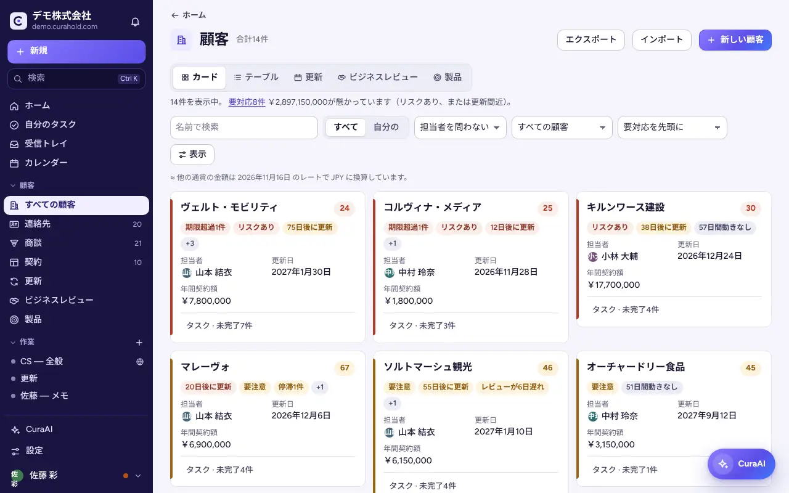
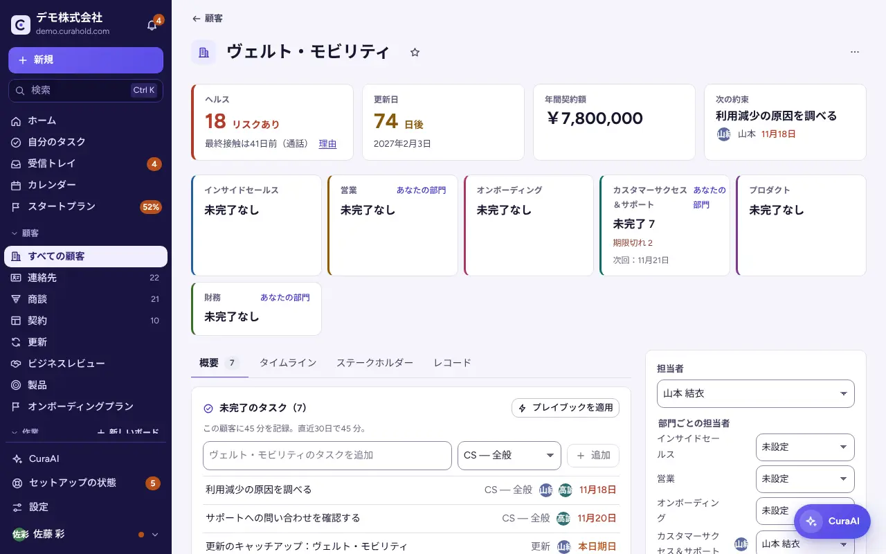

# 顧客、項目、レコード

Curahold の中心は顧客です。顧客には担当者、任意のチーム、そして自社で決めた項目があります。

## 顧客のページ

顧客のページの上部には、ひと目で読める帯があります：理由と **理由** ボタン付きの **ヘルス**、更新日と残りの日数、年間契約額、そして **次の約束**（顧客に約束した直近のステップと、その担当者）。帯の下にはタブがあります：**概要**（未完了のタスクと今後のミーティング）、**タイムライン**、**ステークホルダー**、**レコード**、**詳細**。開いているタブはアドレスに残るので、再読み込みや送ったリンクでも同じタブに戻ります。

## 項目

設定 → 顧客の項目 で項目を追加します：テキスト、数値、金額、日付、選択肢、メール、リンク。選択肢には色を付けられるので、ヘルスのような項目は一覧やカードでその色で表示されます。

「顧客」という呼び方も変えられます。「アカウント」「ブランド」「パートナー」など、チームでの呼び方が画面のどこにでも表示されます。

## レコード：連絡先、商談など

顧客の下にレコードを持てます：

- **連絡先（ステークホルダー）：** 役職、意思決定での役割（決裁者、予算承認者、影響者、評価者、利用者）、こちらへの姿勢（推進者、支持者、中立、懐疑的、反対者）。
- **商談：** 金額、クローズ予定日、ステージ、状態。
- **自社独自のレコード：** たとえば「プロジェクト」や「契約」。

レコードから顧客の項目を作れます：「未決の商談額」「推進者」「反対者」など。レコードが変わると項目も自動で更新されます。

## ビュー：カード、テーブル、更新、製品

顧客ページ上部のボタンで 4 つのビューを切り替えます。選んだビューはその端末で記憶されます。

- **カード：** 顧客ごとに 1 枚のカードで、見るべきことを示します：期限切れのタスク、リスクありや要注意のヘルス、間近または期限を過ぎた更新、14 日間手つかずのタスク、30 日間連絡なし。重要なものから順に並び、何もなければ「問題なし」。既定では「対応が必要な順」で、名前、ヘルス、金額、更新日、未完了のタスク数でも並べ替えられます。カードに出す項目は **表示** メニューで選びます。
- **テーブル：** 並べ替えのできる一覧で、複数の顧客をまとめて変更できます。
- **更新：** 今後 12 か月の更新を月ごとに、各月の合計と、そのうちリスクありや要注意の額とともに表示します。
- **製品：** どの顧客がどの製品を持っているかを、レコードの種類の選択肢項目（例：「サブスクリプション → 製品」）で表示します。空いたセルの **+** で、その顧客へのクロスセルのタスクが開きます。

上部の一文は、対応が必要な顧客の数とリスクにさらされている金額を示し、「要対応」のリンクで一覧をそれらに絞れます。スマートフォンでは、絞り込みはひとつの **フィルター** 画面にまとまっています。

## インポート

Excel または CSV ファイルをドロップし、列を項目に対応付け、プレビューを確認してインポートします。うまくいかなかったインポートは、30 日以内ならワンクリックで取り消せます。

## エクスポート

顧客とレコードの一覧を、いまの絞り込みのまま Excel または CSV でダウンロードできます。ファイルはブラウザーの中で作られ、見る権限のない項目は含まれません。

## まとめて変更する

一覧で複数の顧客を選び、担当者、チーム、または項目をまとめて変更します。下に出る通知から **元に戻す** ことができます。

## 顧客の削除と復元

削除した顧客は、レコード、タイムライン、ミーティング、ポータルの利用者とともに [ごみ箱](/docs/ja/trash/) に入り、30 日以内なら元に戻せます：削除直後の通知で **元に戻す** を選ぶか、メニューから **ごみ箱** を開いて **元に戻す** を選びます。タスクは顧客なしでボードに残り、顧客が戻るとまたその顧客を指します。削除せずに目につかないようにしたいときは、アーカイブしてください。

## プレイブック

**プレイブック** は、日付付きのタスク一式をワンクリックで顧客に入れる仕組みです：オンボーディング、更新の準備、四半期ビジネスレビューなど。管理者が 設定 → **プレイブック** で一度書いておけば（タスク名、開始から何日後か、誰の担当か）、顧客のページの **プレイブックを適用** で開始日を選んでまとめて追加できます。タスク名の `{account_name}` は顧客名に置き換わります。

## ビジネスレビュー

どの顧客とどのくらいの頻度で話すかを一度決めておきます：設定 → **目標とサイクル** → *ビジネスレビュー*（たとえば 90 日ごと）。顧客ごとに、そのページの **ビジネスレビュー** 項目で別のサイクルを設定でき、「レビューなし」にするとその顧客はサイクルから外れます。

ビジネスレビューとは、各顧客と定期的に行う、成果と計画を振り返るミーティング（QBR）です。**顧客 → ビジネスレビュー** に、時期が来たもの（遅れているもの、30 日以内、それ以降）が並びます。レビューを行ったら、行の（または顧客のページの）**完了** でミーティングのフォームが開き、保存すると顧客の **ミーティング** とタイムラインに「ビジネスレビュー」として記録され、次の日付が自動で進みます。一度もレビューしていない顧客は、追加された日から数えます。遅れているレビューは、顧客のカードにも印で表示されます。

## ミーティング

顧客のページの **ミーティング** には、その顧客とのミーティング、ビジネスレビュー、通話がすべて新しい順に並びます：日付、種類、件名、時間、記録した人、出席者（先方と当方）、メモ、次のステップ。上のボタンで種類を絞れ、次のビジネスレビューの日付は見出しの横にあります。

**ミーティングを記録**（顧客のページ、または **+ 新規 → ミーティング、通話、メモを記録**）では、次のことを入力します：

- 種類（ミーティング、ビジネスレビュー、通話）、件名、日付、時間
- 先方の出席者（顧客の連絡先）と当方の出席者
- メモ：話し合ったことと決まったこと
- 次のステップ：担当者と期日を付けたステップは、選んだボードのこの顧客のタスクになります。

次のステップはミーティングの下に進み具合とともに表示され（完了したものは取り消し線）、クリックするとタスクが開きます。ミーティングは後から編集したり、次のステップを追加したり、削除したりできます。削除したミーティングのタスクは残り、ミーティング自体は 30 日以内なら [ごみ箱](/docs/ja/trash/) から元に戻せます。
