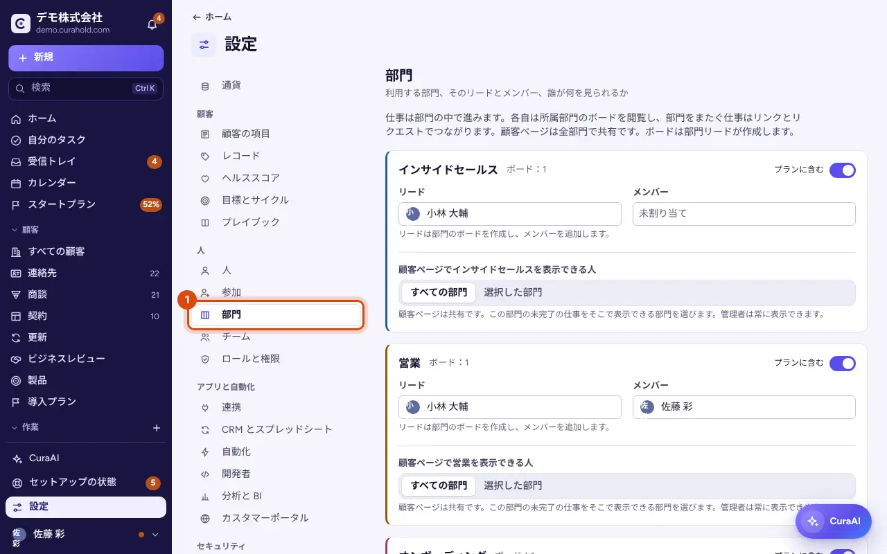
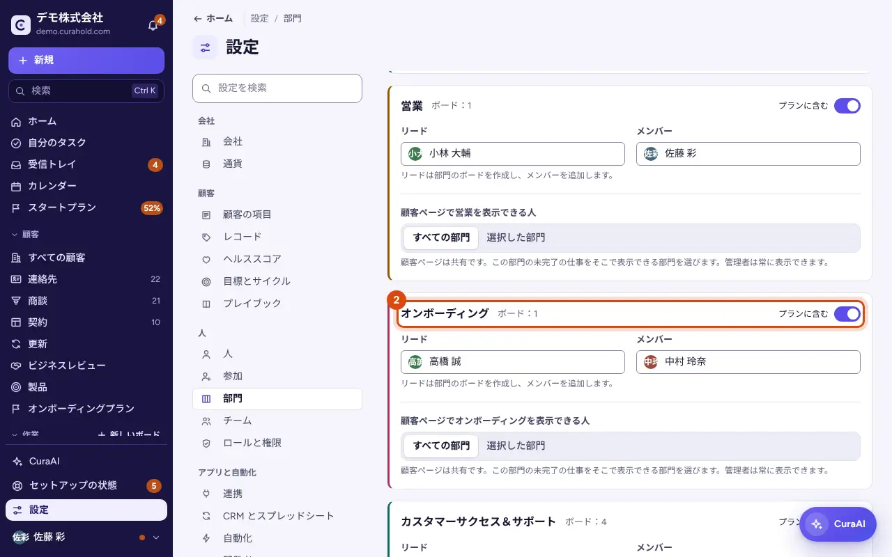
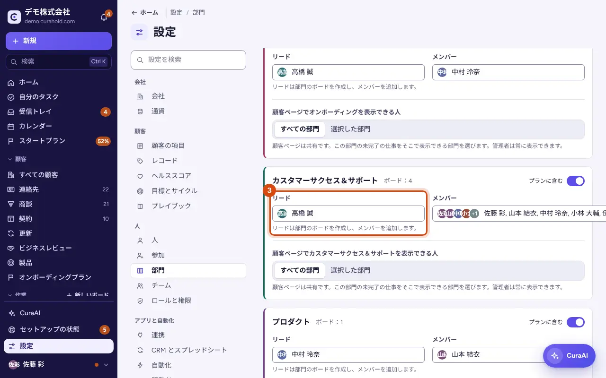
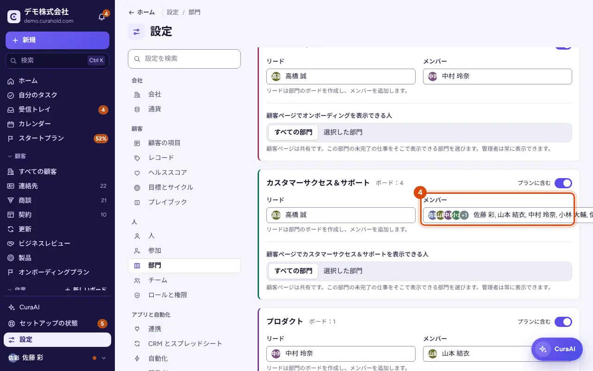
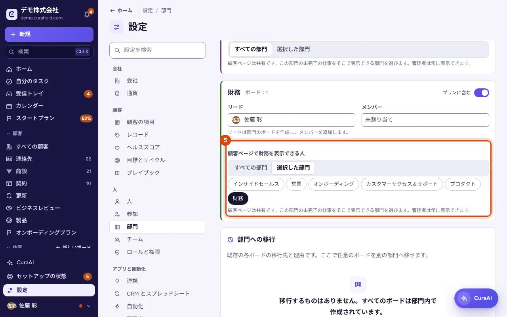
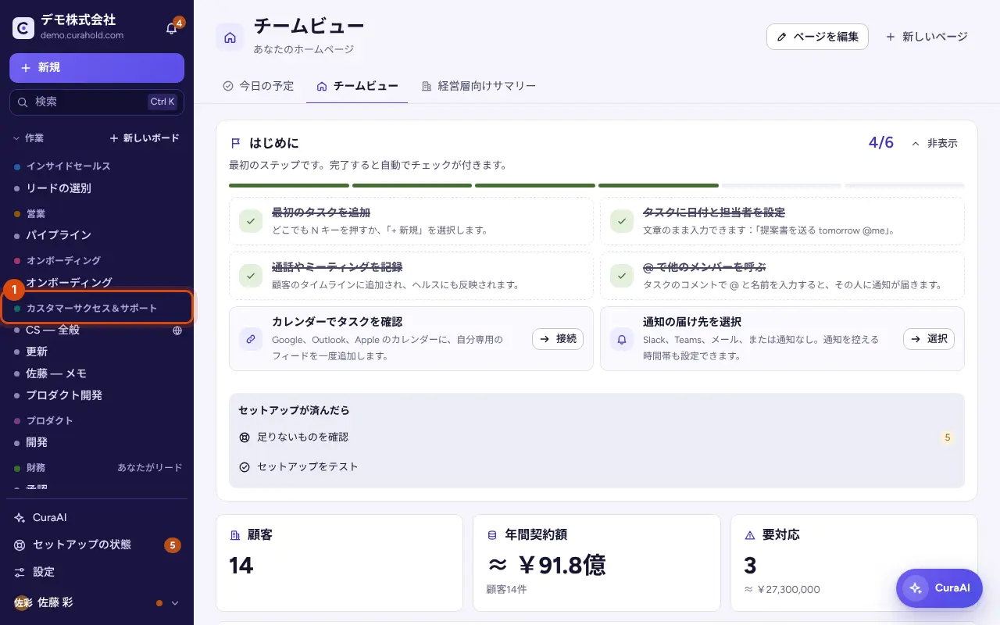
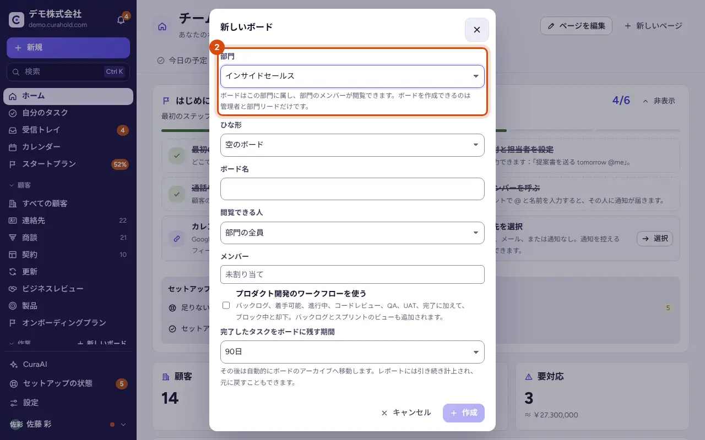
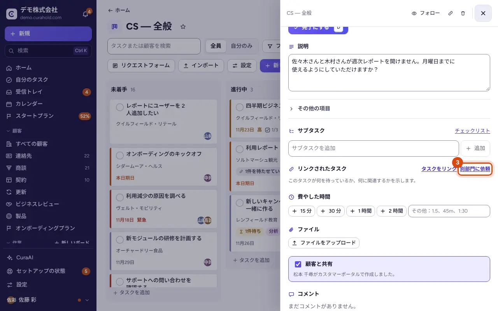
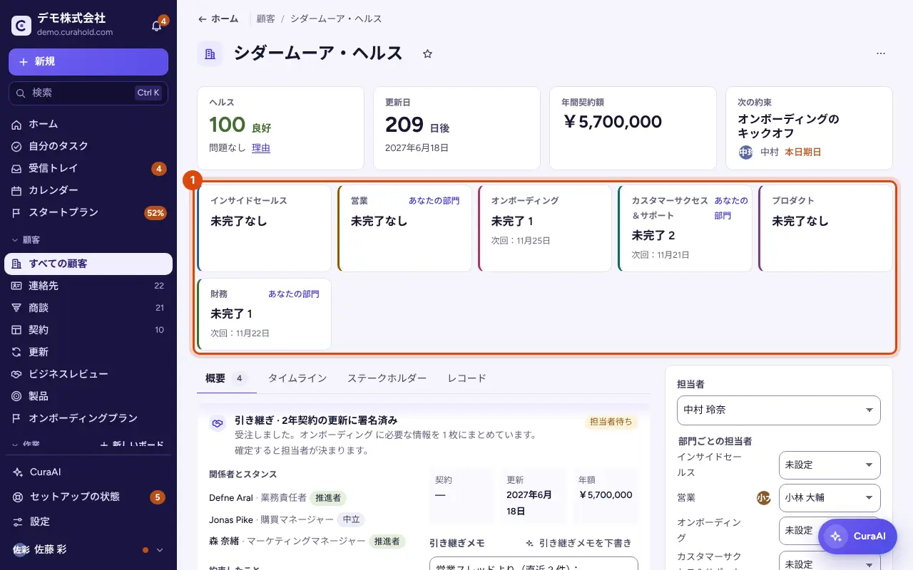
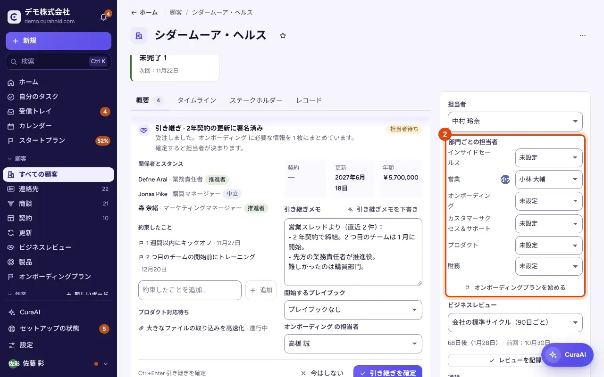

# 部門

Curahold では、仕事は部門の中にあります：インサイドセールス、営業、オンボーディング、カスタマーサクセス＆サポート、プロダクト、財務。各自は自分の部門のボードを見ます。仕事は依頼によって別の部門へ渡り、顧客ページはその顧客を見られる全員で共有します。

## 部門を設定する {#set-up}

管理者（または人を管理する人）である必要があります。

1. 左のメニューで **設定**、続けて **部門**（**人** の下）をクリックします。
   
2. 会社にある部門はすべて **プランに含む** をオンのままにします。使わない部門はオフにします：全員から隠れ、ボードはもう一度オンにするまで保管されます。
   
3. **リード** で部門を率いる人を選びます。リードは部門のボードを開き、メンバーを追加します。
   
4. **メンバー** でそこで働くほかの全員を選びます。一人が複数の部門に入れます。
   
5. **顧客ページで…を表示できる人** で **すべての部門** を選ぶか、**選択した部門** を選んで、この部門の未完了の仕事をそこで見てよい部門をクリックします。管理者は常に見られます。財務は最初、財務だけに表示されます。
   

変更はその場で保存されます。まだどの部門にも入っていない人は、追加されるまで自分の仕事を **自分のタスク** に置きます。

会社が部門に移行したとき、既存のボードはすべていずれかの部門に置かれました。同じページの下にある **部門への移行** で、各ボードの行き先と理由がわかり、そこでボードの部門を変えられます。**配置待ちの人** には、以前ボードを見られたが作業していない人が並びます：**アクセスを付与** でその部門のメンバーになります。

## 部門のボード {#boards}

1. メニューでは、ボードは部門名の下にまとまっています。自分がリードの部門には **あなたがリード** と表示されます。
   
2. 新しいボードを開くには **作業** の横の **+** をクリックします。**部門** でボードを置く部門を選び、名前を付けて **作成** をクリックします。ボードを開けるのは管理者と部門リードだけです。
   

表示範囲は既定で **部門の全員** です。チームや選んだ人に絞ることもできます。

## 別部門に依頼 {#ask}

1. 依頼に関係するタスクを開き、**別部門に依頼** をクリックします。一覧から部門のボードを選び、リクエストフォームに入力して送ります。
   

依頼はその部門のボードに届き、あなたのタスクにリンクされます。タイトルと状況は見えますが、相手の部門のボードは見えません。部門は、リードがボードのリクエストフォームをオンにすると依頼を受け付けます（**ボード設定 → 項目とリクエストフォーム**）。

## 顧客ページで {#customer-page}

1. 顧客ページの **部門横断** には、その顧客に対する各部門の未完了の仕事、そのうち遅れている数、次の期日が表示されます。**あなたの部門** は自分が所属する部門の印です。
   
2. 横の **部門ごとの担当者** で、各部門で誰がその顧客を担当しているかがわかります。人を選ぶと設定できます。
   

部門間の引き継ぎ（受注した案件がオンボーディングやカスタマーサクセスへ渡る）は [引き継ぎ、要望、顧客へのフィードバック](/docs/ja/handover-and-requests/) にあります。
