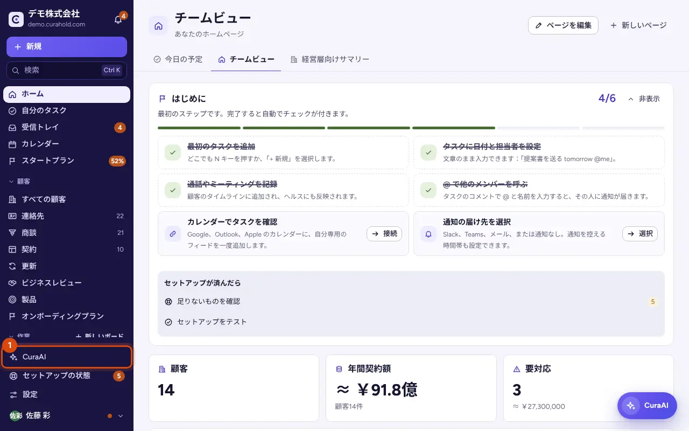
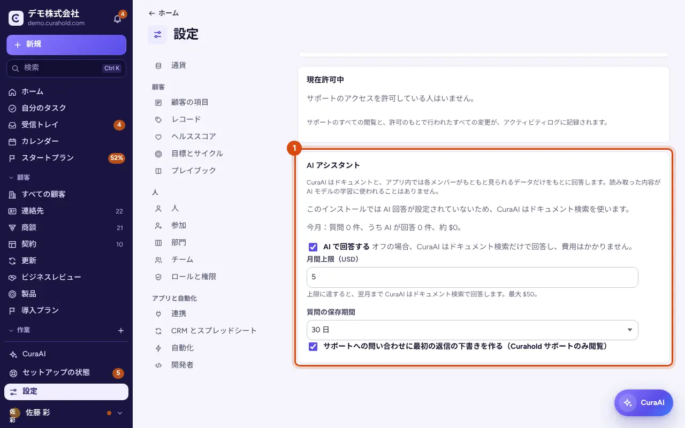
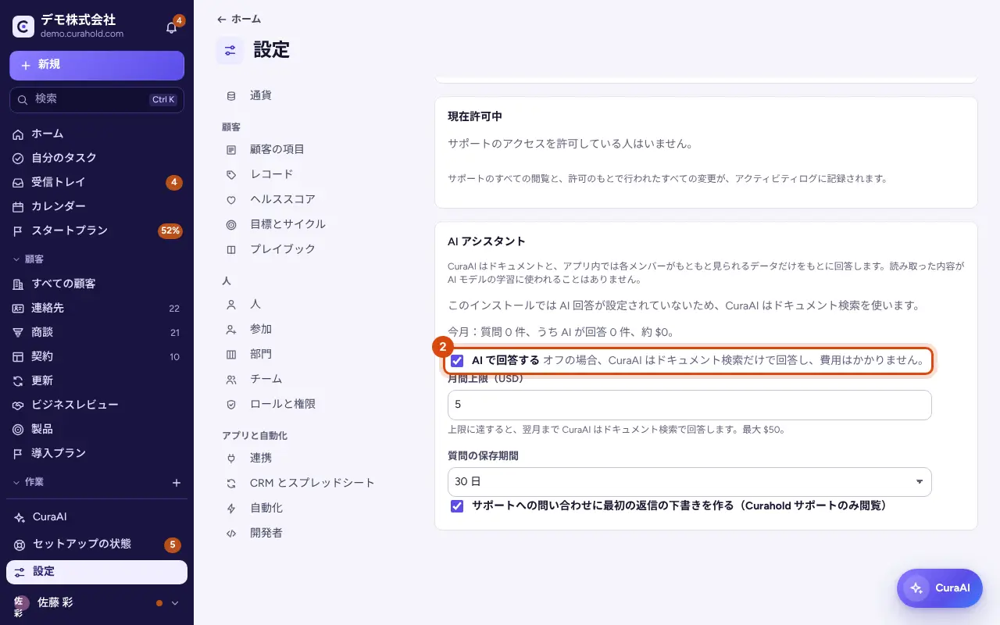

# サポートを受ける

順番は 2 つ：まず **質問する**、それで解決しなければ **サポートに書く**。

## まず質問する {#ask}

1. 左のメニューで **CuraAI** をクリックします（スマートフォンでは隅のボタン、このドキュメントでは **質問** ボタン）。自分の言葉で質問を書きます：「顧客をインポートするには」「この項目を見られるのは誰」。
   

回答はこのドキュメントから、出典付きで届きます。会社で **AI で回答する** がオン（下記）なら、CuraAI は Curahold であなたがもともと見られるもの、たとえば顧客、更新、タスクも読むので、「この先 90 日で更新するのは？」のように聞けます。読むだけで、何も変更しません。オフ、未設定、または月の上限を超えたときは、ドキュメントの検索があなたの端末で行われ、入力した内容はどこにも送られません。

答えが求めていたものでなければ、そう伝えてください：次に近い箇所と、質問が入力済みのサポートへの問い合わせボタンが出ます。

## サポートに連絡する：依頼を送る

CuraAI の下の **サポートに書く** を使います。フォームは、サポートがあなたに聞き返さずに問題を見つけるために必要なことを尋ねます。あなたが見ていないものは送られず、何を送るかはあなたが選びます。

1. **トピック**：うまく動かない、やり方を知りたい、データや連携、アイデア、請求とプラン。
2. **影響**：エラーやデータの問題では、作業が止まっているかどうかを選びます。サポートの対応順はこれに従います。
3. **件名**：短い言葉で。入力中に、答えになりそうなドキュメントのページが提案されます。
4. **何が起きたか**：何をしようとして、何を期待し、代わりに何が起きたか。エラーメッセージがあれば、そのままコピーしてください。
5. **再現の手順**：エラーの場合は手順を順番に（任意ですが、とても役立ちます）。
6. **共有する人** と **期限**（どちらも任意）：依頼を読んで回答を受け取るべき同僚と、必要な日。

**受付番号**（例：CH-000123）と、メールでの控えが届きます。

## やり取り：回答、返信、誰の番か

依頼はひとつの会話です。**自分の依頼**（CuraAI 上部の受信トレイのボタン）で開きます：

- **サポートの回答** はメールと依頼の画面に届きます。回答が届いていると、CuraAI のボタンに印が付きます。
- 製品の中で **返信** するか、**メールに返信** するだけでも大丈夫です。引用部分より上に書いた内容が依頼に入ります。
- 依頼には **誰の番か** が表示されます：*サポート対応中*、*あなたの返信待ち*、*解決済み*。**解決済みにする** で閉じ、もう一度書くと再開します。
- **共有した同僚** は依頼を読め、サポートの回答をメールで受け取り、返信もできます。共有する人を追加・削除できるのは依頼した本人だけです。管理者は会社のどの依頼も読めますが、回答できるのは自分の依頼だけです。
- Curahold のチームが依頼に **社内用のメモ** を残すことがあります。あなたの会社に表示・送信されることはありません。

## スクリーンショットとファイル

- **スクリーンショットを撮る**：ブラウザーがどのタブを共有するか尋ねるので、Curahold のタブを選びます。ヘルプのウィンドウは脇に退くので、ページだけが写ります。
- **貼り付けかドロップ**：コピーした画像をフォームに貼り付けるか、ファイルをドロップします。
- **書き込む**：大事なところを赤い枠で示します。**隠す** でサポートに見せたくないもの（顧客名、金額など）を覆うと、送られる画像からも消えます。

ファイルは 6 個まで、1 個 10 MB まで。画像、PDF、テキスト、CSV、JSON、Excel、短い動画。

## 依頼に添えられる技術情報

フォームが自動で次の情報を添え、送る前にあなたに表示します：

| 情報 | 役立つ理由 |
|---|---|
| ページのアドレス | 問題がどこにあるか。アドレスの秘密の部分（ログインのコードなど）は除かれます。 |
| ブラウザー、画面、アプリのバージョン | 特定のブラウザーでだけ起きる問題のため。 |
| 直前に開いたページ | どうたどり着いたか。アドレスだけで、ページの内容は含みません。 |
| ページのエラー | 裏側のエラーメッセージ。メールアドレスやキーのような文字列は伏せられます。 |
| 失敗したリクエスト | どの操作が失敗したか（パスとステータスコード）。 |
| いま開いているもの | 開いている顧客、ボード、タスク。 |

送りたくないものはチェックを外してください。入力した内容やページ上のデータは、これらの情報に含まれません。

## サポートにアカウントを見てもらう

見なければ直しにくい問題もあります。フォームの最後にある **Curahold サポートにアカウントの閲覧を許可する** は、そのためのものです。勝手にチェックされることはありません。

- **サポートに見えるもの**：あなたに見えるものとまったく同じ — 同じ顧客、ボード、項目。それ以上は見えません。
- **期間**：24 時間、3 日、または 7 日。アクセスは自動で終わります。サポートの 1 回の訪問は最長 8 時間です。
- **サポートにできること**：**見るだけ**。サポートがあなたのアカウントで何かを変えることはありません。
- **決して届かないもの**：あなたの端末とセッション、API キー、アプリと Webhook、メンバーの招待、ロール、会社の設定、データのエクスポートや削除。サポートが自分のアクセスを延長することもできません。
- **閉じる**：いつでも **ヘルプ → 自分の依頼 → アクセスを閉じる** で。進行中のサポートの訪問もすぐに終わります。アクセスが開いている間は、ページ上部の帯でお知らせします。
- **記録**：サポートの訪問と、その間に読んだものは、担当者の名前とともに **設定 → アクティビティログ** に記録されます。

サポートが入っている間は、画面上部の帯に、誰がいつまで見ているかが表示されます。

## 会社の設定（管理者）

**設定 → セキュリティ → サポートのアクセス** で、誰がサポートを招き入れられるかを選びます：

- **誰でも**：自分に見える範囲で（既定）。
- **管理者だけ**：ほかの人が開いたアクセスは、いま終わります。
- **誰も許可しない**：サポートはメールで回答できますが、中には入れません。

同じページに、いま開いているアクセス、それを許可した人、最後の訪問が表示され、どれでも閉じられます。

## サポートのためのセッション記録

何かが壊れたときに、あなたに説明を求める代わりにサポートが何が起きたかを確認できるよう、ページは使われる様子を自動で記録します（どのボタン、どの画面、アプリが何を描いたか）。これはアカウントの閲覧許可とは別で、裏側で静かに動きます。

- **入力した内容は記録されません。** 検索、メモ、入力した顧客情報など、すべての入力欄は伏せられます。記録されるのは画面のつくりで、書いた内容ではありません。
- **7 日間保存** され、その後削除されます。
- **記録を開けるのは Curahold のサポートチームだけ** で、専用のデスクから開くたびにサポートデスクのログに記録されます。あなたの会社は自社の記録を見られません。
- **管理者はオフにできます**：**設定 → セキュリティ → サポートのアクセス → サポートのためのセッション記録**。オフにすると、何も記録されません。

社内のプライバシー通知でこのことを従業員に知らせる必要がある場合は、このスイッチとこのページが根拠になります。

## AI で回答する（管理者） {#ai-answers}

1. **設定 → サポートアクセス** を開き、**AI アシスタント** までスクロールします。
   
2. CuraAI に AI で答えさせるなら **AI で回答する** にチェックを入れ、ドキュメント検索だけで無料で答えさせるならチェックを外します。CuraAI が読んだ内容が AI モデルの学習に使われることはありません。 新しい会社ではこの設定は**オフ**で始まります。管理者がチェックを入れるまで AI プロバイダーには何も送られず、オフの間はカードにそう表示されます。
   

同じカードで：

- **月間上限（USD）**：達すると、翌月まで CuraAI はドキュメント検索で答えます。カードには今月の質問数と費用が出ます。
- **質問の保存期間**：質問をどれだけ保存するか（保存しないことも可）。本人の質問は個人データのダウンロードに含まれます。
- **サポートへの問い合わせに最初の返信の下書きを作る**：Curahold サポートが、あなたの会社の問い合わせへの最初の返信の下書きを見ます。あなたが下書きを見ることはなく、届くのはサポートの実際の回答だけです。下書きは、CuraAI の説明に同意した人の問い合わせにだけ作られます。それ以外の問い合わせは下書きなしでサポートに届き、その内容が AI プロバイダーに送られることはありません。

カードにこの環境では AI 回答が設定されていないと出る場合、CuraAI はドキュメント検索を使います。AI のキーは Curahold のサーバーを運用している人が追加します。

**最初に必ず確認します。** AI による回答がオンのとき、CuraAI を初めて開くと、AI プロバイダーに何を、なぜ、どれだけの期間送るのかを示し、プライバシー通知へのリンクと **同意する**・**同意しない** を表示します（あらかじめチェックされた項目はありません）。同意するまでは入力した内容が端末の外に出ることはなく、ドキュメント検索が答えます。同意しなくても何も失いません。同意は CuraAI の下部か **あなたの設定 → AI アシスタントへの同意** からいつでも取り消せ、説明が変わると再度確認します。「同意」のない質問はサーバーが拒否し、回答はすべてアクティビティログに記録されます。カスタマーポータルと公開ドキュメントも同じように確認します。

## エラーの記録（管理者） {#errors}

**設定 → エラー** には、直近 30 日にメンバーが遭遇した問題とその場所が並びます：画面、失敗したリクエスト、回数。個人的な情報は含まれません。サポートに問い合わせるときは、そこで見た内容を添えてください。
