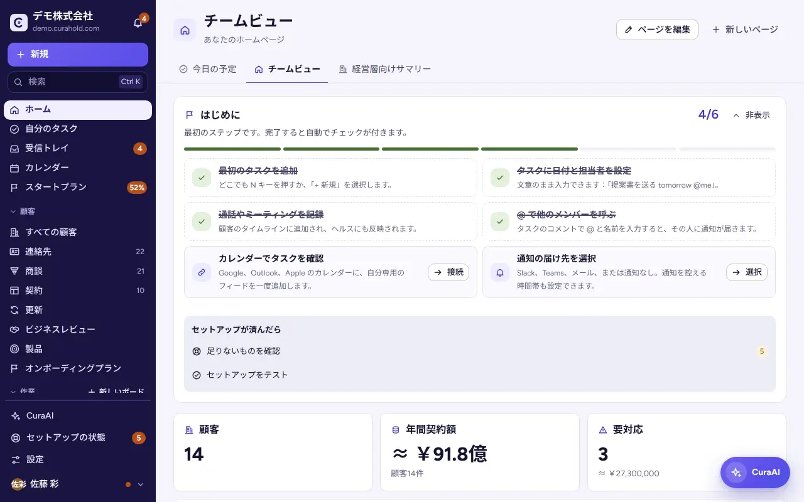

# はじめに

Curahold は、カスタマーサクセスとアカウントマネジメントのチームが、顧客とそのステークホルダー、日々の仕事をひとつの場所で回すためのツールです。このページでは最初の 15 分を案内します。

## 会社のアドレス

会社ごとに専用のアドレスがあります：`yourcompany.curahold.com`。チームの全員がここからログインします。このアドレスにほかの会社のデータが表示されることはありません。会社どうしの分離はデータベースの中で強制されています。

## ログイン

- **メールのリンク：** メールアドレスを入力し、届いたリンクをクリックします。パスワードはありません。
- **Google または Microsoft：** 会社がオンにしていれば、ワンクリックで。初めての端末では、メールに届く 6 桁のコードも入力します。
- **パスキー：** 最初のログインのあとに、指紋、顔、または端末の PIN で。
- **2 段階目：** あなたの設定 → **ログインのセキュリティ** で認証アプリを追加できます。10 個の回復コードも発行されます。管理者は、2 段階目を管理者だけ、または全員に必須にできます。
- 大事な操作（ロールの変更、API キー、自分のデータのエクスポートなど）の前には、直近 10 分以内にログインしていなければ **ご本人確認** を求められます。
- ひとつのアドレスに送られるログインリンクは、15 分間に最大 5 通です。

## 最初の設定

会社を作る人がテンプレートを選びます：カスタマーサクセス、アカウントマネジメント、営業、サポート、または空白。テンプレートには顧客の項目（更新日、年間契約額、ヘルスなど）、ボード、用意された自動化が含まれます。どれも後から変えられます。

次にチームを招待します。会社のメールドメイン（`@yourcompany.com`）を追加しておくと、そのドメインの人は参加を申し込むか、すぐに参加できます。

## 最初の日

ホームの **はじめに** のカードに、最初のステップがいくつか並びます：最初のタスクの追加、タスクに日付と担当者を付ける、通話のメモ、@ でメンバーを呼ぶ、カレンダーでタスクを見る、通知の届け先を選ぶ。やり終えたステップは自動でチェックされ、**非表示** でカードをしまえます。

左の **+ 新規** ボタンから、タスク、顧客、通話のメモ、ボードを何でも追加できます。タスクを書くときは、日付・担当者・顧客を同じ行に書けます。[クイック追加とショートカット](/docs/ja/quick-add/)をご覧ください。メニュー（左下の自分の名前）には、ライト／ダークの切り替え、言語、ショートカットがあります。

## 言語

Curahold は 11 の言語で使えます：英語、トルコ語、アラビア語、ヘブライ語、ペルシア語、簡体字中国語、繁体字中国語、日本語、韓国語、ヒンディー語、マレー語。言語は次のどちらかで選びます：

- **自分用：** あなたの設定 → 言語。どの端末でも同じ言語になります。
- **会社用：** 管理者が 設定 → 会社 で設定します。新しく参加する人はその言語で始まり、会社全体へのメールもその言語で送られます。

ブラウザーから推測することはないので、同じリンクを開けば誰でも同じものが見えます。日付、数値、金額は選んだ言語の書き方に従います。

## 端末の上限

ひとりが同時にログインしたままにできる端末は 2 台です。管理者は 1～5 台の間で設定できます。もう 1 台でログインすると、いちばん古い端末がログアウトされます。こうしてひとつの席を複数人で使い回せないようにしています。

> **ヒント：** あなたの設定 → 端末 で、どこにログインしているかを確認し、どの端末からでもログアウトできます。

## スマートフォンやパソコンにインストールする

Curahold はアプリのようにインストールできます。ストアは必要ありません。

- **Android とパソコン（Chrome、Edge）：** 左下の自分の名前 → **Curahold をインストール**。ブラウザーのアドレスバーにあるインストールのアイコンでも同じです。
- **iPhone と iPad（Safari）：** 共有ボタン → **ホーム画面に追加** → 追加。

インストールしたアプリは専用のウィンドウで開き、アイコンを長押しすると「自分のタスク」「受信トレイ」「顧客」が出てきます。

**オフラインでも** アプリは開き、最後に見た内容（タスク、ボード、顧客、受信トレイ）を表示します。上部の帯がオフラインであることを知らせ、接続が戻るまで変更は保存できません。ログアウトすると、端末に保存していたコピーは削除されます。

**自動更新：** ページを開いている間、ほかの人の変更（新しいカード、移動したタスク、コメント、新しい通知）は数秒のうちに自動で表示されます。再読み込みは不要です。入力中やカードのドラッグ中に、手元のものが動くことはありません。

## 次に読む

- [顧客、項目、レコード](/docs/ja/customers/)
- [タスクとボード](/docs/ja/tasks/)
- [ロールと権限](/docs/ja/roles-and-access/)
- [クイック追加とショートカット](/docs/ja/quick-add/)
