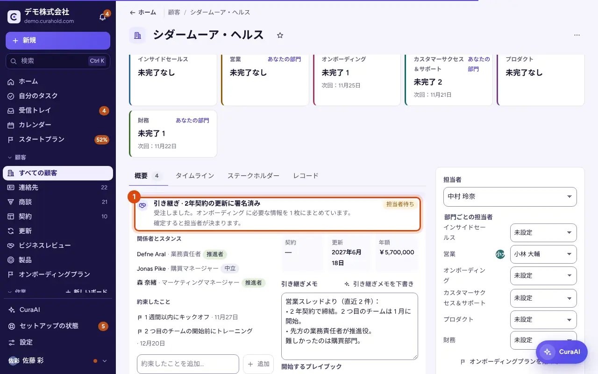
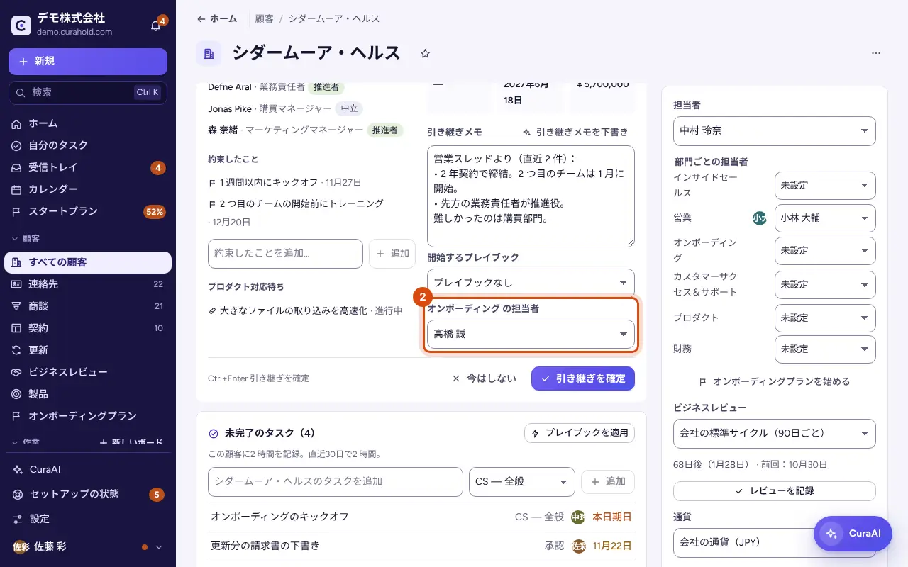
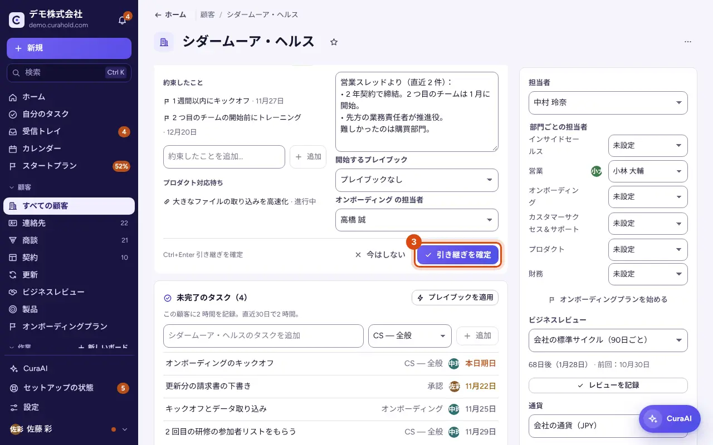
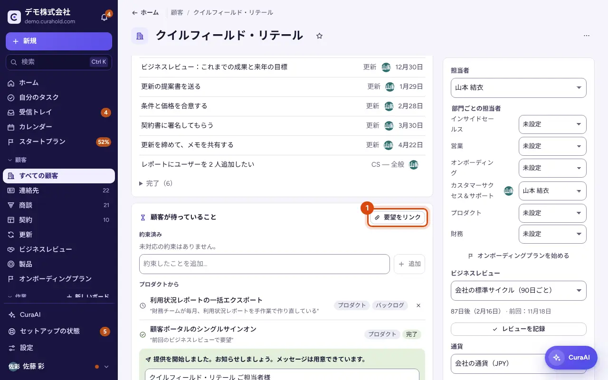
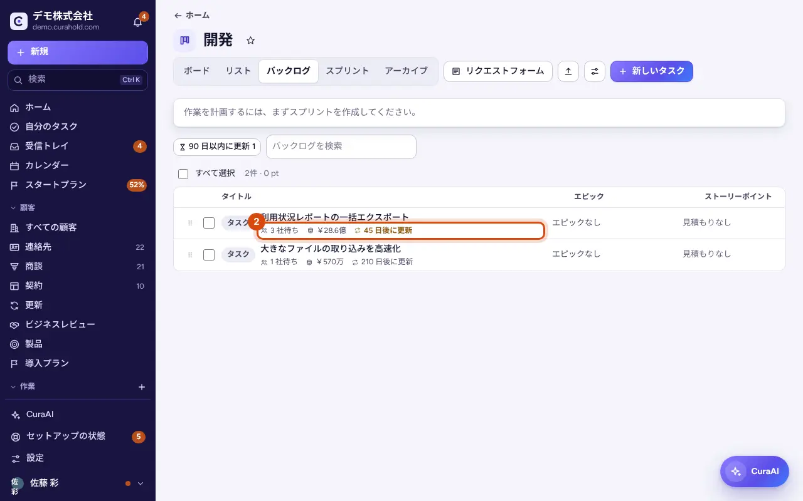
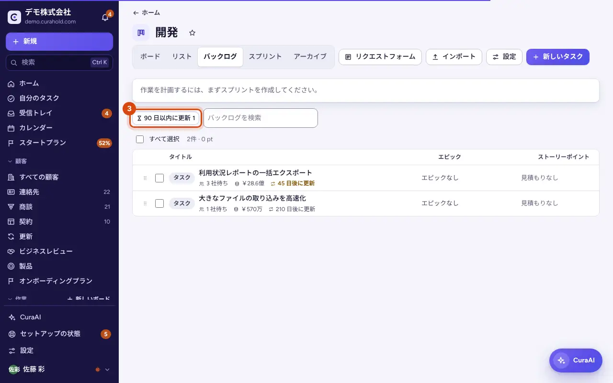
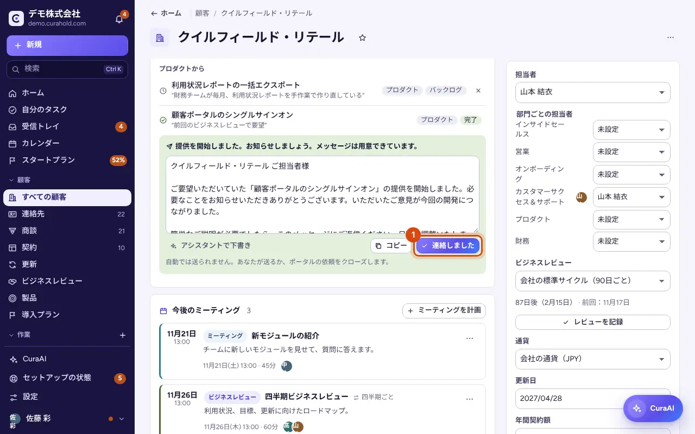
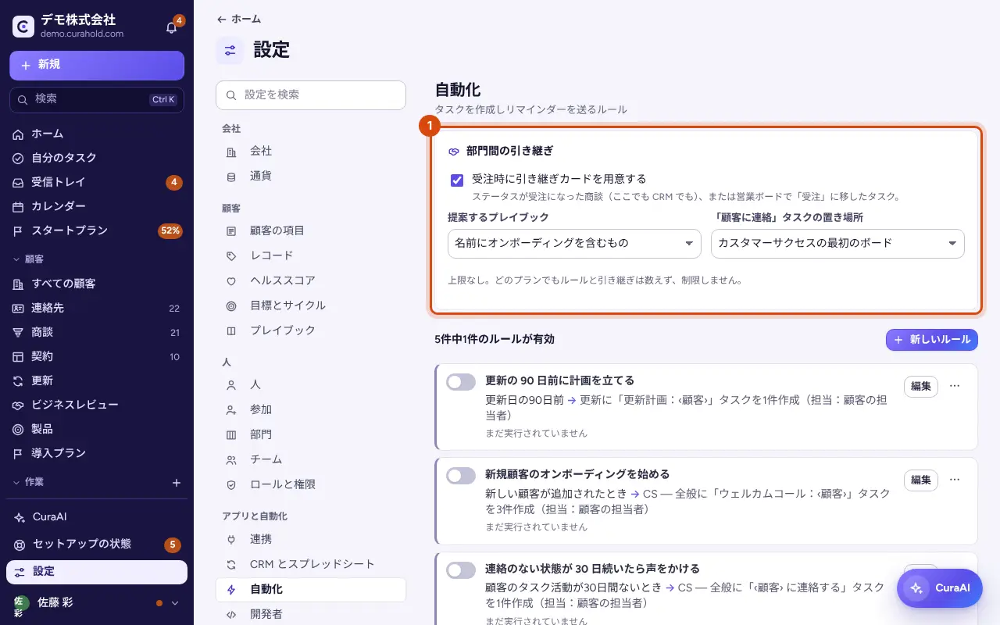

# 引き継ぎ、要望、顧客へのフィードバック

仕事は営業からオンボーディングやカスタマーサクセスへ、顧客からプロダクトへと渡ります。Curahold は各チームに必要なことを顧客ページに置くので、打ち直しも、他部門のボードを開く必要もありません。

## 受注したとき {#handover}

ステータスが **受注** になった案件（ここでも CRM でも）、または営業ボードで **受注** に移したタスクには、顧客ページに **引き継ぎカード** が 1 枚できます。会社にオンボーディング部門があれば **オンボーディング** へ、なければ **カスタマーサクセス** へ渡ります。

1. 顧客ページを開きます。カードは **概要** の一番上にあり、**担当者待ち** と表示されています。読んでください：関係者とその立場、営業が約束したこと、顧客がまだプロダクトに待っていること、日付、年間価値（その項目を見られる場合）、営業スレッドからの引き継ぎメモ。
   
2. **… の担当者** で、顧客を引き継ぐ人を選びます。隣の **開始するプレイブック** も確認します。
   
3. **引き継ぎを確定** をクリックします（または Ctrl+Enter、Mac では ⌘+Enter）。担当者が設定され、プレイブックが始まり、担当者に通知され、顧客のタイムラインに両方の手順が残ります。
   

**今はしない** でカードをしまいます。**引き継ぎメモを下書き** はアシスタントにメモを書かせます。保存前に読んで直せます。

## 顧客の要望をプロダクトの作業にリンクする {#requests}

1. 顧客ページの **顧客が待っていること** で **要望をリンク** をクリックします。プロダクトの作業を検索してストーリーを選び、必要なら顧客の言葉で要望を書き添えます。合うものがなければ、同じ画面からプロダクトに依頼します。
   

同じストーリーを多くの顧客が待つことができ、それぞれが数えられます。顧客を見られる人は、作業のタイトル、状況、スプリントの終わり、部門を見られますが、プロダクトのボードは見えません。

## プロダクトから見えるもの {#backlog}

1. プロダクトのボードで **バックログ** を開きます。各ストーリーの下に、待っている顧客の数、その年間価値（その項目を見られる人だけ）、いちばん近い更新が出ます。
   
2. **90 日以内に更新** をクリックすると、もうすぐ更新する顧客が待っている作業だけが、更新の近い順に表示されます。
   

## 提供開始したとき {#shipped}

リンクしたストーリーが完了すると、各顧客の担当者にタスクが届き、顧客ページのストーリーの下に送れる状態のメッセージが表示されます。

1. メッセージを読み、必要なら直して **コピー** をクリックし、自分のメールやチャットから送ります。それから **連絡しました** をクリックします。顧客がポータルから依頼していた場合は、**ポータルの依頼をクローズ** でそちらも閉じます。
   

**自動では何も送られません。** タイムラインには「この顧客のために作ったもの」と記録され、更新のまとめにも載ります。

## 設定（管理者） {#settings}

1. **設定 → 自動化** を開きます。**部門間の引き継ぎ** で、受注時に引き継ぎカードを作るか、提案するプレイブック、「顧客に連絡」タスクの行き先を選びます。
   

## アシスタントの下書き

引き継ぎメモ、「提供開始」のメッセージ、会議の約束と次の手順は、アシスタントに下書きさせられます。どの下書きも保存前に読んで直せ、元に戻すで取り消せます。アシスタントがない（または月間上限を超えた）場合はテンプレートから下書きされます。

## ルール

ルールは、タスクの追加や完了、フォームからの依頼、レコードのステージ到達、サポートチケットの起票で始められ、割り当て、移動、項目の設定、コメント、Webhook への送信、引き継ぎの準備ができます。ルールは数えられず、上限もありません。
