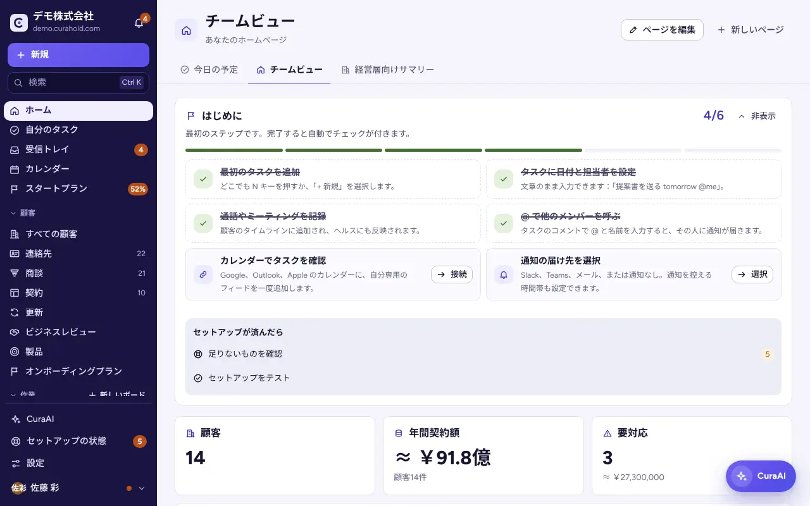

# ホームとカード

ホームは、Curahold を開いた瞬間に自分の仕事が見えるようにするためのページです。どのページもカードでできていて、役割ごとに最初に開くホームがあります。

## カード

| カード | 表示する内容 |
| --- | --- |
| 自分の未完了タスク | 完了していない自分のタスク。期限切れが先頭 |
| 間近の更新 | 選んだ日数以内に更新を迎える顧客と、その合計金額 |
| 要対応 | ヘルスがリスクありまたは要注意の顧客 |
| 連絡が途絶えた顧客 | しばらく動きのない顧客 |
| ステークホルダーのリスク | 反対者と懐疑的な人、推進者のいない顧客 |
| 数値 | 顧客数や合計金額などのひとつの値 |
| 内訳 | 選択肢の項目で分けた顧客 |
| チームの負荷 | 一人ひとりの顧客、未完了・期限切れ・リスクのある作業 |
| 連携の状態 | CRM やスプレッドシートとの同期の状況 |
| メモ | チームへの短いお知らせやリンク |

ほとんどのカードは「自分の」「自分のチームの」「全員の」で使えます。カードは見る人が見られる範囲で計算されるので、同じページを開いても権限が違えば数字も違います。

## ページの編集

管理者は **ページを編集** でカードの追加、並べ替え、大きさの変更を行い、そのページで始めるロールを選びます。一部のロールだけにページを見せることもできます。

> **ヒント：** あるロールに何が見えるかを確かめるには、設定 → ロールと権限 の **…の視点で見る** を使います。その人の画面が閲覧専用で開きます。
