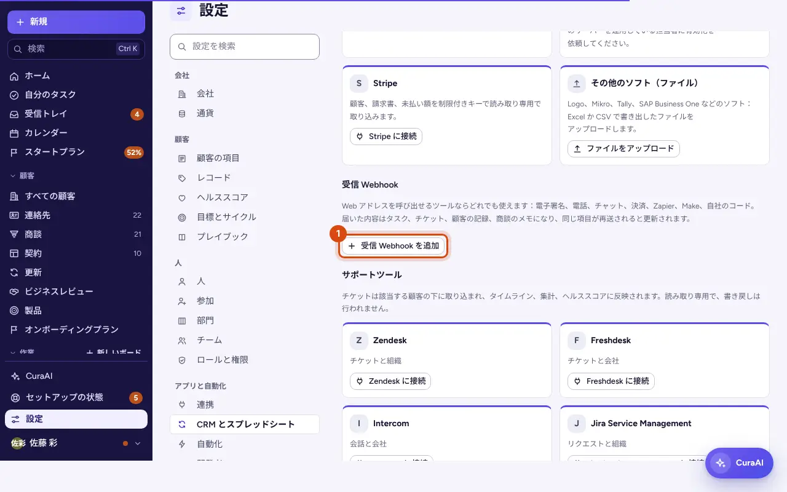
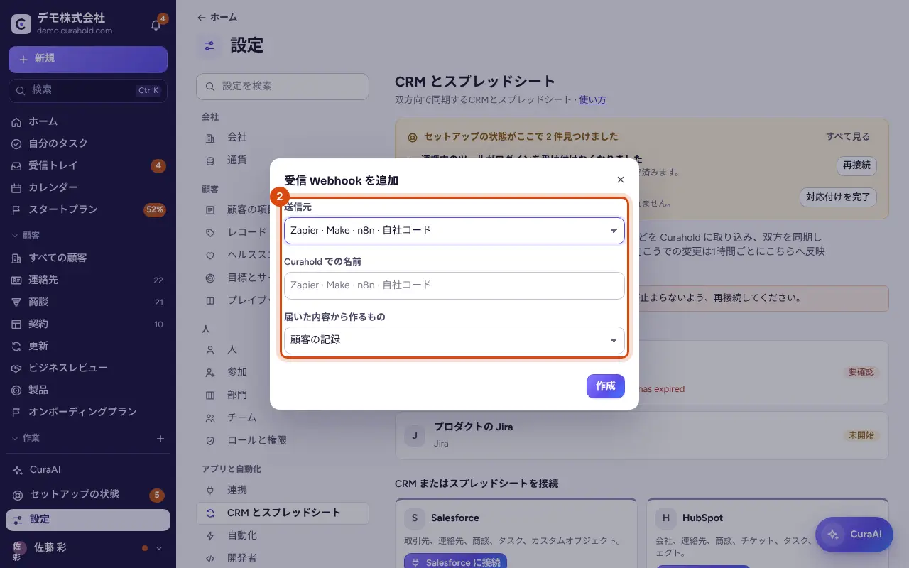
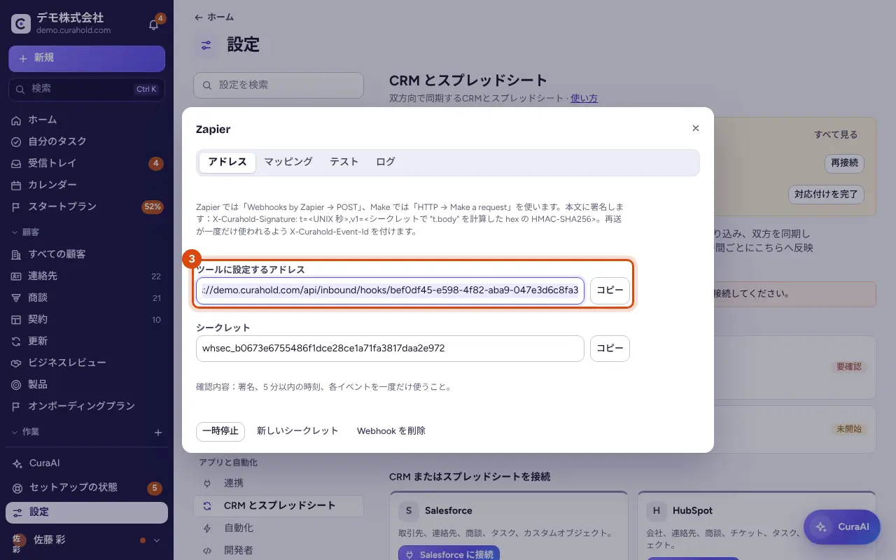
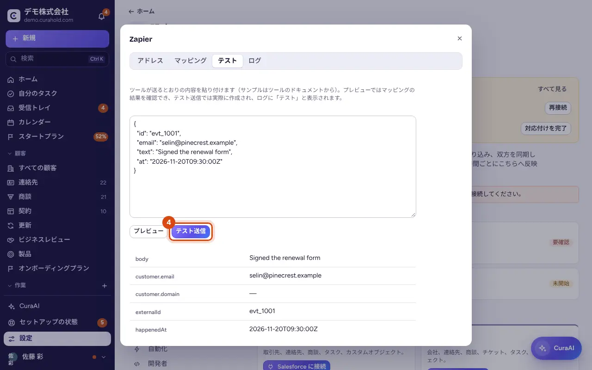
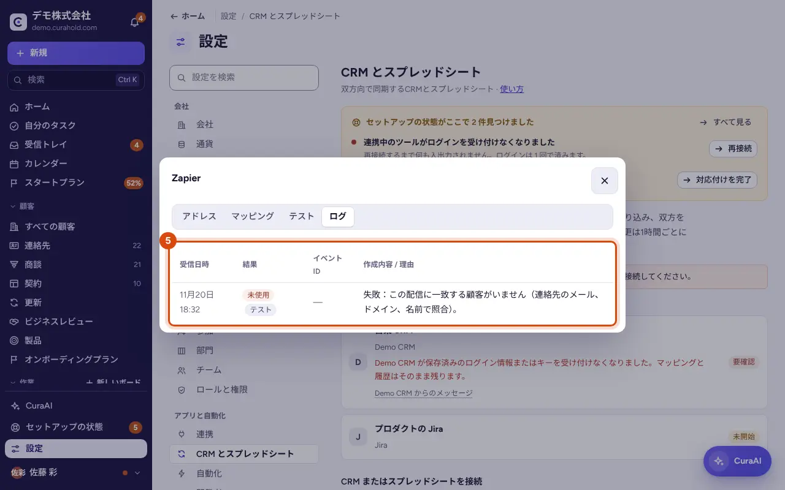

# 受信 Webhook

Curahold に既製のコネクタがないツール向けです。ツールが自社専用のアドレスに送ると、届いた内容が **タスク**、**サポートチケット**、**顧客のタイムラインの記録**、**商談のメモ** のいずれかになります。同じ項目が再送されると、作ったものが更新されます。受信のたびに、署名（または共有トークン）、時刻、各イベントを一度だけ使うことを確認します。

## Curahold で {#connect}

1. **設定 → CRM とスプレッドシート** を開き、**受信 Webhook** までスクロールして **受信 Webhook を追加** をクリックします。
   
2. **送信元** でツール（または **Zapier · Make · n8n · 自社コード**）を選び、**届いた内容から作るもの** を確認して **作成** をクリックします。
   
3. **アドレス** タブで、アドレスとシークレットをツールにコピーします。
   
4. **テスト** タブで **プレビュー** をクリックしてサンプルのマッピング結果を確認し、**テスト送信** をクリックします。
   
5. **ログ** タブで各受信を確認します：使用、スキップ、未使用（理由付き）、拒否。
   

## マッピング

各値はテキストで、届いた内容の値は `{{path}}` で書きます（例：`{{data.envelopeSummary.status}}`、`{{items[0].email}}`）。顧客は連絡先のメールアドレス、Web アドレス、名前の順で見つけます。**ツール側の項目 ID** を入れると「作成または更新」が働きます。**この値が…のときだけ使う** で他のイベントをスキップします（スキップとして記録）。

## 用意されたレシピ

| ツール | 署名 | 作成するもの |
| --- | --- | --- |
| 電子署名（DocuSign Connect。CloudSign、Modusign、Leegality も同様） | `X-DocuSign-Signature-1`, HMAC-SHA256, base64, ツールで作るキー | 商談のメモ |
| Aircall | 本文に入る Webhook のトークン | 顧客の通話 |
| Tawk.to | `X-Tawk-Signature`, HMAC-SHA1, hex | チケット |
| Razorpay（iyzico も同様） | `X-Razorpay-Signature`, HMAC-SHA256, hex | 顧客の記録 |
| Freshchat、Kylas、Sansan、その他 | 共有トークン (`X-Curahold-Token` / `?token=`) | 自由に選択 |

## 自分で署名する（Zapier、Make、n8n、コード） {#sign}

`X-Curahold-Signature` と `X-Curahold-Event-Id` を送ります：

```text
X-Curahold-Signature: t=1763631000,v1=<シークレットで "1763631000.<元の本文>" を計算した hex の HMAC-SHA256>
X-Curahold-Event-Id: evt_1001
```

コードの例（Node.js）：

```js
const t = Math.floor(Date.now() / 1000);
const v1 = crypto.createHmac('sha256', secret).update(`${t}.${body}`).digest('hex');
fetch(address, { method: 'POST', body, headers: { 'content-type': 'application/json', 'x-curahold-signature': `t=${t},v1=${v1}`, 'x-curahold-event-id': id } });
```

時刻は 5 分以内である必要があります。同じイベント ID は `200` と `duplicate` で応答し、再利用しません。応答：`200`（`status` が ok、skipped、failed）、`401`（署名、時刻、トークン）、`404`（不明または一時停止中）。全一覧： API リファレンス.

## コネクタがまだないツール向けの Zapier・Make レシピ

ツールのトリガーを使い、**Webhooks by Zapier → POST**（Zapier）または **HTTP → Make a request**（Make）で、上のアドレスに 2 つのヘッダー付きで送ります。署名は Make の **Custom JS** または Zapier の **Code** ステップで計算します（上のコード）。

| ツール | トリガー | 送る本文の項目 | 作成するもの |
| --- | --- | --- | --- |
| LINE WORKS | Bot チャンネルの新しいメッセージ | `id`、送信者の `email`、`text` | 記録 |
| Chatwork | ルームの新しいメッセージ | `id`、`email`、`text` | 記録 |
| kintone | レコードの追加・編集 | `id`、`email`、`title`、`status` | タスク |
| マネーフォワード クラウド | 請求書の作成・入金 | `id`、`email`、`text`（番号、金額、期日） | 記録 |
| チャネルトーク | チャットの終了 | `id`、`email`、`title` | チケット |
| KakaoWork | Bot メッセージ | `id`、`email`、`text` | 記録 |
| LeadSquared | リード・商談の更新 | `id`、`email`、`title`、`status` | タスク |
| Razorpay | 決済の確定 | `id`、`email`、`text` | 記録（またはレシピ） |
| DingTalk | ロボットのメッセージ | `id`、`email`、`text` | 記録 |
| WeCom | アプリのメッセージ | `id`、`email`、`text` | 記録 |

## 保存と削除

ログは Webhook ごとに 30 日・最大 500 件まで保存します。**新しいシークレット** で古いものはすぐに無効になります。**一時停止** 中は再開まで `404` を返します。**Webhook を削除** すると Webhook とログが消え、作成されたものは残ります。Webhook は設定した人の権限で動くため、その人が見られるボードと顧客にしか届かず、その人が退職すると止まります。

## 関連項目

- [連携と CRM](/docs/ja/connections/)
