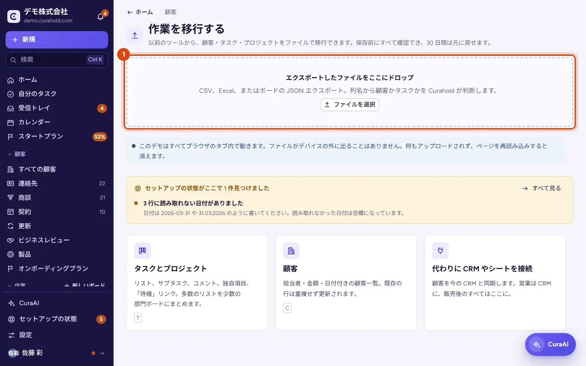
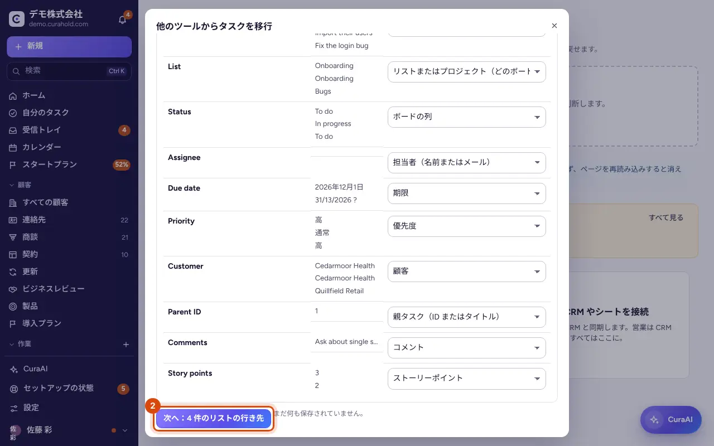
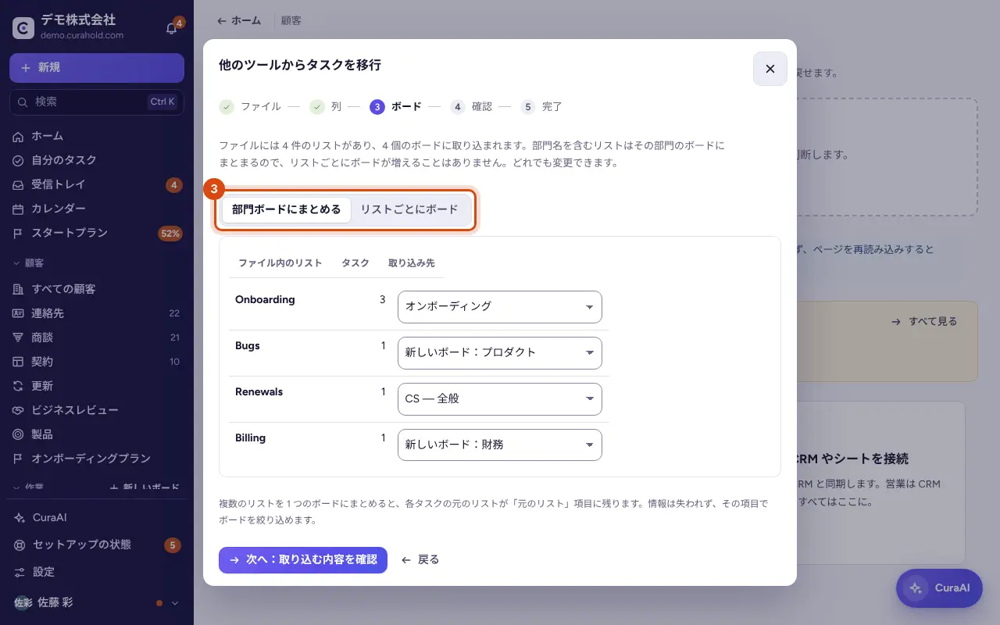
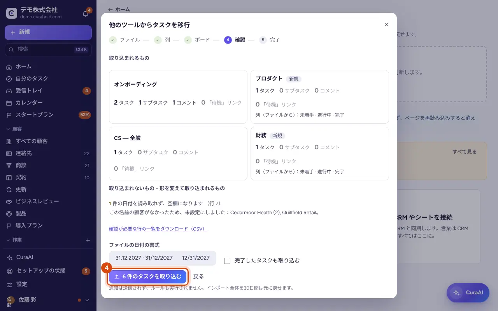
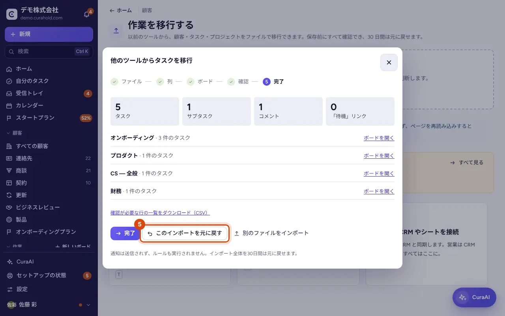

# 他のツールからの移行

前に使っていたツールから仕事をエクスポート（CSV、Excel シート (.xlsx)、カンバンボードの JSON エクスポート）し、そのファイルから移します。最後の手順まで何も保存されず、誰にも通知されず、ルールも動きません：新しい仕事ではなく引っ越しです。

## タスクを移す {#tasks}

1. **作業を移行する** を開きます：検索（Ctrl K、Mac では ⌘ K）で「import」と入力するか、ボードの上向き矢印ボタンを使います。ファイルを **エクスポートしたファイルをここにドロップ** に置くか、**ファイルを選択** をクリックします。Curahold は列名で顧客かタスクかを見分けます。自分で選ぶなら、タスクは **T**、顧客は **C** を押します。
   
2. **列。** ファイルの各列を行き先に合わせます：タイトル、説明、ボードの列、担当者、日付、優先度、顧客、ストーリーポイント、旧ツールの ID、親タスク、コメント、「待ち」リンク、独自の項目。最初の値で何になるかがわかります。違うものを直して **次へ** をクリックします。
   
3. **ボード。** ファイルにリストがたくさんあると、少数の部門ボードにまとまります：「Renewals」というリストはカスタマーサクセスへ、「Bugs」はプロダクトへ。分けておくなら **リストごとにボード** をクリックするか、リストごとに好きなボードを選びます。各タスクは元のリストを **元のリスト** 項目に残します。**次へ：取り込む内容を確認** をクリックします。
   
4. **確認。** ボードごとに、取り込まれるタスク、サブタスク、コメント、リンクの数と、行番号付きで取り込まれないものや違う形で入るものを読みます。先にファイルで直したいときは **確認が必要な行の一覧をダウンロード（CSV）**。それから **… 件のタスクを取り込む** をクリックします。
   
5. **完了。** ボードごとに **ボードを開く** リンクがあります。思ったとおりでなければ **このインポートを元に戻す** をクリックします。
   

Curahold は、見出し行の上のタイトル行、グループごとに見出しが繰り返される形、親の下に字下げされたサブ項目を理解します。

## 元に戻す {#undo}

**このインポートを元に戻す** は 30 日間、結果画面か最初の手順の **これまでのインポート** から使えます。誰も触れていないタスクは 1 件としてゴミ箱へ。その後誰かが変更やコメントをしたタスクは、ボードのアーカイブに残ります。インポートのために作られ空のままのボードは片付けられます。

## テンプレート {#template}

最初の手順の **テンプレートをダウンロード** で、Curahold が読むすべての列と 3 行の例が入ったファイルが手に入り、Excel で開けます。1 行目（Region は独自の列の例）：

```text
ID,Title,Description,List,Status,Assignee,Due date,Priority,Customer,Parent ID,Comments,Depends on,Story points,Region
```

## デモでは

デモはすべてブラウザのタブの中で動きます。デモバーの **自分のファイルで試す** で同じページが開きます：ファイルはタブの中で読まれ、端末の外には出ず、ページを再読み込みすると消えます。
