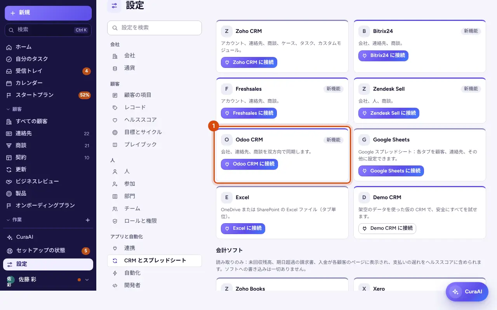

# Odoo CRM

Odoo Online、Odoo.sh、自社サーバーの会社、その連絡先、商談を双方向で同期します。Odoo の変更は 1 時間以内に届き、Curahold の変更はすぐに戻ります。

## Curahold で {#connect}

1. **設定 → CRM とスプレッドシート** を開き、Odoo CRM のタイルで **Odoo CRM に接続** をクリックします。
   

次の 4 項目を入力して **接続** をクリックします：

- **Odoo のアドレス**（例）：

```text
https://yourcompany.odoo.com
```

- **データベース名**：Odoo.sh や、複数のデータベースがある自社サーバーの場合のみ。
- **ログイン（メールアドレス）**：Curahold がその権限で動く Odoo ユーザー。
- **API キー**：下を参照してください。

続いて **会社**、**連絡先**、**商談** にチェックし、提案された項目の対応を確認して **同期を開始** をクリックします。確度 100% の商談は受注、Odoo でアーカイブされた商談は失注として扱います。

## Odoo で

1. 右上の自分の画像 → **設定**（Odoo 17 以降は **マイプロフィール**）をクリックします。
2. **アカウントのセキュリティ** を開き、**新しい API キー** をクリックします。
3. 名前（例：`Curahold`）を入力し、有効期間を選んで **キーを生成** をクリックします。
4. キーをコピーします。Odoo は一度しか表示しません。

Odoo Online で API を使うには **Custom** プランが必要です（Odoo の規則）。CRM アプリがインストールされている必要があります。

## 制限とタイミング

Odoo は固定の上限を公表していません。Curahold は毎秒約 2 リクエストに抑えます。Odoo 19 以降は JSON-2 API、古いバージョンは JSON-RPC（Odoo 20 で削除予定）で応答します。Odoo 19 ではキーの有効期間は最長 3 か月です。切れる前に新しいキーを作って再接続してください。

## 競合・エラー・削除

両方で同じ項目が変わった場合は、連携に設定したルール（既定は後の変更）で決まります。受け付けられなかった値は、Odoo のメッセージとともに連携の **ステータス** タブで待機します。キーが取り消されたり期限切れになると連携は **要確認** になります。**再接続** で新しいキーを貼り付ければ、対応はそのまま残ります。**削除** するとキーは消えますが、取り込んだ顧客とレコードは Curahold に残ります。

## 関連項目

- [連携と CRM](/docs/ja/connections/)
- [Odoo（会計）](/docs/ja/accounting-odoo/)
