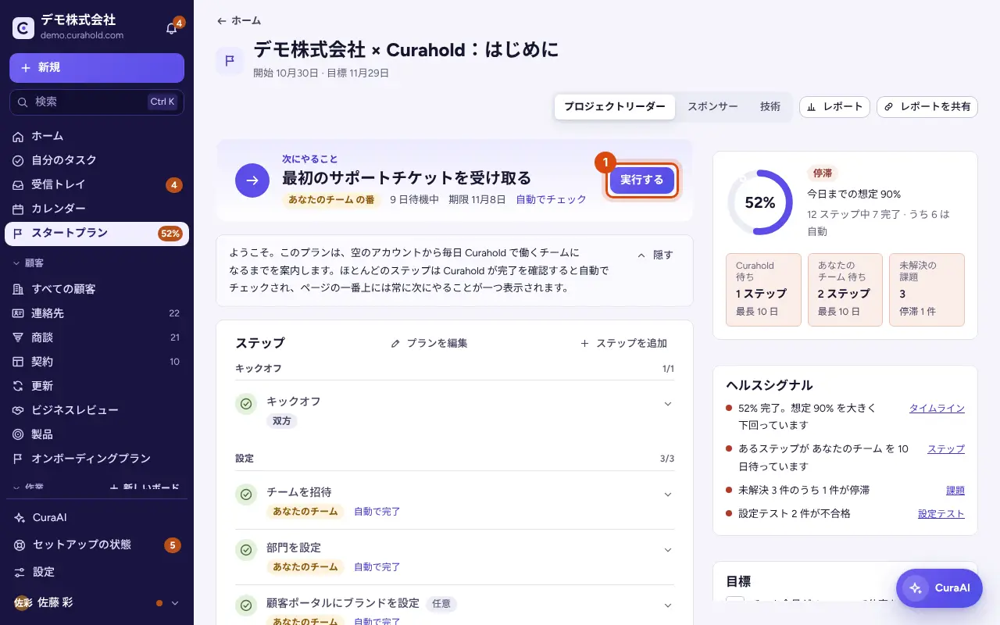
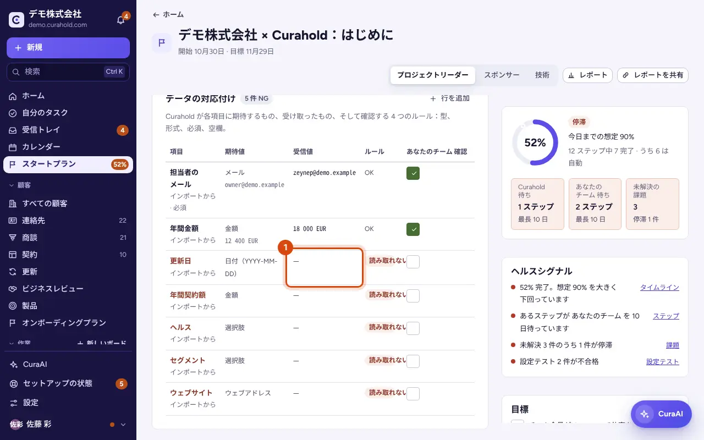
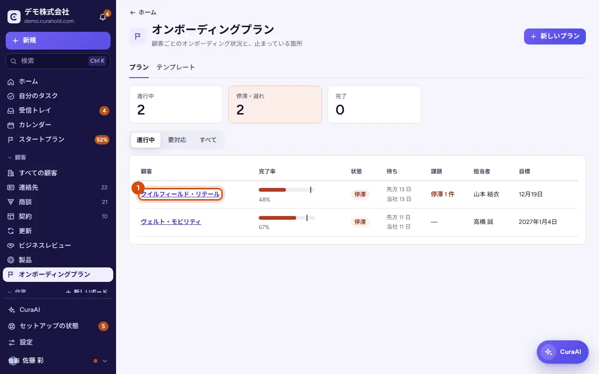

# オンボーディングプラン

オンボーディングプランは、双方が一緒に使う一つのページです。自社が Curahold をはじめるときに使い、導入する顧客ごとにも同じプランを使います。ほとんどのステップは Curahold が完了を確認すると自動でチェックされます。手動でチェックするのは、打ち合わせなど Curahold が見られないものだけです。

## 1. プランを開く {#start}

左のメニューで**スタートプラン**をクリックします。横の数字は完了した割合です。

```text
https://<自社>.curahold.com/onboarding
```


## 2. 次のことをする {#next}

一番上のカードには、次にやること、誰の番か、どれくらい待っているかが常に表示されます。**実行する**をクリックすると、それを行う画面が開きます。



## 3. ステップを開く {#team}

ステップをクリックすると、目的、かかる時間、自動でチェックされるかがわかります。鍵の付いたステップは別のステップを待っています。下の行で、どれを待っていて誰の番かがわかります。**完了にする**は Curahold が見られないステップだけに使います。


## 4. 共有の課題を解決する {#health}

各課題には、次に動くのが誰かが示されます。5 日以上開いているか期限を過ぎたものは**停滞**になります。不合格の設定テストはここに 1 回だけ表示されます。直したら**もう一度テスト**をクリックします。合格すると課題は自動で閉じます。


## 5. データを確認する {#mapping}

データ表には、各項目について Curahold が期待するもの、受け取ったもの、4 つのルール（型・形式・必須・空欄）が表示されます。NG の行はどのルールに合わないかを示します。値が正しければ、自分の側のボックスをチェックします。

```text
2027-03-31
```



## 6. メンバーを決める {#people}

**双方のメンバー**で**メンバーを追加**をクリックし、役割を選びます。各ステップの担当者には、番が来たときと停滞したときに Curahold がアプリ内でお知らせします。メールでのお知らせは、管理者がオンにしない限りオフです。

## 7. 進捗レポートを共有する {#report}

**レポートを共有**をクリックしてリンクをコピーします。リンクを持つ人はレポートだけを見られます（メモや連絡先は含まれません）。印刷や PDF 保存は**レポート**から行います。


## 8. 顧客のスタートプラン {#customers}

顧客の下の**オンボーディングプラン**をクリックします。受注時にプランが自動で開くのは、その設定をオンにした場合だけです（第 10 節）。顧客は同じプランをポータルで貴社の色で見られます。終わったら**完了して引き継ぐ**をクリックします。ヘルススコアが基準値として保存され、カスタマーサクセスに引き継ぎカードが届きます。

顧客のプランを開くには、右上の**新しいプラン**をクリックし、顧客とテンプレートを選んで**プランを開く**をクリックします。今日から始まります。この顧客向けに変えてください（第 9 節）。

顧客ページの「部門ごとの担当者」の下にある**オンボーディングプランを始める**でも同じです。



## 9. 顧客ごとにプランを調整する {#personal}

顧客のプランはそれぞれ独立したコピーです。テンプレートに影響せずに変更できます。

1. プランの**ステップ**で**プランを編集**をクリックします。
2. フェーズ名を入力欄で変える、矢印で移動する、**フェーズを追加**で追加する。ステップが残っているフェーズは削除できません。先にステップを移動するか削除します。
3. ステップ名を入力欄で変える、矢印で移動する、別のフェーズを選ぶ、または削除します。
4. **編集を終える**をクリックします。このプランを再利用するには**テンプレートとして保存**をクリックして名前を付けます。

## 10. 自動で開くプラン {#won}

管理者が**オンボーディングプラン → テンプレート**の一番下で決めます。

1. **商談を受注したらスタートプランを開く**をオンにします。オンにするまではオフです。
2. 開くテンプレートを選ぶか、**毎回たずねる**を選びます。その場合、下書きが顧客を引き継ぐ人に選択を求めます。
3. 任意：セグメント・プラン・地域（どの顧客項目でも可）でルールを追加します。顧客が最初に当てはまるルールでテンプレートが決まります。

リマインダーは常にアプリに表示されます。メールでも受け取るかは、各自が自分の通知設定で決めます。

## スマートフォンでは

同じページを 1 列で表示します。次にやることが一番上です。


