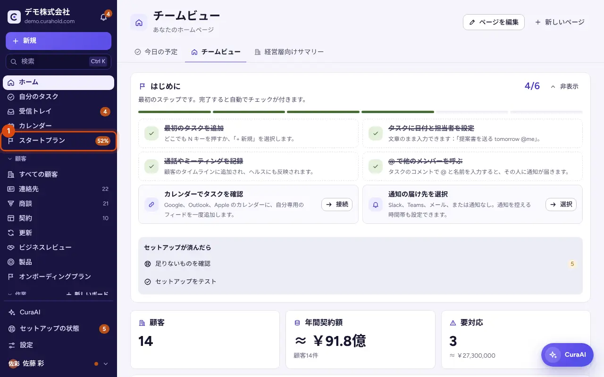
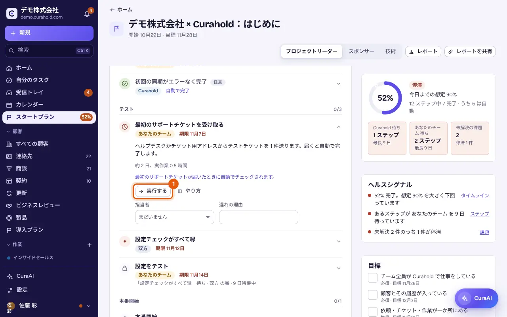
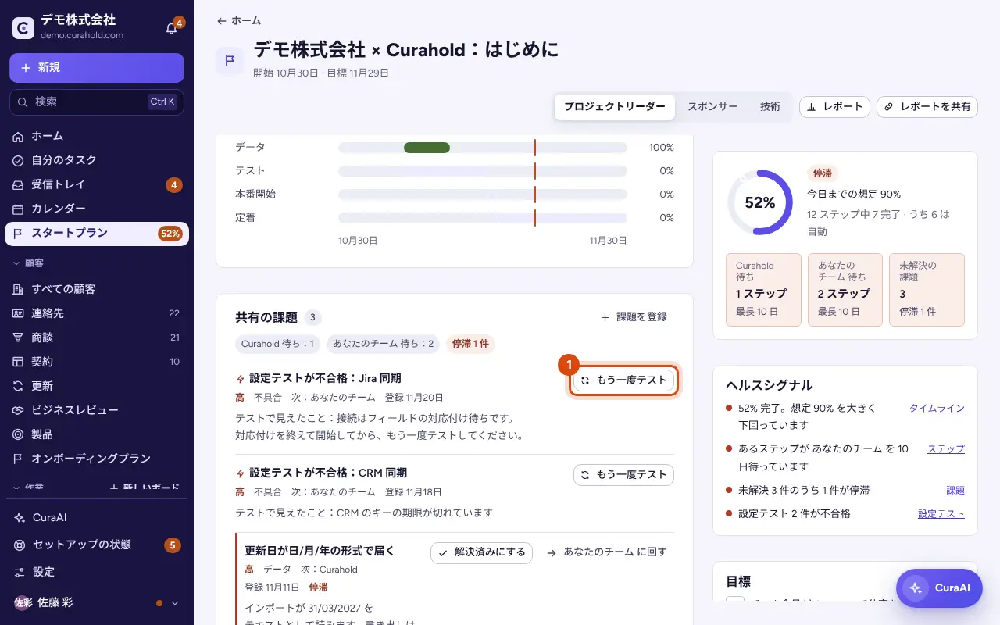
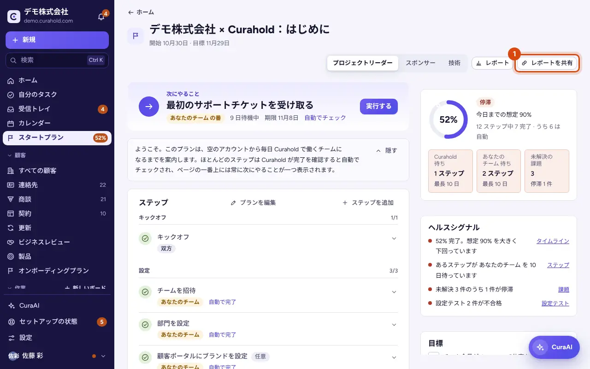
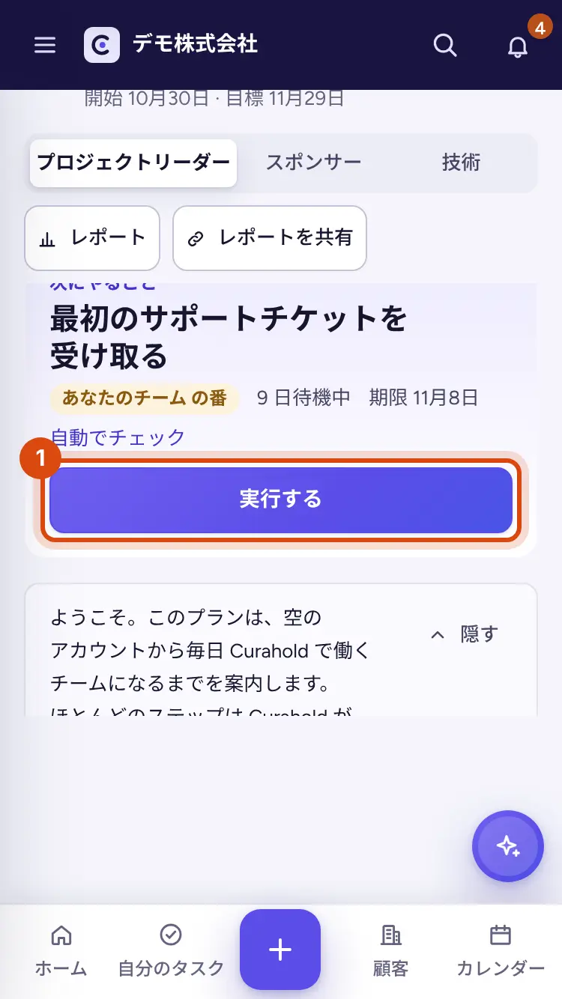

# 導入プラン

導入プランは、双方が一緒に使う一つのページです。自社が Curahold をはじめるときに使い、導入する顧客ごとにも同じプランを使います。ほとんどのステップは Curahold が完了を確認すると自動でチェックされます。手動でチェックするのは、打ち合わせなど Curahold が見られないものだけです。

## 1. プランを開く {#start}

左のメニューで**スタートプラン**をクリックします。横の数字は完了した割合です。

```text
https://<自社>.curahold.com/onboarding
```



## 2. 次のことをする {#next}

一番上のカードには、次にやること、誰の番か、どれくらい待っているかが常に表示されます。**実行する**をクリックすると、それを行う画面が開きます。


## 3. ステップを開く {#team}

ステップをクリックすると、目的、かかる時間、自動でチェックされるかがわかります。鍵の付いたステップは別のステップを待っています。下の行で、どれを待っていて誰の番かがわかります。**完了にする**は Curahold が見られないステップだけに使います。



## 4. 共有の課題を解決する {#health}

各課題には、次に動くのが誰かが示されます。5 日以上開いているか期限を過ぎたものは**停滞**になります。不合格の設定テストはここに 1 回だけ表示されます。直したら**もう一度テスト**をクリックします。合格すると課題は自動で閉じます。



## 5. データを確認する {#mapping}

データ表には、各項目について Curahold が期待するもの、受け取ったもの、4 つのルール（型・形式・必須・空欄）が表示されます。NG の行はどのルールに合わないかを示します。値が正しければ、自分の側のボックスをチェックします。

```text
2027-03-31
```


## 6. メンバーを決める {#people}

**双方のメンバー**で**メンバーを追加**をクリックし、役割を選びます。各ステップの担当者には、番が来たときと停滞したときに Curahold がアプリ内でお知らせします。メールでのお知らせは、管理者がオンにしない限りオフです。

## 7. 進捗レポートを共有する {#report}

**レポートを共有**をクリックしてリンクをコピーします。リンクを持つ人はレポートだけを見られます（メモや連絡先は含まれません）。印刷や PDF 保存は**レポート**から行います。



## 8. 顧客のプラン {#customers}

顧客の下の**導入プラン**をクリックします。商談を受注すると、引き継ぎメモ付きの下書きプランが自動で開き、引き継ぎが確認されると始まります。顧客は同じプランをポータルで貴社の色で見られます。終わったら**完了して引き継ぐ**をクリックします。ヘルススコアが基準値として保存され、カスタマーサクセスに引き継ぎカードが届きます。


## スマートフォンでは

同じページを 1 列で表示します。次にやることが一番上です。


