# セットアップの状態とテスト

推測に頼らずに設定を終えるための画面が 2 つあります。**セットアップの状態** は足りないものや間違いを教えます。**セットアップをテスト** では、チームが使うとおりにすべてを試せます。こちらで勝手に変えることはありません。直すボタンは正しい画面を開くだけで、操作はご自身で行います。

## 足りないものを見つける

1. 左のメニューで **セットアップの状態** をクリックします。横の数字は確認したほうがよい項目の数で、すべて整うと消えます。
   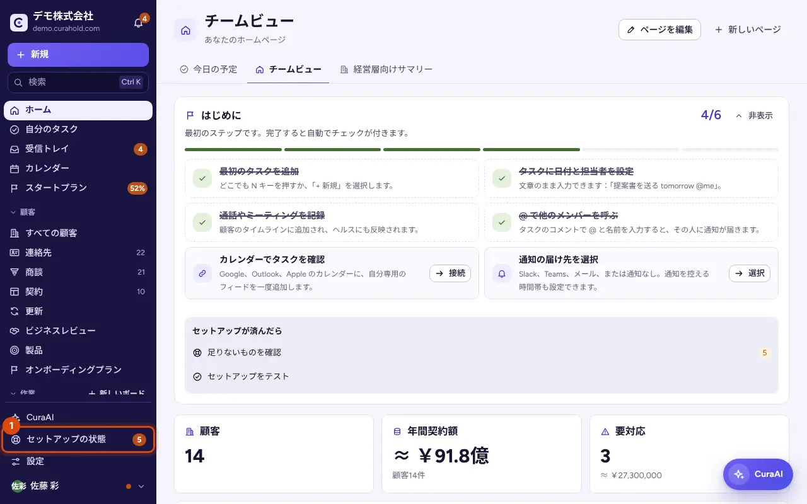
2. 最初の行を読みます。重要なものから並びます。**まずこれ**、**直しておきたい**、**手が空いたら** の順です。各行に、気づいたことと、なぜ大切かが書かれています。
   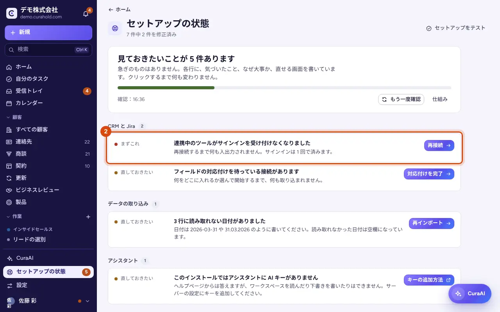
3. その行のボタンをクリックします。直すための画面がそのまま開きます。
   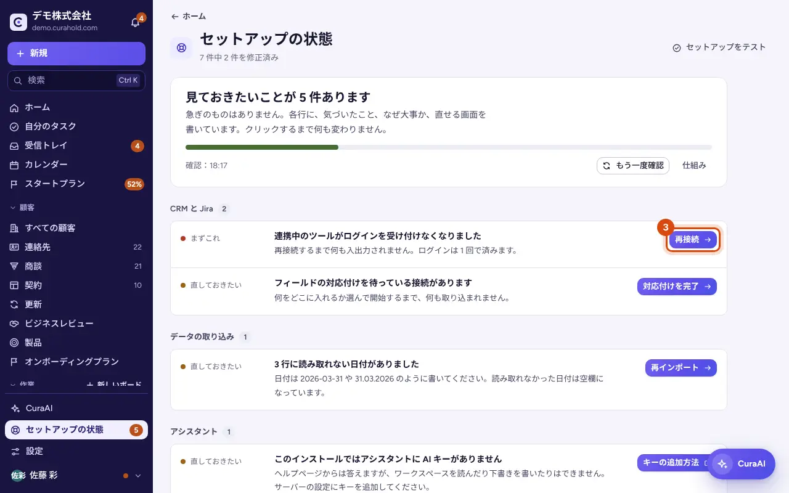
4. 直したら戻って **もう一度確認** をクリックします。行は **修正済み** に移り、ページ上部に直した数が表示されます。
   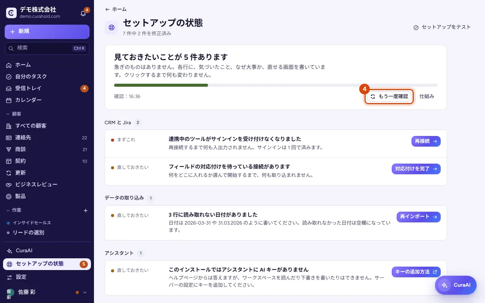
5. 問題は、それを直す画面の上部にも黄色の枠で表示されます。**すべて見る** をクリックすると一覧が開きます。
   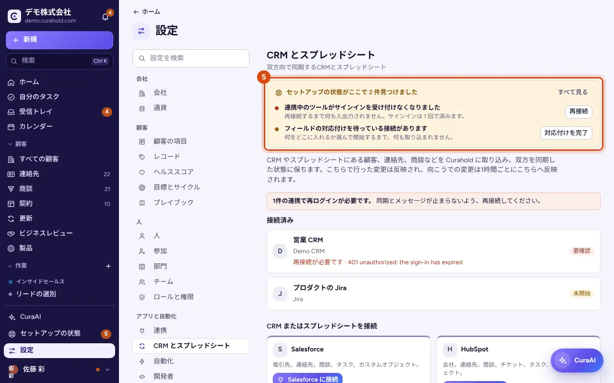

メールドメインの SPF・DKIM・DMARC レコードのように、ここからは読めないものもあります。レコードを追加してから、その行の **対応しました** をクリックします。

各自に見えるのは、自分が直せるものだけです。管理者には会社のすべてが、Curahold のサーバーを運用する人にはメールと AI キーも見えます。1 日 1 回確認し直し、新しく見つかったものに印を付けます。

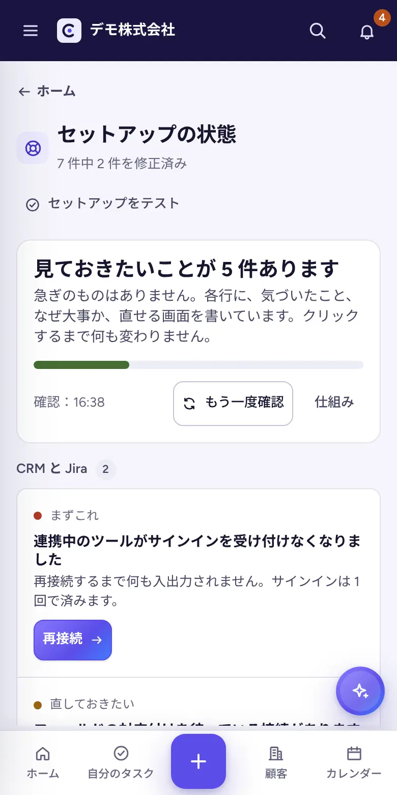

## アシスタントに聞く

アシスタントを開き、そのまま入力します：

```text
設定のどこがおかしいですか？
```

同じ問題がボタン付きで表示されます。アシスタントは読むだけで、自分で直すことはありません。

## セットアップをテストする

1. **セットアップの状態** の右上にある **セットアップをテスト** をクリックします。
   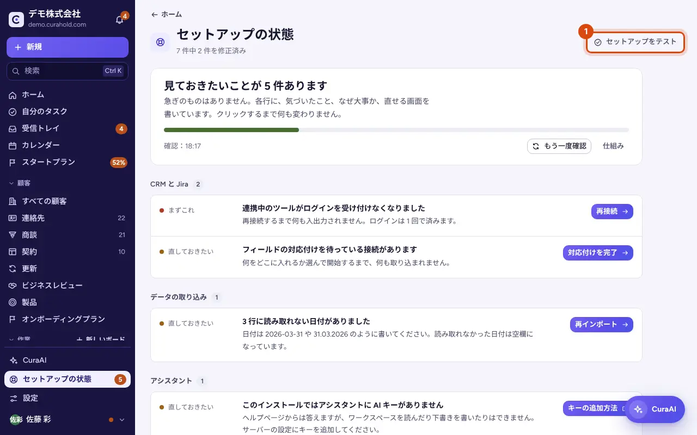
2. ステップの **テスト** をクリックします。目で確かめるステップには、代わりに **うまくいった** と **うまくいかない** があります。何で試すか（顧客・接続・同僚）を聞かれたら一度だけ選びます。次回もそのまま使われます。
   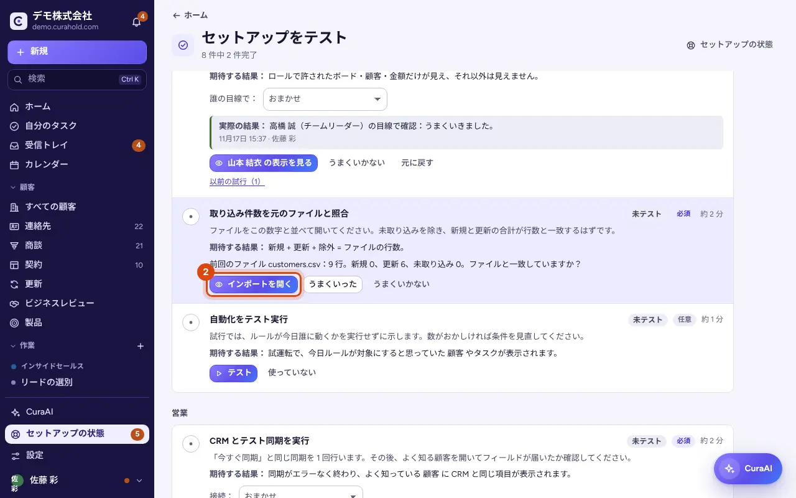
3. **実際の結果** と **期待する結果** を見比べます。一致すれば合格です。試行はすべて、誰がいつ行ったかとともに残るので、いつでも再テストできます。
   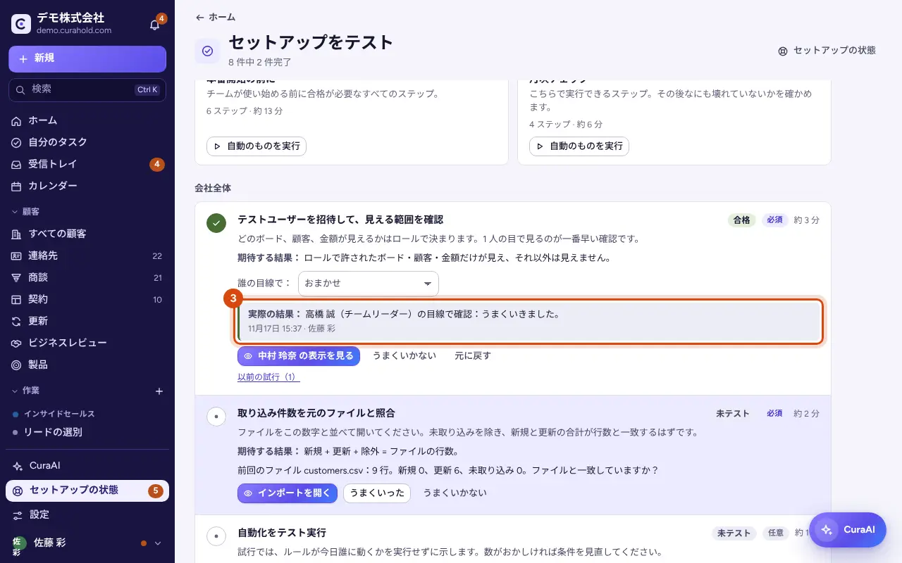
4. うまくいかなければ **直せる画面を開く** をクリックし、直してから再テストします。助けが必要なら **課題を登録** をクリックします。課題はステップに付いたまま残り、合格すると自動で閉じます。
   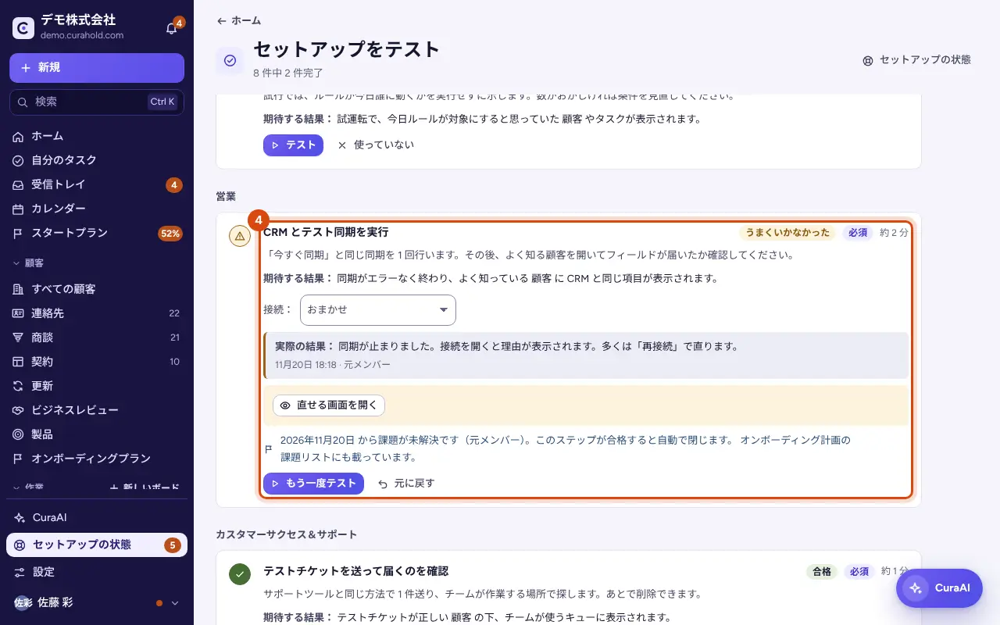
5. まとめて実行するには、セットを選びます。**本番開始の前に** か **月次チェック** を選び、**自動のものを実行** をクリックします。
   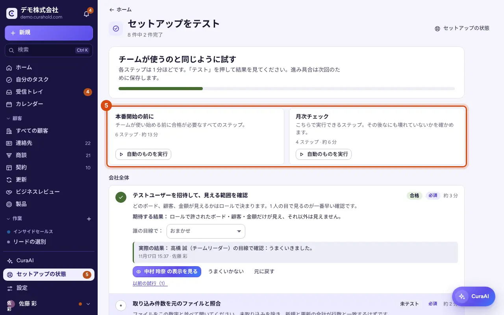
6. **必須** のステップがすべて合格したら、まず御社の管理者が **承認する** をクリックし、次に Curahold の担当者が承認します。するとページに日付つきで **セットアップ完了** と表示されます。
   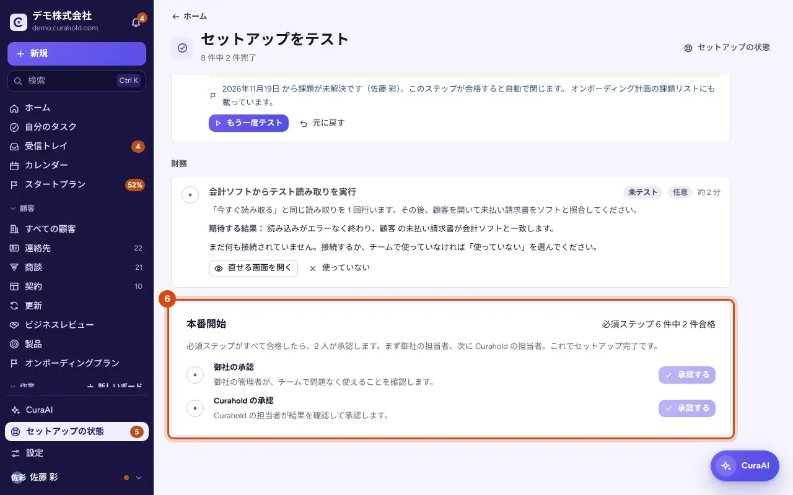

## 各チェックの意味

この表は製品自身の文言から作られるので、画面の表示といつも一致します。

<!-- setup-checks:start (scripts/docs/setup-health-page.ts writes this part) -->

### チーム

| 気づくこと | なぜ大切か | ボタン |
| --- | --- | --- |
| 今のところ、ここにいるのはあなただけです (まずこれ) | タスクや引き継ぎ、リマインダーには受け取る人が必要です。Curahold で働く人を招待しましょう。 | **メンバーを招待** |
| … 件の招待が 1 週間以上承諾されていません (手が空いたら) | メールを見落としているかもしれません。再送するか、アドレスを確認してください。 | **招待を見る** |
| … 個のロールに誰も割り当てられていません (手が空いたら) | 誰もいないロールは何もしません。適切な人に割り当てるか、一覧をすっきりさせるため削除しましょう。 | **ロールを開く** |

### 部門

| 気づくこと | なぜ大切か | ボタン |
| --- | --- | --- |
| 部門がまだ設定されていません (直しておきたい) | ボード、引き継ぎ、閲覧範囲はすべて部門に沿って動きます。各メンバーを所属部門に入れましょう。 | **部門を設定** |
| … 個の部門にリーダーがいません (直しておきたい) | 部門のボードを開けるのはリーダーだけで、部門への引き継ぎもリーダーに届きます。 | **リーダーを選ぶ** |

### データの取り込み

| 気づくこと | なぜ大切か | ボタン |
| --- | --- | --- |
| 前回のインポートで … 行が取り込まれませんでした (直しておきたい) | これらの行の一部が読み取れませんでした。行番号つきの一覧はインポート直後に表示されます。ファイルで直して再インポートしてください。取り込み済みの行は更新され、重複しません。 | **インポートを開く** |
| 前回のインポートで … 行に顧客名がありませんでした (直しておきたい) | 名前はすべての行に必要な唯一の列です。ファイルに記入して再インポートしてください。取り込み済みの行は更新され、重複しません。 | **再インポート** |
| … 行に読み取れない日付がありました (直しておきたい) | 日付は 2026-03-31 や 31.03.2026 のように書いてください。読み取れなかった日付は空欄になっています。 | **再インポート** |
| … 行に読み取れない金額がありました (直しておきたい) | 12500 や 12.500,00 のように数字だけで書き、通貨は別の列にしてください。それらの金額は空欄になっています。 | **再インポート** |
| … 件の顧客が重複しています (手が空いたら) | タスクやメモが 2 つのコピーに分かれてしまいます。1 つを残し、もう 1 つを統合しましょう。 | **表示する** |

### CRM と Jira

| 気づくこと | なぜ大切か | ボタン |
| --- | --- | --- |
| 連携中のツールがログインを受け付けなくなりました (まずこれ) | 再接続するまで何も入出力されません。ログインは 1 回で済みます。 | **再接続** |
| … 個のツールとの前回の同期が完了しませんでした (まずこれ) | その後の変更は待機中です。何が止めたかは接続のページに表示されます。 | **何が起きたか見る** |
| 受信 Webhook が 1 日間何も使えていません (直しておきたい) | すべての受信が拒否された（シークレットの誤り）か、使えなかった（一致する顧客がいない、内容が変わった）状態です。ログに理由が出ています。 | **受信 Webhook を開く** |
| WhatsApp は接続済みですが、メッセージが 1 件も届いていません (直しておきたい) | 1 日たってもこの状態なら、たいていはコールバック URL と認証トークンが Meta アプリに保存されていないか、「messages」が登録されていません。 | **連携を開く** |
| フィールドの対応付けを待っている接続があります (直しておきたい) | 何をどこに入れるか選んで開始するまで、何も取り込まれません。 | **対応付けを完了** |
| … 件の変更を相手のツールに送れませんでした (直しておきたい) | 3 回試しました。接続のページに各変更と理由が表示され、再試行できます。 | **確認する** |
| … 個の API キーが 2 週間以内に使えなくなります (直しておきたい) | それを使っているものは送信できなくなります。期限前に新しいキーを作って差し替えてください。 | **API キーを開く** |
| 今週、… 件の変更が相手のツールで上書きされました (手が空いたら) | 両側で同じ箇所が変更されました。失われたものはなく、置き換えられた値は各タスクの履歴にあります。接続のルールが意図どおりか確認してください。 | **ルールを確認** |

### 会計

| 気づくこと | なぜ大切か | ボタン |
| --- | --- | --- |
| 会計ソフトを読み取れませんでした (まずこれ) | 顧客ページの請求書と入金は、最後に読み取れた時点のままです。 | **接続を開く** |
| 会計データが 2 日間読み取られていません (直しておきたい) | 期限超過の請求書が最新でない可能性があります。今すぐ読み取るか、毎日の読み取りが止まった理由を確認してください。 | **接続を開く** |

### BI ツール

| 気づくこと | なぜ大切か | ボタン |
| --- | --- | --- |
| … 個の分析キーが 2 週間以内に使えなくなります (直しておきたい) | BI ツールのレポートが更新されなくなります。キーを再発行して、新しいキーを貼り付けてください。 | **分析キーを開く** |
| BI ツールが 1 週間データを取得していません (手が空いたら) | ダッシュボードは先週の数字のままです。スケジュール更新か、使っているキーを確認してください。 | **分析キーを開く** |

### 顧客ポータルのチェック

| 気づくこと | なぜ大切か | ボタン |
| --- | --- | --- |
| 顧客ポータルはオンですが、顧客に何も表示していません (直しておきたい) | 顧客がリクエストを送って進み具合を追えるよう、少なくとも 1 つのボードをポータルと共有しましょう。 | **共有するものを選ぶ** |
| まだ誰もポータルに招待されていません (手が空いたら) | 顧客は招待されて初めてログインできます。まず 1 つの顧客の担当者を招待しましょう。 | **顧客を招待** |
| ポータルはまだ Curahold の色のままです (手が空いたら) | ロゴと色があれば、顧客は正しい場所に来たとわかります。 | **ブランドを追加** |

### 自動化

| 気づくこと | なぜ大切か | ボタン |
| --- | --- | --- |
| … 件の自動化が存在しないフィールドを見ています (まずこれ) | このままでは実行されません。「ルールを直す」から「編集」→「保存」を押すと、自社の日付フィールドに切り替わります。またはルールをオフにしてください。 | **ルールを直す** |
| … 件の自動化が存在しないボードを指しています (まずこれ) | 作るはずのタスクの行き先がありません。別のボードを選んでください。 | **ルールを直す** |
| 自動化はまだありません (手が空いたら) | 更新の 60 日前にタスクを作る、といったルールが 1 つあれば毎回のリマインドが不要になります。すぐ使えるルールも用意されています。 | **用意されたルールを見る** |

### データのチェック

| 気づくこと | なぜ大切か | ボタン |
| --- | --- | --- |
| 担当者のいない顧客が … 件あります (直しておきたい) | リマインダーが誰にも届かず、誰の一覧にも載りません。それぞれに担当者を決めましょう。 | **担当者を決める** |
| ステージのない進行中の商談が … 件あります (直しておきたい) | パイプラインと予測から外れてしまいます。 | **商談を開く** |
| 誰も担当していない未解決のチケットが … 件あります (手が空いたら) | 担当者のいないチケットは誰のキューにも入りません。1 件ずつ割り当てるか、割り当てるルールを追加しましょう。 | **チケットを開く** |

### メール

| 気づくこと | なぜ大切か | ボタン |
| --- | --- | --- |
| このインストールはまだメールを送信しません (まずこれ) | 招待、ログインのリンク、リマインダーはサーバーのログに書かれるだけです。メールリレーかメール送信サービスを設定してください。 | **メールの設定方法** |
| メールドメインの SPF・DKIM・DMARC レコードを確認してください (直しておきたい) | これがないと招待メールは迷惑メールになるか拒否されます。ここから DNS は読み取れないので、レコードを追加してから確認してください。 | **レコードを見る** |

### プライバシー

| 気づくこと | なぜ大切か | ボタン |
| --- | --- | --- |
| 個人データの請求に対応できる人がいません (直しておきたい) | KVKK や GDPR では、誰かが個人のデータを書き出し・消去できる必要があります。1 つのロールにプライバシー権限を付けてください。 | **ロールを開く** |

### トライアルとプラン

| 気づくこと | なぜ大切か | ボタン |
| --- | --- | --- |
| トライアルは … に終了します (直しておきたい) | その後はプランを選ぶまで閲覧のみになります。何も削除されません。 | **プランを選ぶ** |
| トライアルの席はすべて埋まっています (直しておきたい) | 新しいメンバーは閲覧者としてしか参加できません。席を追加するか、1 席空けてください。 | **席を見る** |

### アシスタント

| 気づくこと | なぜ大切か | ボタン |
| --- | --- | --- |
| このインストールではアシスタントに AI キーがありません (直しておきたい) | ヘルプページからは答えますが、ワークスペースを読んだり下書きを書いたりはできません。サーバーの設定にキーを追加してください。 | **キーの追加方法** |

<!-- setup-checks:end -->

## 開発者向け

同じチェックは API でも読めます（キーの持ち主として実行）。2 つの例を、御社のアドレスとご自身のキーに置き換えてください：

```bash
curl -H "Authorization: Bearer YOUR_API_KEY" https://your-company.curahold.com/api/setup-health
```

アドレスの一覧は [リファレンス：セットアップの状態](/docs/ja/ref-setup/) にあります。
