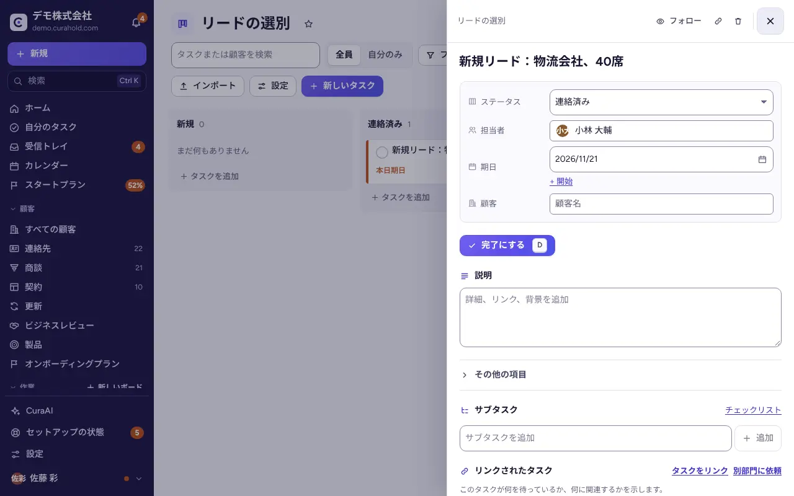

# タスクとボード

仕事はボードで進みます。ボードはチーム、会社全体、または自分だけのものにでき、列は自分で決めます。

## タスク

タスクには件名、説明、担当者（最大 10 人）、期日、優先度、そして必要なら顧客があります。サブタスク、ファイル、コメントも追加できます。タスクはボードを離れずにサイドパネルで開き、そのタスクへのリンクは送った相手にもそのまま使えます。

各カードの端の細い線は、時間に対するタスクの状況を示します：余裕あり、間近、今日、期限切れ、完了。同じ色はカレンダーと「自分のタスク」でも使われます。日付は製品の日付選択で選び、あなたの言語と日付の書き方に合わせて表示されます。

## 2 人が同じタスクを変更したとき

Curahold は誰の変更も黙って上書きしません。編集中にほかの人が保存した場合、その人の変更が残り、あなたの変更はその上に適用されます。同じ項目が本当にぶつかったときだけ確認を求めます。

## まとめて変更と元に戻す

ボードやリストで複数のタスクを選び、状態、担当者、日付、優先度をまとめて変更します。下に出る通知から **元に戻す** ことができます。

## 繰り返しのタスク

タスクを数日、数週間、数か月ごとに繰り返せます。いまのタスクを完了すると次のタスクが開きます。新しい日付の数え方は次のどちらかです：

- **期日から：** 「毎月 1 日にレポート」のような決まった予定に。
- **完了した日から：** 「前回の電話から 2 週間後にまた電話」のような仕事に。

## メンションとミュート

コメントで `@` と入力するとメンションでき、相手に通知が届きます。タスクの通知が不要になったら、そのタスクのメニューで **ミュート** を選びます。

## クイック検索

どこでも Ctrl K（Mac では ⌘ K）で、顧客、タスク、メンバー、ボード、ページを探せます。矢印キーで移動し、Enter で開きます。

## タスクのその他の機能

- **フォロー：** タスク上部のボタンで、自分の担当でないタスクのコメントや列の移動を知らせてもらえます。
- **リンクされたタスク：** あるタスクが別のタスクを **待っている**、別のタスクを **止めている**、または **関連している** と設定できます。待っているタスクのカードには「1 件待機中」と表示され、待っていたタスクが完了すると担当者に「始められます」と通知が届きます。タスクどうしを輪のように待たせることはできません。
- **開始日：** 期日の横の **+ 開始** で作業の開始日を記録します。タイムラインでは帯として表示されます。
- **費やした時間：** +15 分、+30 分、+1 時間のボタン、または手入力（"1.5"、"45m"、"1:30"）。顧客のページには、その顧客に記録された時間の合計が表示されます。
- **チェックリスト：** よく使う手順を一度保存しておけば（サブタスクを追加 → **チェックリスト → チェックリストとして保存**）、どのタスクにもワンクリックで追加できます。
- **履歴：** 誰がいつ何を変えたかが、タスクのいちばん下に 1 行ずつ残ります。
- **似たタスクの警告：** 追加しようとしているタスクが、すでに開いているタスクと似ていると、クイック追加が知らせます。

## ボード独自の項目

ボードの設定 → **項目とリクエストフォーム** で、そのボードのすべてのタスクに項目を追加できます（テキスト、数値、金額、日付、選択肢、リンク、メール、メンバー、はい／いいえ）。**完了に必須** にした項目は、タスクを「完了」の列へ移す前に入力が必要です。まとめての変更ではそうしたタスクはスキップされ、件数が表示されます。選択肢の項目はカード上に色付きのラベルで表示され、絞り込みにも使えます。

## フィルターと保存したビュー

ボード上部の **フィルター** で、担当者、期日（期限切れ、今日、7 日以内など）、優先度、ボードの選択肢項目で絞り込めます。スマートフォンでは、すべての絞り込みがひとつの **フィルター** 画面にまとまっています。いまの絞り込みには **ビュー → 保存** で名前を付けられ、必要ならボードの全員に見せられます。

## リクエストフォーム

ボードの設定で **フォームでリクエストを受け付ける** をオンにし、フォームで尋ねる内容を選びます。同僚はボードの **リクエストフォーム** ボタンを使い、リクエストは選んだ列にタスクとして届き、依頼した人は自動でフォローします。

## ほかのツールからの移行：ファイルからタスクをインポート

ボード上部の上向き矢印のボタン（**ファイルからタスクをインポート**）で、以前のツールから書き出した CSV または Excel ファイルを取り込めます。ファイルはブラウザーの中で読まれ、どの列がどこに入るかを確認するまで何も送られません。

- 列は自動で認識されます（件名、説明、状態、担当者、期日、開始日、優先度、顧客、完了日）。どれも変更でき、「取り込み後」の列で最初の数行がどう入るかを確認できます。
- **状態** は同じ名前のボードの列に入ります。「To do」「In progress」「Done」のような一般的な名前も理解され、それ以外は最初の列に入り、結果に一覧表示されます。
- **担当者** は名前またはメールで照合され、見つからない人は外されて、誰だったかが表示されます。顧客名も同じように照合されます。
- 完了したタスクは「完了したタスクも取り込む」にチェックしない限り取り込みません。
- 誰にも通知は届かず、ルールも動きません。インポート全体は 30 日以内なら **元に戻す** ことができます：誰も触れていないタスクは削除され、誰かが作業したタスクはアーカイブに移ります。

一度に最大 5,000 行です。

## カレンダー

**カレンダー** には、どの日に何があるかが表示されます：期日のあるタスク、実施済みのミーティング、通話、レビュー、更新、期限が来るビジネスレビュー。上のチップで種類ごとに表示を切り替えます。

- **日、週、月、年：** 上部の切り替えで選びます。日表示では顧客と担当者付きでその日のすべてが並び、年表示では 12 か月の小さなカレンダーが、予定の多い日ほど濃く表示されます。日付の数字をクリックするとその日が開きます。
- **誰のカレンダー：** 自分のもの、または見られる全員のもの。ロールで *チームメンバーのカレンダーを見る* ことが許可されている人（最初は管理者とチームリード）は、ひとりやチーム全体を選ぶこともできます。これは見られる範囲を絞るだけで、新しいものは何も見せないので、非公開のボードは非公開のままです。
- 表示、日付、誰のカレンダーかはアドレスに含まれるので、リンクを開けば同じものが表示されます。

## アーカイブ

完了したタスクは、ボードが十分な期間保持すると自動でボードの **アーカイブ** に移ります（既定は 90 日。ボードの設定で 30～365 日または「常に」）。何年も使ったボードでもすぐに開きます。アーカイブしたタスクはレポートに数えられたままで、ボード／リストの横の **アーカイブ** ビューで探し、**元に戻す** でボードに戻せます。戻したタスクは、再び同じ日数だけボードに残ります。リスト表示から手動でアーカイブしたタスクもここにあります。

## タスクの削除と復元

削除したタスクは、サブタスク、コメント、時間、ファイルとともに [ごみ箱](/docs/ja/trash/) に入り、30 日以内なら元に戻せます：削除直後の通知で **元に戻す** を選ぶか、メニューから **ごみ箱** を開いて **元に戻す** を選びます。タスクを削除できるのは、作成した人か、ロールですべてのタスクの削除を許可されている人だけです。完了したタスクを削除せずに目につかないようにしたいときは、アーカイブしてください。
