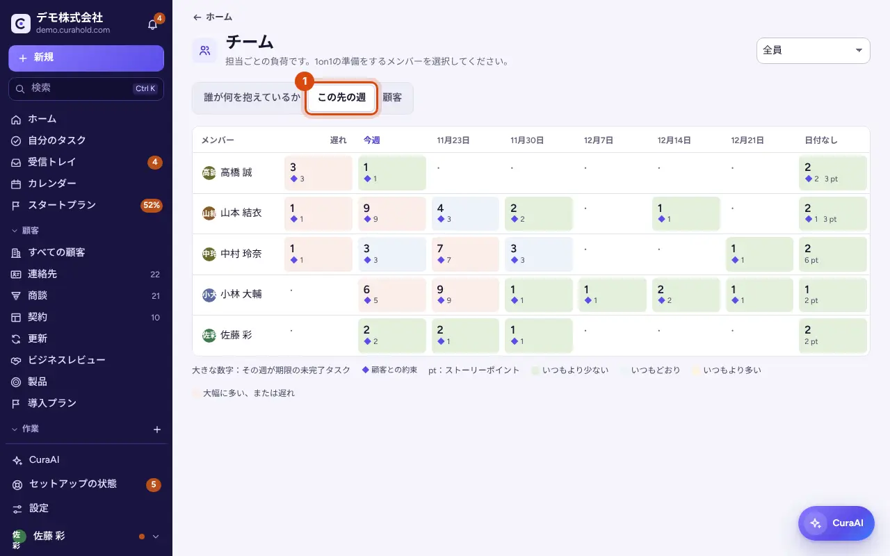
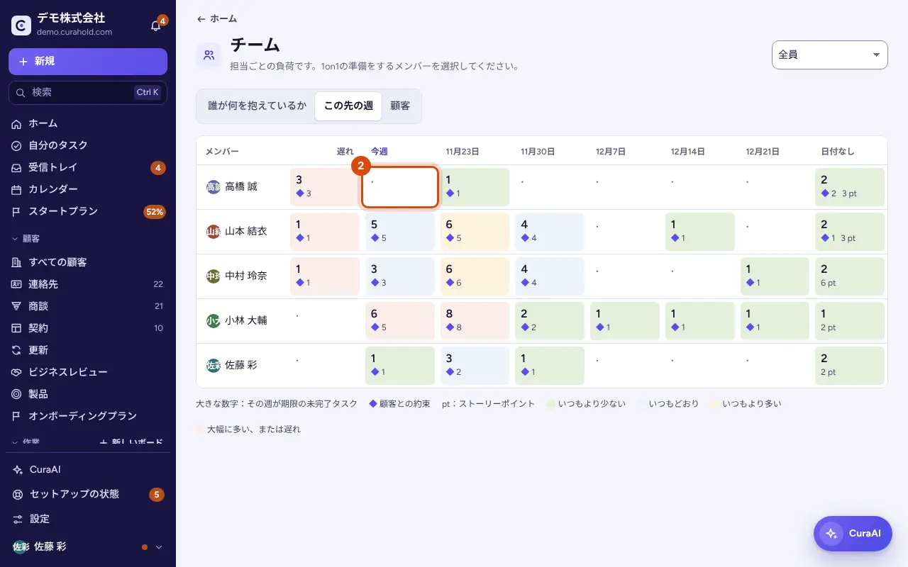
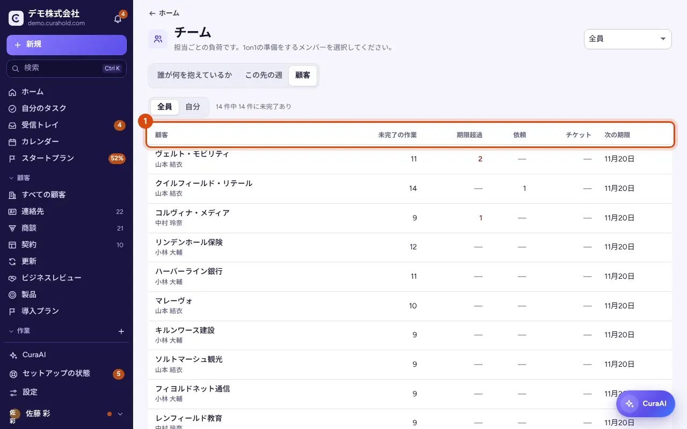
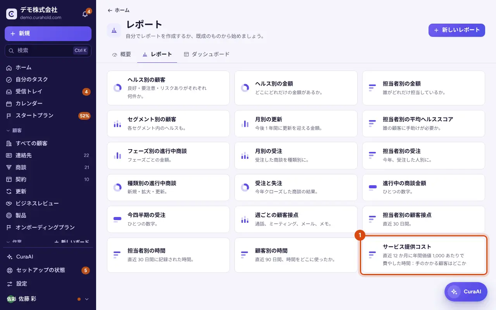

# チームの週、顧客ポートフォリオ、サービス提供コスト

**チーム**（左のメニュー）には 3 つの表示があります：**誰が何を抱えているか**、**この先の週**、**顧客**。上でチームを選ぶと、どれも絞り込めます。数えられるのは自分が見られるタスクだけです。

## この先の週に余裕があるのは誰か {#weeks}

1. **チーム** を開き、**この先の週** をクリックします。
   
2. ある人の行を週ごとに読みます。各マスの大きな数字はその週が期日の未完了タスク、◆ はそのうち顧客への約束の数、**pt** はストーリーポイントです。色はその週をその人のふだんの量と比べます：軽め、いつもどおり、重め、かなり多い。**遅れ** と **日付なし** は別の列です。マスをクリックすると、その人の 1on1 表示が開きます。
   

## 顧客ごとの未完了の仕事 {#customers}

1. **チーム** を開き、**顧客** をクリックします。何か未完了がある顧客が、忙しい順に並びます：未完了の仕事、そのうち遅れている数、先方がポータルから送った依頼、未解決のサポートチケット、次の期日。列名をクリックで並べ替え、**全員** と **自分** を切り替えます。
   

金額はここではあえて出しません。お金を見られる人は項目ごとに決まります。

## サービス提供コスト {#cost-to-serve}

1. メニューの **レポート** を開き、**レポート** タブ、続けて **サービス提供コスト** をクリックします。顧客ごとに、直近 12 か月にその仕事で記録された時間を、年間価値 1,000 あたりで表示します（ARR、なければ MRR × 12、なければ最初の金額項目）。いちばん高いのが、手のかかる顧客です。
   

レポートビルダーでは 2 つの項目が一緒に使えます：**記録時間（直近 12 か月）** と **年間価値 1,000 あたりの時間**。顧客の価値を見られない人には、コストの数字も出ません。
