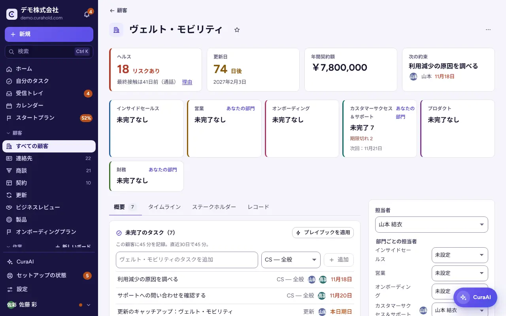

# タイムラインとヘルススコア

どの顧客のページにも **タイムライン** があり、オンにしていれば **ヘルススコア** もあります。タイムラインは顧客との間に何があったかを伝え、スコアはそれを理由付きのひとつの数字にまとめます。

## タイムライン

上のボックスで **メモ**、**通話**、**ミーティング**、**メール** のいずれかを選び、何があったかを書いて追加します。必要なら日付を変え、話した相手にチェックを入れます。

次のものは自動でタイムラインに表示されます：

- その顧客のタスクの作成と完了
- それらのタスクへのコメント
- 追加された連絡先（ステークホルダー）
- ヘルススコアが 10 ポイント以上動いた日

大事なメモは **固定** すると上に残ります。記録した本人か、顧客を管理する人が編集や削除をできます。開けないボードのタスクや、自分に見えない項目は、タイムラインにも表示されません。

## 予定しているミーティング

タイムラインは起きたことです。**予定しているミーティング** はこれからのことです。顧客のページの **今後のミーティング** で **ミーティングを計画** を選び、種類（ミーティング、レビュー、通話、または保存した種類）、開始時刻と長さ、双方の出席者、アジェンダ、繰り返すかどうかを決めます。顧客のページと **カレンダー** に表示されますが、まだタイムラインには入りません。実施されるまで何も記録されません。

予定したミーティングには流れがあります：

- 実施したら **実施済みにする**。アジェンダをメモとしてタイムラインにミーティングを記録し、両者をつなげます。繰り返す場合は次回が自動で予定されます。同時に次のステップを決めることもでき、それぞれがタスクになります。
- 理由を添えて **延期**。ミーティングは残り、同じ時刻のまま別の日に移せます。
- 理由を添えて **キャンセル**。キャンセルとして記録に残り、何も削除されません。

**保存した種類。** 管理者は、よく行うミーティング（四半期ビジネスレビュー、月次の定例など）に名前を付け、それぞれにアジェンダのひな形を付けられます。計画時に種類を選ぶとアジェンダが埋まるので、どのレビューも同じ問いから始められます。

## ヘルススコア

設定 → ヘルススコア でオンにします。Curahold にすでにある情報から、顧客ごとに 0～100 の数値を計算します：

| シグナル | 満点 | 0 点 |
| --- | --- | --- |
| 直近の接点 | 最後の通話、ミーティング、メール、メモが 14 日以内 | 45 日以上前 |
| 期限切れの作業 | 期限切れのタスクなし | 期限切れのタスクが 3 件以上 |
| サポートの負荷 | 未解決のサポートチケットなし | 未解決 5 件（緊急は 2 件と数える） |
| 推進者 | 「推進者」の連絡先が 1 人以上 | いない |
| 決裁者がわかっている | 「決裁者」の連絡先が 1 人以上 | いない |
| 反対者がいない | 反対者も懐疑的な人もいない | 反対者がいる |
| 担当者の判断 | 選択肢項目の最初の選択肢（例：「良好」） | 最後の選択肢（例：「リスクあり」） |
| 数値の項目 | 自分で決めた値 | 自分で決めた値 |

重み、日数、区分（良好、要注意、リスクあり）は自分で決めます。保存する前に、各顧客のスコアがどうなるかをプレビューで確認できます。ある顧客にデータのないシグナルは除かれ、その重みはほかのシグナルで分け合います。

> **理由** 顧客のページのスコアの横にある **理由** で、シグナルごとの点数と最近数週間のグラフが表示されます。スコアはブラックボックスではありません。1 点ごとの出どころがわかります。

スコアはほかの顧客の項目と同じように使えます：一覧の列、絞り込み、ホームのカード、エクスポート、API、Webhook。CRM 同期で項目に対応付ければ、CRM にも書き込まれます。手で入力することはできません。

その顧客に変更があると数秒以内に、また 1 日に 1 回、再計算されます。毎日のスコアは保存され、推移と週次のまとめはそこから作られます。

## 週次のまとめ

月曜、朝のまとめに選んだ時刻に、担当顧客のまとめが届きます：30 日以内の更新、下がったスコアとその主な理由、30 日以上接点のない顧客、今週の作業。あなたの設定でオフにできます。
