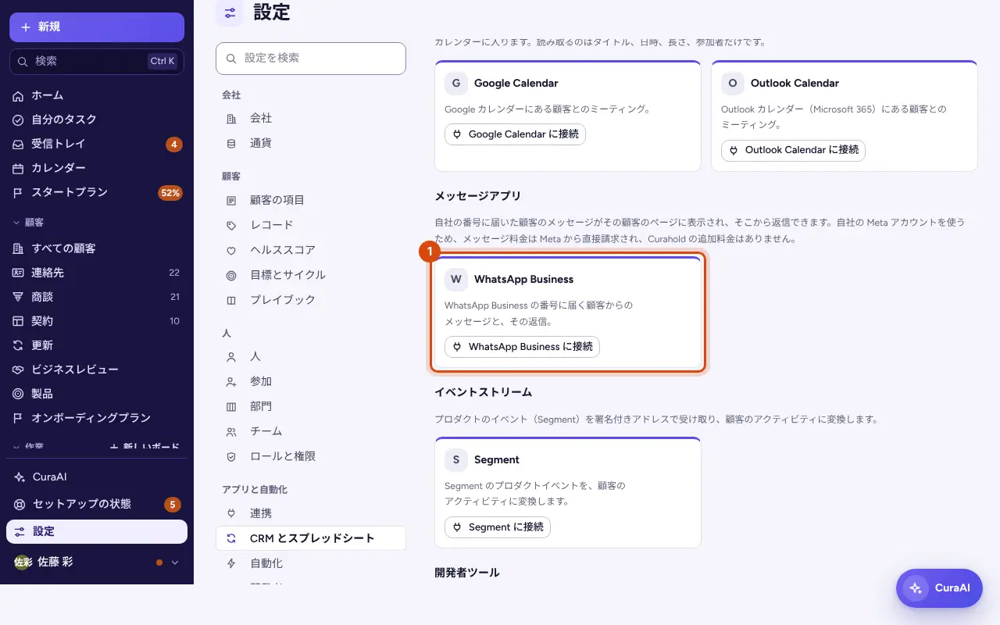
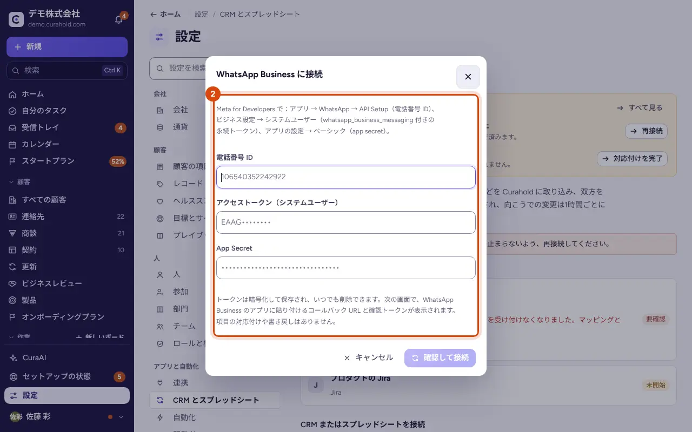

# WhatsApp Business

顧客が自社の WhatsApp Business 番号に送ったメッセージがその顧客のページに表示され、そこから返信できます。使うのは **自社の** Meta アプリと番号です。メッセージ料金は Meta から直接請求され、Curahold の追加料金はなく、Meta の請求書を見ることもありません。

## 始める前に

Cloud API に WhatsApp Business の番号がある Meta ビジネスアカウント、WhatsApp を追加した Meta アプリ、永続トークンを持つ **システムユーザー**（権限 `whatsapp_business_messaging`）が必要です。Meta のページに手順があり、15 分ほどで終わります。

## Curahold で {#connect}

1. **設定 → CRM とスプレッドシート** を開き、**メッセージアプリ** で **WhatsApp Business に接続** をクリックします。
   
2. 下の 3 つの値を貼り付けて **確認して接続** をクリックします。連携のページに **コールバック URL** と **認証トークン** が表示されます。
   

- **電話番号 ID**：Meta for Developers → アプリ → **WhatsApp → API Setup**。
- **アクセストークン（システムユーザー）**：ビジネス設定 → **システムユーザー** → ユーザー → **新しいトークンを生成**。
- **App Secret**：アプリ → **アプリの設定 → ベーシック** → **App Secret** → **表示**。

## Meta で

1. アプリを開き → **WhatsApp → Configuration**。**Webhook** の横で **Edit** をクリックします。
2. コールバック URL を **Callback URL** に、認証トークンを **Verify token** に貼り付け、**Verify and save** をクリックします。
3. **Webhook fields** の **Manage** をクリックし、**messages** をサブスクライブします。

## 届くものと返信

メッセージは、連絡先に送信者の番号がある顧客にメモとして届きます（`0532…` のような国内表記も一致します）。そのメモで **WhatsApp で返信** をクリックします。WhatsApp では、顧客の最後のメッセージから 24 時間以内だけ自由に返信できます。それ以降は、承認済みの **テンプレート** の名前と言語を求められます。

## 制限とタイミング

メッセージは Meta が送るとおりに届きます。Meta は失敗した送信を最大 7 日間再送し、各メッセージは一度だけ保存されます。Meta は 1 つの番号から送れる速さを制限しています。「混雑」の応答でそれが分かり、何も失われません。

## うまくいかないとき

期限切れや取り消されたトークンは返信時に分かります。**再接続** で新しいトークンを貼り付けてください。どの連絡先にもない番号からのメッセージは連携で件数だけ数え、保存しません。**削除** するとコールバックはすぐに止まり、顧客のメモは残ります。

## 関連項目

- [タイムラインとヘルススコア](/docs/ja/timeline-and-health/)
- [連携と CRM](/docs/ja/connections/)
