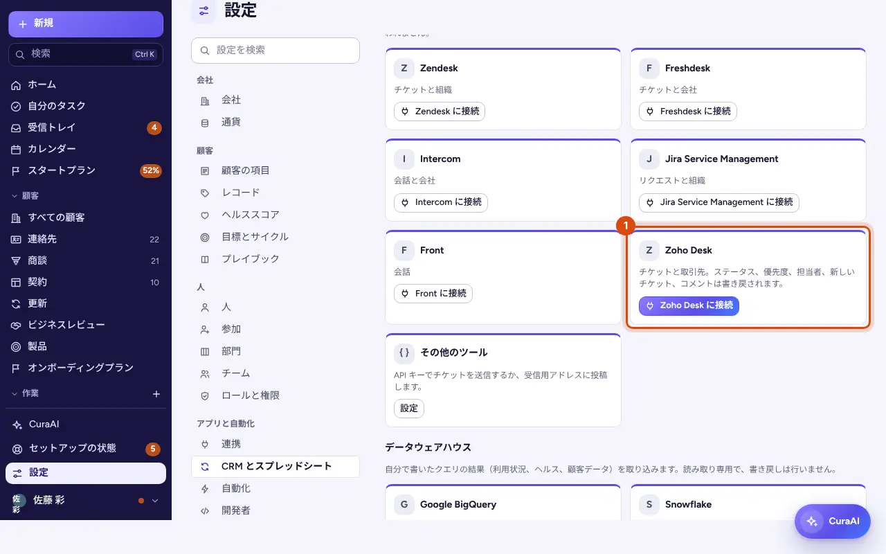

# Zoho Desk

Zoho Desk のチケットと取引先が、対応する顧客、集計、ヘルススコアに表示されます。Curahold で変えたステータス、優先度、担当者は Zoho Desk に書き戻され、Curahold で作ったチケットは Zoho Desk にも作られ、返信や非公開メモはコメントとして追加されます。

## Curahold で {#connect}

1. **設定 → CRM とスプレッドシート** を開き、**サポートツール** で **Zoho Desk に接続** をクリックします。
   

Zoho のページが開きます。ヘルプデスクの担当者でサインインし、**承諾** をクリックします。Curahold がデータセンター（.com、.eu、.in、.com.au、.jp、.sa、.uk、.ae、.ca、.com.cn）とポータルを見つけます。戻ったら **チケット** と **取引先** にチェックし、項目の対応を確認して **同期を開始** をクリックします。

## 制限とタイミング

変更は 1 時間ごとに読み取ります。Zoho はプランごとの 1 日の上限から呼び出しごとにクレジットを差し引きます。使い切ると待つよう求められ、Curahold は次回続きから再開します。Curahold からの公開返信はチケットの公開コメントになります。メールでの返信は Zoho Desk から送られます。

## うまくいかないとき

サインインの期限切れは自動で更新されます。担当者がアクセスを失うと連携は **要確認** になります。**再接続** して、もう一度サインインしてください。**削除** するとサインイン情報は消えますが、取り込んだチケットは残ります。

## 関連項目

- [連携と CRM](/docs/ja/connections/)
