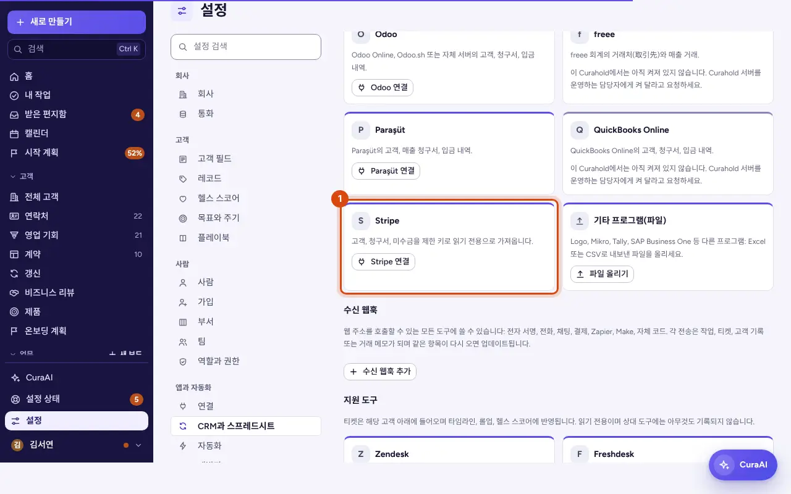

# Stripe(읽기 전용)

Stripe의 고객, 청구서(만기일과 남은 금액 포함), 입금을 가져옵니다. Curahold는 Stripe에 아무것도 쓰지 않습니다. 넘겨주는 키는 읽기만 할 수 있습니다.

## Curahold에서 {#connect}

1. **설정 → CRM과 스프레드시트**을 열고 **회계 프로그램**에서 **Stripe 연결**을 클릭하세요.
   

제한 키를 **제한 키**에 붙여 넣고 **확인 및 연결**을 클릭하세요. 모든 권한이 있는 비밀 키(`sk_…`)는 일부러 거부합니다. 그다음 **시작**을 클릭하고, 연결되지 않은 고객을 **확인 및 연결** 탭에서 확인하세요.

## Stripe에서

1. **개발자 → API 키**를 열고 **제한된 키 생성**을 클릭하세요.
2. 이름을 `Curahold`로 하세요.
3. **Customers**, **Invoices**, **Events**를 **Read**로 두고 나머지는 모두 **None**으로 두세요.
4. **키 생성**을 클릭하고 2단계로 확인한 다음 키를 복사하세요. 다음처럼 시작합니다:

```text
rk_live_
```

먼저 시험하려면 샌드박스 키(`rk_test_…`)를 쓰세요.

## 한도와 주기

첫 읽기에서 모두 가져오고, 그 뒤로는 Stripe의 이벤트 목록(Stripe가 30일 보관)에서 바뀐 것만 읽습니다. Stripe는 초당 100건(샌드박스 25건)을 허용하며 Curahold는 그보다 훨씬 적게 씁니다. 금액은 통화별 소수 자릿수대로 읽습니다(엔화는 소수 없음). Stripe가 “uncollectible”로 표시한 청구서도 여기서는 미결제로 남아 연체가 계속 보입니다.

## 문제가 생기면

교체되거나 삭제된 키는 연결을 **확인 필요**로 만듭니다. 새 제한 키를 만들어 **다시 연결**로 붙여 넣으세요. 권한이 빠지면 연결 단계에서 어떤 권한인지 알려 줍니다. **제거**하면 키가 지워지고, 읽어 온 숫자는 지울 때까지 남습니다.

## 함께 보기

- [회계 프로그램](/docs/ko/accounting/)
