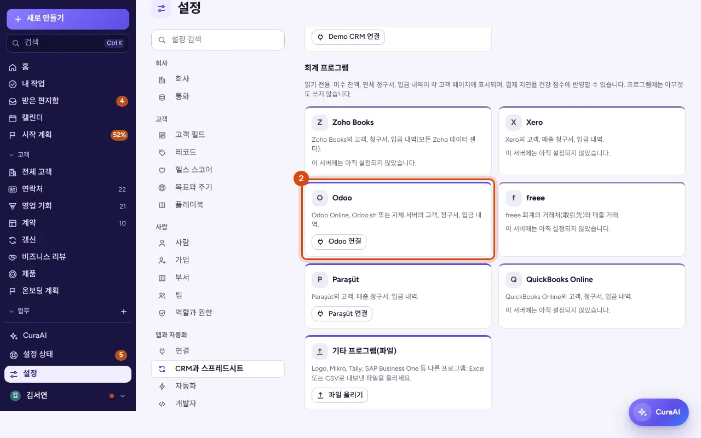

# 회계 프로그램

회계 프로그램을 연결하면 각 고객 페이지에 미수금이 표시됩니다. 미수 잔액, 연체 금액과 연체 기간, 최근 입금, 청구서입니다. 결제 지연을 헬스 스코어에 반영할 수도 있습니다. Curahold는 읽기만 하며 프로그램에는 아무것도 쓰지 않습니다.

## 지원 프로그램

| 프로그램 | 연결 방법 | 페이지 |
| --- | --- | --- |
| Zoho Books | Zoho로 로그인 | [Zoho Books](/docs/ko/accounting-zohobooks/) |
| Xero | Xero로 로그인 | [Xero](/docs/ko/accounting-xero/) |
| Odoo | 주소, 로그인, API 키 | [Odoo](/docs/ko/accounting-odoo/) |
| freee | freee로 로그인 | [freee](/docs/ko/accounting-freee/) |
| Paraşüt | 회사 번호, API 클라이언트, 사용자 | [Paraşüt](/docs/ko/accounting-parasut/) |
| QuickBooks Online | Intuit로 로그인 | [QuickBooks Online](/docs/ko/accounting-quickbooks/) |
| 기타 프로그램(Logo, Mikro, Tally, SAP Business One…) | Excel 또는 CSV 파일 | [파일](/docs/ko/accounting-file/) |

## 프로그램 연결하기 {#connect}

연결을 관리하는 권한이 필요합니다(관리자에게 있음).

1. **설정 → CRM과 스프레드시트**를 열고 **회계 프로그램**까지 스크롤합니다. 쓰는 프로그램 타일의 **… 연결**을 누르거나, **기타 프로그램(파일)**에서 **파일 올리기**를 누른 뒤 위 표에 있는 그 프로그램의 페이지를 따라갑니다.
   

## 고객 연결

회계 프로그램의 각 고객은 Curahold의 고객 한 명과 연결됩니다. 먼저 사업자 번호, 그다음 웹 주소나 이메일 도메인, 마지막으로 이름입니다(Ltd., A.Ş., 株式会社 같은 회사 형태는 무시). 정확히 한 고객이 맞으면 연결하고, 없거나 여럿이면 연결의 **연결** 탭에서 기다립니다. 그곳에서 고객을 고르거나 제외할 수 있습니다. 직접 한 연결은 유지됩니다.

## 수치를 볼 수 있는 사람

금액은 **재무 수치 보기** 권한이 있는 역할에만 보입니다(처음에는 관리자와 매니저, 설정 → 역할과 권한에서 변경). 고객을 볼 수 있는 다른 사람은 헬스 스코어 안에서 결제가 며칠 늦었는지만 보며, 금액은 보지 못합니다.

**재무** 부서 사람은 역할과 관계없이 금액을 볼 수 있고, 설정 → 부서의 **고객 페이지에서 재무를 볼 수 있는 사람**에서 고른 부서도 마찬가지입니다. 재무 부서를 끄면 이 권한도 사라집니다.

## 헬스 스코어의 결제 지연

첫 읽기를 시작할 때 **결제 지연을 헬스 스코어에 반영**을 선택할 수 있습니다. **제때 결제** 신호는 연체가 없으면 만점, 가장 오래된 미결제 청구서가 60일 늦으면 0점을 줍니다. 두 숫자 모두 설정 → 헬스 스코어에서 바꿀 수 있습니다. 프로그램과 연결되지 않은 고객은 계산하지 않습니다.

## 연결 상태

회계 연결은 설정 → 연결에 다른 연결과 함께 표시됩니다. 정상, 문제, 일시 중지 중 하나와 마지막으로 정상 작동한 시각입니다.
