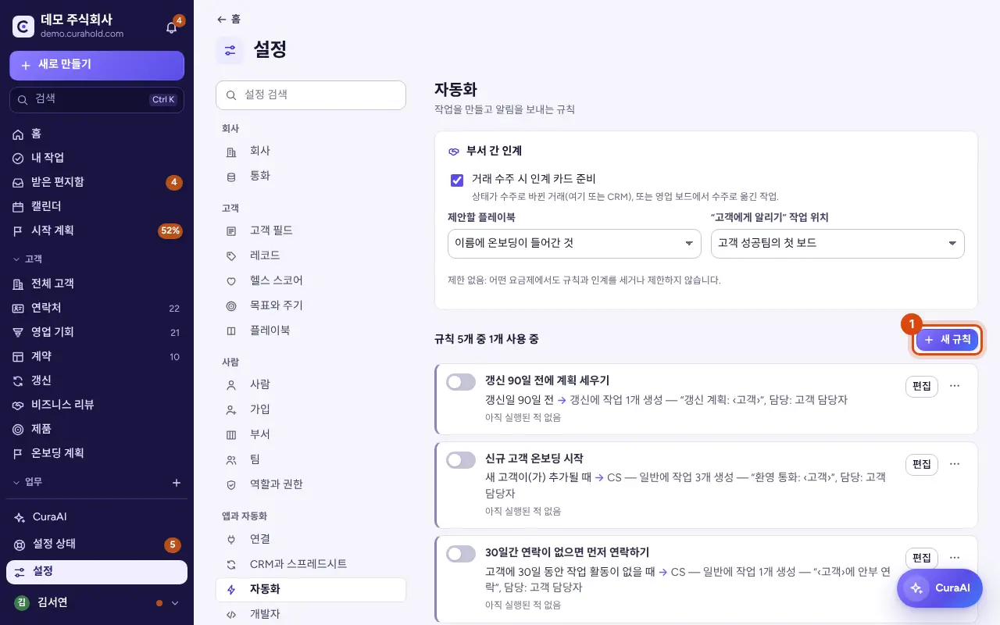
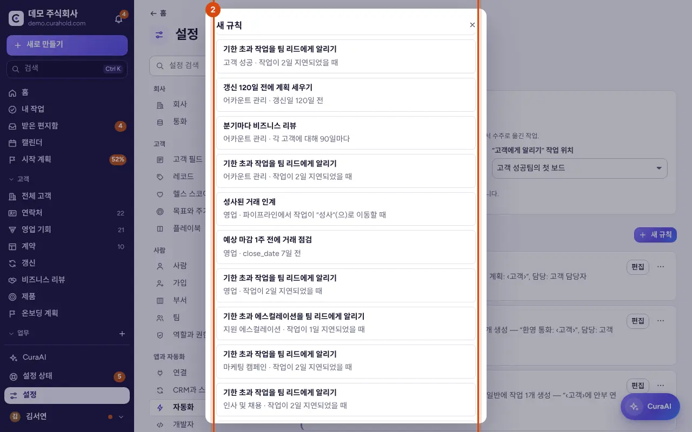
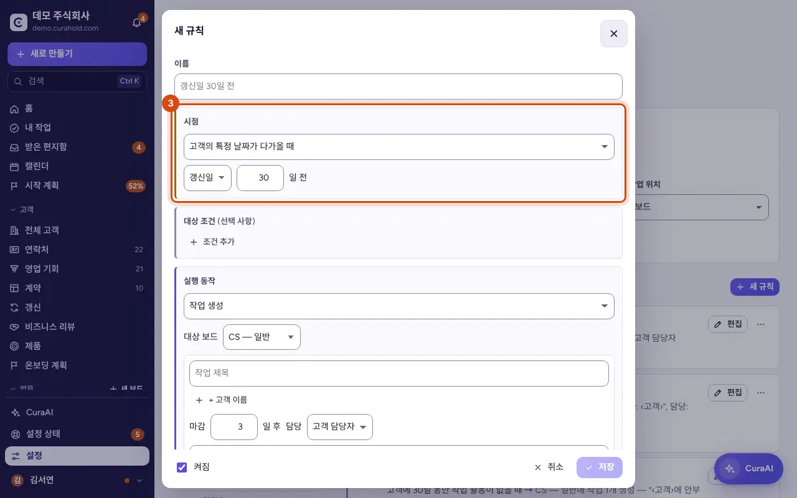
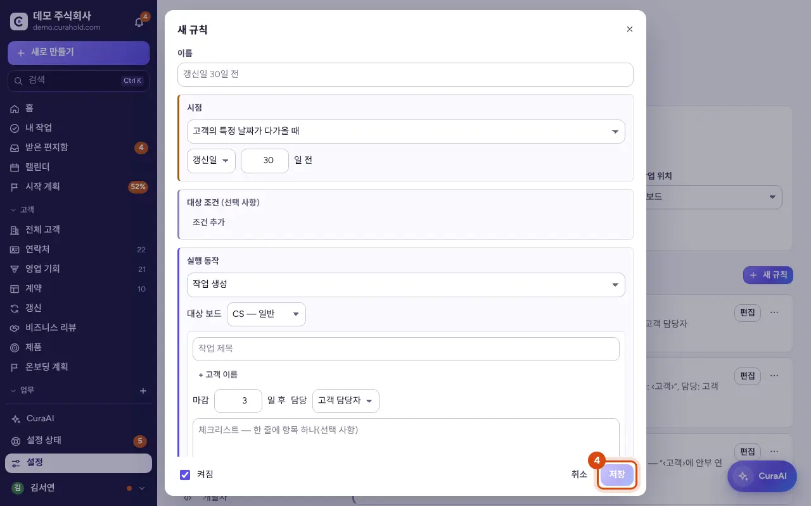

# 자동화

규칙이 반복 업무를 대신합니다: 90일 전 갱신 계획, 새 고객 환영 통화, 작업이 늦을 때 알림, 거래 수주 시 인계 카드. 어떤 요금제에서도 집계되지 않고 한도도 없습니다.

## 규칙 만들기 {#new-rule}

자동화를 관리하는 권한이 필요합니다(관리자에게 있음).

1. **설정 → 자동화**를 열고 **새 규칙**을 누릅니다.
   
2. 맞는 기본 규칙을 고르거나 **처음부터 시작**을 고릅니다.
   
3. **시점**에서 규칙을 시작할 계기와 세부 사항(어떤 날짜, 며칠, 어떤 보드)을 고릅니다. 일부 고객이나 작업으로 좁히려면 **조건 추가**를 누릅니다. **실행 동작**에서 무엇을 할지 고릅니다. 아래의 "오늘 기준 …건에 실행됩니다"에서 지금 무엇에 적용될지 보여 줍니다. 아직 아무것도 바뀌지 않습니다.
   
4. **이름**을 붙이고 **켜짐**을 체크한 채로 **저장**을 누릅니다.
   

## 규칙을 시작하는 계기 {#when}

고객의 다가오는 날짜(갱신, 계약 종료), 고객마다 며칠 간격, 조용해진 고객, 새 고객, 지연된 작업, 열로 옮겨진 작업, 추가되거나 끝난 작업, 보드 양식으로 들어온 요청, 단계에 도달한 레코드, 생성된 지원 티켓.

## 규칙이 할 수 있는 일 {#then}

작업 열기(체크리스트 포함, 고객 담당자나 누구에게나), 알림 보내기, 배정, 이동, 필드 설정, 댓글 쓰기, 웹훅으로 보내기, 인계 카드 준비.

## 실행과 중지 {#running}

규칙마다 최근 30일 동안 몇 번 실행되었는지 보여 줍니다. **지금 실행**은 예약된 규칙을 다음 정각을 기다리지 않고 바로 실행하며, 여전히 경우마다 한 번만 적용됩니다. 잠시 멈추려면 규칙을 끕니다. 규칙을 삭제해도 이미 연 작업은 남고, 규칙은 30일 동안 휴지통에 남습니다.

같은 페이지 위쪽의 인계 설정은 [인계, 요청, 고객에게 다시 알리기](/docs/ko/handover-and-requests/)에 있습니다.
