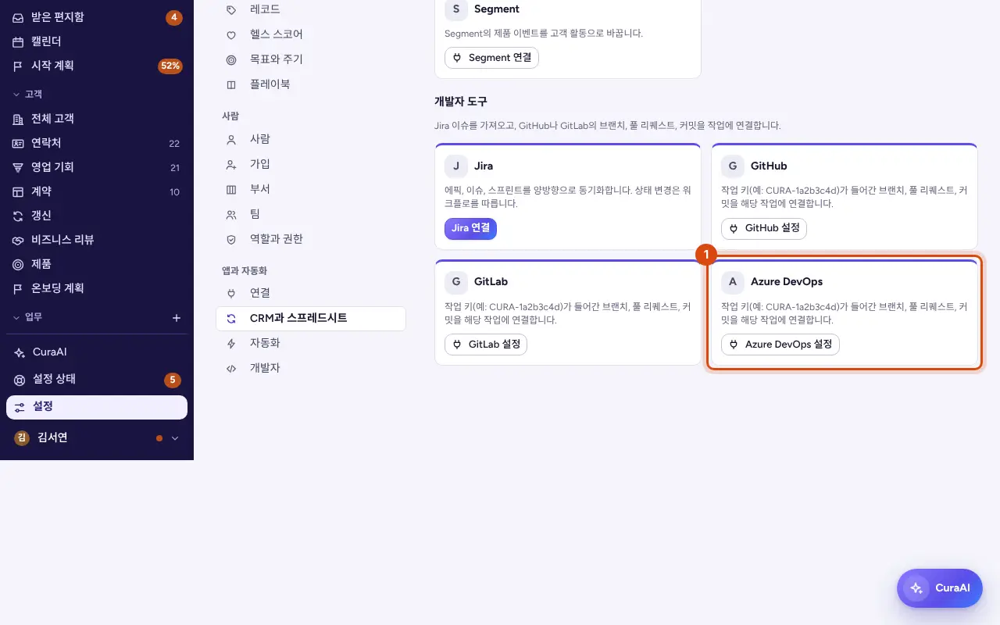
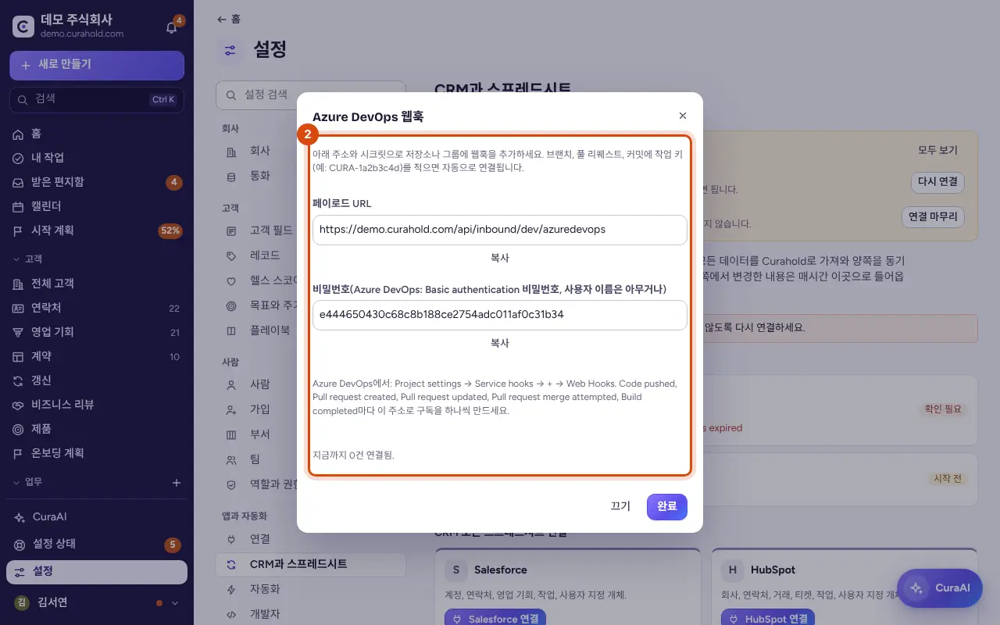

# Azure DevOps

작업을 언급한 Azure Repos의 브랜치, 풀 리퀘스트, 커밋이 그 작업에 연결되며 상태(열림, 병합됨, 닫힘)와 빌드 결과도 보입니다. GitHub·GitLab과 같게, 브랜치 이름이나 풀 리퀘스트 제목, 커밋 메시지에 작업 키(예: `CURA-1a2b3c4d`)를 쓰세요.

## Curahold에서 {#connect}

1. **설정 → CRM과 스프레드시트**을 열고 **개발자 도구**에서 **Azure DevOps 설정**을 클릭하세요.
   
2. **켜기**를 클릭한 다음 표시된 **주소**와 **비밀번호**를 복사하세요.
   

## Azure DevOps에서

이벤트마다 한 번씩 하세요(Code pushed, Pull request created, Pull request updated, Pull request merge attempted, Build completed):

1. 프로젝트를 열고 → **Project settings** → **Service hooks** → **+**(Create subscription).
2. **Web Hooks**를 고르고 **Next**를 클릭하세요.
3. 이벤트를 고르고 필터는 그대로 둔 채 **Next**를 클릭하세요.
4. 주소를 **URL**에 붙여 넣으세요. **Username**은 아무거나(예: `azure`) 쓰고 비밀번호를 **Password**에 붙여 넣으세요.
5. **Resource details to send**는 **All**로 두고 **Test**, 이어서 **Finish**를 클릭하세요.

## 한도와 주기

Azure DevOps가 보내는 즉시 연결이 나타납니다. Azure DevOps는 HTTPS로만 보내고 서명은 하지 않습니다. 비밀번호가 증명이므로 비밀번호처럼 관리하세요.

## 문제가 생기면

Azure DevOps는 각 전송의 응답을 **Service hooks → History**에 보여 줍니다. 401은 비밀번호가 틀렸다는 뜻입니다(웹훅을 다시 켜서 새 비밀번호를 받고 모든 구독을 업데이트하세요). **끄기**하면 새 연결이 멈추고, 기존 연결은 작업에 남습니다.

## 함께 보기

- [연결과 CRM](/docs/ko/connections/)
- [작업과 보드](/docs/ko/tasks/)
