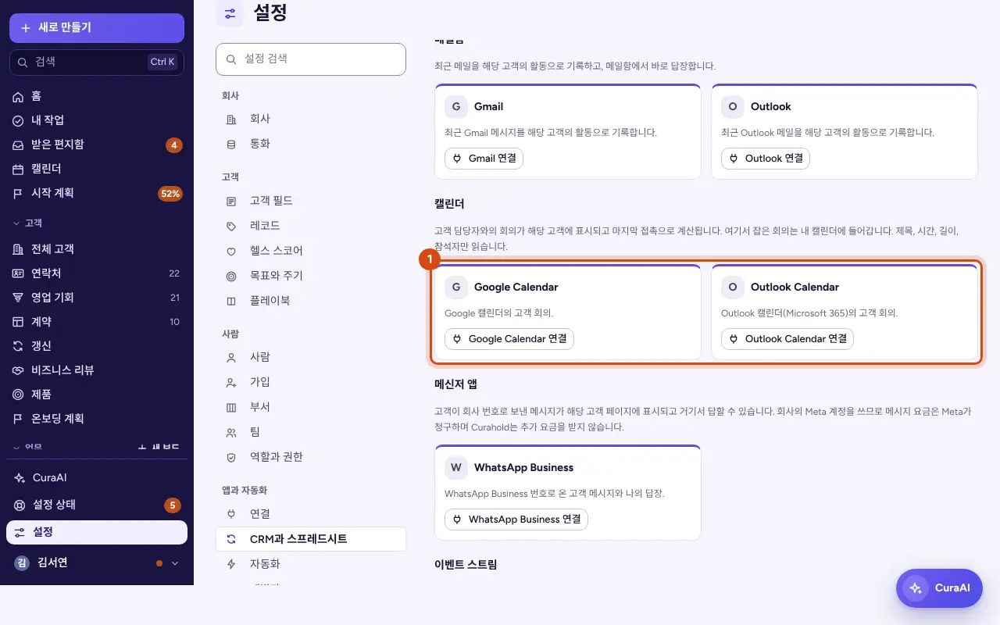

# Google 캘린더와 Outlook 캘린더

캘린더를 연결하면 고객 담당자와 한 회의가 길이와 함께 그 고객의 타임라인에 회의로 표시되고, 마지막 접촉으로 계산됩니다. 고객 타임라인에서 캘린더에 바로 회의를 잡을 수도 있으며, 초대는 캘린더가 보냅니다.

## 읽는 것과 읽지 않는 것

기본 캘린더에서 이미 열린 회의만 읽습니다: 제목, 시간, 길이, 참석자. 설명, 장소, 통화 링크는 읽지 않습니다. 비공개 회의, 종일 일정, 외부 참석자가 없는 회의는 빠집니다. 회의는 연락처가 참석자인 고객, 또는 웹 주소가 참석자의 도메인과 같은 고객에 기록됩니다.

## Curahold에서 {#connect}

1. **설정 → CRM과 스프레드시트**을 열고 **캘린더**에서 **Google Calendar 연결** 또는 **Outlook Calendar 연결**을 클릭하세요.
   

Google 또는 Microsoft 페이지가 열립니다. 업무용 계정을 고르고 **허용**(Google) 또는 **수락**(Microsoft)을 클릭하세요. Curahold로 돌아와 **시작**을 클릭하면 최근 90일을 읽고, 그 뒤로는 한 시간마다 읽습니다.

## 회의 잡기

고객 페이지에서 **타임라인**을 열고 **Google Calendar에 회의 잡기**(또는 Outlook)를 클릭하세요. 제목, 시간, 길이, 참석자 이메일을 입력하고 **…에 추가**를 클릭하세요. 회의는 열린 뒤에 타임라인에 나타납니다.

## 한도와 주기

한 시간마다 읽습니다. 지난 일주일 안에 이름이 바뀌거나 취소된 회의는 업데이트되거나 제거됩니다. Google과 Microsoft는 분당 요청 수를 제한합니다. “바쁨” 응답이면 읽기가 잠시 멈추고 다음에 이어서 읽습니다.

## 문제가 생기면

로그인이 만료되면 저절로 갱신됩니다. 접근 권한이 회수되면(비밀번호 변경, 관리자 결정 등) 연결이 **확인 필요**로 표시됩니다. **다시 연결**을 클릭하고 같은 계정으로 로그인하세요. **제거**하면 로그인 정보가 지워지고, 타임라인의 회의는 남습니다.

## 함께 보기

- [타임라인과 헬스 스코어](/docs/ko/timeline-and-health/)
- [연결과 CRM](/docs/ko/connections/)
