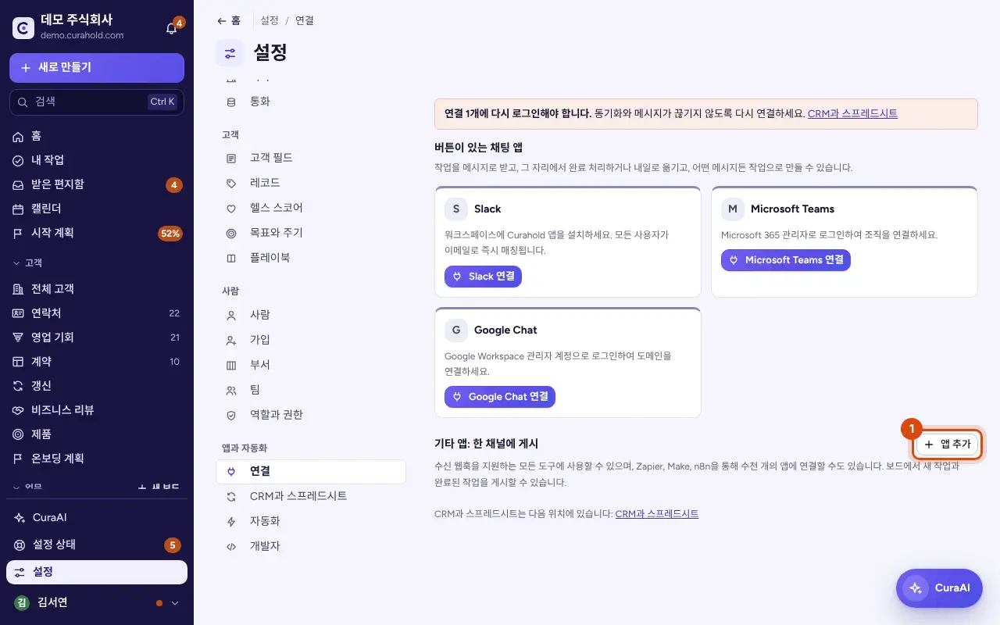
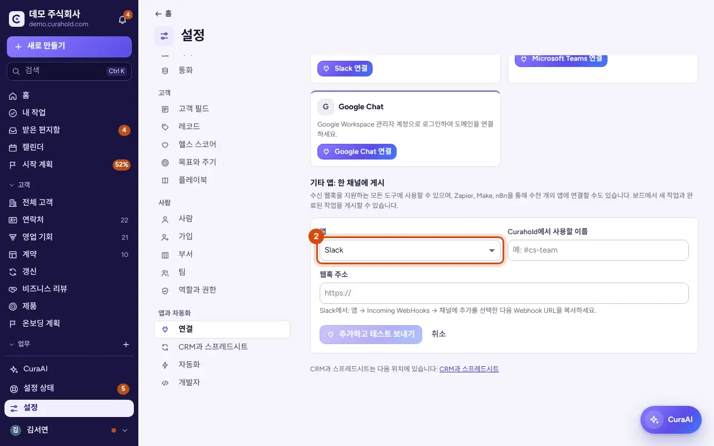

# Lark, Feishu, Telegram 알림

보드는 새 소식(새 작업, 완료된 작업)을 그룹 채팅에 올릴 수 있습니다. Lark와 Feishu는 그룹의 사용자 지정 봇을, Telegram은 2분이면 만드는 봇을 씁니다. 둘 다 단방향이라 올리기만 하고, 그쪽에서 답장을 받지는 않습니다.

## Curahold에서 {#connect}

1. **설정 → 연결**을 열고 **앱 추가**를 클릭하세요.
   
2. **Lark · Feishu** 또는 **Telegram**을 고르고, 아래 단계에서 받은 값을 붙여 넣은 뒤 **추가하고 테스트 보내기**를 클릭하세요. 그룹에 테스트 메시지가 도착합니다.
   

그다음 보드를 열고 보드 설정의 알림에서 원하는 소식에 새 연결을 고르세요.

## Lark · Feishu

1. 그룹에서 **설정 → 봇 → 봇 추가 → 사용자 지정 봇**을 열고 이름을 정한 뒤 **추가**를 클릭하세요.
2. **웹훅 주소**를 복사하세요. 다음과 같은 모양입니다:

```text
https://open.larksuite.com/open-apis/bot/v2/hook/0f3c2a9e-7d1b-4c55-9a7e-2b8f6c1d3e4f
```

선택 사항이지만 권장: **보안 설정**에서 **서명 확인**을 켜고 비밀 키를 Curahold의 **서명 키**에 복사하세요. 키워드 필터는 쓰지 마세요. 메시지가 버려집니다.

## Telegram

1. Telegram에서 **@BotFather**에게 메시지를 보내 `/newbot`을 보내고, 두 질문에 답한 다음 받은 **토큰**을 복사하세요.
2. 봇을 그룹에 추가하세요(채널이라면 관리자로).
3. 그룹에 메시지를 하나 보내세요. Curahold가 그 메시지로 그룹을 찾으므로 ID는 몰라도 됩니다.
4. 토큰을 Curahold의 **봇 토큰**에 붙여 넣으세요. 공개 채널이라면 `@이름`을 입력해도 됩니다.

## 한도와 주기

Lark는 봇당 분당 약 100건, Telegram은 그룹당 분당 약 20건을 받습니다. “바쁨” 응답은 다시 보내지며 사라지지 않습니다. Telegram 메시지는 일반 텍스트이며 최대 4,096자입니다.

## 문제가 생기면

서명 키가 틀리거나, 봇이 제거되었거나, 토큰이 취소되면 설정 → 연결에서 연결이 **확인 필요**로 표시되고 테스트도 그렇게 알려 줍니다. 상대 쪽에서 고친 뒤 다시 **테스트 보내기**를 클릭하세요. 테스트가 성공하면 문제가 사라집니다. **제거**하면 올리기가 멈추고, 봇은 그룹에서 직접 내보낼 때까지 남습니다.

## 함께 보기

- [연결과 CRM](/docs/ko/connections/)
- [알림](/docs/ko/notifications/)
