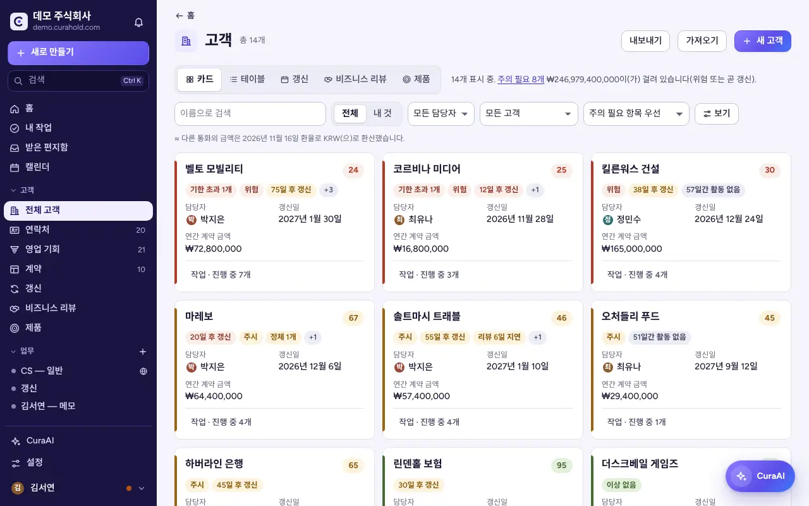
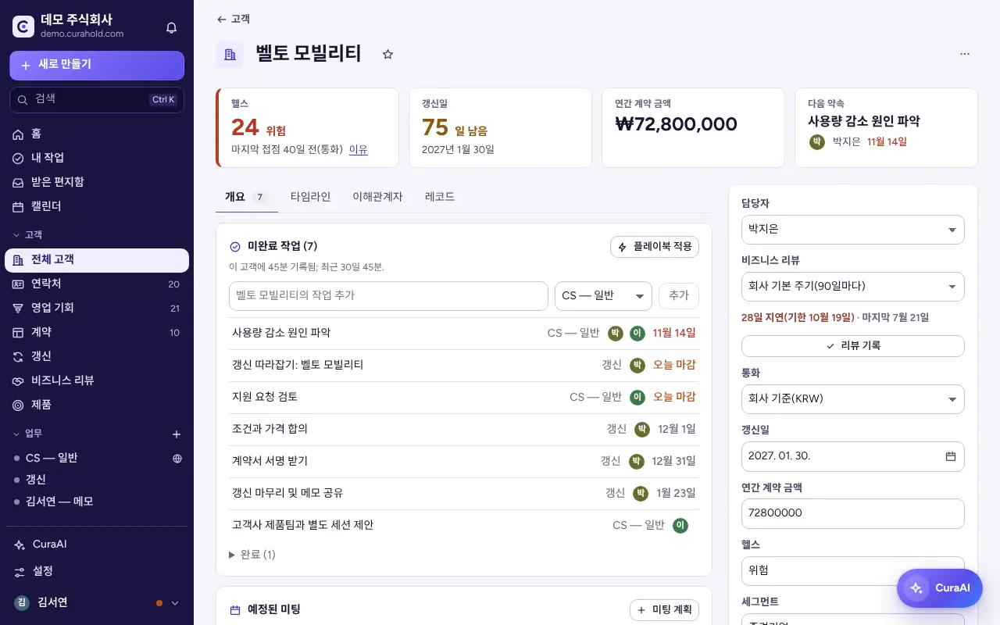

# 고객, 필드, 레코드

Curahold의 중심에는 고객이 있습니다. 고객마다 담당자, 팀(선택), 그리고 회사에서 정한 필드가 있습니다.

## 고객 페이지

고객 페이지 맨 위에는 한눈에 읽는 띠가 있습니다: 이유와 **이유** 버튼이 있는 **헬스**, 갱신일과 남은 일수, 연간 계약 금액, 그리고 **다음 약속**(고객에게 약속한 가장 가까운 단계와 그 담당자). 띠 아래에는 탭이 있습니다: **개요**(열린 작업과 예정된 미팅), **타임라인**, **이해관계자**, **레코드**, **상세 내용**. 열려 있는 탭은 주소에 남으므로, 새로 고치거나 링크를 보내도 같은 탭이 열립니다.

## 필드

설정 → 고객 필드에서 필드를 추가합니다: 텍스트, 숫자, 금액, 날짜, 선택, 이메일, 링크. 선택 필드의 옵션에는 색을 지정할 수 있어서, 헬스 같은 필드가 목록과 카드에 그 색으로 표시됩니다.

"고객"이라는 이름도 바꿀 수 있습니다: "어카운트", "브랜드", "파트너" 등 팀에서 쓰는 말이 인터페이스 전체에 표시됩니다.

## 레코드: 연락처, 영업 기회 등

고객 아래에 레코드를 둡니다.

- **연락처(이해관계자):** 직함, 의사결정 역할(의사결정권자, 승인자(예산), 영향력 행사자, 평가자, 사용자), 우리를 대하는 태도(핵심 지지자, 지지자, 중립, 회의적, 반대자).
- **영업 기회:** 금액, 마감일, 단계, 상태.
- **직접 만든 레코드 유형:** 예를 들어 "프로젝트"나 "계약".

레코드는 고객 필드를 채울 수 있습니다: "열린 파이프라인", "핵심 지지자 수", "반대자 수". 레코드가 바뀌면 필드가 저절로 업데이트됩니다.

## 보기: 카드, 테이블, 갱신, 제품

고객 페이지 위쪽 버튼으로 네 가지 보기를 오갑니다. 선택한 보기는 그 기기에 기억됩니다.

- **카드:** 고객마다 카드 한 장. 살펴볼 일을 알려 줍니다: 지연된 작업, 위험하거나 주의가 필요한 헬스, 다가오거나 지난 갱신, 14일 동안 손대지 않은 작업, 30일 동안 연락 없음. 가장 심각한 것이 먼저 나오고, 아무것도 없으면 "이상 없음"이라고 표시됩니다. 기본 정렬은 "주의가 필요한 순"이며 이름, 헬스, 금액, 갱신, 열린 작업으로 정렬할 수 있습니다. 카드에 표시할 필드는 **보기** 메뉴에서 고릅니다.
- **테이블:** 정렬할 수 있는 목록으로, 여러 고객을 한 번에 바꿀 수 있습니다.
- **갱신:** 앞으로 12개월의 갱신을 월별로 보여 주고, 월별 합계와 그중 위험하거나 주의가 필요한 금액을 표시합니다.
- **제품:** 레코드 유형의 선택 필드(예: "구독 → 제품")를 기준으로 누가 어떤 제품을 쓰는지 보여 줍니다. 빈 칸의 **+**를 누르면 그 고객에 대한 교차 판매 작업이 열립니다.

맨 위 문장은 주의가 필요한 고객 수와 위험한 금액을 알려 주고, "주의 필요" 링크를 누르면 목록이 그 고객들로 좁혀집니다. 휴대폰에서는 모든 필터가 하나의 **필터** 시트에 모여 있습니다.

## 갱신 추가하기

갱신은 고객의 **갱신일**입니다. 고객을 열고 **상세 정보**에서 입력하거나, 가져오기를 할 때 열로 함께 가져옵니다. 그러면 고객이 **갱신**에서 해당 월에 금액과 함께 표시됩니다. 아직 그런 필드가 없나요? 설정 → 고객 필드에서 날짜 필드를 추가하세요. 갱신 작업이 자동으로 열리게 하려면 설정 → **목표와 주기**에서 **갱신 자동 시작**을 켜고, 얼마나 미리, 어떤 플레이북으로 시작할지 고르세요.

## 가져오기

Excel 또는 CSV 파일을 끌어다 놓고, 열을 필드에 맞추고, 미리보기를 확인한 뒤 가져옵니다. 잘못된 가져오기는 30일 동안 클릭 한 번으로 되돌릴 수 있습니다.

## 내보내기

고객과 레코드 목록을 현재 필터 그대로 Excel 또는 CSV로 내려받습니다. 파일은 브라우저에서 만들어지며, 볼 권한이 없는 필드는 파일에도 들어가지 않습니다.

## 여러 고객을 한 번에 바꾸기

목록에서 여러 고객을 선택하고 담당자, 팀 또는 필드를 한꺼번에 바꿉니다. 아래쪽 알림에서 **실행 취소**를 할 수 있습니다.

## 고객 삭제와 삭제한 고객 되살리기

삭제한 고객은 레코드, 타임라인, 미팅, 포털 사용자와 함께 [휴지통](/docs/ko/trash/)으로 가며 30일 동안 되돌릴 수 있습니다. 삭제 직후 알림에서 **실행 취소**를 누르거나, 내 메뉴를 열고 **휴지통**을 선택한 다음 **복원**을 누르세요. 고객의 작업은 고객 없이 보드에 남아 있다가, 고객이 돌아오면 다시 그 고객을 가리킵니다. 삭제하지 않고 눈앞에서 치우려면 보관하세요.

## 플레이북

**플레이북**은 날짜가 정해진 작업 묶음으로, 클릭 한 번에 고객에게 적용됩니다: 온보딩, 갱신 준비, QBR. 관리자가 설정 → **플레이북**에서 한 번 작성해 두면(작업 제목, 시작 후 며칠 뒤인지, 누구에게 맡길지), 고객 페이지의 **플레이북 적용**에서 시작일을 고르고 전부 추가할 수 있습니다. 제목의 `{account_name}`은 고객 이름으로 바뀝니다.

## 비즈니스 리뷰

모든 고객과 얼마나 자주 만날지 한 번 정해 두세요: 설정 → **목표와 주기** → *비즈니스 리뷰*(예: 90일마다). 특정 고객은 페이지의 **비즈니스 리뷰** 필드에서 자기만의 주기를 가질 수 있고, "리뷰 없음"을 고르면 그 고객은 주기에서 빠집니다.

비즈니스 리뷰는 성과와 계획을 함께 짚어 보기 위해 고객과 정기적으로 갖는 미팅(QBR)입니다. **고객 → 비즈니스 리뷰**에서 예정된 리뷰를 지연, 30일 이내, 그 이후로 나눠 보여 줍니다. 리뷰를 마친 뒤 행(또는 고객 페이지)의 **완료**를 누르면 미팅 양식이 열리고, 저장하면 고객의 **미팅**과 타임라인에 "비즈니스 리뷰"로 남으며 다음 날짜가 저절로 넘어갑니다. 한 번도 리뷰하지 않은 고객은 추가된 날부터 셉니다. 지연된 리뷰는 고객 카드에도 표시됩니다.

## 미팅

고객 페이지의 **미팅**은 그 고객과의 모든 미팅, 비즈니스 리뷰, 통화를 최신순으로 보여 줍니다: 날짜, 종류, 제목, 길이, 기록한 사람, 참석자(고객 측과 우리 측), 메모, 다음 단계. 위쪽 버튼으로 한 종류만 볼 수 있고, 다음 비즈니스 리뷰 날짜는 제목 옆에 있습니다.

**미팅 기록**(고객 페이지 또는 **+ 새로 만들기 → 미팅, 통화 또는 메모 기록**)에서 입력하는 항목:

- 종류(미팅, 비즈니스 리뷰, 통화), 제목, 날짜, 길이
- 참석한 고객 측 사람(고객의 연락처)과 우리 측 사람
- 메모: 논의한 내용과 결정한 내용
- 다음 단계: 담당자와 기한이 있는 각 단계가, 고른 보드에 이 고객의 작업으로 만들어집니다.

다음 단계는 미팅 아래에 진행 상황과 함께 표시되고(끝난 것은 취소선), 클릭하면 작업이 열립니다. 미팅은 나중에 수정하거나, 다음 단계를 더 추가하거나, 삭제할 수 있습니다. 삭제한 미팅의 작업은 남아 있고, 미팅 자체는 30일 동안 [휴지통](/docs/ko/trash/)에서 되돌릴 수 있습니다.
