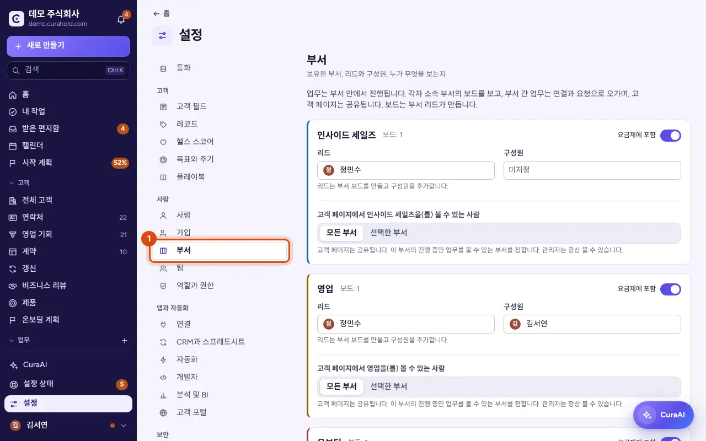
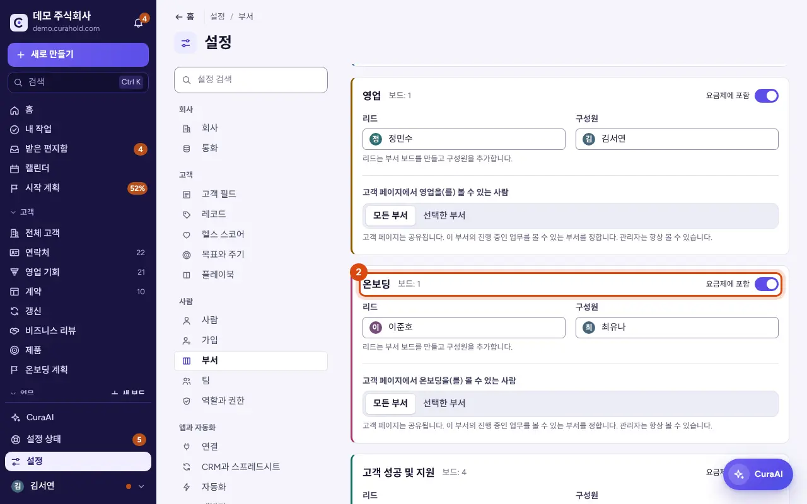
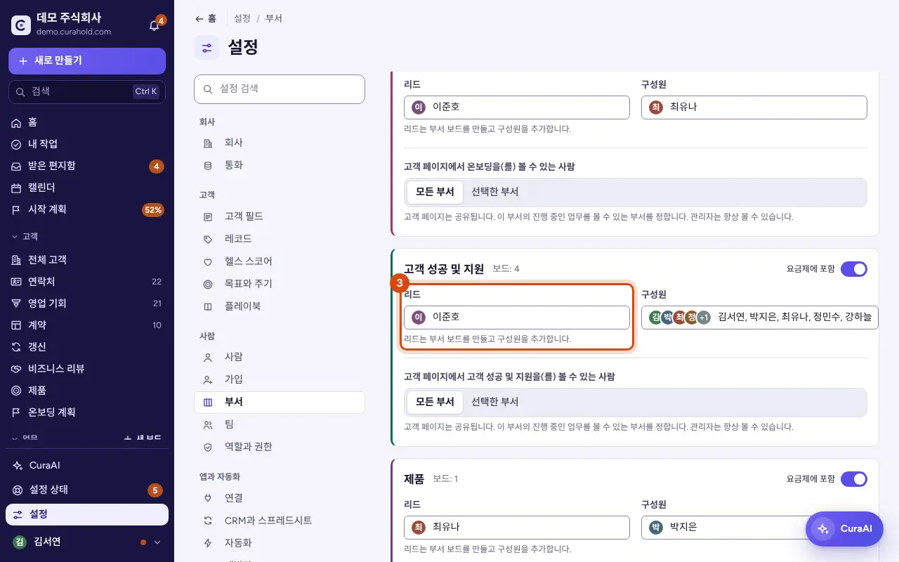
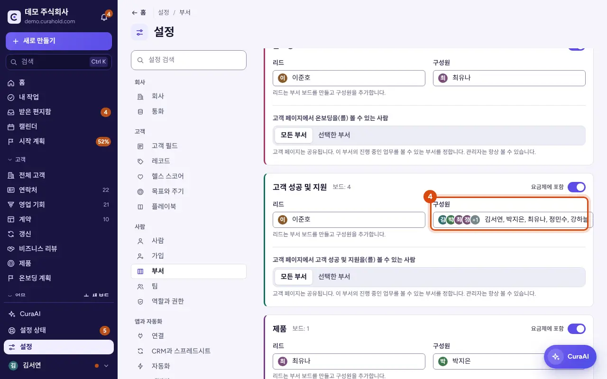
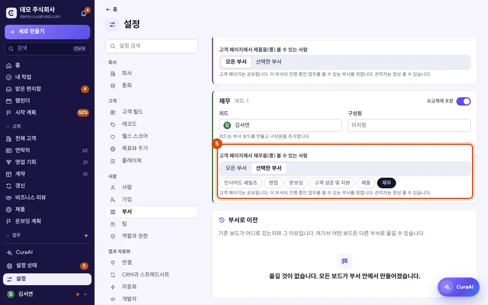
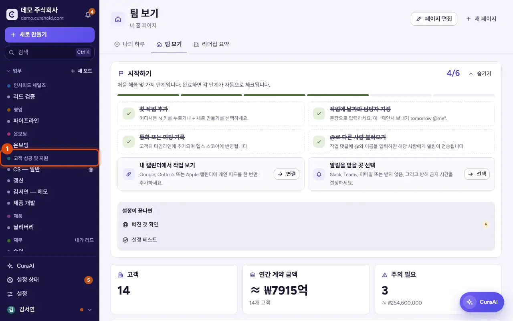
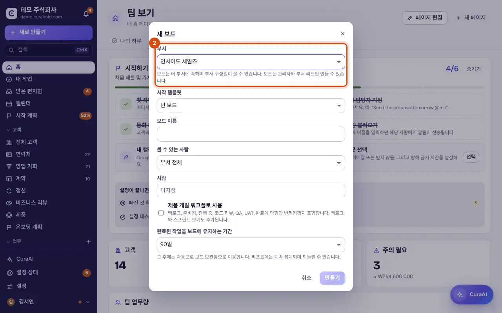
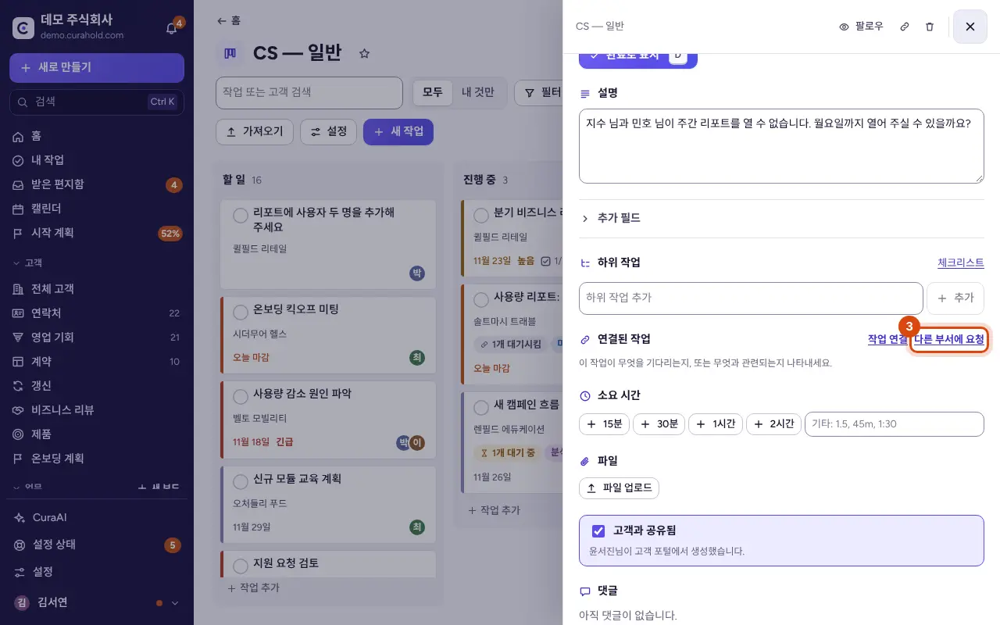
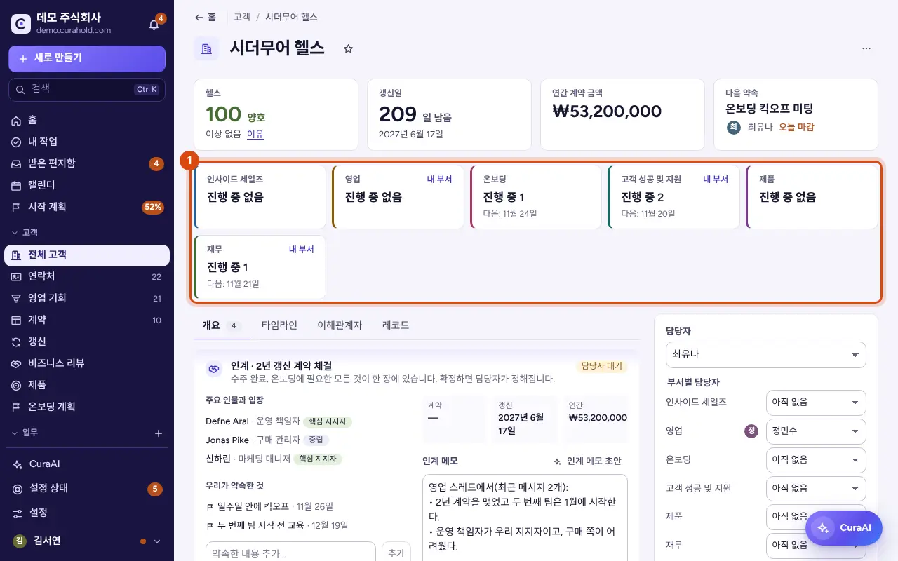
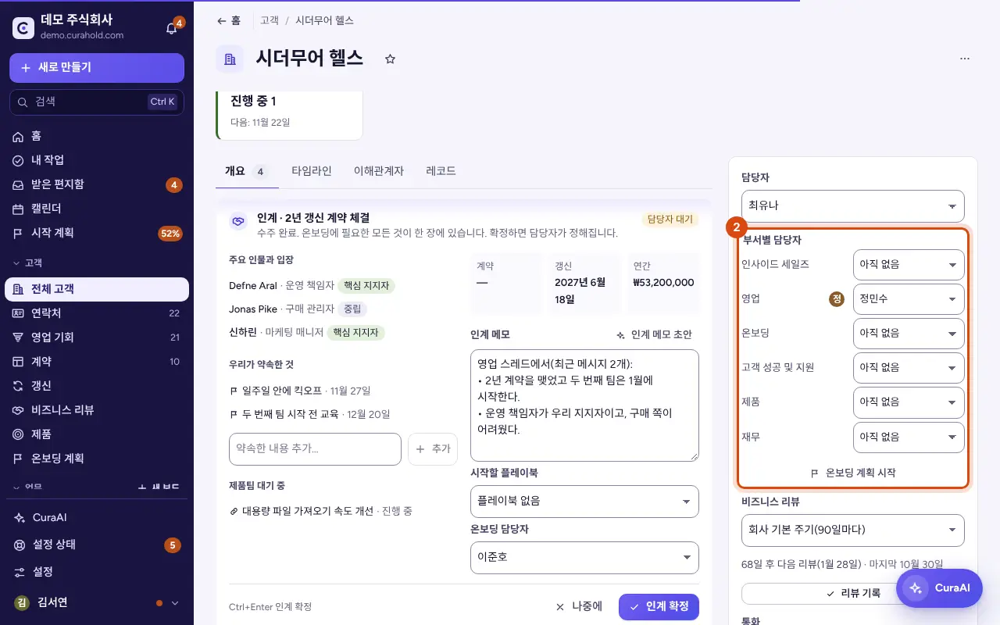

# 부서

Curahold에서 업무는 부서 안에 있습니다: 인사이드 세일즈, 영업, 온보딩, 고객 성공 및 지원, 제품, 재무. 각자 자기 부서의 보드를 봅니다. 업무는 요청으로 다른 부서에 넘어가고, 고객 페이지는 그 고객을 볼 수 있는 모든 사람이 함께 씁니다.

## 부서 설정하기 {#set-up}

관리자(또는 사람을 관리하는 사람)여야 합니다.

1. 왼쪽 메뉴에서 **설정**을 누르고 **사람** 아래의 **부서**를 누릅니다.
   
2. 회사에 있는 부서는 모두 **요금제에 포함**을 켜 둡니다. 쓰지 않는 부서는 끕니다: 모두에게 숨겨지고, 보드는 다시 켤 때까지 보관됩니다.
   
3. **리드**에서 부서를 이끌 사람을 고릅니다. 리드는 부서 보드를 열고 구성원을 추가합니다.
   
4. **구성원**에서 그 부서에서 일하는 나머지 사람을 모두 고릅니다. 한 사람이 여러 부서에 속할 수 있습니다.
   
5. **고객 페이지에서 …을(를) 볼 수 있는 사람**에서 **모든 부서**를 고르거나, **선택한 부서**를 고른 뒤 이 부서의 진행 중인 업무를 거기서 볼 수 있는 부서를 누릅니다. 관리자는 항상 봅니다. 재무는 처음에 재무만 볼 수 있습니다.
   

모든 변경은 바로 저장됩니다. 아직 어느 부서에도 없는 사람은 추가될 때까지 자기 업무를 **내 작업**에 둡니다.

회사가 부서로 옮겨 갈 때 기존 보드는 모두 한 부서에 배치되었습니다. 같은 페이지 아래의 **부서로 이전**에서 각 보드가 어디로 갔고 왜 그런지 보고, 거기서 보드의 부서를 바꿀 수 있습니다. **배치할 사람**에는 예전에 보드를 볼 수 있었지만 그 보드에서 일하지 않는 사람이 나옵니다: **접근 허용**을 누르면 그 부서의 구성원이 됩니다.

## 부서의 보드 {#boards}

1. 메뉴에서 보드는 부서 이름 아래에 모여 있습니다. 내가 이끄는 부서 옆에는 **내가 리드**가 표시됩니다.
   
2. 새 보드를 열려면 **업무** 옆의 **+**를 누릅니다. **부서**에서 보드가 속할 곳을 고르고, 이름을 정한 뒤 **만들기**를 누릅니다. 보드는 관리자와 부서 리드만 열 수 있습니다.
   

보는 사람은 기본적으로 **부서 전체**이며, 팀이나 고른 사람으로 좁힐 수 있습니다.

## 다른 부서에 요청 {#ask}

1. 요청과 관련된 작업을 열고 **다른 부서에 요청**을 누릅니다. 목록에서 부서의 보드를 고르고, 요청 양식을 채워 보냅니다.
   

요청은 그 부서의 보드에 도착하고 내 작업에 연결됩니다. 제목과 진행 상태는 보이지만, 다른 부서의 보드는 보이지 않습니다. 부서는 리드가 보드의 요청 양식을 켜면 요청을 받습니다(**보드 설정 → 필드 및 요청 양식**).

## 고객 페이지에서 {#customer-page}

1. 고객 페이지의 **부서별 현황**은 그 고객에 대한 부서별 진행 중인 업무, 그중 지연된 수, 다음 기한을 보여 줍니다. **내 부서**는 내가 속한 부서를 표시합니다.
   
2. 옆의 **부서별 담당자**에서 부서마다 누가 그 고객을 맡는지 봅니다. 사람을 고르면 지정됩니다.
   

부서 사이의 인계(수주한 거래가 온보딩이나 고객 성공으로 넘어가는 것)는 [인계, 요청, 고객에게 다시 알리기](/docs/ko/handover-and-requests/)에 있습니다.
