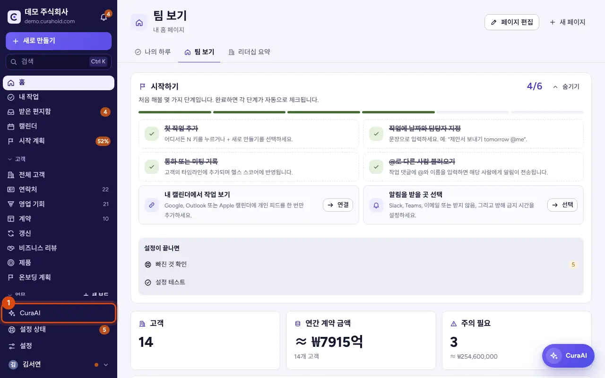
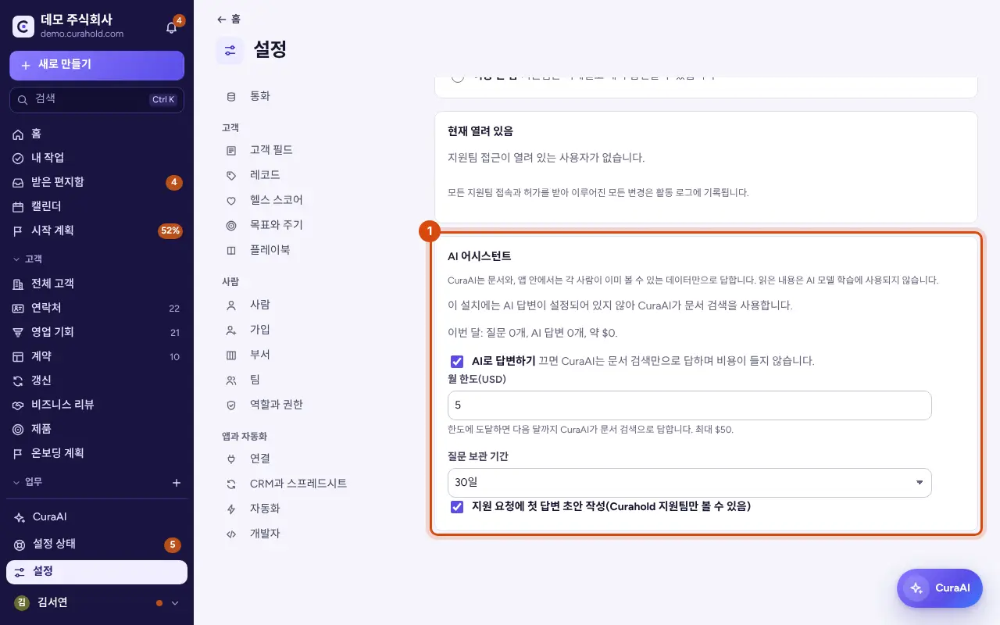
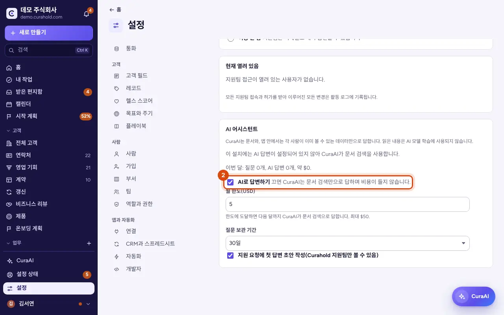

# 도움 받기

두 단계를 이 순서대로: 먼저 **질문**하고, 그래도 해결되지 않으면 **지원팀에 문의**하세요.

## 먼저 질문하기 {#ask}

1. 왼쪽 메뉴에서 **CuraAI**를 누릅니다(휴대폰에서는 구석의 버튼, 이 문서에서는 **질문** 버튼). 내 말로 질문을 씁니다: "고객을 가져오려면", "이 필드는 누가 볼 수 있나요".
   

답은 이 문서에서, 출처와 함께 옵니다. 회사에서 **AI로 답변하기**가 켜져 있으면(아래 참고) CuraAI는 Curahold에서 내가 이미 볼 수 있는 것, 예를 들어 고객, 갱신, 작업도 읽으므로 "앞으로 90일 안에 갱신되는 것은?"처럼 물을 수 있습니다. 읽기만 하고 아무것도 바꾸지 않습니다. 꺼져 있거나 설정되지 않았거나 월 한도를 넘으면 문서 검색이 내 기기에서 이루어지고, 입력한 내용은 어디에도 보내지지 않습니다.

답이 원하던 것이 아니면 그렇다고 말하세요: 다음으로 가까운 곳들과, 질문이 미리 채워진 지원팀 문의 버튼이 나옵니다.

## 지원팀에 문의하기: 요청 보내기

CuraAI 아래쪽의 **지원팀에 문의**를 쓰세요. 양식은 지원팀이 다시 묻지 않고도 문제를 찾을 수 있도록 필요한 것을 묻습니다. 내가 보지 않은 것은 아무것도 보내지 않으며, 무엇을 보낼지 직접 고릅니다.

1. **주제**: 작동하지 않는 기능이 있어요, 사용 방법이 궁금해요, 데이터 또는 연결 문제, 아이디어 제안, 청구 및 요금제.
2. **영향**: 오류와 데이터 문제라면 업무가 멈추는지 알려 주세요. 지원팀의 처리 순서가 이를 따릅니다.
3. **제목**: 몇 단어면 됩니다. 입력하는 동안 이미 답이 있을 수 있는 문서 페이지를 제안합니다.
4. **발생한 일**: 무엇을 하려고 했는지, 무엇을 기대했는지, 대신 무슨 일이 일어났는지. 오류 메시지가 있었다면 그대로 복사해 주세요.
5. **문제를 재현하려면 어떻게 해야 하나요?**: 오류라면 단계별로(선택 사항이지만 큰 도움이 됩니다).

6. **참조 대상**과 **필요 기한**(둘 다 선택): 요청을 함께 읽고 답을 받아야 할 동료, 그리고 언제까지 필요한지.

**접수 번호**(예: CH-000123)와 이메일 사본을 받습니다.

## 대화: 답변, 회신, 누구 차례인지

요청은 대화입니다. **내 요청**(CuraAI 위쪽의 받은 편지함 버튼)에서 엽니다.

- **지원팀의 답변**은 이메일과 요청에 함께 도착합니다. CuraAI 버튼의 표시가 답변이 기다리고 있음을 알려 줍니다.
- 제품에서 **답장**하거나, 그냥 **이메일에 회신**하세요. 인용된 부분 위에 쓴 내용이 요청에 들어갑니다.
- 요청에는 **누구 차례인지** 표시됩니다: *지원팀 처리 중*, *회신 대기 중*, *해결됨*. **해결됨으로 표시**하면 닫히고, 다시 쓰면 열립니다.
- **참조된 동료**는 요청을 읽고, 지원팀 답변을 이메일로 받고, 회신할 수 있습니다. 추가하거나 빼는 것은 질문한 사람만 할 수 있습니다. 관리자는 회사의 모든 요청을 읽을 수 있지만, 답변은 자기 요청에만 합니다.
- Curahold 팀은 요청에 **자체 메모**를 남길 수 있습니다. 이 메모는 회사에 절대 표시되거나 전송되지 않습니다.

## 스크린샷과 파일

- **스크린샷 찍기**: 브라우저가 어떤 탭을 공유할지 묻습니다. Curahold 탭을 고르세요. 도움말 창이 비켜 주므로 페이지만 캡처됩니다.
- **붙여 넣기 또는 끌어 놓기**: 복사한 그림을 양식에 붙여 넣거나, 파일을 끌어 놓으세요.
- **표시하기**: 중요한 부분을 빨간 테두리로 강조합니다. **숨기기**는 지원팀이 보면 안 되는 것(고객 이름, 금액)을 가리며, 보내는 그림에서 지워집니다.

파일은 최대 6개, 각 10MB까지. 그림, PDF, 텍스트, CSV, JSON, Excel, 짧은 영상.

## 요청에 더해지는 기술 정보

양식이 다음 정보를 알아서 더하고, 보내기 전에 보여 줍니다.

| 정보 | 도움이 되는 이유 |
|---|---|
| 페이지 주소 | 문제가 있는 곳. 주소의 비밀 부분(로그인 코드 등)은 지웁니다. |
| 브라우저, 화면, 앱 버전 | 특정 브라우저에서만 생기는 문제를 위해. |
| 최근에 연 페이지 | 그곳까지 어떻게 왔는지. 주소만, 페이지 내용은 없음. |
| 페이지의 오류 | 백그라운드 오류 메시지. 이메일 주소와 키처럼 보이는 텍스트는 가립니다. |
| 실패한 요청 | 어떤 동작이 실패했는지(경로와 상태 코드). |
| 지금 열려 있는 것 | 열어 둔 고객, 보드, 작업. |

보내고 싶지 않은 항목은 체크를 해제하세요. 직접 입력한 내용과 페이지의 데이터는 이 정보에 포함되지 않습니다.

## 지원팀이 내 계정을 보게 하기

어떤 문제는 직접 보지 않으면 고치기 어렵습니다. 양식 끝의 **Curahold 지원팀이 내 계정을 볼 수 있도록 허용** 체크 상자가 그런 경우를 위한 것입니다. 절대 대신 체크해 두지 않습니다.

- **지원팀이 보는 것**: 내가 보는 그대로, 같은 고객, 보드, 필드. 그 이상은 없습니다.
- **허용 기간**: 24시간, 3일, 7일. 접근은 저절로 끝납니다. 지원팀의 방문 한 번은 최대 8시간입니다.
- **지원팀이 할 수 있는 일**: **보기만** 합니다. 지원팀은 내 계정에서 절대 아무것도 바꾸지 않습니다.
- **절대 닿지 않는 것**: 내 기기와 세션, API 키, 앱과 웹훅, 사람 초대, 역할, 회사 설정, 데이터 내보내기와 삭제. 지원팀은 자기 접근을 연장할 수도 없습니다.
- **닫기**: 언제든 **도움말 → 내 요청 → 접근 닫기**에서. 진행 중인 지원팀 방문은 즉시 끝납니다. 접근이 열려 있는 동안 페이지 위쪽 띠가 알려 줍니다.
- **기록**: 모든 지원팀 방문과 그동안 읽은 내용은 지원 담당자 이름과 함께 **설정 → 활동 로그**에 기록됩니다.

지원팀이 들어와 있는 동안 화면 위쪽 띠에 누가 언제까지 보고 있는지 표시됩니다.

## 회사 설정(관리자)

**설정 → 보안 → 지원 접근**에서 누가 지원팀을 들일 수 있는지 고릅니다.

- **모든 사용자**: 자신이 볼 수 있는 범위에 대해(기본).
- **관리자만**: 다른 사람들의 열린 접근은 지금 끝납니다.
- **허용 안 함**: 지원팀은 이메일로 답할 수는 있지만 들어올 수는 없습니다.

같은 페이지에 지금 열려 있는 접근, 누가 허용했는지, 마지막 방문이 나오고, 무엇이든 닫을 수 있습니다.

## 지원용 세션 녹화

무언가 고장 났을 때 설명을 부탁하는 대신 지원팀이 무슨 일이 있었는지 볼 수 있도록, 페이지는 사용하는 동안 스스로를 녹화합니다(어떤 버튼, 어떤 화면, 앱이 무엇을 그렸는지). 이것은 지원팀에 계정 접근을 허용하는 것과는 별개이며, 백그라운드에서 조용히 동작합니다.

- **입력한 내용은 녹화되지 않습니다.** 모든 입력란(검색, 메모, 입력한 고객 정보)은 가려집니다. 녹화되는 것은 인터페이스이지, 거기에 쓴 내용이 아닙니다.
- **7일 동안 보관**한 뒤 삭제합니다.
- **Curahold 지원팀만 녹화를 열 수 있으며**, 자기 데스크에서 열 때마다 지원 데스크 로그에 기록됩니다. 회사는 자기 녹화를 보지 못합니다.
- **관리자가 끌 수 있습니다**: **설정 → 보안 → 지원 접근 → 지원용 세션 녹화**. 끄면 아무것도 녹화되지 않습니다.

조직이 개인정보 처리 안내에서 구성원에게 이를 알려야 한다면, 이 스위치와 이 페이지가 그 근거입니다.

## AI로 답변하기(관리자) {#ai-answers}

1. **설정 → 지원 접근**을 열고 **AI 어시스턴트**까지 스크롤합니다.
   
2. CuraAI가 AI로 답하게 하려면 **AI로 답변하기**에 체크하고, 문서 검색만으로 비용 없이 답하게 하려면 체크를 해제합니다. CuraAI가 읽는 내용은 AI 모델 학습에 절대 쓰이지 않습니다. 새 회사는 이 항목이 **꺼진** 상태로 시작합니다. 관리자가 체크하기 전에는 AI 제공업체로 아무것도 보내지 않으며, 꺼져 있는 동안 카드에 그렇게 표시됩니다.
   

같은 카드에서:

- **월 한도(USD)**: 한도에 이르면 다음 달까지 CuraAI가 문서 검색으로 답합니다. 카드에 이번 달 질문 수와 비용이 나옵니다.
- **질문 보관 기간**: 질문을 얼마나 보관할지(보관하지 않을 수도 있음). 각자의 질문은 본인 개인정보 다운로드에 들어 있습니다.
- **지원 요청에 첫 답변 초안 작성**: Curahold 지원팀이 회사의 요청에 대한 첫 답변 초안을 봅니다. 초안은 보이지 않고, 지원팀의 실제 답변만 받습니다.

카드에 이 설치에서는 AI 답변이 설정되지 않았다고 나오면 CuraAI는 문서 검색을 씁니다. AI 키는 Curahold 서버를 운영하는 사람이 추가합니다.

## 오류 기록(관리자) {#errors}

**설정 → 오류**에는 최근 30일 동안 구성원이 겪은 문제와 그 위치가 나옵니다: 화면, 실패한 요청, 횟수. 개인 정보는 들어 있지 않습니다. 지원팀에 문의할 때 거기서 본 내용을 함께 보내세요.
