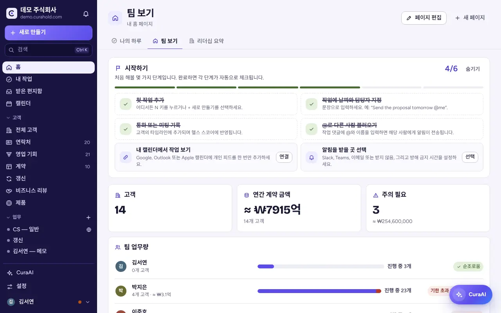

# 시작하기

Curahold는 고객 성공 팀과 어카운트 팀이 고객, 이해관계자, 매일의 업무를 한곳에서 운영하는 곳입니다. 이 페이지에서는 처음 15분을 안내합니다.

## 체험 신청하기

웹사이트의 **무료로 시작**은 회사를 바로 만들지 않고 체험을 신청합니다. 짧은 양식을 작성하고 업무용 이메일로 받은 코드를 입력하면, 보통 영업일 기준 하루 안에 답변드립니다. 승인되면 회사가 만들어지고 로그인 링크가 전송됩니다. 체험 기간, 좌석 수, 알림은 [요금제와 결제](/docs/ko/billing/)를 참고하세요.

## 회사 주소

회사마다 고유한 주소가 있습니다: `yourcompany.curahold.com`. 팀원 모두 이 주소로 로그인합니다. 다른 회사의 데이터는 이 주소에 절대 나타나지 않으며, 이 분리는 데이터베이스 자체에서 강제됩니다.

## 로그인

- **이메일 링크:** 이메일 주소를 입력하고 보내 드리는 링크를 클릭하세요. 비밀번호가 없습니다.
- **Google 또는 Microsoft:** 회사에서 켜 두었다면 클릭 한 번이면 됩니다. 처음 보는 기기에서는 이메일로 보내 드리는 6자리 코드도 입력해야 합니다.
- **패스키:** 첫 로그인 후에는 지문, 얼굴 또는 기기 PIN으로 로그인합니다.
- **2단계 인증:** 내 설정 → **로그인 보안**에서 인증 앱을 추가하고 복구 코드 10개를 받으세요. 관리자는 관리자 또는 모든 사람에게 2단계 인증을 요구할 수 있습니다.
- 민감한 작업(역할 변경, API 키, 데이터 내보내기 등) 전에는, 최근 10분 안에 로그인하지 않았다면 **본인 확인**을 요청합니다.
- 한 주소로는 15분에 로그인 링크를 최대 5개까지 보냅니다.

## 첫 설정

회사를 만드는 사람이 템플릿을 고릅니다: 고객 성공, 어카운트 관리, 영업, 지원 또는 빈 템플릿. 템플릿에는 고객 필드(갱신일, 연간 계약 금액, 헬스 등), 보드, 기본 자동화가 들어 있습니다. 모두 나중에 바꿀 수 있습니다.

그다음 팀을 초대하세요. 회사 이메일 도메인(`@yourcompany.com`)을 추가하면 그 도메인의 사람들이 참여를 요청하거나 바로 참여할 수 있습니다.

## 첫날

홈의 **시작하기** 카드에 처음 할 일 몇 가지가 나옵니다: 첫 작업 추가, 작업에 날짜와 담당자 지정, 통화 기록, @로 동료 부르기, 캘린더에서 작업 보기, 알림 받을 곳 정하기. 각 단계는 실제로 하면 저절로 체크되고, **숨기기**를 누르면 카드가 사라집니다.

왼쪽의 **+ 새로 만들기** 버튼으로 무엇이든 한곳에서 추가합니다: 작업, 고객, 통화 메모, 보드. 작업을 쓸 때 날짜, 담당자, 고객을 한 줄에 함께 적을 수 있습니다. [빠른 추가와 단축키](/docs/ko/quick-add/)를 참고하세요. 내 메뉴(왼쪽 아래의 내 이름)에는 라이트·다크 모드, 언어, 단축키가 있고, **새로운 소식**에서 최근에 추가된 기능을 볼 수 있습니다.

## 언어

Curahold는 11개 언어를 지원합니다: 영어, 터키어, 아랍어, 히브리어, 페르시아어, 중국어 간체와 번체, 일본어, 한국어, 힌디어, 말레이어. 언어는 두 곳 중 하나에서 정합니다.

- **나에게만:** 내 설정 → 언어. 어느 기기에서든 같은 언어로 보입니다.
- **회사 전체:** 관리자가 설정 → 회사에서 정합니다. 새로 들어오는 사람은 이 언어로 시작하고, 회사 전체에 가는 이메일도 이 언어로 보냅니다.

브라우저에서 언어를 짐작하지 않으므로, 같은 링크를 연 사람은 모두 같은 화면을 봅니다. 날짜, 숫자, 금액은 선택한 언어의 방식을 따르고, 아랍어·히브리어·페르시아어는 오른쪽에서 왼쪽으로 표시됩니다.

## 기기 수 제한

한 사람은 기기 두 대에서 동시에 로그인해 둘 수 있으며, 관리자가 1~5대 사이로 바꿀 수 있습니다. 기기를 하나 더 로그인하면 가장 오래된 기기가 로그아웃됩니다. 그래서 한 좌석을 여러 사람이 나눠 쓸 수 없습니다.

> **팁:** 내 설정 → 기기에서 어디에 로그인되어 있는지 보고, 원하는 기기에서 로그아웃할 수 있습니다.

## 휴대폰이나 컴퓨터에 설치하기

Curahold는 스토어 없이 앱처럼 설치됩니다.

- **Android와 컴퓨터(Chrome, Edge):** 왼쪽 아래의 내 이름 → **Curahold 설치**. 브라우저 주소 표시줄의 설치 아이콘도 같은 일을 합니다.
- **iPhone과 iPad(Safari):** 공유 버튼 → **홈 화면에 추가** → 추가.

설치한 앱은 별도 창으로 열리고, 아이콘을 길게 누르면 내 작업, 받은 편지함, 고객으로 바로 갈 수 있습니다.

**인터넷 연결이 없어도** 앱은 열리고 마지막으로 본 내용, 즉 작업, 보드, 고객, 받은 편지함을 보여 줍니다. 화면 위쪽 띠에 오프라인 상태임이 표시되며, 다시 연결될 때까지 변경 사항은 저장되지 않습니다. 로그아웃하면 기기에 보관된 사본이 지워집니다.

**실시간 새로 고침:** 페이지를 열어 둔 동안 다른 사람의 변경(새 카드, 옮겨진 작업, 댓글, 새 알림)이 몇 초 안에 저절로 나타납니다. 새로 고칠 필요가 없습니다. 입력하거나 카드를 끌어 옮기는 동안에는 화면이 움직이지 않습니다.

## 다음 단계

- [고객, 필드, 레코드](/docs/ko/customers/)
- [작업과 보드](/docs/ko/tasks/)
- [역할과 권한](/docs/ko/roles-and-access/)
- [빠른 추가와 단축키](/docs/ko/quick-add/)
