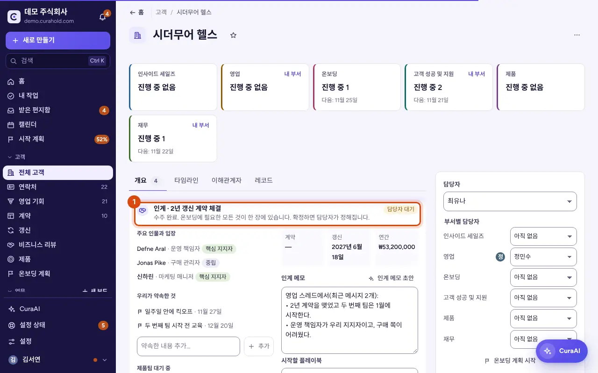
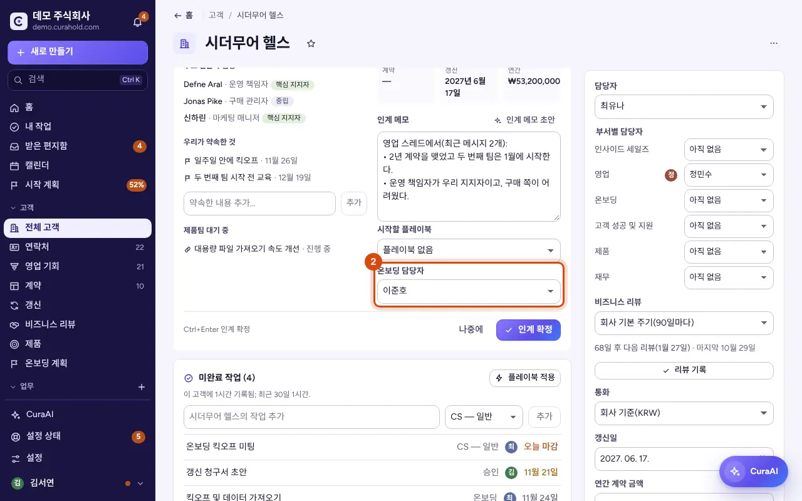
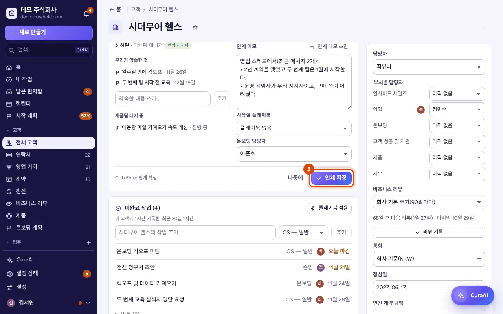
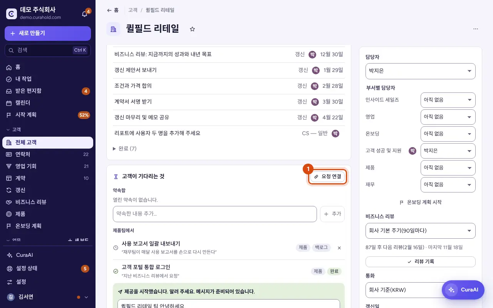
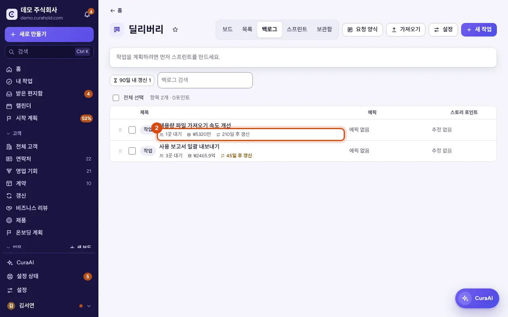
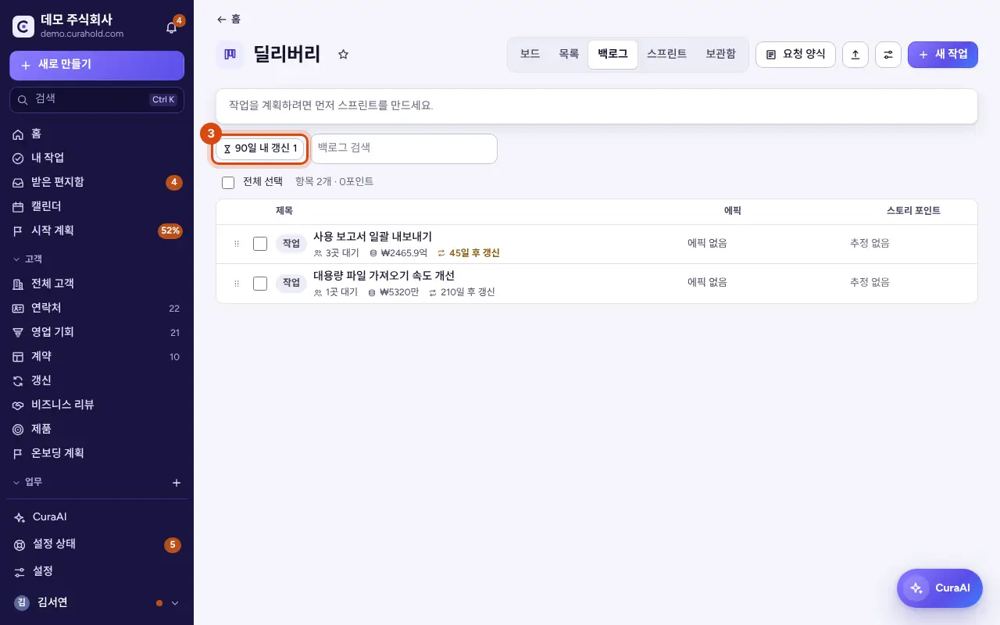
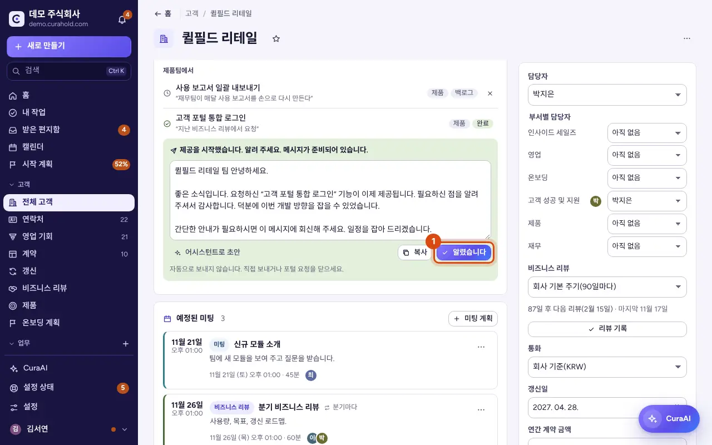
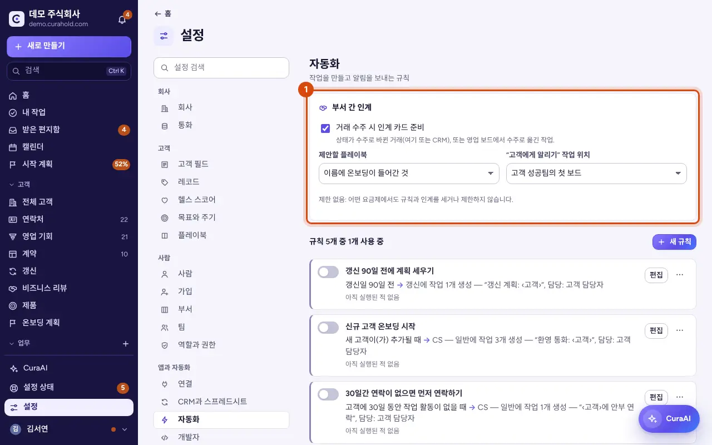

# 인계, 요청, 고객에게 다시 알리기

업무는 영업에서 온보딩이나 고객 성공으로, 고객에게서 제품으로 넘어갑니다. Curahold는 각 팀에 필요한 것을 고객 페이지에 두므로 다시 입력할 일도, 다른 부서의 보드를 열 일도 없습니다.

## 거래를 수주하면 {#handover}

상태가 **수주**로 바뀐 거래(여기서든 CRM에서든), 또는 영업 보드에서 **수주**로 옮긴 작업은 고객 페이지에 **인계 카드** 하나를 받습니다. 회사에 온보딩 부서가 있으면 **온보딩**으로, 없으면 **고객 성공**으로 갑니다.

1. 고객 페이지를 엽니다. 카드는 **개요** 맨 위에 있고 **담당자 대기**라고 표시됩니다. 읽어 보세요: 사람들과 그들의 입장, 영업이 약속한 것, 고객이 아직 제품에 기다리는 것, 날짜, 연간 가치(그 필드를 볼 수 있다면), 영업 대화에서 온 인계 메모.
   
2. **… 담당자**에서 고객을 넘겨받을 사람을 고릅니다. 옆의 **시작할 플레이북**도 확인합니다.
   
3. **인계 확정**을 누릅니다(또는 Ctrl+Enter, Mac에서는 ⌘+Enter). 담당자가 지정되고, 플레이북이 시작되고, 담당자에게 알림이 가고, 고객 타임라인에 두 단계가 기록됩니다.
   

**나중에**는 카드를 치웁니다. **인계 메모 초안**은 어시스턴트에게 메모를 쓰게 하며, 저장 전에 읽고 고칠 수 있습니다.

## 고객 요청을 제품 작업에 연결하기 {#requests}

1. 고객 페이지의 **고객이 기다리는 것** 아래에서 **요청 연결**을 누릅니다. 제품 작업을 검색해 스토리를 고르고, 원하면 고객이 요청한 내용을 그들의 말로 덧붙입니다. 맞는 것이 없으면 같은 창에서 제품에 요청합니다.
   

여러 고객이 같은 스토리를 기다릴 수 있고, 하나하나 집계됩니다. 고객을 볼 수 있는 사람은 작업의 제목, 상태, 스프린트 종료일, 부서를 보지만 제품 보드는 보지 못합니다.

## 제품이 보는 것 {#backlog}

1. 제품 보드에서 **백로그**를 엽니다. 각 스토리 아래에 기다리는 고객 수, 그들의 연간 가치(그 필드를 볼 수 있는 사람에게만), 가장 가까운 갱신이 나옵니다.
   
2. **90일 내 갱신**을 누르면 곧 갱신하는 고객이 기다리는 작업만, 갱신이 가까운 순으로 봅니다.
   

## 제공을 시작하면 {#shipped}

연결된 스토리가 끝나면 각 고객의 담당자에게 작업이 생기고, 고객 페이지의 스토리 아래에 보낼 준비가 된 메시지가 나타납니다.

1. 메시지를 읽고 필요하면 고친 뒤 **복사**를 누르고 내 이메일이나 채팅으로 보냅니다. 그다음 **알렸습니다**를 누릅니다. 고객이 포털로 요청했다면 **포털 요청 닫기**로 거기서도 닫습니다.
   

**아무것도 저절로 보내지지 않습니다.** 타임라인에 "고객을 위해 만든 것"이 기록되고, 갱신 요약에도 나옵니다.

## 설정(관리자) {#settings}

1. **설정 → 자동화**를 엽니다. **부서 간 인계**에서 수주한 거래에 인계 카드를 만들지, 제안할 플레이북, "고객에게 알리기" 작업이 갈 곳을 고릅니다.
   

## 어시스턴트 초안

인계 메모, "제공 시작" 메시지, 회의의 약속과 다음 단계는 어시스턴트가 초안을 쓸 수 있습니다. 모든 초안은 저장 전에 읽고 고칠 수 있고, 실행 취소로 되돌릴 수 있습니다. 어시스턴트가 없거나 월 한도를 넘으면 초안은 템플릿에서 옵니다.

## 규칙

규칙은 작업 추가나 완료, 양식으로 들어온 요청, 레코드의 단계 도달, 지원 티켓 생성 때 시작할 수 있고, 배정, 이동, 필드 설정, 댓글, 웹훅 전송, 인계 준비를 할 수 있습니다. 규칙은 집계되지 않고 한도도 없습니다.
