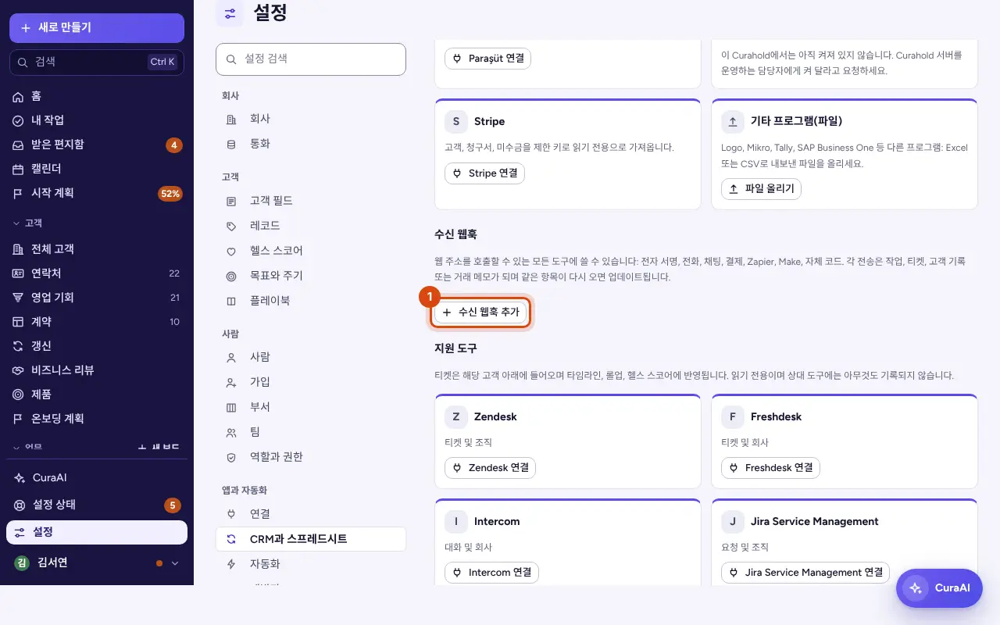
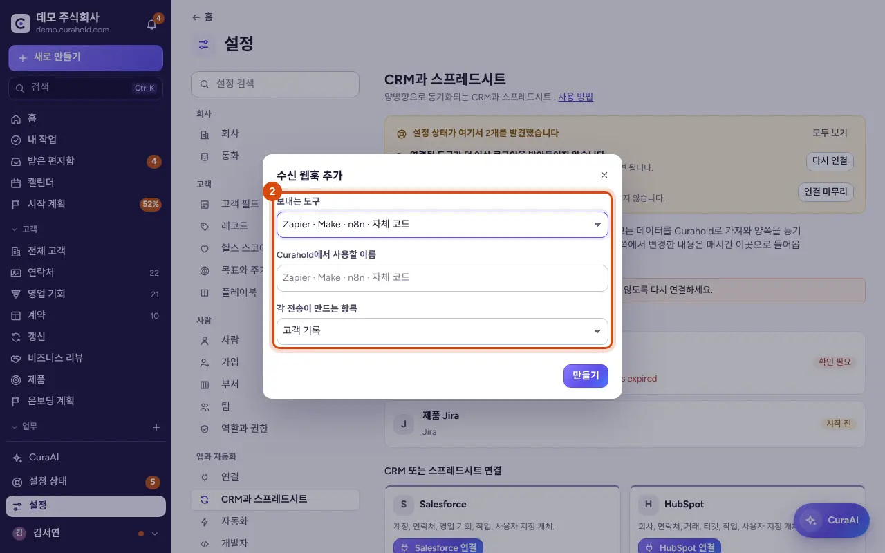
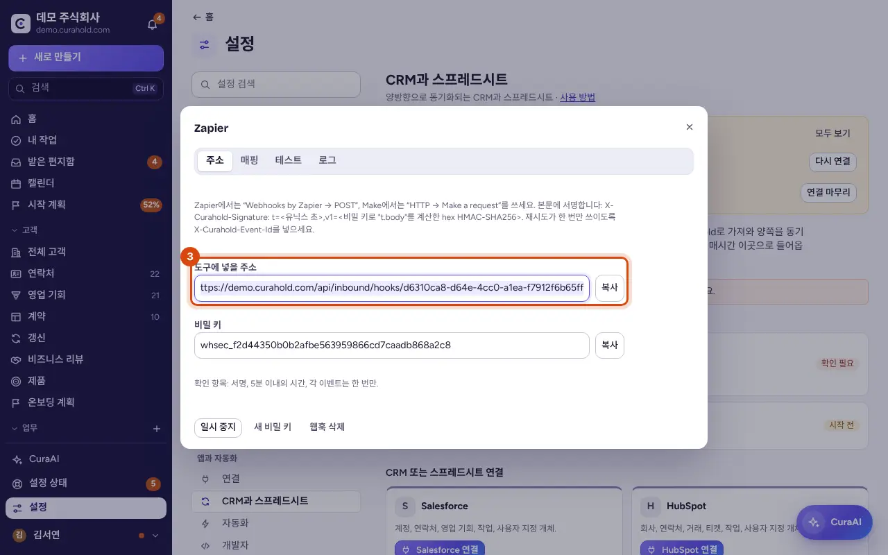
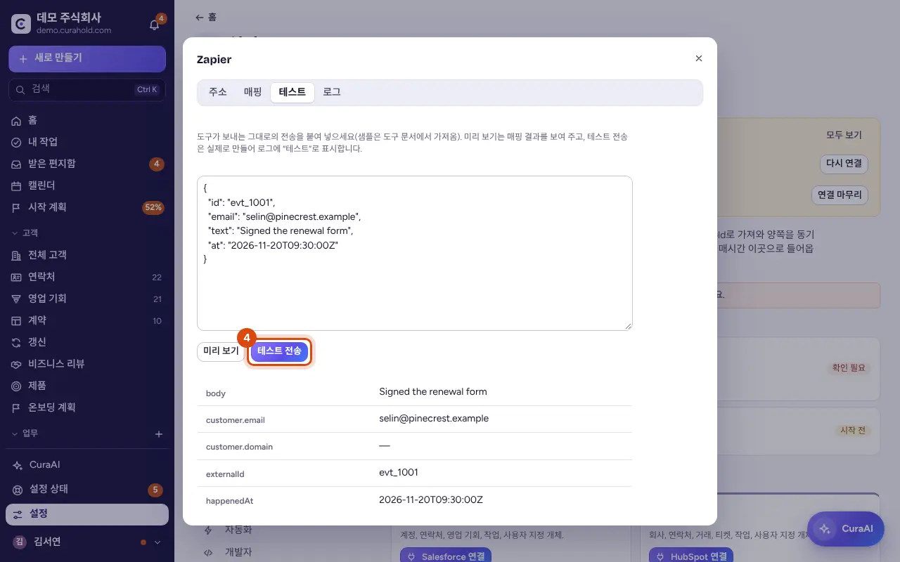
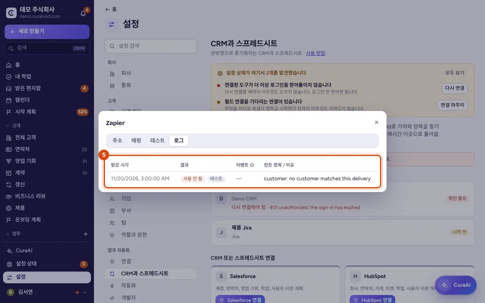

# 수신 웹훅

Curahold에 준비된 커넥터가 없는 도구를 위한 기능입니다. 도구가 회사 전용 주소로 보내면, 각 전송이 **작업**, **지원 티켓**, **고객 타임라인 기록**, **거래 메모** 중 하나가 됩니다. 같은 항목이 다시 오면 만든 것이 업데이트됩니다. 모든 전송은 서명(또는 공유 토큰), 시간, 이벤트당 한 번 사용을 확인합니다.

## Curahold에서 {#connect}

1. **설정 → CRM과 스프레드시트**을 열고 **수신 웹훅**까지 내려가 **수신 웹훅 추가**를 클릭하세요.
   
2. **보내는 도구**에서 도구(또는 **Zapier · Make · n8n · 자체 코드**)를 고르고, **각 전송이 만드는 항목**을 확인한 뒤 **만들기**를 클릭하세요.
   
3. **주소** 탭에서 주소와 비밀 키를 도구에 복사하세요.
   
4. **테스트** 탭에서 **미리 보기**로 샘플의 매핑 결과를 확인한 뒤 **테스트 전송**을 클릭하세요.
   
5. **로그** 탭에서 각 전송을 확인하세요: 사용됨, 건너뜀, 사용 안 됨(이유 포함), 거부됨.
   

## 매핑

각 값은 텍스트이며 전송된 값은 `{{path}}`로 넣습니다(예: `{{data.envelopeSummary.status}}`, `{{items[0].email}}`). 고객은 연락처 이메일, 웹 주소, 이름 순으로 찾습니다. **도구에서의 항목 ID**가 있으면 “만들거나 업데이트”가 동작합니다. **이 값이…일 때만 사용**은 다른 이벤트를 건너뜁니다(건너뜀으로 기록).

## 준비된 레시피

| 도구 | 서명 | 만드는 항목 |
| --- | --- | --- |
| 전자 서명(DocuSign Connect. CloudSign, Modusign, Leegality도 같은 방식) | `X-DocuSign-Signature-1`, HMAC-SHA256, base64, 도구에서 만든 키 | 거래 메모 |
| Aircall | 본문에 든 웹훅 토큰 | 고객의 통화 |
| Tawk.to | `X-Tawk-Signature`, HMAC-SHA1, hex | 티켓 |
| Razorpay(iyzico도 같은 방식) | `X-Razorpay-Signature`, HMAC-SHA256, hex | 고객 기록 |
| Freshchat, Kylas, Sansan 등 그 밖의 모든 도구 | 공유 토큰 (`X-Curahold-Token` / `?token=`) | 원하는 대로 |

## 직접 서명하기(Zapier, Make, n8n, 코드) {#sign}

`X-Curahold-Signature`와 `X-Curahold-Event-Id`를 보내세요:

```text
X-Curahold-Signature: t=1763631000,v1=<비밀 키로 "1763631000.<원본 본문>"을 계산한 hex HMAC-SHA256>
X-Curahold-Event-Id: evt_1001
```

코드 예(Node.js):

```js
const t = Math.floor(Date.now() / 1000);
const v1 = crypto.createHmac('sha256', secret).update(`${t}.${body}`).digest('hex');
fetch(address, { method: 'POST', body, headers: { 'content-type': 'application/json', 'x-curahold-signature': `t=${t},v1=${v1}`, 'x-curahold-event-id': id } });
```

시간은 5분 이내여야 합니다. 같은 이벤트 ID는 `200`과 `duplicate`로 응답하고 다시 쓰지 않습니다. 응답: `200`(`status`가 ok, skipped, failed), `401`(서명, 시간, 토큰), `404`(알 수 없거나 일시 중지). 전체 목록: API 참조.

## 아직 커넥터가 없는 도구를 위한 Zapier·Make 레시피

도구의 트리거를 쓰고, **Webhooks by Zapier → POST**(Zapier) 또는 **HTTP → Make a request**(Make)로 위 주소에 두 헤더를 붙여 보내세요. 서명은 Make의 **Custom JS**나 Zapier의 **Code** 단계에서 계산합니다(위 코드).

| 도구 | 트리거 | 보낼 본문 필드 | 만드는 항목 |
| --- | --- | --- | --- |
| LINE WORKS | 봇 채널의 새 메시지 | `id`, 보낸 사람 `email`, `text` | 기록 |
| Chatwork | 방의 새 메시지 | `id`, `email`, `text` | 기록 |
| kintone | 레코드 추가·수정 | `id`, `email`, `title`, `status` | 작업 |
| Money Forward Cloud | 청구서 생성·입금 | `id`, `email`, `text`(번호, 금액, 만기) | 기록 |
| 채널톡 | 상담 종료 | `id`, `email`, `title` | 티켓 |
| 카카오워크 | 봇 메시지 | `id`, `email`, `text` | 기록 |
| LeadSquared | 리드·기회 업데이트 | `id`, `email`, `title`, `status` | 작업 |
| Razorpay | 결제 완료 | `id`, `email`, `text` | 기록(또는 레시피) |
| DingTalk | 로봇 메시지 | `id`, `email`, `text` | 기록 |
| WeCom | 앱 메시지 | `id`, `email`, `text` | 기록 |

## 보관과 삭제

로그는 웹훅마다 30일, 최대 500건을 보관합니다. **새 비밀 키**는 이전 키를 바로 멈춥니다. **일시 중지** 중에는 다시 시작할 때까지 `404`로 응답합니다. **웹훅 삭제**는 웹훅과 로그를 지우며, 만든 항목은 남습니다. 웹훅은 만든 사람의 권한으로 동작하므로 그 사람이 볼 수 있는 보드와 고객에만 닿고, 그 사람이 떠나면 멈춥니다.

## 전송이 거부되거나 사용되지 않았을 때 {#log}

**로그** 탭은 각 전송에 무슨 일이 있었는지 알려 줍니다: 서명이나 토큰이 틀림(**주소**의 시크릿을 도구에 다시 복사하세요), 너무 오래전에 보냄(다시 보낸 오래된 전송도 이렇게 거부됩니다), 이 웹훅이 쓰지 않는 값, 맞는 고객이 없음, 또는 비어 나온 필드(**매핑**을 확인하세요). Zapier나 Make의 재시도처럼 같은 전송이 두 번 와도 한 번만 처리됩니다. 작업 웹훅의 보드는 **매핑**의 **보드**에서 바꿀 수 있습니다. 주소는 그대로이므로 보내는 도구에서 바꿀 것이 없습니다.

## 함께 보기

- [연결과 CRM](/docs/ko/connections/)
