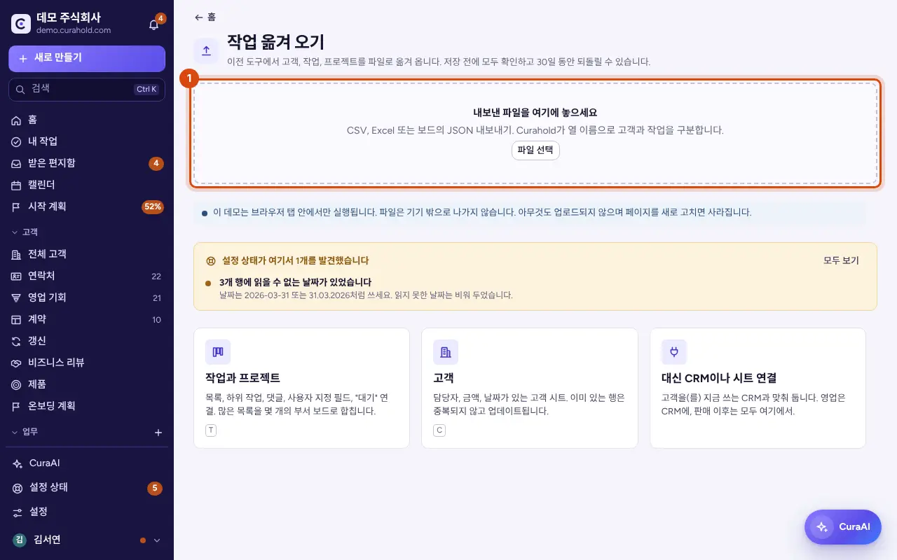
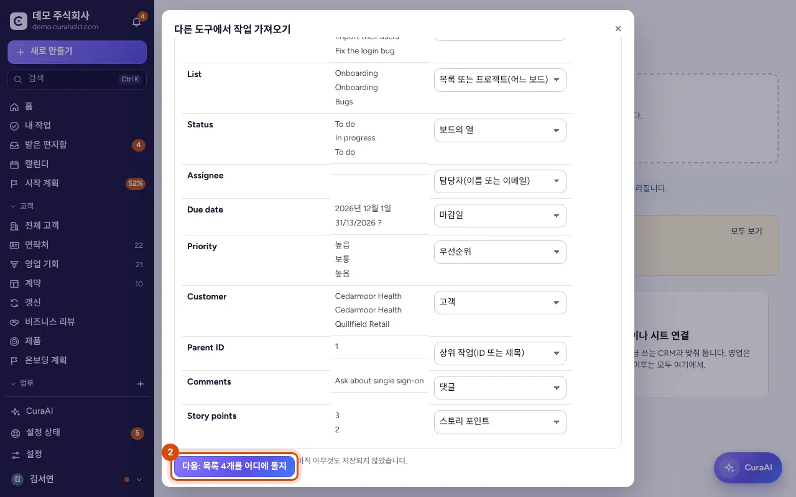
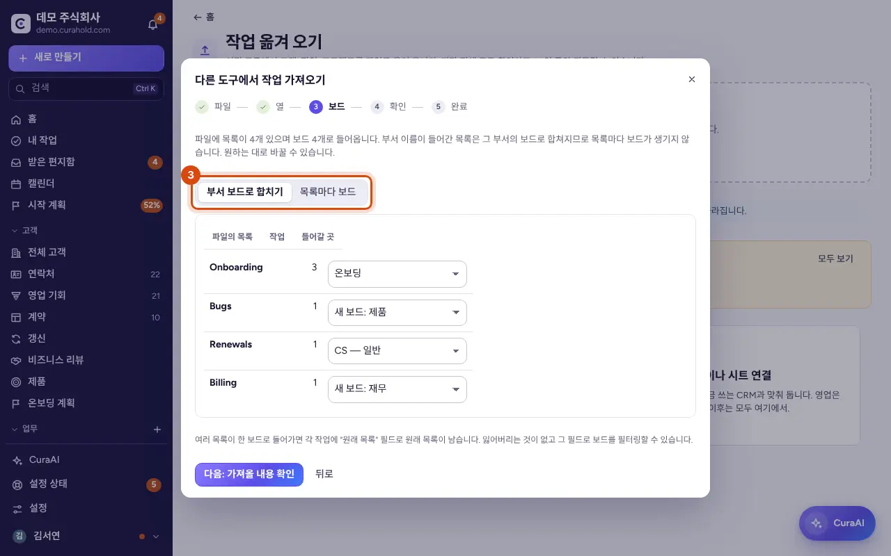
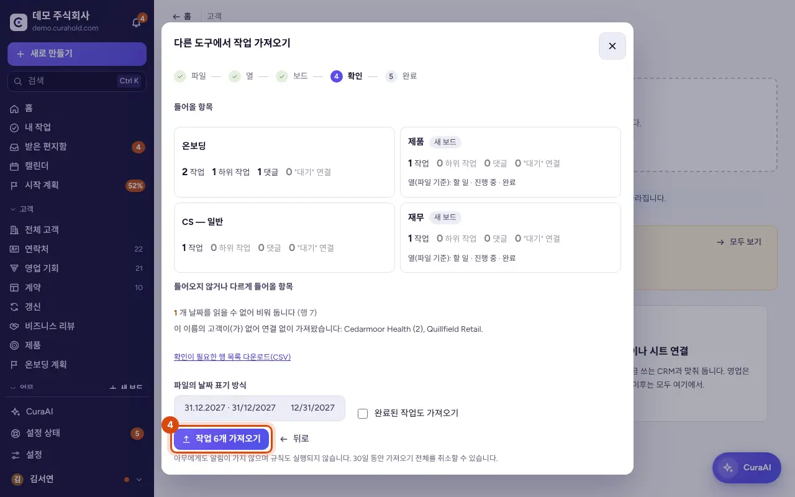
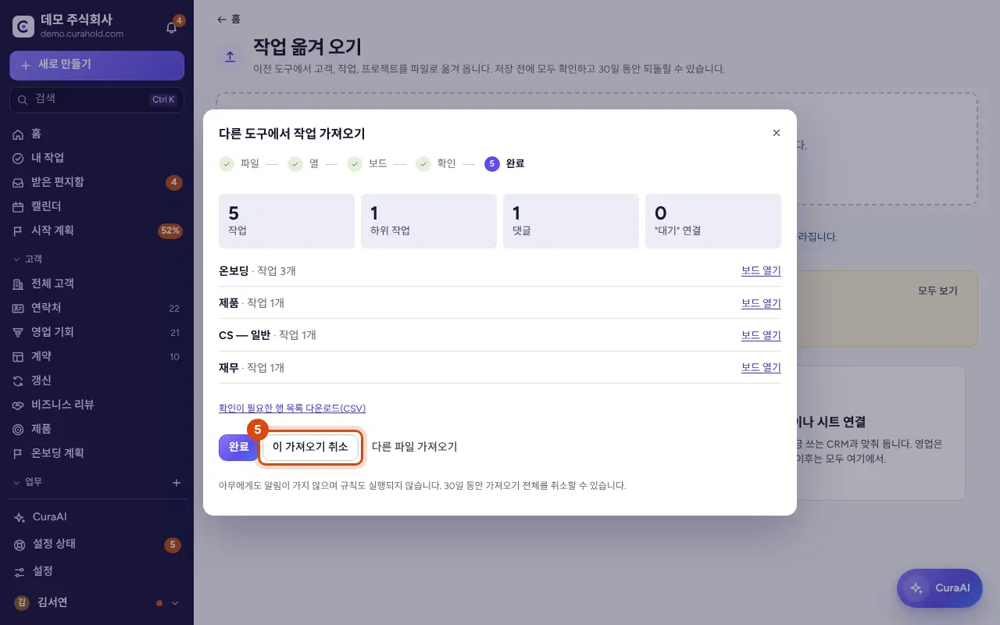

# 다른 도구에서 옮겨 오기

전에 쓰던 도구에서 업무를 내보내고(CSV, Excel 시트(.xlsx), 칸반 보드의 JSON 내보내기) 그 파일에서 옮겨 옵니다. 마지막 단계 전에는 아무것도 저장되지 않고, 아무에게도 알림이 가지 않으며, 규칙도 실행되지 않습니다: 새 업무가 아니라 이사입니다.

## 작업 옮겨 오기 {#tasks}

1. **작업 옮겨 오기**를 엽니다: 검색(Ctrl K, Mac에서는 ⌘ K)에 "import"를 입력하거나 보드의 위쪽 화살표 버튼을 씁니다. 파일을 **내보낸 파일을 여기에 놓으세요**에 놓거나 **파일 선택**을 누릅니다. Curahold는 열 이름으로 고객인지 작업인지 구분합니다. 직접 고르려면 작업은 **T**, 고객은 **C**를 누릅니다.
   
2. **열.** 파일의 각 열을 갈 곳에 맞춥니다: 제목, 설명, 보드의 열, 사람, 날짜, 우선순위, 고객, 스토리 포인트, 이전 도구의 ID, 상위 작업, 댓글, "기다림" 연결, 또는 자체 필드. 첫 값들이 각각 무엇이 될지 보여 줍니다. 틀린 것을 고치고 **다음**을 누릅니다.
   
3. **보드.** 파일에 목록이 많으면 몇 개의 부서 보드로 합쳐집니다: "Renewals"라는 목록은 고객 성공으로, "Bugs"는 제품으로 갑니다. 따로 두려면 **목록마다 보드**를 누르거나, 목록마다 원하는 보드를 고릅니다. 각 작업은 원래 목록을 **원래 목록** 필드에 남깁니다. **다음: 가져올 내용 확인**을 누릅니다.
   
4. **확인.** 보드별로 작업, 하위 작업, 댓글, 연결이 몇 개 들어오는지, 그리고 행 번호와 함께 들어오지 않거나 다르게 들어오는 것을 읽습니다. 먼저 파일에서 고치려면 **확인이 필요한 행 목록 다운로드(CSV)**를 누릅니다. 그다음 **작업 …개 가져오기**를 누릅니다.
   
5. **완료.** 보드마다 **보드 열기** 링크가 있습니다. 원하던 것과 다르면 **이 가져오기 취소**를 누릅니다.
   

Curahold는 머리글 위의 제목 줄, 그룹마다 머리글이 반복되는 형태, 상위 항목 아래 들여쓴 하위 항목을 이해합니다.

## 되돌리기 {#undo}

**이 가져오기 취소**는 30일 동안 결과 화면이나 첫 단계의 **이전 가져오기**에서 쓸 수 있습니다. 아무도 건드리지 않은 작업은 한 항목으로 휴지통에 갑니다. 그 뒤 누군가 바꾸거나 댓글을 단 작업은 보드의 보관함에 남습니다. 가져오기용으로 만들어지고 비어 있는 보드는 치워집니다.

## 템플릿 {#template}

첫 단계의 **템플릿 다운로드**는 Curahold가 읽는 모든 열과 예시 세 줄이 든 파일을 주며, Excel에서 열립니다. 첫 줄(Region은 자체 열의 예):

```text
ID,Title,Description,List,Status,Assignee,Due date,Priority,Customer,Parent ID,Comments,Depends on,Story points,Region
```

## 데모에서는

데모는 모두 브라우저 탭 안에서 돌아갑니다. 데모 바의 **내 파일로 해 보기**는 같은 페이지를 엽니다: 파일은 탭에서 읽히고 기기 밖으로 나가지 않으며, 페이지를 새로 고치면 사라집니다.
