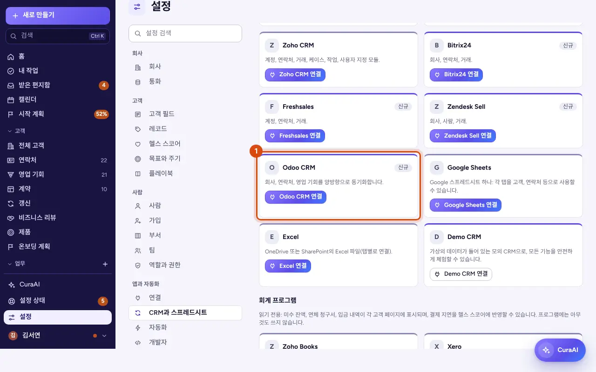

# Odoo CRM

Odoo Online, Odoo.sh 또는 자체 서버의 회사와 그 연락처, 영업 기회를 양방향으로 맞춥니다. Odoo의 변경은 한 시간 안에 오고, Curahold의 변경은 바로 돌아갑니다.

## Curahold에서 {#connect}

1. **설정 → CRM과 스프레드시트**을 열고 타일의 **Odoo CRM 연결**을 클릭하세요.
   

네 칸을 채우고 **연결**을 클릭하세요:

- **Odoo 주소**, 예:

```text
https://yourcompany.odoo.com
```

- **데이터베이스 이름**: Odoo.sh 또는 데이터베이스가 여러 개인 자체 서버에서만.
- **로그인(이메일)**: Curahold가 그 권한으로 일할 Odoo 사용자.
- **API 키**: 아래를 보세요.

그다음 **회사**, **연락처**, **영업 기회**를 선택하고, 제안된 필드 짝을 확인한 뒤 **동기화 시작**을 클릭하세요. 확률 100%인 기회는 성사, Odoo가 보관 처리한 기회는 실패로 봅니다.

## Odoo에서

1. 오른쪽 위 내 사진 → **환경설정**(Odoo 17 이후: **내 프로필**)을 클릭하세요.
2. **계정 보안**을 열고 **새 API 키**를 클릭하세요.
3. 이름(예: `Curahold`)을 입력하고 유효 기간을 고른 뒤 **키 생성**을 클릭하세요.
4. 키를 복사하세요. Odoo는 한 번만 보여 줍니다.

Odoo Online에서 API를 쓰려면 **Custom** 요금제가 필요합니다(Odoo의 규칙). CRM 앱이 설치되어 있어야 합니다.

## 한도와 주기

Odoo는 고정 한도를 공개하지 않습니다. Curahold는 초당 약 두 번 요청에 머뭅니다. Odoo 19 이후는 JSON-2 API로, 이전 버전은 JSON-RPC로 답하며 Odoo는 JSON-RPC를 버전 20에서 없앱니다. Odoo 19에서 키는 최대 석 달 유효합니다. 만료 전에 새 키를 만들고 다시 연결하세요.

## 충돌, 오류, 제거

양쪽에서 같은 필드를 바꾸면 연결에 정한 규칙이 결정합니다(기본: 나중 변경). 거부된 값은 Odoo의 메시지와 함께 연결의 **상태** 탭에서 기다립니다. 키가 취소되거나 만료되면 연결이 **확인 필요**가 됩니다. **다시 연결**로 새 키를 붙여 넣으면 매핑은 그대로 남습니다. **제거**하면 키가 지워지고, 이미 가져온 고객과 레코드는 Curahold에 남습니다.

## 함께 보기

- [연결과 CRM](/docs/ko/connections/)
- [Odoo(회계)](/docs/ko/accounting-odoo/)
