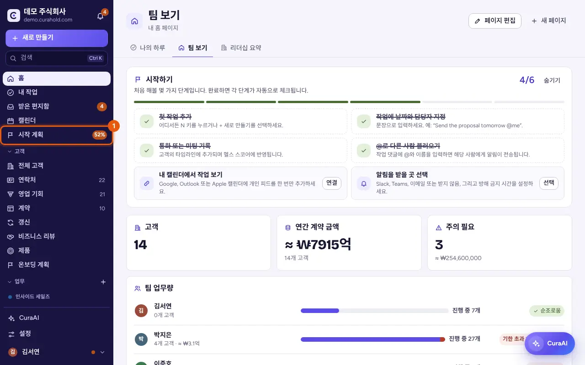
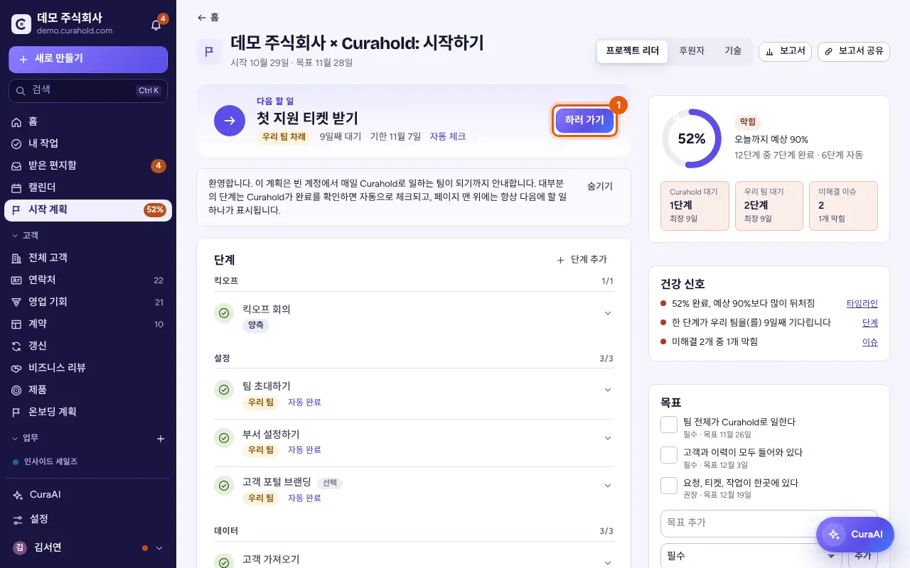
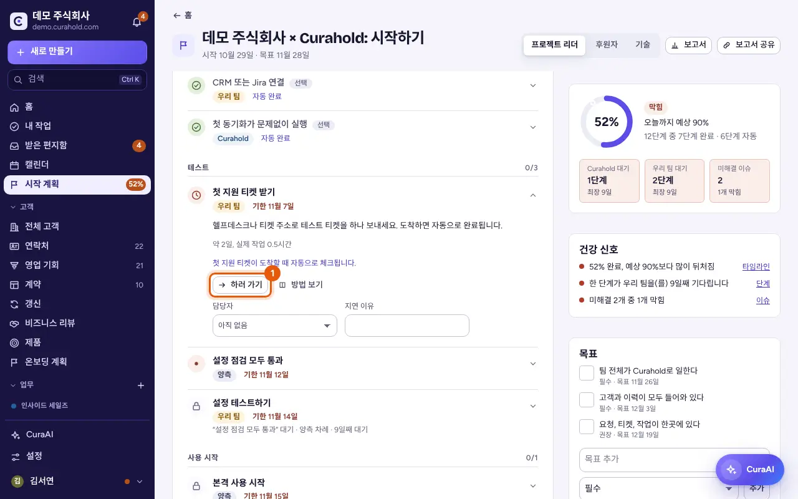
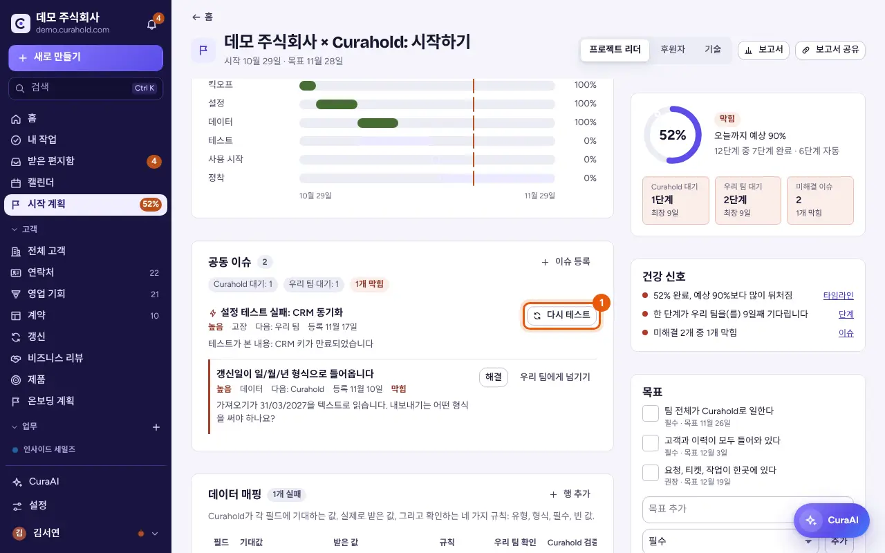
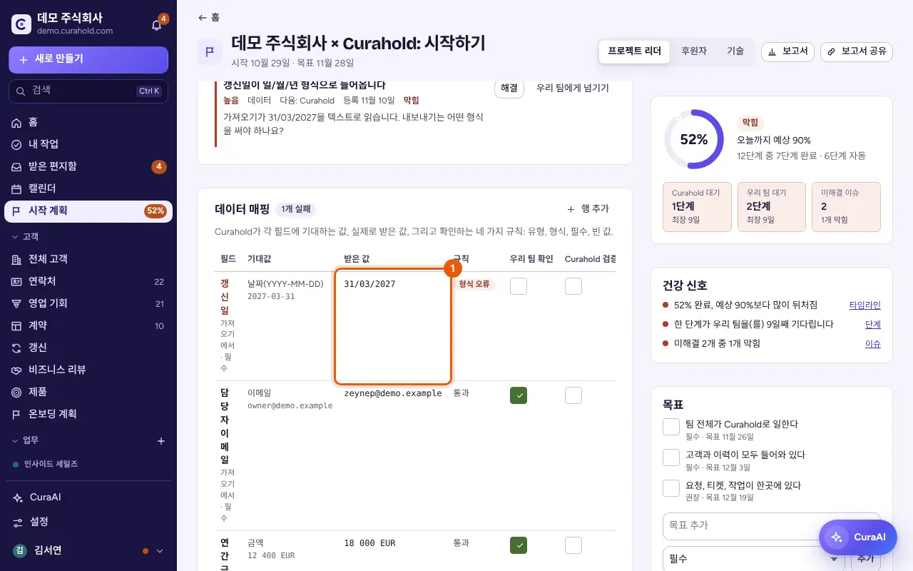
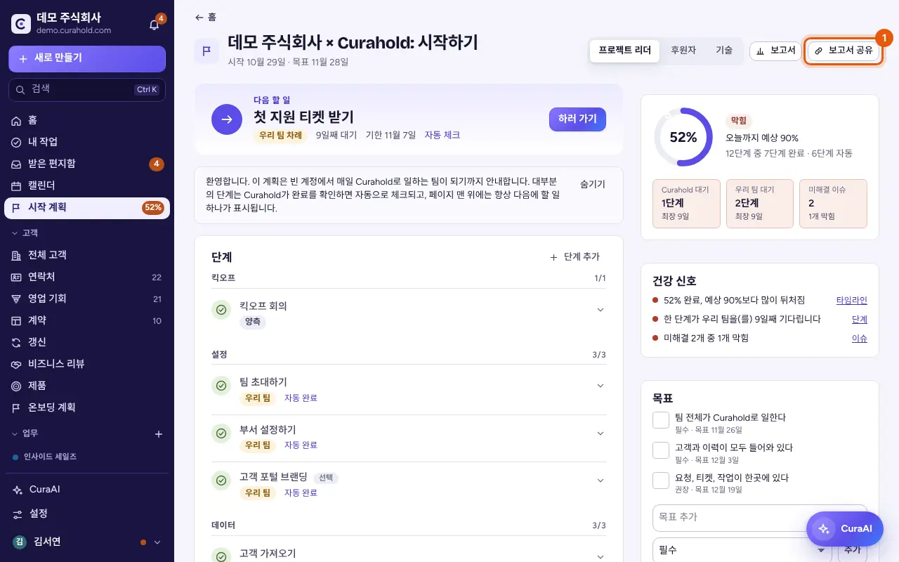
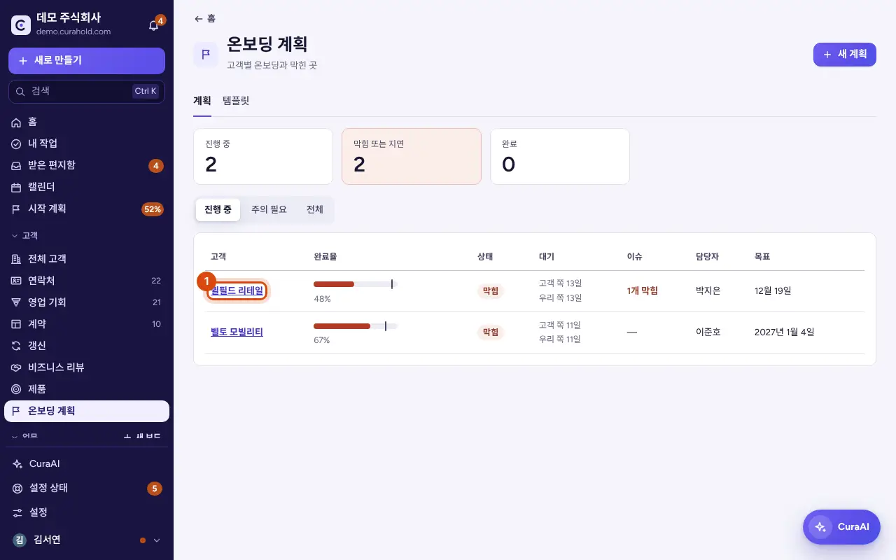
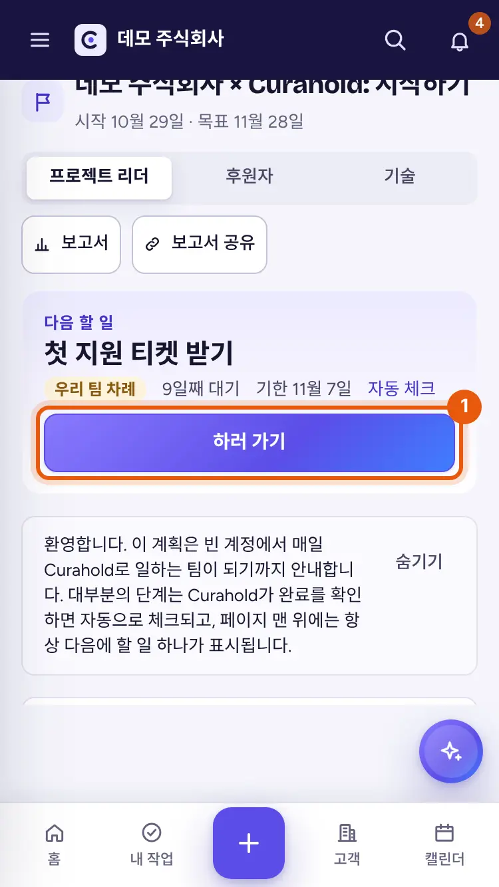

# 온보딩 계획

온보딩 계획은 양측이 함께 쓰는 하나의 페이지입니다. 회사가 Curahold를 시작할 때 사용하고, 온보딩하는 고객마다 같은 계획을 사용합니다. 대부분의 단계는 Curahold가 완료를 확인하면 자동으로 체크됩니다. 미팅처럼 Curahold가 볼 수 없는 것만 직접 체크하세요.

## 1. 계획 열기 {#start}

왼쪽 메뉴에서 **시작 계획**을 클릭하세요. 옆의 숫자는 완료한 비율입니다.

```text
https://<회사>.curahold.com/onboarding
```



## 2. 다음 할 일 하기 {#next}

맨 위 카드에는 항상 다음 할 일, 누구 차례인지, 얼마나 기다렸는지가 나옵니다. **하러 가기**를 클릭하면 그 일을 하는 화면이 열립니다.



## 3. 단계 열기 {#team}

단계를 클릭하면 용도, 걸리는 시간, 자동 체크 여부를 볼 수 있습니다. 잠긴 단계는 다른 단계를 기다립니다. 아래 줄에 어떤 단계를 기다리는지, 누구 차례인지 나옵니다. **완료 표시**는 Curahold가 볼 수 없는 단계에만 쓰세요.



## 4. 공동 이슈 해결하기 {#health}

각 이슈에는 누가 움직일 차례인지 나옵니다. 5일 넘게 열려 있거나 기한이 지나면 **막힘**으로 표시됩니다. 실패한 설정 테스트는 여기에 한 번만 나옵니다. 고친 뒤 **다시 테스트**를 클릭하세요. 테스트가 통과하면 이슈가 자동으로 닫힙니다.



## 5. 데이터 확인하기 {#mapping}

데이터 표에는 필드마다 Curahold가 기대하는 값, 받은 값, 네 가지 규칙(유형, 형식, 필수, 빈 값)이 나옵니다. 실패한 행은 어떤 규칙에 맞지 않는지 알려 줍니다. 값이 맞으면 우리 쪽 상자를 체크하세요.

```text
2027-03-31
```



## 6. 사람 정하기 {#people}

**양측 사람들**에서 **사람 추가**를 클릭하고 역할을 고르세요. Curahold는 각 단계 담당자에게 차례가 오면, 그리고 단계가 막히면 앱에서 알려 줍니다. 이메일 알림은 관리자가 켜지 않는 한 꺼져 있습니다.

## 7. 진행 보고서 공유하기 {#report}

**보고서 공유**를 클릭하고 링크를 복사하세요. 링크가 있는 사람은 보고서만 봅니다(메모와 연락처 없음). 인쇄하거나 PDF로 저장하려면 **보고서**를 여세요.



## 8. 고객들의 시작 계획 {#customers}

고객 아래의 **온보딩 계획**을 클릭하세요. 거래가 성사되면 인계 메모가 담긴 초안 계획이 자동으로 열리고, 인계가 확인되면 시작됩니다. 고객은 같은 계획을 여러분의 포털에서 여러분의 색으로 봅니다. 끝나면 **완료하고 인계**를 클릭하세요. 건강 점수가 기준값으로 저장되고 고객 성공팀이 인계 카드를 받습니다.



## 휴대폰에서

같은 페이지를 한 열로 보여 줍니다. 다음 할 일이 맨 위에 있습니다.


