# 설정 상태와 설정 테스트

짐작하지 않고 설정을 마칠 수 있도록 두 화면이 돕습니다. **설정 상태** 화면은 빠졌거나 잘못된 것을 알려 줍니다. **설정 테스트** 화면에서는 팀이 쓰는 방식대로 모든 것을 시험해 볼 수 있습니다. 대신 바꾸는 것은 없습니다. 고치기 버튼은 알맞은 화면을 열 뿐이고, 나머지는 직접 합니다.

## 빠진 것 찾기

1. 왼쪽 메뉴에서 **설정 상태** 항목을 클릭합니다. 옆의 숫자는 살펴볼 항목 수이며, 모두 바로잡으면 사라집니다.
   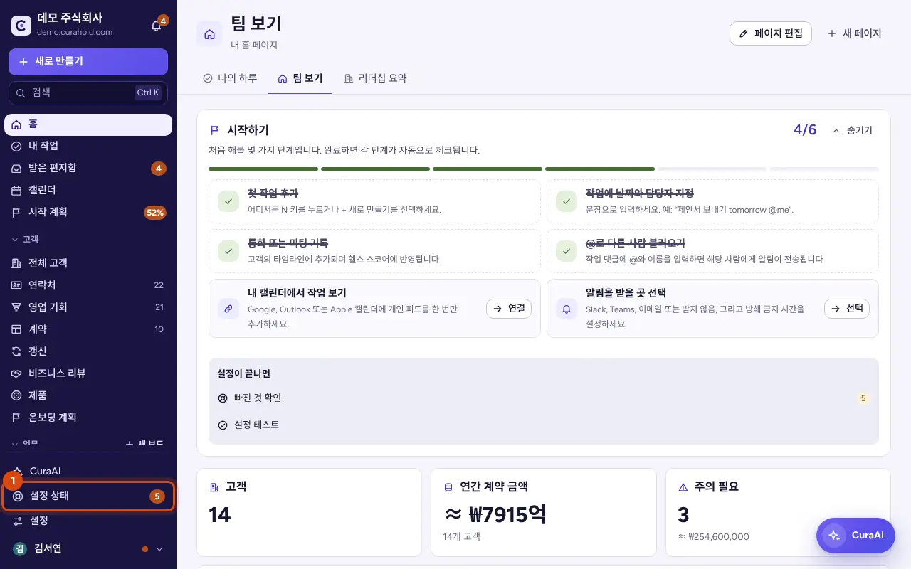
2. 첫 줄을 읽습니다. 가장 중요한 것이 먼저 나옵니다. **먼저 처리**, 그다음 **고칠 만함**, 그다음 **시간 날 때** 순입니다. 각 줄에 무엇을 발견했는지와 왜 중요한지가 적혀 있습니다.
   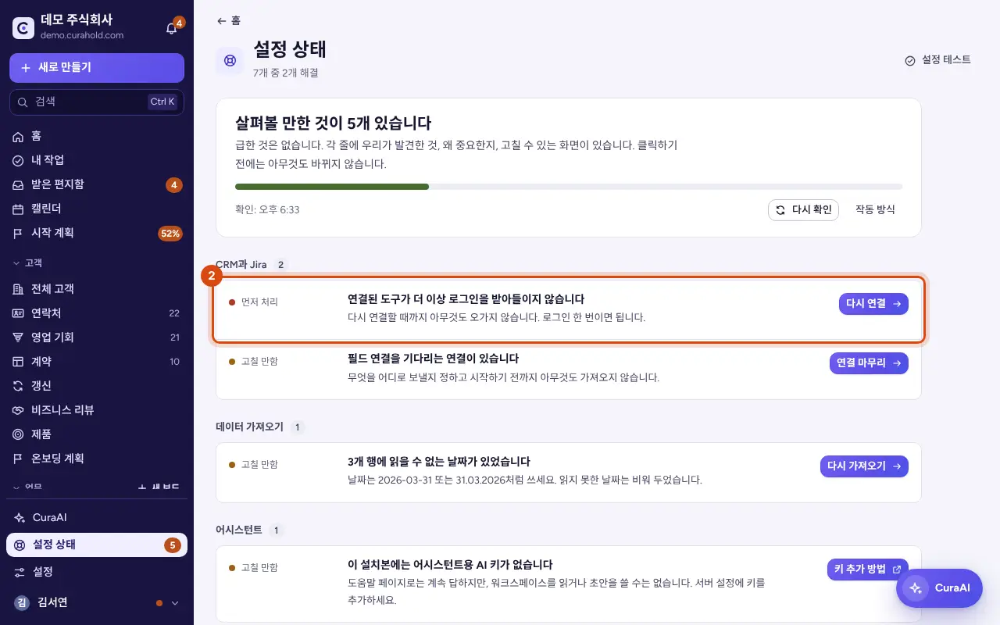
3. 그 줄의 버튼을 클릭합니다. 고칠 화면이 바로 열립니다.
   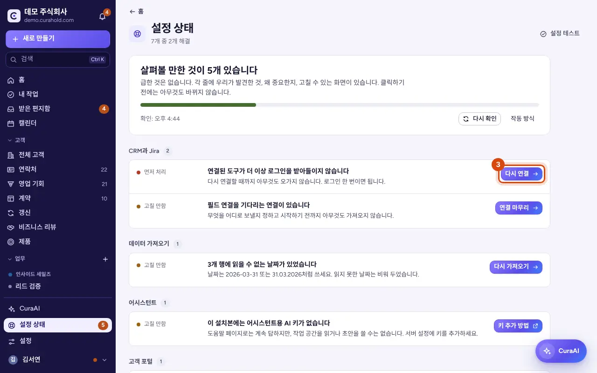
4. 고친 뒤 돌아와 **다시 확인** 버튼을 클릭합니다. 그 줄이 **해결됨** 목록으로 옮겨지고, 페이지 위에 고친 개수가 표시됩니다.
   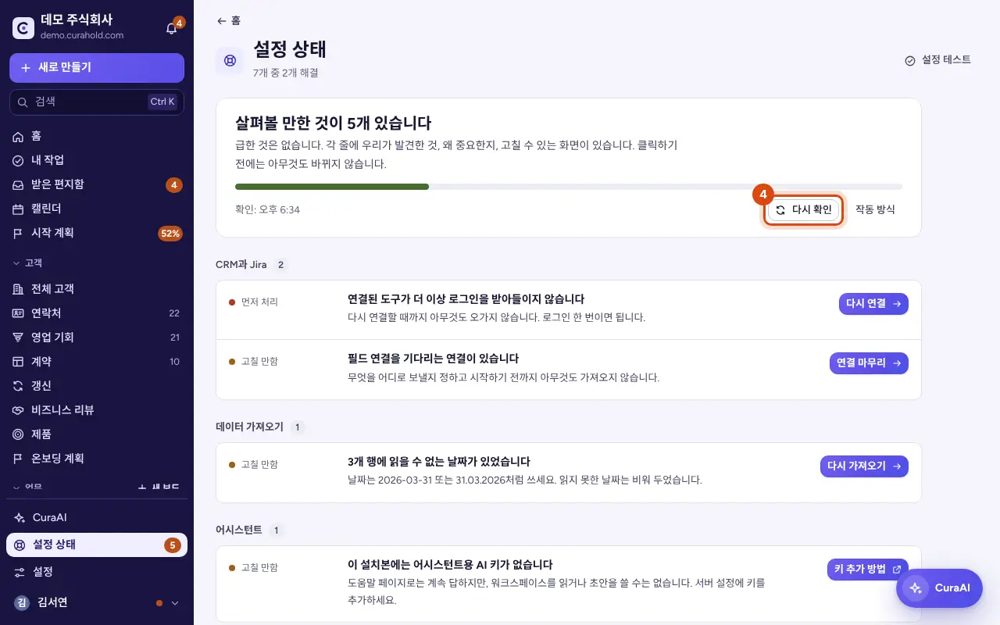
5. 문제는 그것을 고치는 화면 위쪽에도 노란 상자로 보입니다. 전체 목록은 **모두 보기** 버튼을 클릭합니다.
   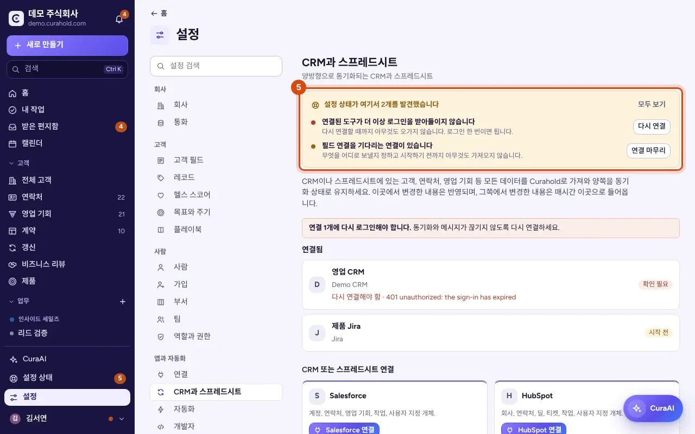

메일 도메인의 SPF, DKIM, DMARC 레코드처럼 여기서 읽을 수 없는 것도 있습니다. 레코드를 추가한 뒤 그 줄의 **완료했습니다** 버튼을 클릭합니다.

각자 자신이 고칠 수 있는 것만 봅니다. 관리자는 회사의 모든 항목을, Curahold 서버를 운영하는 사람은 메일과 AI 키도 봅니다. 하루에 한 번 다시 확인하고 새로 생긴 것을 표시합니다.

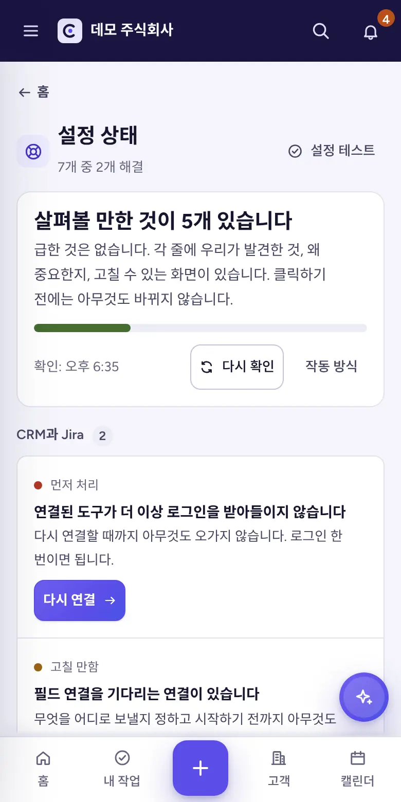

## 어시스턴트에게 묻기

어시스턴트를 열고 그대로 물어보세요:

```text
설정에 뭐가 문제인가요?
```

같은 문제를 버튼과 함께 보여 줍니다. 읽기만 하며, 스스로 고치는 일은 없습니다.

## 설정 테스트하기

1. **설정 상태** 화면 오른쪽 위의 **설정 테스트** 버튼을 클릭합니다.
   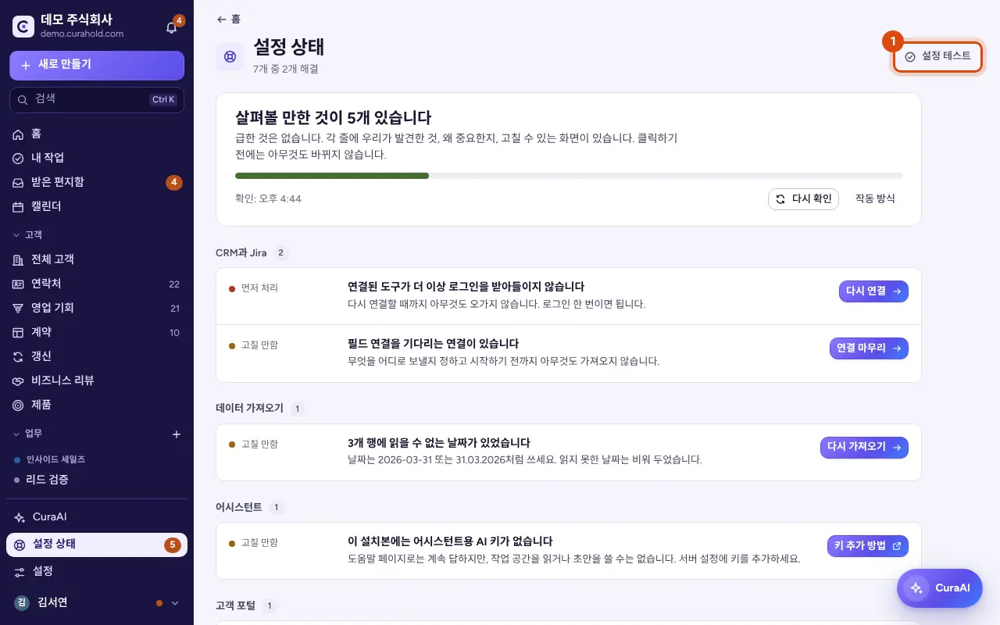
2. 단계의 **테스트** 버튼을 클릭합니다. 눈으로 확인하는 단계에는 대신 **잘 됨** 버튼과 **안 됨** 버튼이 있습니다. 무엇으로 시험할지(고객, 연결, 동료) 물으면 한 번만 고르세요. 다음 시도에도 그대로 쓰입니다.
   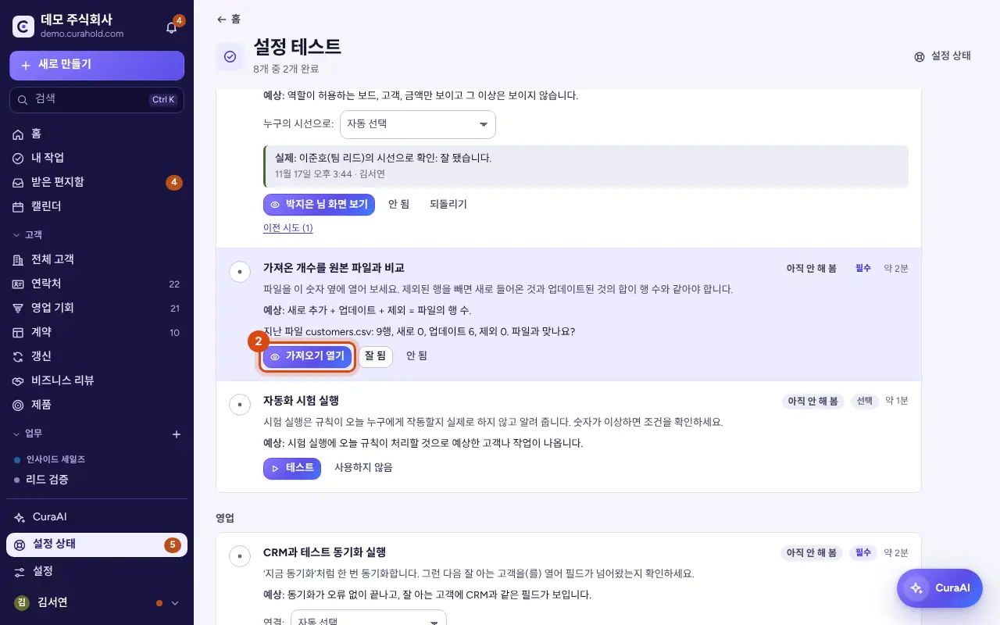
3. **실제** 줄과 **예상** 줄을 비교합니다. 같으면 통과입니다. 모든 시도는 누가 언제 했는지와 함께 남으므로 언제든 다시 시험할 수 있습니다.
   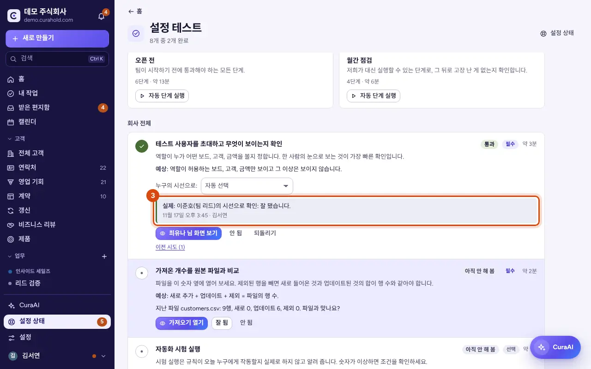
4. 되지 않았다면 **고칠 화면 열기** 버튼을 클릭해 고치고 다시 시험합니다. 도움이 필요하면 **이슈 등록** 버튼을 클릭하세요. 이슈는 단계와 함께 남고, 단계를 통과하면 저절로 닫힙니다.
   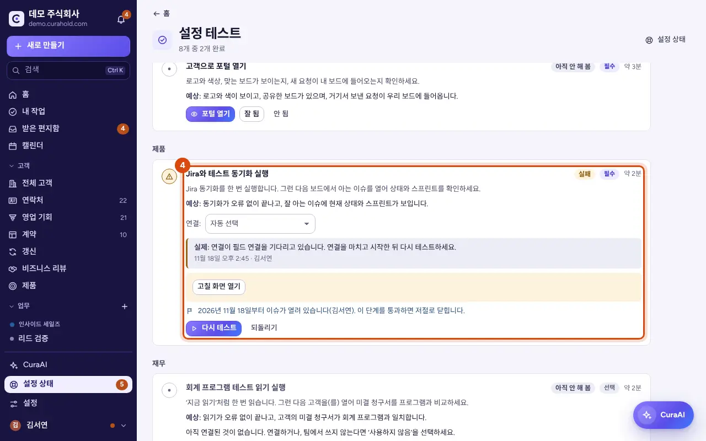
5. 여러 단계를 한 번에 실행하려면 묶음을 고릅니다. **오픈 전** 또는 **월간 점검** 묶음을 고른 뒤 **자동 단계 실행** 버튼을 클릭합니다.
   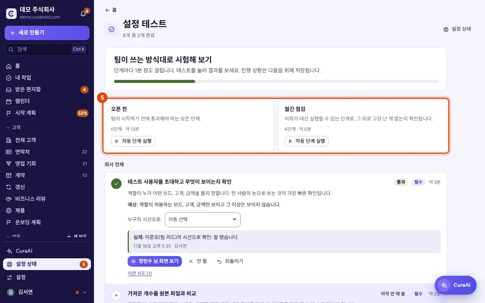
6. **필수** 단계를 모두 통과하면 먼저 회사 관리자가 **승인** 버튼을 클릭하고, 그다음 Curahold 담당자가 승인합니다. 그러면 날짜와 함께 **설정 완료** 표시가 나타납니다.
   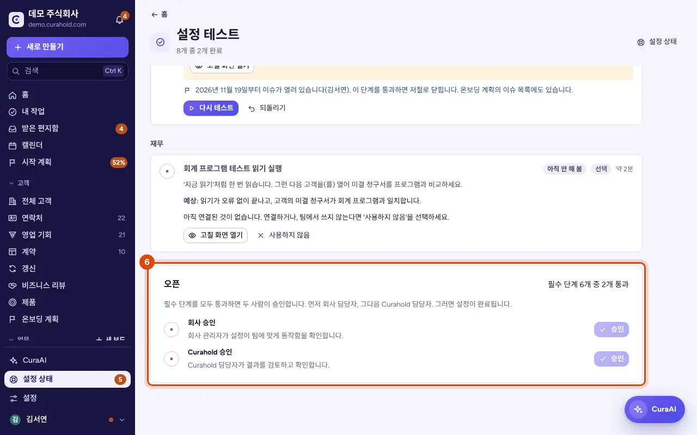

## 각 점검의 의미

이 표는 제품 자체의 문구로 만들어지므로 화면과 항상 일치합니다.

<!-- setup-checks:start (scripts/docs/setup-health-page.ts writes this part) -->

### 팀

| 발견하는 것 | 왜 중요한가 | 버튼 |
| --- | --- | --- |
| 아직은 여기 당신 혼자입니다 (먼저 처리) | 작업, 인계, 알림을 받을 사람이 필요합니다. Curahold에서 일할 사람을 초대하세요. | **사람 초대** |
| 초대 …건이 일주일 넘게 수락되지 않았습니다 (시간 날 때) | 이메일을 놓쳤을 수 있습니다. 다시 보내거나 주소를 확인하세요. | **초대 보기** |
| 역할 …개에 아무도 없습니다 (시간 날 때) | 아무도 없는 역할은 아무 일도 하지 않습니다. 알맞은 사람에게 주거나, 목록이 깔끔하도록 삭제하세요. | **역할 열기** |

### 부서

| 발견하는 것 | 왜 중요한가 | 버튼 |
| --- | --- | --- |
| 부서가 아직 설정되지 않았습니다 (고칠 만함) | 보드, 인계, 누가 무엇을 보는지는 모두 부서를 따릅니다. 각자를 소속 부서에 넣으세요. | **부서 설정** |
| 부서 …곳에 리더가 없습니다 (고칠 만함) | 부서 보드는 리더만 열 수 있고, 부서로 오는 인계도 리더에게 갑니다. | **리더 선택** |

### 데이터 가져오기

| 발견하는 것 | 왜 중요한가 | 버튼 |
| --- | --- | --- |
| 지난 가져오기에서 …개 행이 들어오지 않았습니다 (고칠 만함) | 이 행들에서 읽을 수 없는 내용이 있었습니다. 가져오기 화면에 행 번호와 함께 나옵니다. | **가져오기 열기** |
| 지난 가져오기에서 …개 행에 고객 이름이 없었습니다 (고칠 만함) | 이름은 모든 행에 필요한 유일한 열입니다. 파일에 채운 뒤 다시 가져오세요. 이미 들어온 행은 중복되지 않고 업데이트됩니다. | **다시 가져오기** |
| …개 행에 읽을 수 없는 날짜가 있었습니다 (고칠 만함) | 날짜는 2026-03-31 또는 31.03.2026처럼 쓰세요. 읽지 못한 날짜는 비워 두었습니다. | **다시 가져오기** |
| …개 행에 읽을 수 없는 금액이 있었습니다 (고칠 만함) | 12500 또는 12.500,00처럼 숫자만 쓰고, 통화는 별도 열에 넣으세요. 해당 금액은 비워 두었습니다. | **다시 가져오기** |
| 고객 …곳이 두 번 등록되어 있습니다 (시간 날 때) | 작업과 메모가 두 사본으로 나뉩니다. 하나를 남기고 다른 하나를 합치세요. | **보기** |

### CRM과 Jira

| 발견하는 것 | 왜 중요한가 | 버튼 |
| --- | --- | --- |
| 연결된 도구가 더 이상 로그인을 받아들이지 않습니다 (먼저 처리) | 다시 연결할 때까지 아무것도 오가지 않습니다. 로그인 한 번이면 됩니다. | **다시 연결** |
| 도구 …개와의 마지막 동기화가 끝나지 않았습니다 (먼저 처리) | 그 뒤의 변경 사항은 대기 중입니다. 무엇이 멈추게 했는지 연결 페이지에 나옵니다. | **무슨 일인지 보기** |
| 수신 웹훅이 하루 동안 아무것도 쓰지 못했습니다 (고칠 만함) | 모든 전송이 거부되었거나(비밀 키 오류) 쓸 수 없었습니다(맞는 고객 없음, 내용 변경). 로그에 이유가 있습니다. | **수신 웹훅 열기** |
| WhatsApp이 연결됐지만 메시지가 하나도 오지 않았습니다 (고칠 만함) | 하루가 지나도 이렇다면 보통 콜백 주소와 확인 토큰이 Meta 앱에 저장되지 않았거나 “messages”를 구독하지 않은 것입니다. | **연결 열기** |
| 필드 연결을 기다리는 연결이 있습니다 (고칠 만함) | 무엇을 어디로 보낼지 정하고 시작하기 전까지 아무것도 가져오지 않습니다. | **연결 마무리** |
| 변경 …건을 다른 도구로 보내지 못했습니다 (고칠 만함) | 세 번 시도했습니다. 연결 페이지에서 하나하나 이유를 보고 다시 시도할 수 있습니다. | **검토** |
| API 키 …개가 2주 안에 만료됩니다 (고칠 만함) | 이 키를 쓰는 곳은 전송이 멈춥니다. 그 전에 새 키를 만들어 바꿔 두세요. | **API 키 열기** |
| 이번 주에 변경 …건이 다른 도구에 의해 덮어써졌습니다 (시간 날 때) | 양쪽에서 같은 항목이 바뀌었습니다. 잃은 것은 없으며, 바뀐 값은 각 작업의 기록에 있습니다. 연결 규칙이 원하는 대로인지 확인하세요. | **규칙 확인** |

### 회계

| 발견하는 것 | 왜 중요한가 | 버튼 |
| --- | --- | --- |
| 회계 프로그램을 읽지 못했습니다 (먼저 처리) | 고객 페이지의 청구서와 결제는 마지막으로 읽은 상태 그대로입니다. | **연결 열기** |
| 회계 데이터를 이틀째 읽지 않았습니다 (고칠 만함) | 연체 청구서가 최신이 아닐 수 있습니다. 지금 읽거나, 매일 읽기가 왜 멈췄는지 확인하세요. | **연결 열기** |

### BI 도구

| 발견하는 것 | 왜 중요한가 | 버튼 |
| --- | --- | --- |
| 분석 키 …개가 2주 안에 만료됩니다 (고칠 만함) | BI 도구의 보고서가 새로 고쳐지지 않게 됩니다. 키를 교체하고 새 키를 붙여 넣으세요. | **분석 키 열기** |
| BI 도구가 일주일째 데이터를 가져가지 않았습니다 (시간 날 때) | 대시보드가 지난주 숫자를 보여 줍니다. 예약 새로 고침이나 사용하는 키를 확인하세요. | **분석 키 열기** |

### 고객 포털 점검

| 발견하는 것 | 왜 중요한가 | 버튼 |
| --- | --- | --- |
| 고객 포털이 켜져 있지만 고객에게 아무것도 보여 주지 않습니다 (고칠 만함) | 고객이 요청을 보내고 따라갈 수 있도록 보드를 하나 이상 포털과 공유하세요. | **공유할 것 선택** |
| 아직 아무도 포털에 초대되지 않았습니다 (시간 날 때) | 고객은 초대를 받아야 로그인할 수 있습니다. 고객 한 곳의 담당자부터 초대해 보세요. | **고객 초대** |
| 포털이 아직 Curahold 색상입니다 (시간 날 때) | 로고와 색상이 고객에게 제대로 찾아왔다는 것을 알려 줍니다. | **브랜드 추가** |

### 자동화

| 발견하는 것 | 왜 중요한가 | 버튼 |
| --- | --- | --- |
| 자동화 …개가 삭제된 필드를 사용합니다 (먼저 처리) | 지금 상태로는 절대 실행되지 않습니다. 다른 필드를 고르거나 규칙을 끄세요. | **규칙 고치기** |
| 자동화 …개가 없어진 보드를 가리킵니다 (먼저 처리) | 만들어야 할 작업이 갈 곳이 없습니다. 다른 보드를 고르세요. | **규칙 고치기** |
| 아직 자동화가 없습니다 (시간 날 때) | 갱신 60일 전에 작업을 만드는 규칙 하나면 매번 알림을 챙길 필요가 없습니다. 바로 켤 수 있는 규칙이 있습니다. | **준비된 규칙 보기** |

### 데이터 점검

| 발견하는 것 | 왜 중요한가 | 버튼 |
| --- | --- | --- |
| 담당자가 없는 고객 …곳이 있습니다 (고칠 만함) | 알림이 아무에게도 가지 않고, 누구의 목록에도 없습니다. 각각 담당자를 정하세요. | **담당자 지정** |
| 단계가 없는 진행 중 거래가 …건 있습니다 (고칠 만함) | 파이프라인과 예측에서 빠집니다. | **거래 열기** |
| 아무도 맡지 않은 열린 티켓이 …건 있습니다 (시간 날 때) | 담당자가 없는 티켓은 누구의 대기열에도 없습니다. 하나씩 배정하거나 배정해 주는 규칙을 추가하세요. | **티켓 열기** |

### 메일

| 발견하는 것 | 왜 중요한가 | 버튼 |
| --- | --- | --- |
| 이 설치본은 아직 메일을 보내지 않습니다 (먼저 처리) | 초대, 로그인 링크, 알림이 서버 로그에만 기록됩니다. 메일 릴레이나 메일 서비스를 설정하세요. | **메일 설정 방법** |
| 메일 도메인의 SPF, DKIM, DMARC 레코드를 확인하세요 (고칠 만함) | 이 레코드가 없으면 초대 메일이 스팸으로 가거나 거부됩니다. 여기서는 DNS를 읽을 수 없으니 레코드를 추가한 뒤 확인하세요. | **레코드 보기** |

### 개인정보

| 발견하는 것 | 왜 중요한가 | 버튼 |
| --- | --- | --- |
| 개인정보 요청에 답할 수 있는 사람이 없습니다 (고칠 만함) | KVKK와 GDPR에 따라 누군가는 개인의 데이터를 내보내거나 지울 수 있어야 합니다. 한 역할에 개인정보 권한을 주세요. | **역할 열기** |

### 체험과 요금제

| 발견하는 것 | 왜 중요한가 | 버튼 |
| --- | --- | --- |
| 체험 기간이 …에 끝납니다 (고칠 만함) | 그 뒤에는 요금제를 고를 때까지 읽기 전용이 됩니다. 아무것도 삭제되지 않습니다. | **요금제 선택** |
| 체험판 좌석이 모두 찼습니다 (고칠 만함) | 새 사람은 보기 전용으로만 들어올 수 있습니다. 좌석을 더 요청하거나 하나를 비우세요. | **좌석 보기** |

### 어시스턴트

| 발견하는 것 | 왜 중요한가 | 버튼 |
| --- | --- | --- |
| 이 설치본에는 어시스턴트용 AI 키가 없습니다 (고칠 만함) | 도움말 페이지로는 계속 답하지만, 워크스페이스를 읽거나 초안을 쓸 수는 없습니다. 서버 설정에 키를 추가하세요. | **키 추가 방법** |

<!-- setup-checks:end -->

## 개발자용

같은 점검을 API로도 읽을 수 있으며, 키 소유자 권한으로 실행됩니다. 두 예시를 회사 주소와 본인 키로 바꾸세요:

```bash
curl -H "Authorization: Bearer YOUR_API_KEY" https://your-company.curahold.com/api/setup-health
```

전체 주소 목록은 [참조: 설정 상태](/docs/ko/ref-setup/)에 있습니다.
