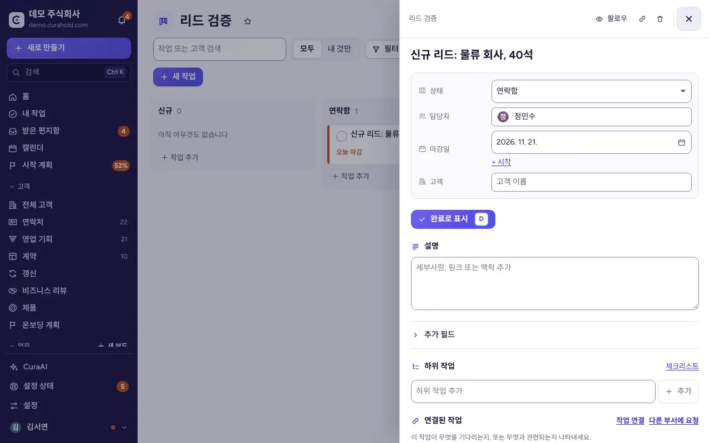

# 작업과 보드

업무는 보드에서 진행됩니다. 보드는 팀, 회사 전체 또는 나만의 것이 될 수 있고, 열은 직접 정합니다.

## 작업

작업에는 제목, 설명, 담당자(최대 10명), 마감일, 우선순위, 그리고 선택적으로 고객이 있습니다. 하위 작업, 파일, 댓글을 더할 수 있습니다. 작업은 보드 옆 패널에서 열리고, 작업 링크는 받은 사람 누구에게나 열립니다.

모든 카드 가장자리의 가는 띠는 시간 대비 작업 상태를 보여 줍니다: 여유, 임박, 오늘, 지연, 완료. 같은 색이 캘린더와 내 작업에서도 쓰입니다. 날짜는 제품 자체의 날짜 선택기로 고르며, 사용하는 언어와 날짜 순서에 맞게 표시됩니다.

## 두 사람이 같은 작업을 바꿀 때

Curahold는 누구의 변경도 몰래 덮어쓰지 않습니다. 내가 편집하는 동안 다른 사람이 저장했다면, 그 사람의 변경은 유지되고 내 변경이 그 위에 적용됩니다. 같은 필드가 실제로 충돌할 때만 묻습니다.

## 여러 작업을 한 번에 바꾸기와 실행 취소

보드나 목록에서 작업을 여러 개 선택하고 상태, 담당자, 날짜, 우선순위를 한꺼번에 바꿉니다. 아래쪽 알림에서 **실행 취소**를 할 수 있습니다.

## 반복 작업

작업을 며칠, 몇 주, 몇 달마다 반복하게 할 수 있습니다. 지금 작업이 끝나면 다음 작업이 열립니다. 새 날짜는 둘 중 하나로 계산합니다.

- **마감일 기준:** "매달 1일 보고"처럼 고정된 일정에 씁니다.
- **완료한 날 기준:** "마지막 통화 2주 뒤에 다시 전화"처럼 이어지는 업무에 씁니다.

## 멘션과 알림 끄기

댓글에 `@`를 입력해 동료를 멘션하면 그 사람에게 알림이 갑니다. 어떤 작업에 대한 소식을 더 받고 싶지 않다면 작업 메뉴에서 **이 작업의 댓글 알림 중지**를 고르세요.

## 빠른 검색

어디서든 Ctrl K(Mac은 ⌘ K)를 누르면 고객, 작업, 사람, 보드, 페이지를 찾을 수 있습니다. 화살표 키로 이동하고 Enter로 엽니다.

## 작업의 다른 기능

- **팔로우:** 작업 위쪽 버튼으로, 내 작업이 아니어도 댓글과 열 이동 소식을 받습니다.
- **연결된 작업:** 작업이 다른 작업을 **대기**하는지, 다른 작업을 **차단**하는지, **관련** 작업인지 지정합니다. 대기 중인 작업의 카드에는 "1개 대기 중"이 표시되고, 기다리던 작업이 끝나면 담당자에게 "시작할 수 있습니다" 알림이 갑니다. 작업끼리 서로를 빙 돌아 기다리게 만들 수는 없습니다.
- **시작일:** 마감일 옆의 **+ 시작**으로 업무 시작일을 기록하면, 타임라인에 막대로 그려집니다.
- **소요 시간:** +15분, +30분, +1시간 버튼이나 직접 입력("1.5", "45m", "1:30"). 고객 페이지에 그 고객에 기록된 합계가 표시됩니다.
- **체크리스트:** 자주 쓰는 단계를 한 번 저장해 두고(하위 작업 추가 → **이 하위 작업을 체크리스트로 저장**), 클릭 한 번으로 어떤 작업에든 추가합니다.
- **기록:** 누가 언제 무엇을 바꿨는지 작업 아래쪽에 한 줄씩 나옵니다.
- **비슷한 작업 경고:** 추가하려는 작업이 이미 열려 있는 작업과 비슷하면 빠른 추가가 알려 줍니다.

## 보드 전용 필드

보드 설정 → **필드 및 요청 양식**: 그 보드의 모든 작업에 필드를 더합니다(텍스트, 숫자, 금액, 날짜, 선택, 링크, 이메일, 사람, 예/아니요). **완료하려면 필수 입력**으로 표시한 필드는 작업이 "완료" 열로 가기 전에 채워야 하며, 일괄 변경에서는 그런 작업을 건너뛰고 몇 개인지 알려 줍니다. 선택 필드는 카드에 색 라벨로 표시되고 필터로 쓸 수 있습니다.

## 필터와 저장한 보기

보드 위쪽의 **필터**로 사람, 마감일(지연, 오늘, 7일 등), 우선순위, 보드의 선택 필드로 좁힙니다. 휴대폰에서는 모든 필터가 하나의 **필터** 시트에 모여 있습니다. 켜 둔 필터에 **보기 → 저장**으로 이름을 붙이고, 원하면 보드의 모든 사람에게 보여 줄 수 있습니다.

## 요청 양식

보드 설정에서 **양식으로 요청 받기**를 켜고 양식이 물을 항목을 고릅니다. 동료는 보드의 **요청 양식** 버튼을 쓰고, 요청은 정해 둔 열에 작업으로 들어오며 요청한 사람은 자동으로 그 작업을 팔로우합니다.

## 다른 도구에서 옮겨 오기: 파일에서 작업 가져오기

보드 위쪽의 위쪽 화살표 버튼(**파일에서 작업 가져오기**)으로 예전 도구에서 내보낸 CSV나 Excel 파일을 가져옵니다. 파일은 브라우저에서 읽히며, 어느 열이 어디로 가는지 확인하기 전에는 아무것도 보내지 않습니다.

- 열은 자동으로 인식됩니다(Title, Description, Status, Assignee, Due date, Start date, Priority, Customer, Completed on, 그리고 터키어 이름). 어떤 열이든 바꿀 수 있고, "가져올 위치" 열에서 첫 몇 행이 어떻게 들어올지 볼 수 있습니다.
- **Status**는 같은 이름의 보드 열로 갑니다. "To do", "In progress", "Done" 같은 흔한 이름도 알아듣고, 그 밖의 값은 첫 번째 열로 들어가며 결과에 목록으로 나옵니다.
- **Assignee**는 이름이나 이메일로 찾습니다. 찾지 못한 사람은 빠지고, 누가 빠졌는지 알려 줍니다. 고객 이름도 같은 방식으로 찾습니다.
- 완료된 작업은 "완료된 작업도 가져오기"를 체크하지 않으면 빠집니다.
- 아무에게도 알림이 가지 않고 규칙도 실행되지 않습니다. 가져오기 전체를 30일 동안 **실행 취소**할 수 있습니다. 아무도 손대지 않은 작업은 삭제되고, 누군가 작업한 것은 보관함으로 갑니다.

한 번에 최대 5,000행입니다.

## 캘린더

**캘린더**는 어느 날에 무엇이 있는지 보여 줍니다: 마감일 기준 작업, 진행한 미팅·통화·리뷰, 갱신, 다가오는 비즈니스 리뷰. 위쪽 칩으로 종류별로 켜고 끕니다.

- **일, 주, 월, 연:** 위쪽 전환 버튼. 하루 보기는 그날의 모든 항목을 고객과 담당자와 함께 나열하고, 연 보기는 작은 열두 달을 보여 주며 일이 많은 날일수록 진하게 표시됩니다. 날짜 숫자를 누르면 그날이 열립니다.
- **누구의 캘린더:** 내 것, 또는 내가 볼 수 있는 모든 사람. 역할에 *팀원 캘린더 보기* 권한이 있는 사람(처음에는 관리자와 팀 리드)은 한 사람이나 팀 전체를 고를 수도 있습니다. 이미 볼 수 있는 것을 좁힐 뿐 새로운 것을 보여 주지는 않으므로, 비공개 보드는 그대로 비공개입니다.
- 보기, 날짜, 누구의 캘린더인지가 주소에 남으므로 링크를 열면 같은 화면이 나옵니다.

## 보관함

완료된 작업은 보드가 충분히 오래 둔 뒤(기본 90일, 보드 설정에서 30~365일 또는 "항상") 보드의 **보관함**으로 저절로 옮겨집니다. 몇 년 동안 쓴 보드도 곧바로 열립니다. 보관된 작업도 리포트에는 계속 집계됩니다. 보드 / 목록 옆의 **보관함** 보기에서 검색하고 **복원**으로 되돌리세요. 되돌린 작업은 같은 일수 동안 다시 보드에 머뭅니다. 목록 보기에서 직접 보관한 작업도 여기에 있습니다.

## 작업 삭제와 삭제한 작업 되살리기

삭제한 작업은 하위 작업, 댓글, 소요 시간, 파일과 함께 [휴지통](/docs/ko/trash/)으로 가며 30일 동안 되돌릴 수 있습니다. 삭제 직후 알림에서 **실행 취소**를 누르거나, 내 메뉴를 열고 **휴지통**을 선택한 다음 **복원**을 누르세요. 작업은 만든 사람이나, 역할에 모든 작업을 삭제할 권한이 있는 사람만 삭제할 수 있습니다. 완료된 작업을 삭제하지 않고 치우려면 보관하세요.
