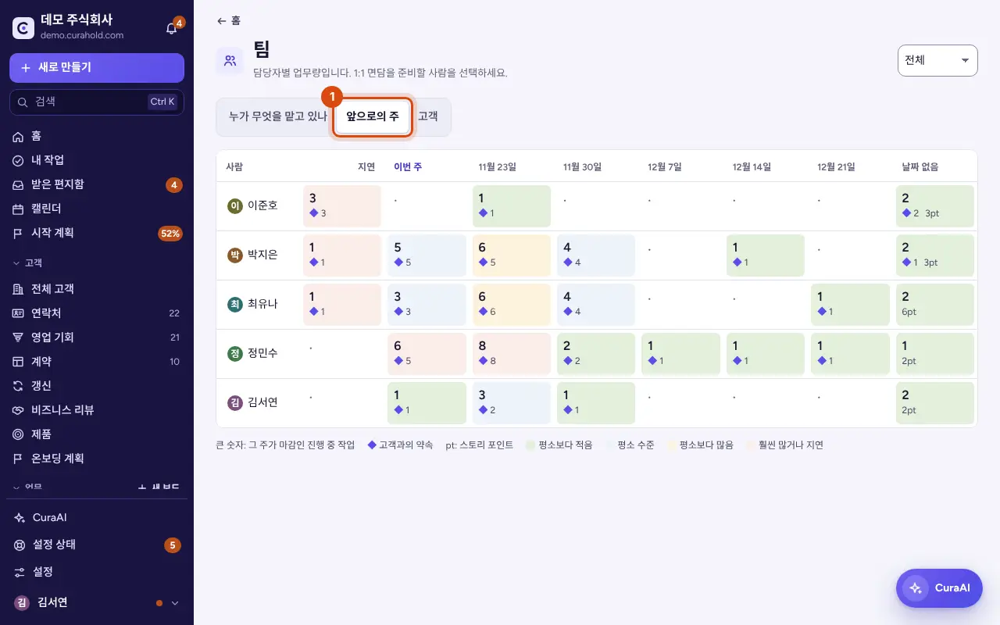
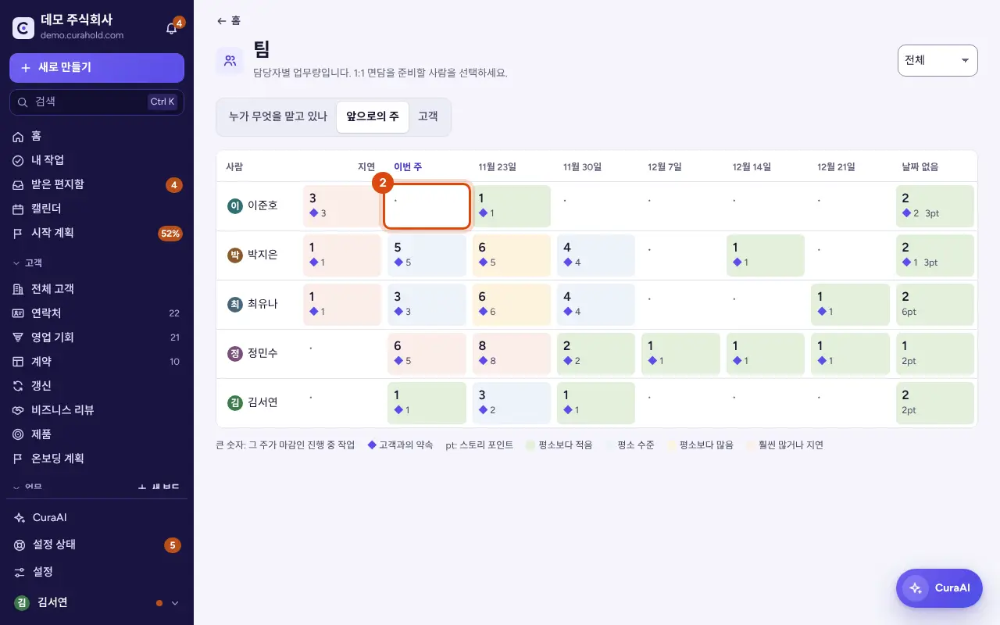
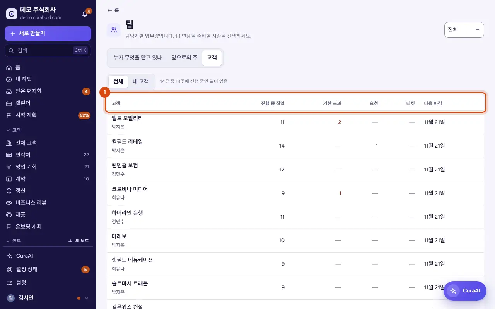
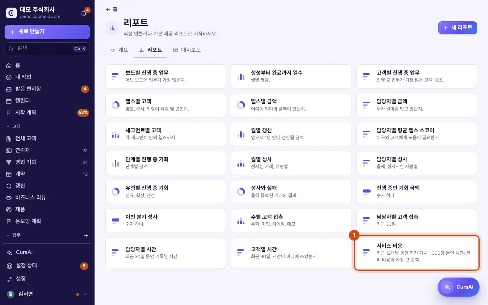

# 팀의 주, 고객 포트폴리오, 서비스 비용

**팀**(왼쪽 메뉴)에는 세 가지 보기가 있습니다: **누가 무엇을 맡고 있나**, **앞으로의 주**, **고객**. 위에서 팀을 고르면 어느 보기든 좁힐 수 있습니다. 내가 볼 수 있는 작업만 집계됩니다.

## 앞으로 몇 주 동안 여유가 있는 사람 {#weeks}

1. **팀**을 열고 **앞으로의 주**를 누릅니다.
   
2. 한 사람의 행을 주별로 읽습니다. 각 칸의 큰 숫자는 그 주가 기한인 진행 중인 작업, ◆는 그중 고객과의 약속 수, **pt**는 스토리 포인트입니다. 색은 그 주를 그 사람의 평소 양과 비교합니다: 가벼움, 평소, 무거움, 훨씬 많음. **지연**과 **날짜 없음**은 따로 열이 있습니다. 칸을 누르면 그 사람의 1:1 보기가 열립니다.
   

## 고객별 진행 중인 업무 {#customers}

1. **팀**을 열고 **고객**을 누릅니다. 진행 중인 것이 있는 고객이 바쁜 순으로 나옵니다: 진행 중인 업무, 그중 지연된 것, 고객 측 사람들이 포털로 보낸 요청, 해결되지 않은 지원 티켓, 다음 기한. 열 이름을 눌러 정렬하고, **전체**와 **내 고객**을 오갑니다.
   

금액은 일부러 여기 보이지 않습니다: 누가 돈을 볼 수 있는지는 필드마다 정해집니다.

## 서비스 비용 {#cost-to-serve}

1. 메뉴에서 **리포트**를 열고 **리포트** 탭, 이어서 **서비스 비용**을 누릅니다. 고객마다 최근 12개월 동안 그 업무에 기록된 시간을 연간 가치 1,000당으로 보여 줍니다(ARR, 없으면 MRR × 12, 없으면 첫 금액 필드). 가장 높은 고객이 관리 비용이 가장 큰 고객입니다.
   

리포트 빌더에서 두 필드가 함께 제공됩니다: **기록 시간(최근 12개월)**과 **연간 가치 1,000당 시간**. 고객의 가치를 볼 수 없는 사람에게는 비용 수치도 나오지 않습니다.
