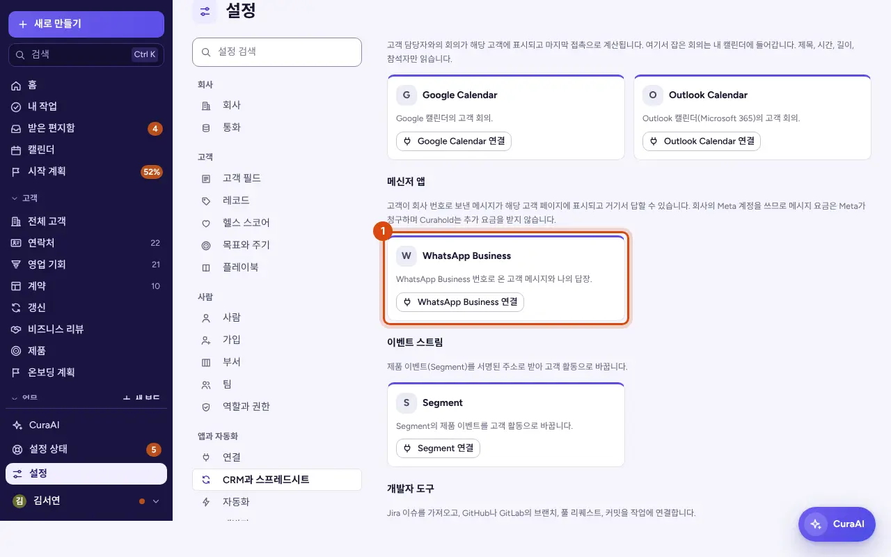
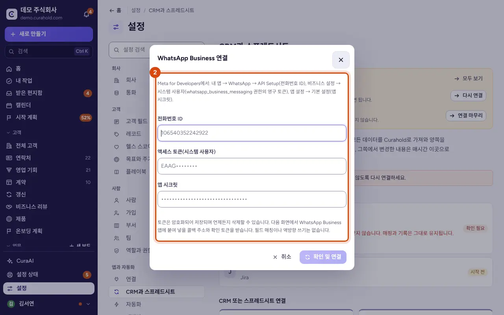

# WhatsApp Business

고객이 회사의 WhatsApp Business 번호로 보낸 메시지가 고객 페이지에 나타나고, 거기서 답할 수 있습니다. **회사의** Meta 앱과 번호를 쓰므로 메시지 요금은 Meta가 청구하며, Curahold는 추가 요금을 받지 않고 Meta 청구서도 보지 않습니다.

## 시작하기 전에

Cloud API에 WhatsApp Business 번호가 있는 Meta 비즈니스 계정, WhatsApp 제품을 추가한 Meta 앱, 영구 토큰이 있는 **시스템 사용자**(권한 `whatsapp_business_messaging`)가 필요합니다. Meta 페이지가 단계별로 안내하며 15분 정도 걸립니다.

## Curahold에서 {#connect}

1. **설정 → CRM과 스프레드시트**을 열고 **메신저 앱**에서 **WhatsApp Business 연결**을 클릭하세요.
   
2. 아래 세 값을 붙여 넣고 **확인 및 연결**을 클릭하세요. 연결 페이지에 **콜백 주소**와 **확인 토큰**이 나타납니다.
   

- **전화번호 ID**: Meta for Developers → 앱 → **WhatsApp → API Setup**.
- **액세스 토큰(시스템 사용자)**: 비즈니스 설정 → **시스템 사용자** → 사용자 → **새 토큰 생성**.
- **앱 시크릿**: 앱 → **앱 설정 → 기본 설정** → **앱 시크릿 코드** → **보기**.

## Meta에서

1. 앱을 열고 → **WhatsApp → Configuration**. **Webhook** 옆의 **Edit**를 클릭하세요.
2. 콜백 주소를 **Callback URL**에, 확인 토큰을 **Verify token**에 붙여 넣고 **Verify and save**를 클릭하세요.
3. **Webhook fields**에서 **Manage**를 클릭하고 **messages**를 구독하세요.

## 무엇이 오고, 어떻게 답하나

메시지는 연락처에 보낸 사람 번호가 있는 고객에게 메모로 들어옵니다(`0532…` 같은 국내 표기도 맞춰집니다). 그 메모에서 **WhatsApp으로 답장**을 클릭하세요. WhatsApp은 고객의 마지막 메시지 후 24시간 안에만 자유로운 답장을 허용합니다. 그 뒤에는 Curahold가 승인된 **템플릿**의 이름과 언어를 물어봅니다.

## 한도와 주기

메시지는 Meta가 보내는 대로 도착합니다. Meta는 실패한 전송을 최대 7일 동안 다시 보내며, 각 메시지는 한 번만 저장됩니다. Meta는 번호 하나가 보낼 수 있는 속도를 제한합니다. “바쁨” 응답이 그렇게 알려 주며 아무것도 사라지지 않습니다.

## 문제가 생기면

만료되거나 취소된 토큰은 답장할 때 드러납니다. **다시 연결**로 새 토큰을 붙여 넣으세요. 어떤 연락처에도 없는 번호의 메시지는 연결에 건수만 세고 저장하지 않습니다. **제거**하면 콜백이 바로 멈추고, 고객의 메모는 남습니다.

## 함께 보기

- [타임라인과 헬스 스코어](/docs/ko/timeline-and-health/)
- [연결과 CRM](/docs/ko/connections/)
