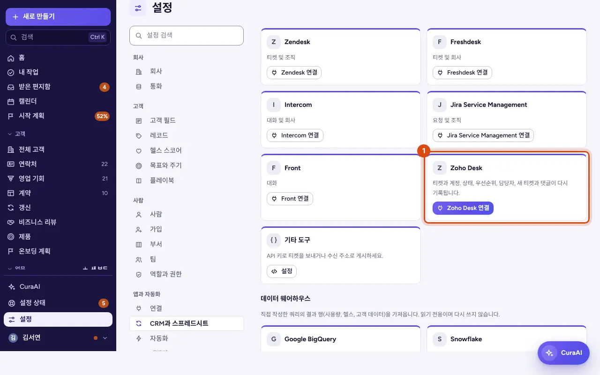

# Zoho Desk

Zoho Desk의 티켓과 계정이 해당 고객, 합계, 헬스 스코어에 나타납니다. Curahold에서 바꾼 상태, 우선순위, 담당자는 Zoho Desk에 다시 기록되고, Curahold에서 만든 티켓은 그곳에도 만들어지며, 답장이나 비공개 메모는 댓글로 추가됩니다.

## Curahold에서 {#connect}

1. **설정 → CRM과 스프레드시트**을 열고 **지원 도구**에서 **Zoho Desk 연결**을 클릭하세요.
   

Zoho 페이지가 열립니다. 헬프데스크 상담원 계정으로 로그인하고 **수락**을 클릭하세요. Curahold가 데이터 센터(.com, .eu, .in, .com.au, .jp, .sa, .uk, .ae, .ca, .com.cn)와 포털을 찾습니다. 돌아와서 **티켓**과 **계정**을 선택하고 필드 짝을 확인한 뒤 **동기화 시작**을 클릭하세요.

## 한도와 주기

변경은 한 시간마다 읽습니다. Zoho는 요금제별 하루 한도에서 호출마다 크레딧을 차감합니다. 다 쓰면 기다리라고 하고, Curahold는 다음에 이어서 읽습니다. Curahold에서 보낸 공개 답장은 티켓의 공개 댓글이며, 이메일 답장은 Zoho Desk에서 보냅니다.

## 문제가 생기면

로그인이 만료되면 저절로 갱신됩니다. 상담원이 접근 권한을 잃으면 연결이 **확인 필요**가 됩니다. **다시 연결**하고 다시 로그인하세요. **제거**하면 로그인 정보가 지워지고, 이미 가져온 티켓은 남습니다.

## 함께 보기

- [연결과 CRM](/docs/ko/connections/)
